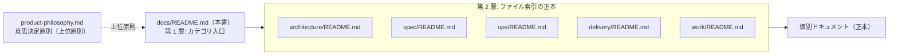

# Animal Ekarte プロジェクト・ドキュメント (Documentation Index)

> **目的**: docs/ 配下の公式ドキュメントへの入口（カテゴリ索引）を提供する。
> **読者**: 全開発者・AI エージェント。
> **タイミング**: 関連ドキュメントを探す時。

開発規約・アーキテクチャ・開発手順の統合ルール（SSOT）は **[.claude/CLAUDE.md](../.claude/CLAUDE.md)** を最優先で参照すること。

## 構成（2層索引）

ファイル単位の説明は各フォルダの README.md が正本。本書はカテゴリの入口のみを持つ（二重管理をしない）。

```
docs/
├── product-philosophy.md   … 意思決定原則（何を作るか/作らないか。全文書の上位）
├── architecture/           … 説明系: システムがどう作られているか
├── spec/                   … 仕様系: システムが何をするか（業務・画面・UI）
├── ops/                    … 運用系: デプロイ・CI・テスト・インフラ
├── delivery/               … 納品系: クライアント納品物（Go-live・操作マニュアル）
└── work/                   … 補助メモ・採択済み決裁・今期外索引（実行 SoT ではない）
```

索引の参照チェーン（本書は入口のみ。ファイル単位の説明は各フォルダ README が正本）:



| カテゴリ | 索引 | 概要 |
|:---|:---|:---|
| **意思決定原則** | [product-philosophy.md](product-philosophy.md) | 5 ステップの意思決定原則。新機能・仕様変更の着手前に必読 |
| **説明系** | [architecture/README.md](architecture/README.md) | domain/capability-first modular monolith・package 境界・ERD・RBAC/マルチテナント・データフロー・削除設計・ADR |
| **仕様系** | [spec/README.md](spec/README.md) | 機能要件・全画面仕様・会計/顧客分析/予約フロー・デザイン規約・LINE 連携 |
| **運用系** | [ops/README.md](ops/README.md) | デプロイ・ランブック・テスト・CI/カバレッジポリシー・インフラ構成 |
| **納品系** | [delivery/README.md](delivery/README.md) | 納品パッケージ・Go-live 手順・現場向け操作マニュアル |
| **作業記録・提案** | [work/README.md](work/README.md) | 補助メモ・採択済み決裁・今期外索引（実行 SoT は Plane。root 台帳の例外は下記参照） |
> **フォルダ規律**: docs/ 直下に新カテゴリを追加する場合は本表とローカル必須ゲート（`scripts/checks/check-docs-symbol-drift.sh` の TOP_DIR_ALLOWLIST）を同コミットで更新すること。allowlist 外のフォルダは `make ci` が拒否する。

## 主分類（primary role）の判定

フォルダは物理配置であり primary role ではない。ドメイン・読者・現行 vs 日付付き証跡は別の facet として管理する。各文書の primary role は **1 つだけ**で、以下の規則を上から順に最初にマッチしたものを採用する（2026-10-11 の静的スナップショットで全 558 ファイル（文書・生成物・ツール等）が一意に分類済み。件数は静的スナップショットの分類結果であり意味的完全性の証明ではない）:

| 順 | 条件（この順で最初にマッチした role を採用） | role | 件数 |
|---:|:---|:---|---:|
| a | `architecture/erd-detail/**` | generated | 137 |
| b | basename `CLAUDE.md` | rules | 4 |
| c | basename/stem `README`・`index`（大小文字無視） | index | 20 |
| d | `architecture/adr/**` または `work/decisions/**` | decision | 9 |
| e | `work/**` に加えて `architecture/be9-2a-boundary-map.md`・`architecture/be9-2a-classification-manifest.csv`・`ops/testing/UAT-DOMAIN-STATUS.md` | evidence-or-proposal | 182 |
| f | 残りの `.sh`/`.mjs`/`.py`/`.json`/`.csv`/`.txt` | tooling-or-fixture | 7 |
| g | 残りの `.png`/`.jpg`/`.jpeg`/`.svg`/`.pdf` | asset（予約 role。現在 0 件） | 0 |
| h | `product-philosophy.md` | principle | 1 |
| i | `architecture/**` に加えて `spec/line/architecture.md`・`ops/infra/architecture.md` | architecture | 13 |
| j | 残りの `spec/**` | specification | 83 |
| k | 残りの `ops/**` | operations | 98 |
| l | 残りの `delivery/**` | delivery | 4 |

いずれにも当てはまらない新規パスは **unclassified として停止**し、分類規則をここで先に更新する（推測で既存 role に押し込まない）。1 文書に複数の fact 種が混在する場合は primary role を 2 つ取らず、混在節から各 fact の正本（下表の fact owner）へリンクする。index/rules 文書が work/ などの履歴ディレクトリに置かれていても、その索引が履歴 contents を現在の証明に格上げするわけではない。

## Fact owner（canonical fact の一意な正本）

同じ fact を複数文書へ複製しない。参照側はリンクで指す。実装と spec の差異は discrepancy として残り、コードや Issue Closed から runtime・provider・受入状態を宣言しない。

| fact 範囲 | canonical owner |
|:---|:---|
| 開発規約・エージェント規律 | [.claude/CLAUDE.md](../.claude/CLAUDE.md) と最寄りの CLAUDE.md/AGENTS.md |
| 臨床安全原則 | [spec/specification.md](spec/specification.md) §2.1 |
| 要件の意思決定原則 | [product-philosophy.md](product-philosophy.md) |
| wire 契約（field・型・エラー・公開 API） | [`backend/docs/api.yaml`](../backend/docs/api.yaml) |
| DB カラム・FK | `backend/migrations`（`architecture/erd-detail/` は生成物） |
| RBAC モデル・clinic 分離の設計 | [architecture/auth.md](architecture/auth.md) |
| permission の resource/action 定義 | `backend/internal/model/permission.go`（定義の正本） |
| action の enforcement（実行証拠） | 各 domain の route 登録と auth/permission middleware（実行可能な証拠であり文書方針ではない） |
| 予約・受付・カルテ連携 workflow | [spec/reservation-to-record-flow.md](spec/workflows/reservation-to-record-flow.md) |
| 会計・締め業務 | [spec/cash-register.md](spec/cash-register.md) |
| 顧客集計業務 | [spec/customer-aggregation.md](spec/customer-aggregation.md) |
| 画面挙動 | [spec/ui-design-compliance.md §2](spec/ui-design-compliance.md) の primary 仕様リンク |
| 共有 UI の色 | [spec/design-system.md](spec/design-system.md) |
| ジオメトリ・タイポグラフィ | [`DESIGN.md`](../DESIGN.md) |
| GORM 型の write owner | [architecture/model-write-owner-catalog.md](architecture/model-write-owner-catalog.md) |
| backend package 境界・依存方向の裁定 | [architecture/adr/006-backend-domain-package-boundaries.md](architecture/adr/006-backend-domain-package-boundaries.md) |
| 跨 domain orchestration | [architecture/cross-domain-orchestration-catalog.md](architecture/cross-domain-orchestration-catalog.md) |
| リポジトリ上のインフラ・routing 設計 | [ops/infra/architecture.md](ops/infra/architecture.md)（設計の正本であり稼働観測ではない。workflow/config が証拠） |
| 環境別手順 | 対象環境名で選択 — STG は [ops/infra/staging/runbook.md](ops/infra/staging/runbook.md)、production は [ops/infra/production/runbook.md](ops/infra/production/runbook.md)。個別オペレーションは選んだ環境 runbook から辿る。 |
| rollout イベント計画 | [delivery/GOLIVE_RUNBOOK.md](delivery/GOLIVE_RUNBOOK.md)（環境手順とは別 role） |
| 検証レイヤ・環境境界・証跡の管理方針 | [ops/testing/TEST_ARCHITECTURE.md](ops/testing/TEST_ARCHITECTURE.md)（方針の正本。個別の実行結果を保証しない） |
| CI ゲート方針 | [ops/ci-policy.md](ops/ci-policy.md) |
| カバレッジ ratchet | [ops/coverage-policy.md](ops/coverage-policy.md)（CI ゲートとは別 scope） |
| クライアント納品の契約入力 | [delivery/DELIVERY_PACKAGE.md](delivery/DELIVERY_PACKAGE.md) の USER 表 |
| エンドユーザ向け操作手順 | `frontend/src/features/manual/content`（[delivery/OPERATION_MANUAL.md](delivery/OPERATION_MANUAL.md) に複製しない） |
| 日付付き実行結果・受入の証跡 | 各 dated receipt / run output（`docs/work`・`ops/testing` の日付付き記録。証跡であり第二台帳ではない） |
| 現在の受入・Done・タスク状態 | **Plane**（EMR）のみ |

## 文書の参照方針

仕様は現行実装と採択済み決裁を参照し、Issue の本文だけでなく後続の決裁・実装を確認する。Closed は STG/PROD 稼働・UAT 合格を意味しない。文書内の実測日・採択日は当時の証跡を示す。現在状態が未確認の項目や未記入の承認欄・臨床値は推測で更新しない。記載日が古いこと自体は陳腐の理由にならない。実測・採択・観測の日付は当時の証跡として残し、現在値に変更があった箇所だけを更新する（一律の日付更新はしない）。

以下は読む際の注意であり、主分類は上の判定表のみが担う（この表は第二の分類器ではない）:

| 参照対象 | 扱い | 例 |
|:---|:---|:---|
| **現行契約・仕様** | 現在の実装・合意を述べる。変更時は同コミットで更新 | `spec/`、`ops/ci-policy.md`、`backend/docs/api.yaml` |
| **生成物** | 生成元（migration・スキーマ定義）が正本。生成物は再生成で更新し手編集しない | `architecture/erd-detail/`（`scripts/tools/generate-erd-detail.py`） |
| **ADR・採択済み決裁** | 決定時点の判断記録。現行運用は最新 ADR と現行規約を見る | `architecture/adr/` |
| **調査・提案メモ（work/）** | 日付付き観測・提案であって実行中の状態ではない | `work/` 配下の日付付きレポート |
| **外部証跡・UAT 記録** | 実行時点の結果。現在の受入状態は Plane を見る | `ops/testing/` の日付付き UAT 記録 |

## 横断事項

- **API contract**: 正本は [`backend/docs/api.yaml`](../backend/docs/api.yaml)（Swagger UI 表示は `make docs-ui`）。
- **docs ドリフトゲート**: `scripts/checks/check-docs-symbol-drift.sh`（GitHub CI ではなく `make ci` のローカル必須ゲート。分担は [ops/ci-policy.md](ops/ci-policy.md)）が、spec/screens/・spec/domains/・spec/workflows/ 系ドキュメントの言及シンボル実在と宣言数値（テーブル数・リソース数等）の実装一致を機械検査する。
- **タスク台帳**: 実行 SoT は **Plane**（workspace `baritechllc` / Project `EMR` / hub `EMR-1`。case_id `BRT-4` は hub の不変識別子として継承。`BRT-n`・`LINMIG-n` は Linear 閉鎖前の履歴別名）。`todo.md#human-lane` は入口ポインタ。[`todo.md`](../todo.md) は repo に結び付く未完了作業（受入残・USER ゲート・STG 実データ・deferred）の入口、[`todo.md#product-bugs`](../todo.md#product-bugs) は確認済み UAT 製品 FAIL の記録を担う。競合時の状態の正本は Plane。root 例外台帳は同一変更で同期し、終了条件と削除予定を台帳内に明記する。Linear から Plane への移行記録は [plane-md-migration-20260923-receipt.md](work/plane/plane-md-migration-20260923-receipt.md) と git 履歴を参照する。`reports/` は gitignore（新規 UAT をコミットしない）。
- **作業補助**: [`work/README.md`](work/README.md)（採択済み方針の短いポインタに加え、**日付付き証跡・調査票**（security-triage 票・infra 変更 review 票等）を置ける。work/ に置く場合は work/README への索引登録が必須。実行 SoT は Plane のまま。索引未登録の時点レポートの置き場所は CorpVault `evidence/` と git 履歴）

---

**最新更新**: 2026-10-11（本索引の構成・参照方針の更新。全ドキュメントの一括受入を意味しない） | **ステータス**: 実行 SoT は Plane（baritechllc / `EMR` / hub `EMR-1`、case_id `BRT-4` 継承・旧 Linear は 2026-09-16 閉鎖）。docs/ は 5 カテゴリ体制で、ファイル単位の説明は各フォルダ README が正本

予約 → 受付 → カルテ入力 → 会計・未納の仕様見直しは [spec/ の読む順](spec/README.md)から開始する。横断フロー・ドメイン・共通用語の入口をまとめている。
