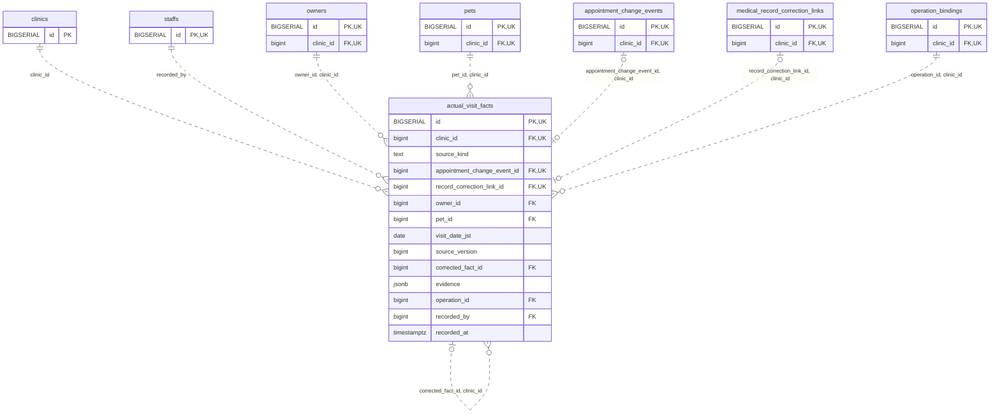

<!-- GENERATED: scripts/tools/generate-erd-detail.py; do not edit -->
# `actual_visit_facts`

[詳細ERD一覧](index.md) · [概要ERD](../erd.md)

このページは、マイグレーションをファイル名順に静的解析した最終定義です。稼働DBの状態は未確認です。

## カラム

型・DEFAULTはDDLの宣言表記です。`bigserial` は採番宣言であり、DBカタログ上の型名ではありません。

| カラム | 型（DDL） | NULL | DEFAULT（DDL） | キー構成列 | 定義元 |
|:---|:---|:---|:---|:---|:---|
| `id` | `BIGSERIAL` | NOT NULL | — | PK, UK | [001_init.sql:10060](../../../backend/migrations/001_init.sql#L10060) |
| `clinic_id` | `bigint` | NOT NULL | — | FK, UK | [001_init.sql:10060](../../../backend/migrations/001_init.sql#L10060) |
| `source_kind` | `text` | NOT NULL | — | — | [001_init.sql:10061](../../../backend/migrations/001_init.sql#L10061) |
| `appointment_change_event_id` | `bigint` | NULL | — | FK, UK | [001_init.sql:10062](../../../backend/migrations/001_init.sql#L10062) |
| `record_correction_link_id` | `bigint` | NULL | — | FK, UK | [001_init.sql:10062](../../../backend/migrations/001_init.sql#L10062) |
| `owner_id` | `bigint` | NOT NULL | — | FK | [001_init.sql:10063](../../../backend/migrations/001_init.sql#L10063) |
| `pet_id` | `bigint` | NOT NULL | — | FK | [001_init.sql:10063](../../../backend/migrations/001_init.sql#L10063) |
| `visit_date_jst` | `date` | NOT NULL | — | — | [001_init.sql:10063](../../../backend/migrations/001_init.sql#L10063) |
| `source_version` | `bigint` | NOT NULL | — | — | [001_init.sql:10064](../../../backend/migrations/001_init.sql#L10064) |
| `corrected_fact_id` | `bigint` | NULL | — | FK | [001_init.sql:10064](../../../backend/migrations/001_init.sql#L10064) |
| `evidence` | `jsonb` | NOT NULL | — | — | [001_init.sql:10065](../../../backend/migrations/001_init.sql#L10065) |
| `operation_id` | `bigint` | NOT NULL | — | FK | [001_init.sql:10065](../../../backend/migrations/001_init.sql#L10065) |
| `recorded_by` | `bigint` | NOT NULL | — | FK | [001_init.sql:10066](../../../backend/migrations/001_init.sql#L10066) |
| `recorded_at` | `timestamptz` | NOT NULL | `clock_timestamp()` | — | [001_init.sql:10066](../../../backend/migrations/001_init.sql#L10066) |

PK/FK/UKはキーの構成列を示します。複合キーの各列が単独で一意という意味ではありません。部分uniqueは下記indexの述語を参照してください。

## ERD

このテーブルの全カラムと、すべての参照先を表示します。参照先はFKの対象列だけを表示し、全カラムは各テーブルのページに置きます。

親側の任意参照はFK列のNULL可否、子側の最大1件は無条件のPK/UNIQUEから導出します。部分uniqueによる条件付きの最大件数は図に反映せず、index一覧に記録します。実線はFK全列が子のPKに含まれる識別関係、破線はそれ以外です。

## 外部キー（全件）

| 制約 | 子の列（順序あり） | 参照先 | 親の列（順序あり） | 削除時の動作 | 定義元 |
|:---|:---|:---|:---|:---|:---|
| `actual_visit_facts_clinic_id_fkey` | `clinic_id` | [clinics](clinics.md) | `id` | `ON DELETE RESTRICT` | [001_init.sql:10060](../../../backend/migrations/001_init.sql#L10060) |
| `actual_visit_facts_recorded_by_fkey` | `recorded_by` | [staffs](staffs.md) | `id` | `ON DELETE RESTRICT` | [001_init.sql:10066](../../../backend/migrations/001_init.sql#L10066) |
| `actual_visit_facts_owner_id_clinic_id_fkey` | `owner_id, clinic_id` | [owners](owners.md) | `id, clinic_id` | `ON DELETE RESTRICT` | [001_init.sql:10071](../../../backend/migrations/001_init.sql#L10071) |
| `actual_visit_facts_pet_id_clinic_id_fkey` | `pet_id, clinic_id` | [pets](pets.md) | `id, clinic_id` | `ON DELETE RESTRICT` | [001_init.sql:10072](../../../backend/migrations/001_init.sql#L10072) |
| `actual_visit_facts_appointment_change_event_id_clinic_id_fkey` | `appointment_change_event_id, clinic_id` | [appointment_change_events](appointment_change_events.md) | `id, clinic_id` | `ON DELETE RESTRICT` | [001_init.sql:10073](../../../backend/migrations/001_init.sql#L10073) |
| `actual_visit_facts_record_correction_link_id_clinic_id_fkey` | `record_correction_link_id, clinic_id` | [medical_record_correction_links](medical_record_correction_links.md) | `id, clinic_id` | `ON DELETE RESTRICT` | [001_init.sql:10074](../../../backend/migrations/001_init.sql#L10074) |
| `actual_visit_facts_corrected_fact_id_clinic_id_fkey` | `corrected_fact_id, clinic_id` | [actual_visit_facts](actual_visit_facts.md) | `id, clinic_id` | `ON DELETE RESTRICT` | [001_init.sql:10075](../../../backend/migrations/001_init.sql#L10075) |
| `actual_visit_facts_operation_id_clinic_id_fkey` | `operation_id, clinic_id` | [operation_bindings](operation_bindings.md) | `id, clinic_id` | `ON DELETE RESTRICT` | [001_init.sql:10076](../../../backend/migrations/001_init.sql#L10076) |

正確なON UPDATE・MATCH・DEFERRABLE等を含む制約DDL:

- `actual_visit_facts_clinic_id_fkey`: `REFERENCES clinics(id) ON DELETE RESTRICT`
- `actual_visit_facts_recorded_by_fkey`: `REFERENCES staffs(id) ON DELETE RESTRICT`
- `actual_visit_facts_owner_id_clinic_id_fkey`: `FOREIGN KEY(owner_id,clinic_id) REFERENCES owners(id,clinic_id) ON DELETE RESTRICT`
- `actual_visit_facts_pet_id_clinic_id_fkey`: `FOREIGN KEY(pet_id,clinic_id) REFERENCES pets(id,clinic_id) ON DELETE RESTRICT`
- `actual_visit_facts_appointment_change_event_id_clinic_id_fkey`: `FOREIGN KEY(appointment_change_event_id,clinic_id) REFERENCES appointment_change_events(id,clinic_id) ON DELETE RESTRICT`
- `actual_visit_facts_record_correction_link_id_clinic_id_fkey`: `FOREIGN KEY(record_correction_link_id,clinic_id) REFERENCES medical_record_correction_links(id,clinic_id) ON DELETE RESTRICT`
- `actual_visit_facts_corrected_fact_id_clinic_id_fkey`: `FOREIGN KEY(corrected_fact_id,clinic_id) REFERENCES actual_visit_facts(id,clinic_id) ON DELETE RESTRICT`
- `actual_visit_facts_operation_id_clinic_id_fkey`: `FOREIGN KEY(operation_id,clinic_id) REFERENCES operation_bindings(id,clinic_id) ON DELETE RESTRICT`

## その他の制約

| 制約 | 種別 | DDL | 定義元 |
|:---|:---|:---|:---|
| `actual_visit_facts_pkey` | primary | `PRIMARY KEY` | [001_init.sql:10060](../../../backend/migrations/001_init.sql#L10060) |
| `actual_visit_facts_source_kind_check` | check | `CHECK(source_kind IN('checkin','retrospective','correction'))` | [001_init.sql:10061](../../../backend/migrations/001_init.sql#L10061) |
| `actual_visit_facts_source_version_check` | check | `CHECK(source_version>0)` | [001_init.sql:10064](../../../backend/migrations/001_init.sql#L10064) |
| `actual_visit_facts_evidence_check` | check | `CHECK(jsonb_typeof(evidence)='object')` | [001_init.sql:10065](../../../backend/migrations/001_init.sql#L10065) |
| `actual_visit_facts_id_clinic_id_key` | unique | `UNIQUE(id,clinic_id)` | [001_init.sql:10067](../../../backend/migrations/001_init.sql#L10067) |
| `actual_visit_facts_clinic_id_appointment_change_event_id_key` | unique | `UNIQUE(clinic_id,appointment_change_event_id)` | [001_init.sql:10067](../../../backend/migrations/001_init.sql#L10067) |
| `actual_visit_facts_clinic_id_record_correction_link_id_key` | unique | `UNIQUE(clinic_id,record_correction_link_id)` | [001_init.sql:10067](../../../backend/migrations/001_init.sql#L10067) |
| `actual_visit_facts_check` | check | `CHECK((source_kind='checkin' AND appointment_change_event_id IS NOT NULL AND record_correction_link_id IS NULL AND corrected_fact_id IS NULL)  OR(source_kind='retrospective' AND record_correction_link_id IS NOT NULL AND appointment_change_event_id IS NULL AND corrected_fact_id IS NULL)  OR(source_kind='correction' AND corrected_fact_id IS NOT NULL AND num_nonnulls(appointment_change_event_id,record_correction_link_id)=1))` | [001_init.sql:10068](../../../backend/migrations/001_init.sql#L10068) |

## インデックス

明示的なCREATE INDEXなし。PK/UNIQUEに付随する暗黙のindexは制約欄を参照してください。
