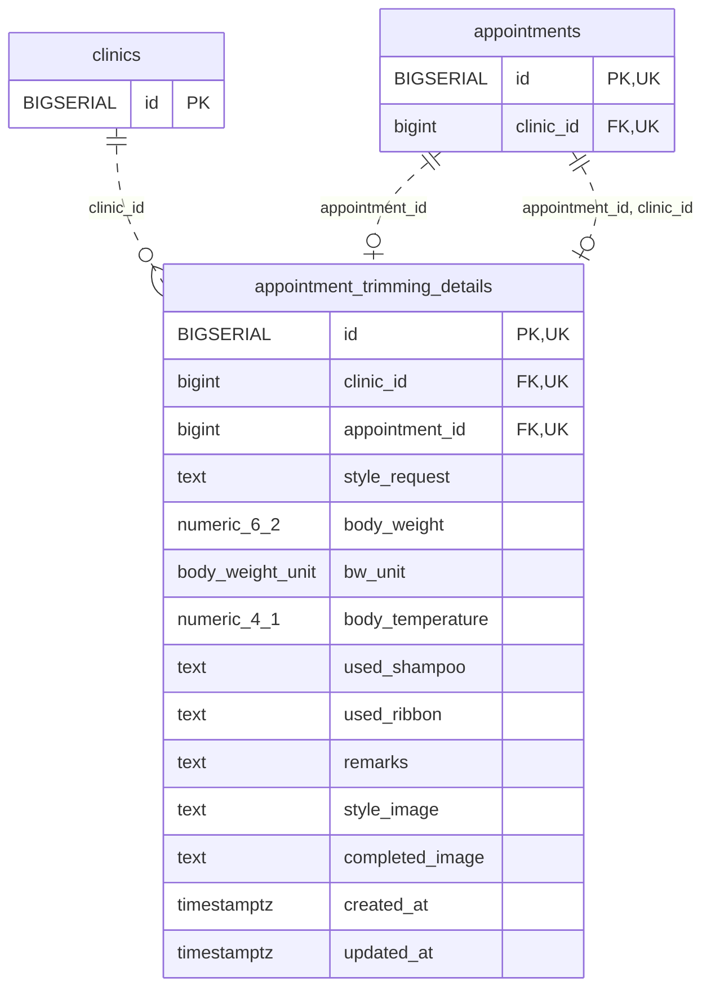

<!-- GENERATED: scripts/tools/generate-erd-detail.py; do not edit -->
# `appointment_trimming_details`

[詳細ERD一覧](index.md) · [概要ERD](../erd.md)

このページは、マイグレーションをファイル名順に静的解析した最終定義です。稼働DBの状態は未確認です。

## カラム

型・DEFAULTはDDLの宣言表記です。`bigserial` は採番宣言であり、DBカタログ上の型名ではありません。

| カラム | 型（DDL） | NULL | DEFAULT（DDL） | キー構成列 | 定義元 |
|:---|:---|:---|:---|:---|:---|
| `id` | `BIGSERIAL` | NOT NULL | — | PK, UK | [001_init.sql:1396](../../../backend/migrations/001_init.sql#L1396) |
| `clinic_id` | `bigint` | NOT NULL | — | FK, UK | [001_init.sql:1397](../../../backend/migrations/001_init.sql#L1397) |
| `appointment_id` | `bigint` | NOT NULL | — | FK, UK | [001_init.sql:1398](../../../backend/migrations/001_init.sql#L1398) |
| `style_request` | `text` | NOT NULL | `''` | — | [001_init.sql:1400](../../../backend/migrations/001_init.sql#L1400) |
| `body_weight` | `numeric(6,2)` | NULL | — | — | [001_init.sql:1401](../../../backend/migrations/001_init.sql#L1401) |
| `bw_unit` | `body_weight_unit` | NULL | `'Kg'` | — | [001_init.sql:1402](../../../backend/migrations/001_init.sql#L1402) |
| `body_temperature` | `numeric(4,1)` | NULL | — | — | [001_init.sql:1403](../../../backend/migrations/001_init.sql#L1403) |
| `used_shampoo` | `text` | NOT NULL | `''` | — | [001_init.sql:1404](../../../backend/migrations/001_init.sql#L1404) |
| `used_ribbon` | `text` | NOT NULL | `''` | — | [001_init.sql:1405](../../../backend/migrations/001_init.sql#L1405) |
| `remarks` | `text` | NOT NULL | `''` | — | [001_init.sql:1406](../../../backend/migrations/001_init.sql#L1406) |
| `style_image` | `text` | NOT NULL | `''` | — | [001_init.sql:1407](../../../backend/migrations/001_init.sql#L1407) |
| `completed_image` | `text` | NOT NULL | `''` | — | [001_init.sql:1408](../../../backend/migrations/001_init.sql#L1408) |
| `created_at` | `timestamptz` | NOT NULL | `now()` | — | [001_init.sql:1409](../../../backend/migrations/001_init.sql#L1409) |
| `updated_at` | `timestamptz` | NOT NULL | `now()` | — | [001_init.sql:1410](../../../backend/migrations/001_init.sql#L1410) |

PK/FK/UKはキーの構成列を示します。複合キーの各列が単独で一意という意味ではありません。部分uniqueは下記indexの述語を参照してください。

## ERD

このテーブルの全カラムと、すべての参照先を表示します。参照先はFKの対象列だけを表示し、全カラムは各テーブルのページに置きます。

親側の任意参照はFK列のNULL可否、子側の最大1件は無条件のPK/UNIQUEから導出します。部分uniqueによる条件付きの最大件数は図に反映せず、index一覧に記録します。実線はFK全列が子のPKに含まれる識別関係、破線はそれ以外です。

## 外部キー（全件）

| 制約 | 子の列（順序あり） | 参照先 | 親の列（順序あり） | 削除時の動作 | 定義元 |
|:---|:---|:---|:---|:---|:---|
| `appointment_trimming_details_clinic_id_fkey` | `clinic_id` | [clinics](clinics.md) | `id` | `ON DELETE RESTRICT` | [001_init.sql:1397](../../../backend/migrations/001_init.sql#L1397) |
| `appointment_trimming_details_appointment_id_fkey` | `appointment_id` | [appointments](appointments.md) | `id` | `ON DELETE CASCADE` | [001_init.sql:1398](../../../backend/migrations/001_init.sql#L1398) |
| `fk_appointment_trimming_details_appointment_clinic` | `appointment_id, clinic_id` | [appointments](appointments.md) | `id, clinic_id` | `ON DELETE CASCADE` | [001_init.sql:5856](../../../backend/migrations/001_init.sql#L5856) |

正確なON UPDATE・MATCH・DEFERRABLE等を含む制約DDL:

- `appointment_trimming_details_clinic_id_fkey`: `REFERENCES clinics(id) ON DELETE RESTRICT`
- `appointment_trimming_details_appointment_id_fkey`: `REFERENCES appointments(id) ON DELETE CASCADE`
- `fk_appointment_trimming_details_appointment_clinic`: `CONSTRAINT fk_appointment_trimming_details_appointment_clinic         FOREIGN KEY (appointment_id, clinic_id)         REFERENCES appointments (id, clinic_id)         ON DELETE CASCADE`

## その他の制約

| 制約 | 種別 | DDL | 定義元 |
|:---|:---|:---|:---|
| `appointment_trimming_details_pkey` | primary | `PRIMARY KEY` | [001_init.sql:1396](../../../backend/migrations/001_init.sql#L1396) |
| `appointment_trimming_details_appointment_id_key` | unique | `UNIQUE` | [001_init.sql:1398](../../../backend/migrations/001_init.sql#L1398) |
| `uq_trimming_details_id_clinic` | unique | `CONSTRAINT uq_trimming_details_id_clinic UNIQUE (id, clinic_id)` | [001_init.sql:7938](../../../backend/migrations/001_init.sql#L7938) |

## インデックス

| 名前 | UNIQUE | 述語 | DDL | 定義元 |
|:---|:---|:---|:---|:---|
| `idx_appt_trimming_clinic_appointment` | NO | — | `CREATE INDEX idx_appt_trimming_clinic_appointment ON appointment_trimming_details(clinic_id, appointment_id)` | [001_init.sql:1413](../../../backend/migrations/001_init.sql#L1413) |
