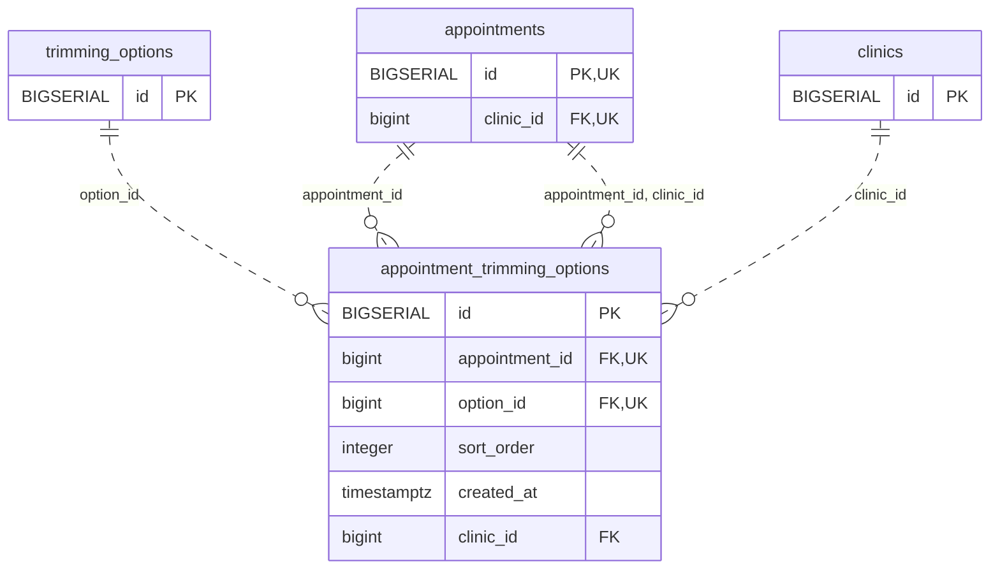

<!-- GENERATED: scripts/tools/generate-erd-detail.py; do not edit -->
# `appointment_trimming_options`

[詳細ERD一覧](index.md) · [概要ERD](../erd.md)

このページは、マイグレーションをファイル名順に静的解析した最終定義です。稼働DBの状態は未確認です。

## カラム

型・DEFAULTはDDLの宣言表記です。`bigserial` は採番宣言であり、DBカタログ上の型名ではありません。

| カラム | 型（DDL） | NULL | DEFAULT（DDL） | キー構成列 | 定義元 |
|:---|:---|:---|:---|:---|:---|
| `id` | `BIGSERIAL` | NOT NULL | — | PK | [001_init.sql:1407](../../../backend/migrations/001_init.sql#L1407) |
| `appointment_id` | `bigint` | NOT NULL | — | FK, UK | [001_init.sql:1408](../../../backend/migrations/001_init.sql#L1408) |
| `option_id` | `bigint` | NOT NULL | — | FK, UK | [001_init.sql:1409](../../../backend/migrations/001_init.sql#L1409) |
| `sort_order` | `integer` | NULL | `0` | — | [001_init.sql:1410](../../../backend/migrations/001_init.sql#L1410) |
| `created_at` | `timestamptz` | NOT NULL | `now()` | — | [001_init.sql:1411](../../../backend/migrations/001_init.sql#L1411) |
| `clinic_id` | `bigint` | NOT NULL | — | FK | [001_init.sql:5853](../../../backend/migrations/001_init.sql#L5853) |

PK/FK/UKはキーの構成列を示します。複合キーの各列が単独で一意という意味ではありません。部分uniqueは下記indexの述語を参照してください。

## ERD

このテーブルの全カラムと、すべての参照先を表示します。参照先はFKの対象列だけを表示し、全カラムは各テーブルのページに置きます。

親側の任意参照はFK列のNULL可否、子側の最大1件は無条件のPK/UNIQUEから導出します。部分uniqueによる条件付きの最大件数は図に反映せず、index一覧に記録します。実線はFK全列が子のPKに含まれる識別関係、破線はそれ以外です。

## 外部キー（全件）

| 制約 | 子の列（順序あり） | 参照先 | 親の列（順序あり） | 削除時の動作 | 定義元 |
|:---|:---|:---|:---|:---|:---|
| `appointment_trimming_options_appointment_id_fkey` | `appointment_id` | [appointments](appointments.md) | `id` | `ON DELETE CASCADE` | [001_init.sql:1408](../../../backend/migrations/001_init.sql#L1408) |
| `appointment_trimming_options_option_id_fkey` | `option_id` | [trimming_options](trimming_options.md) | `id` | `ON DELETE RESTRICT` | [001_init.sql:1409](../../../backend/migrations/001_init.sql#L1409) |
| `fk_appointment_trimming_options_clinic_id` | `clinic_id` | [clinics](clinics.md) | `id` | `ON DELETE RESTRICT` | [001_init.sql:5856](../../../backend/migrations/001_init.sql#L5856) |
| `fk_appointment_trimming_options_appointment_clinic` | `appointment_id, clinic_id` | [appointments](appointments.md) | `id, clinic_id` | `ON DELETE CASCADE` | [001_init.sql:5894](../../../backend/migrations/001_init.sql#L5894) |

正確なON UPDATE・MATCH・DEFERRABLE等を含む制約DDL:

- `appointment_trimming_options_appointment_id_fkey`: `REFERENCES appointments(id) ON DELETE CASCADE`
- `appointment_trimming_options_option_id_fkey`: `REFERENCES trimming_options(id) ON DELETE RESTRICT`
- `fk_appointment_trimming_options_clinic_id`: `CONSTRAINT fk_appointment_trimming_options_clinic_id     FOREIGN KEY (clinic_id)     REFERENCES clinics (id)     ON DELETE RESTRICT`
- `fk_appointment_trimming_options_appointment_clinic`: `CONSTRAINT fk_appointment_trimming_options_appointment_clinic         FOREIGN KEY (appointment_id, clinic_id)         REFERENCES appointments (id, clinic_id)         ON DELETE CASCADE`

## その他の制約

| 制約 | 種別 | DDL | 定義元 |
|:---|:---|:---|:---|
| `appointment_trimming_options_pkey` | primary | `PRIMARY KEY` | [001_init.sql:1407](../../../backend/migrations/001_init.sql#L1407) |
| `appointment_trimming_options_appointment_id_option_id_key` | unique | `UNIQUE (appointment_id, option_id)` | [001_init.sql:1412](../../../backend/migrations/001_init.sql#L1412) |

## インデックス

| 名前 | UNIQUE | 述語 | DDL | 定義元 |
|:---|:---|:---|:---|:---|
| `idx_appt_trimming_options_appointment` | NO | — | `CREATE INDEX idx_appt_trimming_options_appointment ON appointment_trimming_options(appointment_id)` | [001_init.sql:1415](../../../backend/migrations/001_init.sql#L1415) |
| `idx_appointment_trimming_options_clinic_id` | NO | — | `CREATE INDEX idx_appointment_trimming_options_clinic_id     ON appointment_trimming_options (clinic_id)` | [001_init.sql:5861](../../../backend/migrations/001_init.sql#L5861) |
