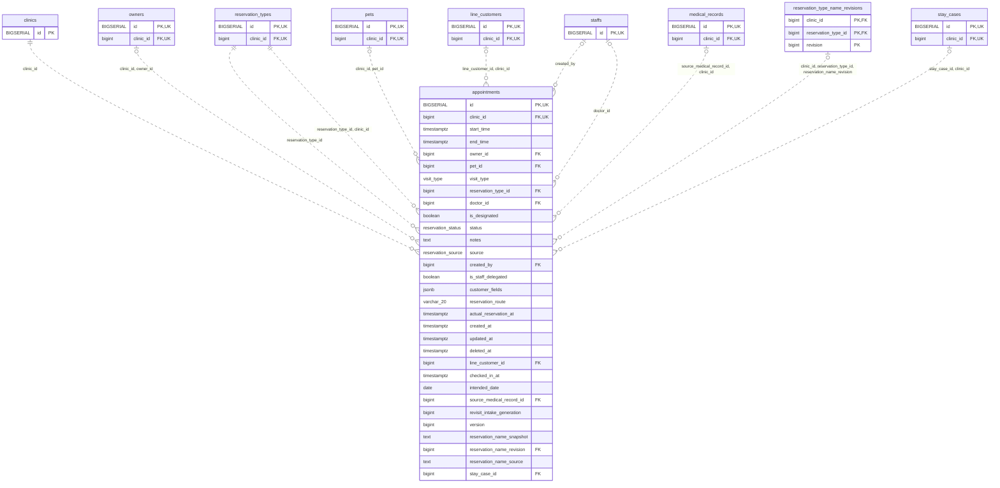

<!-- GENERATED: scripts/tools/generate-erd-detail.py; do not edit -->
# `appointments`

[詳細ERD一覧](index.md) · [概要ERD](../erd.md)

このページは、マイグレーションをファイル名順に静的解析した最終定義です。稼働DBの状態は未確認です。

## カラム

型・DEFAULTはDDLの宣言表記です。`bigserial` は採番宣言であり、DBカタログ上の型名ではありません。

| カラム | 型（DDL） | NULL | DEFAULT（DDL） | キー構成列 | 定義元 |
|:---|:---|:---|:---|:---|:---|
| `id` | `BIGSERIAL` | NOT NULL | — | PK, UK | [001_init.sql:1343](../../../backend/migrations/001_init.sql#L1343) |
| `clinic_id` | `bigint` | NOT NULL | — | FK, UK | [001_init.sql:1344](../../../backend/migrations/001_init.sql#L1344) |
| `start_time` | `timestamptz` | NOT NULL | — | — | [001_init.sql:1345](../../../backend/migrations/001_init.sql#L1345) |
| `end_time` | `timestamptz` | NOT NULL | — | — | [001_init.sql:1346](../../../backend/migrations/001_init.sql#L1346) |
| `owner_id` | `bigint` | NULL | — | FK | [001_init.sql:1347](../../../backend/migrations/001_init.sql#L1347) |
| `pet_id` | `bigint` | NULL | — | FK | [001_init.sql:1348](../../../backend/migrations/001_init.sql#L1348) |
| `visit_type` | `visit_type` | NOT NULL | `'revisit'` | — | [001_init.sql:1349](../../../backend/migrations/001_init.sql#L1349) |
| `reservation_type_id` | `bigint` | NOT NULL | — | FK | [001_init.sql:1350](../../../backend/migrations/001_init.sql#L1350) |
| `doctor_id` | `bigint` | NULL | — | FK | [001_init.sql:1351](../../../backend/migrations/001_init.sql#L1351) |
| `is_designated` | `boolean` | NULL | `false` | — | [001_init.sql:1352](../../../backend/migrations/001_init.sql#L1352) |
| `status` | `reservation_status` | NULL | `'pending'` | — | [001_init.sql:1353](../../../backend/migrations/001_init.sql#L1353) |
| `notes` | `text` | NOT NULL | `''` | — | [001_init.sql:1354](../../../backend/migrations/001_init.sql#L1354) |
| `source` | `reservation_source` | NOT NULL | `'manual'` | — | [001_init.sql:1355](../../../backend/migrations/001_init.sql#L1355) |
| `created_by` | `bigint` | NULL | — | FK | [001_init.sql:1356](../../../backend/migrations/001_init.sql#L1356) |
| `is_staff_delegated` | `boolean` | NOT NULL | `false` | — | [001_init.sql:1357](../../../backend/migrations/001_init.sql#L1357) |
| `customer_fields` | `jsonb` | NOT NULL | `'{}'` | — | [001_init.sql:1358](../../../backend/migrations/001_init.sql#L1358) |
| `reservation_route` | `varchar(20)` | NULL | — | — | [001_init.sql:1359](../../../backend/migrations/001_init.sql#L1359) |
| `actual_reservation_at` | `timestamptz` | NULL | — | — | [001_init.sql:1360](../../../backend/migrations/001_init.sql#L1360) |
| `created_at` | `timestamptz` | NOT NULL | `now()` | — | [001_init.sql:1361](../../../backend/migrations/001_init.sql#L1361) |
| `updated_at` | `timestamptz` | NOT NULL | `now()` | — | [001_init.sql:1362](../../../backend/migrations/001_init.sql#L1362) |
| `deleted_at` | `timestamptz` | NULL | — | — | [001_init.sql:1363](../../../backend/migrations/001_init.sql#L1363) |
| `line_customer_id` | `bigint` | NULL | — | FK | [001_init.sql:1364](../../../backend/migrations/001_init.sql#L1364) |
| `checked_in_at` | `timestamptz` | NULL | — | — | [001_init.sql:1365](../../../backend/migrations/001_init.sql#L1365) |
| `intended_date` | `date` | NULL | — | — | [001_init.sql:7221](../../../backend/migrations/001_init.sql#L7221) |
| `source_medical_record_id` | `bigint` | NULL | — | FK | [001_init.sql:7222](../../../backend/migrations/001_init.sql#L7222) |
| `revisit_intake_generation` | `bigint` | NOT NULL | `1` | — | [001_init.sql:7632](../../../backend/migrations/001_init.sql#L7632) |
| `version` | `bigint` | NOT NULL | `1` | — | [001_init.sql:8917](../../../backend/migrations/001_init.sql#L8917) |
| `reservation_name_snapshot` | `text` | NULL | — | — | [001_init.sql:8918](../../../backend/migrations/001_init.sql#L8918) |
| `reservation_name_revision` | `bigint` | NULL | — | FK | [001_init.sql:8919](../../../backend/migrations/001_init.sql#L8919) |
| `reservation_name_source` | `text` | NULL | — | — | [001_init.sql:8920](../../../backend/migrations/001_init.sql#L8920) |
| `stay_case_id` | `bigint` | NULL | — | FK | [001_init.sql:9275](../../../backend/migrations/001_init.sql#L9275) |

PK/FK/UKはキーの構成列を示します。複合キーの各列が単独で一意という意味ではありません。部分uniqueは下記indexの述語を参照してください。

## ERD

このテーブルの全カラムと、すべての参照先を表示します。参照先はFKの対象列だけを表示し、全カラムは各テーブルのページに置きます。

親側の任意参照はFK列のNULL可否、子側の最大1件は無条件のPK/UNIQUEから導出します。部分uniqueによる条件付きの最大件数は図に反映せず、index一覧に記録します。実線はFK全列が子のPKに含まれる識別関係、破線はそれ以外です。

## 外部キー（全件）

| 制約 | 子の列（順序あり） | 参照先 | 親の列（順序あり） | 削除時の動作 | 定義元 |
|:---|:---|:---|:---|:---|:---|
| `appointments_clinic_id_fkey` | `clinic_id` | [clinics](clinics.md) | `id` | `ON DELETE RESTRICT` | [001_init.sql:1344](../../../backend/migrations/001_init.sql#L1344) |
| `appointments_reservation_type_id_fkey` | `reservation_type_id` | [reservation_types](reservation_types.md) | `id` | `ON DELETE RESTRICT` | [001_init.sql:1350](../../../backend/migrations/001_init.sql#L1350) |
| `fk_appointments_owner_clinic` | `clinic_id, owner_id` | [owners](owners.md) | `clinic_id, id` | `ON DELETE SET NULL (owner_id)` | [001_init.sql:5753](../../../backend/migrations/001_init.sql#L5753) |
| `fk_appointments_pet_clinic` | `clinic_id, pet_id` | [pets](pets.md) | `clinic_id, id` | `ON DELETE SET NULL (pet_id)` | [001_init.sql:5759](../../../backend/migrations/001_init.sql#L5759) |
| `fk_appointments_reservation_type_clinic` | `reservation_type_id, clinic_id` | [reservation_types](reservation_types.md) | `id, clinic_id` | `ON DELETE RESTRICT` | [001_init.sql:5765](../../../backend/migrations/001_init.sql#L5765) |
| `fk_appointments_line_customer_clinic` | `line_customer_id, clinic_id` | [line_customers](line_customers.md) | `id, clinic_id` | `ON DELETE SET NULL (line_customer_id)` | [001_init.sql:5783](../../../backend/migrations/001_init.sql#L5783) |
| `fk_appointments_created_by` | `created_by` | [staffs](staffs.md) | `id` | `ON DELETE RESTRICT` | [001_init.sql:6317](../../../backend/migrations/001_init.sql#L6317) |
| `fk_appointments_doctor` | `doctor_id` | [staffs](staffs.md) | `id` | `ON DELETE SET NULL` | [001_init.sql:6784](../../../backend/migrations/001_init.sql#L6784) |
| `fk_appointments_source_medical_record_clinic` | `source_medical_record_id, clinic_id` | [medical_records](medical_records.md) | `id, clinic_id` | `ON DELETE SET NULL (source_medical_record_id)` | [001_init.sql:7480](../../../backend/migrations/001_init.sql#L7480) |
| `fk_appointment_name_revision` | `clinic_id, reservation_type_id, reservation_name_revision` | [reservation_type_name_revisions](reservation_type_name_revisions.md) | `clinic_id, reservation_type_id, revision` | `ON DELETE RESTRICT` | [001_init.sql:8921](../../../backend/migrations/001_init.sql#L8921) |
| `fk_appointment_stay_case` | `stay_case_id, clinic_id` | [stay_cases](stay_cases.md) | `id, clinic_id` | `ON DELETE RESTRICT` | [001_init.sql:9276](../../../backend/migrations/001_init.sql#L9276) |

正確なON UPDATE・MATCH・DEFERRABLE等を含む制約DDL:

- `appointments_clinic_id_fkey`: `REFERENCES clinics(id) ON DELETE RESTRICT`
- `appointments_reservation_type_id_fkey`: `REFERENCES reservation_types(id) ON DELETE RESTRICT`
- `fk_appointments_owner_clinic`: `CONSTRAINT fk_appointments_owner_clinic     FOREIGN KEY (clinic_id, owner_id)     REFERENCES owners (clinic_id, id)     ON DELETE SET NULL (owner_id)`
- `fk_appointments_pet_clinic`: `CONSTRAINT fk_appointments_pet_clinic     FOREIGN KEY (clinic_id, pet_id)     REFERENCES pets (clinic_id, id)     ON DELETE SET NULL (pet_id)`
- `fk_appointments_reservation_type_clinic`: `CONSTRAINT fk_appointments_reservation_type_clinic     FOREIGN KEY (reservation_type_id, clinic_id)     REFERENCES reservation_types (id, clinic_id)     ON DELETE RESTRICT`
- `fk_appointments_line_customer_clinic`: `CONSTRAINT fk_appointments_line_customer_clinic     FOREIGN KEY (line_customer_id, clinic_id)     REFERENCES line_customers (id, clinic_id)     ON DELETE SET NULL (line_customer_id)`
- `fk_appointments_created_by`: `CONSTRAINT fk_appointments_created_by         FOREIGN KEY (created_by) REFERENCES staffs (id) ON DELETE RESTRICT`
- `fk_appointments_doctor`: `CONSTRAINT fk_appointments_doctor         FOREIGN KEY (doctor_id) REFERENCES staffs (id) ON DELETE SET NULL`
- `fk_appointments_source_medical_record_clinic`: `CONSTRAINT fk_appointments_source_medical_record_clinic         FOREIGN KEY (source_medical_record_id, clinic_id)         REFERENCES medical_records (id, clinic_id)         ON DELETE SET NULL (source_medical_record_id)`
- `fk_appointment_name_revision`: `CONSTRAINT fk_appointment_name_revision FOREIGN KEY (clinic_id,reservation_type_id,reservation_name_revision)       REFERENCES reservation_type_name_revisions(clinic_id,reservation_type_id,revision) ON DELETE RESTRICT`
- `fk_appointment_stay_case`: `CONSTRAINT fk_appointment_stay_case  FOREIGN KEY (stay_case_id,clinic_id) REFERENCES stay_cases(id,clinic_id) ON DELETE RESTRICT`

## その他の制約

| 制約 | 種別 | DDL | 定義元 |
|:---|:---|:---|:---|
| `appointments_pkey` | primary | `PRIMARY KEY` | [001_init.sql:1343](../../../backend/migrations/001_init.sql#L1343) |
| `chk_reservation_times` | check | `CONSTRAINT chk_reservation_times CHECK (end_time >= start_time)` | [001_init.sql:1366](../../../backend/migrations/001_init.sql#L1366) |
| `uq_appointments_id_clinic` | unique | `CONSTRAINT uq_appointments_id_clinic UNIQUE (id, clinic_id)` | [001_init.sql:5750](../../../backend/migrations/001_init.sql#L5750) |
| `appointments_revisit_intake_generation_check` | check | `CHECK (revisit_intake_generation > 0)` | [001_init.sql:7632](../../../backend/migrations/001_init.sql#L7632) |
| `appointments_version_check` | check | `CHECK (version > 0)` | [001_init.sql:8917](../../../backend/migrations/001_init.sql#L8917) |
| `appointments_reservation_name_source_check` | check | `CHECK (reservation_name_source IN ('recorded','verified_legacy','unknown'))` | [001_init.sql:8920](../../../backend/migrations/001_init.sql#L8920) |

## インデックス

| 名前 | UNIQUE | 述語 | DDL | 定義元 |
|:---|:---|:---|:---|:---|
| `idx_appointments_clinic_id` | NO | — | `CREATE INDEX idx_appointments_clinic_id ON appointments(clinic_id)` | [001_init.sql:2264](../../../backend/migrations/001_init.sql#L2264) |
| `idx_appointments_owner_id` | NO | — | `CREATE INDEX idx_appointments_owner_id ON appointments(owner_id)` | [001_init.sql:2292](../../../backend/migrations/001_init.sql#L2292) |
| `idx_appointments_pet_id` | NO | — | `CREATE INDEX idx_appointments_pet_id ON appointments(pet_id)` | [001_init.sql:2293](../../../backend/migrations/001_init.sql#L2293) |
| `idx_appointments_reservation_type_id` | NO | — | `CREATE INDEX idx_appointments_reservation_type_id ON appointments(reservation_type_id)` | [001_init.sql:2294](../../../backend/migrations/001_init.sql#L2294) |
| `idx_appointments_doctor_id` | NO | — | `CREATE INDEX idx_appointments_doctor_id ON appointments(doctor_id)` | [001_init.sql:2295](../../../backend/migrations/001_init.sql#L2295) |
| `idx_appointments_created_by` | NO | — | `CREATE INDEX idx_appointments_created_by ON appointments(created_by)` | [001_init.sql:2296](../../../backend/migrations/001_init.sql#L2296) |
| `idx_appointments_clinic_date` | NO | `deleted_at IS NULL` | `CREATE INDEX idx_appointments_clinic_date   ON appointments(clinic_id, start_time)   WHERE deleted_at IS NULL` | [001_init.sql:2366](../../../backend/migrations/001_init.sql#L2366) |
| `idx_appointments_clinic_status` | NO | `deleted_at IS NULL` | `CREATE INDEX idx_appointments_clinic_status   ON appointments(clinic_id, status)   WHERE deleted_at IS NULL` | [001_init.sql:2370](../../../backend/migrations/001_init.sql#L2370) |
| `idx_appointments_pet_date` | NO | `deleted_at IS NULL` | `CREATE INDEX idx_appointments_pet_date   ON appointments(pet_id, start_time)   WHERE deleted_at IS NULL` | [001_init.sql:2374](../../../backend/migrations/001_init.sql#L2374) |
| `idx_appointments_line_customer` | NO | `line_customer_id IS NOT NULL AND deleted_at IS NULL` | `CREATE INDEX idx_appointments_line_customer ON appointments(line_customer_id)     WHERE line_customer_id IS NOT NULL AND deleted_at IS NULL` | [001_init.sql:2753](../../../backend/migrations/001_init.sql#L2753) |
| `uq_appointments_one_active_tentative` | YES | `status = 'tentative' AND deleted_at IS NULL` | `CREATE UNIQUE INDEX uq_appointments_one_active_tentative     ON appointments (clinic_id, pet_id)     WHERE status = 'tentative' AND deleted_at IS NULL` | [001_init.sql:7244](../../../backend/migrations/001_init.sql#L7244) |
| `idx_appointments_doctor_time` | NO | `deleted_at IS NULL AND status<>'cancelled'` | `CREATE INDEX idx_appointments_doctor_time ON appointments(clinic_id,doctor_id,start_time,end_time)  WHERE deleted_at IS NULL AND status<>'cancelled'` | [001_init.sql:8927](../../../backend/migrations/001_init.sql#L8927) |
