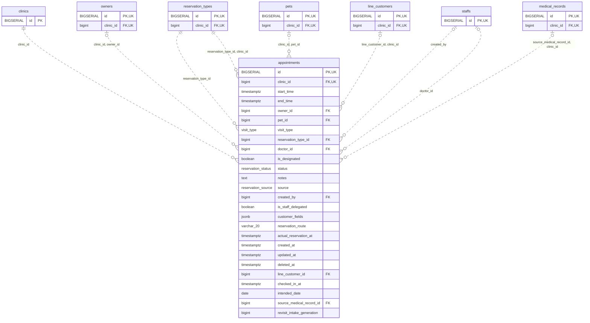

<!-- GENERATED: scripts/tools/generate-erd-detail.py; do not edit -->
# `appointments`

[詳細ERD一覧](index.md) · [概要ERD](../erd.md)

このページは、マイグレーションをファイル名順に静的解析した最終定義です。稼働DBの状態は未確認です。

## カラム

型・DEFAULTはDDLの宣言表記です。`bigserial` は採番宣言であり、DBカタログ上の型名ではありません。

| カラム | 型（DDL） | NULL | DEFAULT（DDL） | キー構成列 | 定義元 |
|:---|:---|:---|:---|:---|:---|
| `id` | `BIGSERIAL` | NOT NULL | — | PK, UK | [001_init.sql:1329](../../../backend/migrations/001_init.sql#L1329) |
| `clinic_id` | `bigint` | NOT NULL | — | FK, UK | [001_init.sql:1330](../../../backend/migrations/001_init.sql#L1330) |
| `start_time` | `timestamptz` | NOT NULL | — | — | [001_init.sql:1331](../../../backend/migrations/001_init.sql#L1331) |
| `end_time` | `timestamptz` | NOT NULL | — | — | [001_init.sql:1332](../../../backend/migrations/001_init.sql#L1332) |
| `owner_id` | `bigint` | NULL | — | FK | [001_init.sql:1333](../../../backend/migrations/001_init.sql#L1333) |
| `pet_id` | `bigint` | NULL | — | FK | [001_init.sql:1334](../../../backend/migrations/001_init.sql#L1334) |
| `visit_type` | `visit_type` | NOT NULL | `'revisit'` | — | [001_init.sql:1335](../../../backend/migrations/001_init.sql#L1335) |
| `reservation_type_id` | `bigint` | NOT NULL | — | FK | [001_init.sql:1336](../../../backend/migrations/001_init.sql#L1336) |
| `doctor_id` | `bigint` | NULL | — | FK | [001_init.sql:1337](../../../backend/migrations/001_init.sql#L1337) |
| `is_designated` | `boolean` | NULL | `false` | — | [001_init.sql:1338](../../../backend/migrations/001_init.sql#L1338) |
| `status` | `reservation_status` | NULL | `'pending'` | — | [001_init.sql:1339](../../../backend/migrations/001_init.sql#L1339) |
| `notes` | `text` | NOT NULL | `''` | — | [001_init.sql:1340](../../../backend/migrations/001_init.sql#L1340) |
| `source` | `reservation_source` | NOT NULL | `'manual'` | — | [001_init.sql:1341](../../../backend/migrations/001_init.sql#L1341) |
| `created_by` | `bigint` | NULL | — | FK | [001_init.sql:1342](../../../backend/migrations/001_init.sql#L1342) |
| `is_staff_delegated` | `boolean` | NOT NULL | `false` | — | [001_init.sql:1343](../../../backend/migrations/001_init.sql#L1343) |
| `customer_fields` | `jsonb` | NOT NULL | `'{}'` | — | [001_init.sql:1344](../../../backend/migrations/001_init.sql#L1344) |
| `reservation_route` | `varchar(20)` | NULL | — | — | [001_init.sql:1345](../../../backend/migrations/001_init.sql#L1345) |
| `actual_reservation_at` | `timestamptz` | NULL | — | — | [001_init.sql:1346](../../../backend/migrations/001_init.sql#L1346) |
| `created_at` | `timestamptz` | NOT NULL | `now()` | — | [001_init.sql:1347](../../../backend/migrations/001_init.sql#L1347) |
| `updated_at` | `timestamptz` | NOT NULL | `now()` | — | [001_init.sql:1348](../../../backend/migrations/001_init.sql#L1348) |
| `deleted_at` | `timestamptz` | NULL | — | — | [001_init.sql:1349](../../../backend/migrations/001_init.sql#L1349) |
| `line_customer_id` | `bigint` | NULL | — | FK | [001_init.sql:1350](../../../backend/migrations/001_init.sql#L1350) |
| `checked_in_at` | `timestamptz` | NULL | — | — | [001_init.sql:1351](../../../backend/migrations/001_init.sql#L1351) |
| `intended_date` | `date` | NULL | — | — | [001_init.sql:7207](../../../backend/migrations/001_init.sql#L7207) |
| `source_medical_record_id` | `bigint` | NULL | — | FK | [001_init.sql:7208](../../../backend/migrations/001_init.sql#L7208) |
| `revisit_intake_generation` | `bigint` | NOT NULL | `1` | — | [001_init.sql:7596](../../../backend/migrations/001_init.sql#L7596) |

PK/FK/UKはキーの構成列を示します。複合キーの各列が単独で一意という意味ではありません。部分uniqueは下記indexの述語を参照してください。

## ERD

このテーブルの全カラムと、すべての参照先を表示します。参照先はFKの対象列だけを表示し、全カラムは各テーブルのページに置きます。

親側の任意参照はFK列のNULL可否、子側の最大1件は無条件のPK/UNIQUEから導出します。部分uniqueによる条件付きの最大件数は図に反映せず、index一覧に記録します。実線はFK全列が子のPKに含まれる識別関係、破線はそれ以外です。

## 外部キー（全件）

| 制約 | 子の列（順序あり） | 参照先 | 親の列（順序あり） | 削除時の動作 | 定義元 |
|:---|:---|:---|:---|:---|:---|
| `appointments_clinic_id_fkey` | `clinic_id` | [clinics](clinics.md) | `id` | `ON DELETE RESTRICT` | [001_init.sql:1330](../../../backend/migrations/001_init.sql#L1330) |
| `appointments_reservation_type_id_fkey` | `reservation_type_id` | [reservation_types](reservation_types.md) | `id` | `ON DELETE RESTRICT` | [001_init.sql:1336](../../../backend/migrations/001_init.sql#L1336) |
| `fk_appointments_owner_clinic` | `clinic_id, owner_id` | [owners](owners.md) | `clinic_id, id` | `ON DELETE SET NULL (owner_id)` | [001_init.sql:5739](../../../backend/migrations/001_init.sql#L5739) |
| `fk_appointments_pet_clinic` | `clinic_id, pet_id` | [pets](pets.md) | `clinic_id, id` | `ON DELETE SET NULL (pet_id)` | [001_init.sql:5745](../../../backend/migrations/001_init.sql#L5745) |
| `fk_appointments_reservation_type_clinic` | `reservation_type_id, clinic_id` | [reservation_types](reservation_types.md) | `id, clinic_id` | `ON DELETE RESTRICT` | [001_init.sql:5751](../../../backend/migrations/001_init.sql#L5751) |
| `fk_appointments_line_customer_clinic` | `line_customer_id, clinic_id` | [line_customers](line_customers.md) | `id, clinic_id` | `ON DELETE SET NULL (line_customer_id)` | [001_init.sql:5769](../../../backend/migrations/001_init.sql#L5769) |
| `fk_appointments_created_by` | `created_by` | [staffs](staffs.md) | `id` | `ON DELETE RESTRICT` | [001_init.sql:6303](../../../backend/migrations/001_init.sql#L6303) |
| `fk_appointments_doctor` | `doctor_id` | [staffs](staffs.md) | `id` | `ON DELETE SET NULL` | [001_init.sql:6770](../../../backend/migrations/001_init.sql#L6770) |
| `fk_appointments_source_medical_record_clinic` | `source_medical_record_id, clinic_id` | [medical_records](medical_records.md) | `id, clinic_id` | `ON DELETE SET NULL (source_medical_record_id)` | [001_init.sql:7466](../../../backend/migrations/001_init.sql#L7466) |

正確なON UPDATE・MATCH・DEFERRABLE等を含む制約DDL:

- `appointments_clinic_id_fkey`: `REFERENCES clinics(id) ON DELETE RESTRICT`
- `appointments_reservation_type_id_fkey`: `REFERENCES reservation_types(id) ON DELETE RESTRICT`
- `fk_appointments_owner_clinic`: `CONSTRAINT fk_appointments_owner_clinic     FOREIGN KEY (clinic_id, owner_id)     REFERENCES owners (clinic_id, id)     ON DELETE SET NULL (owner_id)`
- `fk_appointments_pet_clinic`: `CONSTRAINT fk_appointments_pet_clinic     FOREIGN KEY (clinic_id, pet_id)     REFERENCES pets (clinic_id, id)     ON DELETE SET NULL (pet_id)`
- `fk_appointments_reservation_type_clinic`: `CONSTRAINT fk_appointments_reservation_type_clinic     FOREIGN KEY (reservation_type_id, clinic_id)     REFERENCES reservation_types (id, clinic_id)     ON DELETE RESTRICT`
- `fk_appointments_line_customer_clinic`: `CONSTRAINT fk_appointments_line_customer_clinic     FOREIGN KEY (line_customer_id, clinic_id)     REFERENCES line_customers (id, clinic_id)     ON DELETE SET NULL (line_customer_id)`
- `fk_appointments_created_by`: `CONSTRAINT fk_appointments_created_by         FOREIGN KEY (created_by) REFERENCES staffs (id) ON DELETE RESTRICT`
- `fk_appointments_doctor`: `CONSTRAINT fk_appointments_doctor         FOREIGN KEY (doctor_id) REFERENCES staffs (id) ON DELETE SET NULL`
- `fk_appointments_source_medical_record_clinic`: `CONSTRAINT fk_appointments_source_medical_record_clinic         FOREIGN KEY (source_medical_record_id, clinic_id)         REFERENCES medical_records (id, clinic_id)         ON DELETE SET NULL (source_medical_record_id)`

## その他の制約

| 制約 | 種別 | DDL | 定義元 |
|:---|:---|:---|:---|
| `appointments_pkey` | primary | `PRIMARY KEY` | [001_init.sql:1329](../../../backend/migrations/001_init.sql#L1329) |
| `chk_reservation_times` | check | `CONSTRAINT chk_reservation_times CHECK (end_time >= start_time)` | [001_init.sql:1352](../../../backend/migrations/001_init.sql#L1352) |
| `excl_appointments_doctor_timerange` | exclude | `CONSTRAINT excl_appointments_doctor_timerange     EXCLUDE USING gist (         clinic_id WITH =,         doctor_id WITH =,         tstzrange(start_time, end_time, '[)') WITH &&     )     WHERE (deleted_at IS NULL AND status <> 'cancelled' AND doctor_id IS NOT NULL)` | [001_init.sql:4592](../../../backend/migrations/001_init.sql#L4592) |
| `uq_appointments_id_clinic` | unique | `CONSTRAINT uq_appointments_id_clinic UNIQUE (id, clinic_id)` | [001_init.sql:5736](../../../backend/migrations/001_init.sql#L5736) |
| `appointments_revisit_intake_generation_check` | check | `CHECK (revisit_intake_generation > 0)` | [001_init.sql:7596](../../../backend/migrations/001_init.sql#L7596) |

## インデックス

| 名前 | UNIQUE | 述語 | DDL | 定義元 |
|:---|:---|:---|:---|:---|
| `idx_appointments_clinic_id` | NO | — | `CREATE INDEX idx_appointments_clinic_id ON appointments(clinic_id)` | [001_init.sql:2250](../../../backend/migrations/001_init.sql#L2250) |
| `idx_appointments_owner_id` | NO | — | `CREATE INDEX idx_appointments_owner_id ON appointments(owner_id)` | [001_init.sql:2278](../../../backend/migrations/001_init.sql#L2278) |
| `idx_appointments_pet_id` | NO | — | `CREATE INDEX idx_appointments_pet_id ON appointments(pet_id)` | [001_init.sql:2279](../../../backend/migrations/001_init.sql#L2279) |
| `idx_appointments_reservation_type_id` | NO | — | `CREATE INDEX idx_appointments_reservation_type_id ON appointments(reservation_type_id)` | [001_init.sql:2280](../../../backend/migrations/001_init.sql#L2280) |
| `idx_appointments_doctor_id` | NO | — | `CREATE INDEX idx_appointments_doctor_id ON appointments(doctor_id)` | [001_init.sql:2281](../../../backend/migrations/001_init.sql#L2281) |
| `idx_appointments_created_by` | NO | — | `CREATE INDEX idx_appointments_created_by ON appointments(created_by)` | [001_init.sql:2282](../../../backend/migrations/001_init.sql#L2282) |
| `idx_appointments_clinic_date` | NO | `deleted_at IS NULL` | `CREATE INDEX idx_appointments_clinic_date   ON appointments(clinic_id, start_time)   WHERE deleted_at IS NULL` | [001_init.sql:2352](../../../backend/migrations/001_init.sql#L2352) |
| `idx_appointments_clinic_status` | NO | `deleted_at IS NULL` | `CREATE INDEX idx_appointments_clinic_status   ON appointments(clinic_id, status)   WHERE deleted_at IS NULL` | [001_init.sql:2356](../../../backend/migrations/001_init.sql#L2356) |
| `idx_appointments_pet_date` | NO | `deleted_at IS NULL` | `CREATE INDEX idx_appointments_pet_date   ON appointments(pet_id, start_time)   WHERE deleted_at IS NULL` | [001_init.sql:2360](../../../backend/migrations/001_init.sql#L2360) |
| `idx_appointments_line_customer` | NO | `line_customer_id IS NOT NULL AND deleted_at IS NULL` | `CREATE INDEX idx_appointments_line_customer ON appointments(line_customer_id)     WHERE line_customer_id IS NOT NULL AND deleted_at IS NULL` | [001_init.sql:2739](../../../backend/migrations/001_init.sql#L2739) |
| `uk_appointment_staff_time` | YES | `deleted_at IS NULL AND status != 'cancelled'` | `CREATE UNIQUE INDEX uk_appointment_staff_time     ON appointments (clinic_id, doctor_id, start_time)     WHERE deleted_at IS NULL AND status != 'cancelled'` | [001_init.sql:2745](../../../backend/migrations/001_init.sql#L2745) |
| `uq_appointments_one_active_tentative` | YES | `status = 'tentative' AND deleted_at IS NULL` | `CREATE UNIQUE INDEX uq_appointments_one_active_tentative     ON appointments (clinic_id, pet_id)     WHERE status = 'tentative' AND deleted_at IS NULL` | [001_init.sql:7230](../../../backend/migrations/001_init.sql#L7230) |
