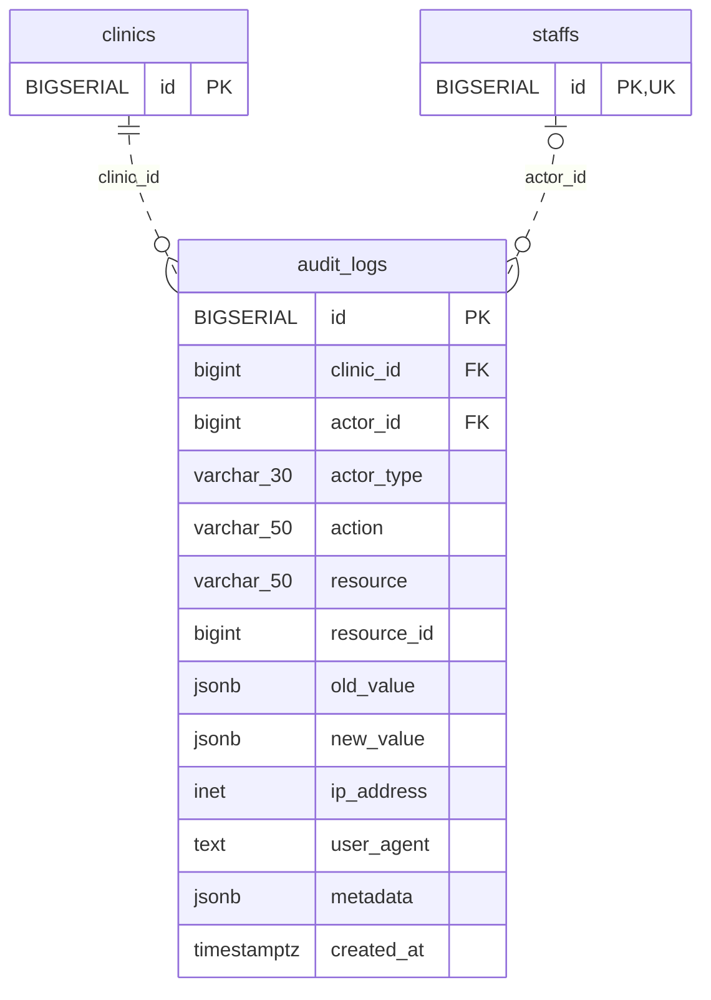

<!-- GENERATED: scripts/tools/generate-erd-detail.py; do not edit -->
# `audit_logs`

[詳細ERD一覧](index.md) · [概要ERD](../erd.md)

このページは、マイグレーションをファイル名順に静的解析した最終定義です。稼働DBの状態は未確認です。

## カラム

型・DEFAULTはDDLの宣言表記です。`bigserial` は採番宣言であり、DBカタログ上の型名ではありません。

| カラム | 型（DDL） | NULL | DEFAULT（DDL） | キー構成列 | 定義元 |
|:---|:---|:---|:---|:---|:---|
| `id` | `BIGSERIAL` | NOT NULL | — | PK | [001_init.sql:2597](../../../backend/migrations/001_init.sql#L2597) |
| `clinic_id` | `bigint` | NOT NULL | — | FK | [001_init.sql:2598](../../../backend/migrations/001_init.sql#L2598) |
| `actor_id` | `bigint` | NULL | — | FK | [001_init.sql:2599](../../../backend/migrations/001_init.sql#L2599) |
| `actor_type` | `varchar(30)` | NOT NULL | — | — | [001_init.sql:2600](../../../backend/migrations/001_init.sql#L2600) |
| `action` | `varchar(50)` | NOT NULL | — | — | [001_init.sql:2601](../../../backend/migrations/001_init.sql#L2601) |
| `resource` | `varchar(50)` | NOT NULL | — | — | [001_init.sql:2602](../../../backend/migrations/001_init.sql#L2602) |
| `resource_id` | `bigint` | NULL | — | — | [001_init.sql:2603](../../../backend/migrations/001_init.sql#L2603) |
| `old_value` | `jsonb` | NULL | — | — | [001_init.sql:2604](../../../backend/migrations/001_init.sql#L2604) |
| `new_value` | `jsonb` | NULL | — | — | [001_init.sql:2605](../../../backend/migrations/001_init.sql#L2605) |
| `ip_address` | `inet` | NULL | — | — | [001_init.sql:2606](../../../backend/migrations/001_init.sql#L2606) |
| `user_agent` | `text` | NULL | — | — | [001_init.sql:2607](../../../backend/migrations/001_init.sql#L2607) |
| `metadata` | `jsonb` | NULL | — | — | [001_init.sql:2608](../../../backend/migrations/001_init.sql#L2608) |
| `created_at` | `timestamptz` | NOT NULL | `now()` | — | [001_init.sql:2609](../../../backend/migrations/001_init.sql#L2609) |

PK/FK/UKはキーの構成列を示します。複合キーの各列が単独で一意という意味ではありません。部分uniqueは下記indexの述語を参照してください。

## ERD

このテーブルの全カラムと、すべての参照先を表示します。参照先はFKの対象列だけを表示し、全カラムは各テーブルのページに置きます。

親側の任意参照はFK列のNULL可否、子側の最大1件は無条件のPK/UNIQUEから導出します。部分uniqueによる条件付きの最大件数は図に反映せず、index一覧に記録します。実線はFK全列が子のPKに含まれる識別関係、破線はそれ以外です。

## 外部キー（全件）

| 制約 | 子の列（順序あり） | 参照先 | 親の列（順序あり） | 削除時の動作 | 定義元 |
|:---|:---|:---|:---|:---|:---|
| `audit_logs_clinic_id_fkey` | `clinic_id` | [clinics](clinics.md) | `id` | `ON DELETE RESTRICT` | [001_init.sql:2598](../../../backend/migrations/001_init.sql#L2598) |
| `audit_logs_actor_id_fkey` | `actor_id` | [staffs](staffs.md) | `id` | `ON DELETE RESTRICT` | [001_init.sql:2599](../../../backend/migrations/001_init.sql#L2599) |

正確なON UPDATE・MATCH・DEFERRABLE等を含む制約DDL:

- `audit_logs_clinic_id_fkey`: `REFERENCES clinics(id) ON DELETE RESTRICT`
- `audit_logs_actor_id_fkey`: `REFERENCES staffs(id) ON DELETE RESTRICT`

## その他の制約

| 制約 | 種別 | DDL | 定義元 |
|:---|:---|:---|:---|
| `audit_logs_pkey` | primary | `PRIMARY KEY` | [001_init.sql:2597](../../../backend/migrations/001_init.sql#L2597) |
| `audit_logs_actor_type_check` | check | `CHECK (actor_type IN ('staff', 'system'))` | [001_init.sql:2600](../../../backend/migrations/001_init.sql#L2600) |
| `audit_logs_actor_consistency_check` | check | `CONSTRAINT audit_logs_actor_consistency_check         CHECK (             (actor_type = 'system' AND actor_id IS NULL)             OR             (actor_type = 'staff' AND actor_id IS NOT NULL)         )` | [001_init.sql:2610](../../../backend/migrations/001_init.sql#L2610) |

## インデックス

| 名前 | UNIQUE | 述語 | DDL | 定義元 |
|:---|:---|:---|:---|:---|
| `idx_audit_logs_clinic` | NO | — | `CREATE INDEX idx_audit_logs_clinic   ON audit_logs(clinic_id, created_at DESC)` | [001_init.sql:2618](../../../backend/migrations/001_init.sql#L2618) |
| `idx_audit_logs_actor` | NO | — | `CREATE INDEX idx_audit_logs_actor    ON audit_logs(actor_id, created_at DESC)` | [001_init.sql:2619](../../../backend/migrations/001_init.sql#L2619) |
| `idx_audit_logs_resource` | NO | — | `CREATE INDEX idx_audit_logs_resource ON audit_logs(resource, resource_id, created_at DESC)` | [001_init.sql:2620](../../../backend/migrations/001_init.sql#L2620) |
