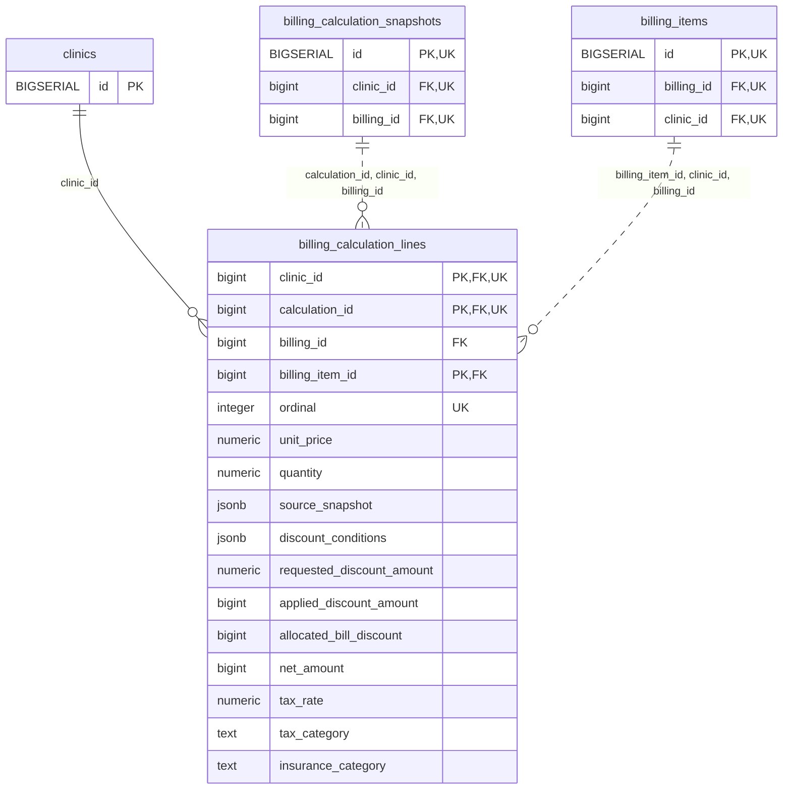

<!-- GENERATED: scripts/tools/generate-erd-detail.py; do not edit -->
# `billing_calculation_lines`

[詳細ERD一覧](index.md) · [概要ERD](../erd.md)

このページは、マイグレーションをファイル名順に静的解析した最終定義です。稼働DBの状態は未確認です。

## カラム

型・DEFAULTはDDLの宣言表記です。`bigserial` は採番宣言であり、DBカタログ上の型名ではありません。

| カラム | 型（DDL） | NULL | DEFAULT（DDL） | キー構成列 | 定義元 |
|:---|:---|:---|:---|:---|:---|
| `clinic_id` | `bigint` | NOT NULL | — | PK, FK, UK | [001_init.sql:9419](../../../backend/migrations/001_init.sql#L9419) |
| `calculation_id` | `bigint` | NOT NULL | — | PK, FK, UK | [001_init.sql:9420](../../../backend/migrations/001_init.sql#L9420) |
| `billing_id` | `bigint` | NOT NULL | — | FK | [001_init.sql:9421](../../../backend/migrations/001_init.sql#L9421) |
| `billing_item_id` | `bigint` | NOT NULL | — | PK, FK | [001_init.sql:9422](../../../backend/migrations/001_init.sql#L9422) |
| `ordinal` | `integer` | NOT NULL | — | UK | [001_init.sql:9423](../../../backend/migrations/001_init.sql#L9423) |
| `unit_price` | `numeric` | NOT NULL | — | — | [001_init.sql:9424](../../../backend/migrations/001_init.sql#L9424) |
| `quantity` | `numeric` | NOT NULL | — | — | [001_init.sql:9425](../../../backend/migrations/001_init.sql#L9425) |
| `source_snapshot` | `jsonb` | NOT NULL | — | — | [001_init.sql:9426](../../../backend/migrations/001_init.sql#L9426) |
| `discount_conditions` | `jsonb` | NOT NULL | — | — | [001_init.sql:9427](../../../backend/migrations/001_init.sql#L9427) |
| `requested_discount_amount` | `numeric` | NOT NULL | — | — | [001_init.sql:9428](../../../backend/migrations/001_init.sql#L9428) |
| `applied_discount_amount` | `bigint` | NOT NULL | — | — | [001_init.sql:9429](../../../backend/migrations/001_init.sql#L9429) |
| `allocated_bill_discount` | `bigint` | NOT NULL | — | — | [001_init.sql:9430](../../../backend/migrations/001_init.sql#L9430) |
| `net_amount` | `bigint` | NOT NULL | — | — | [001_init.sql:9431](../../../backend/migrations/001_init.sql#L9431) |
| `tax_rate` | `numeric` | NOT NULL | — | — | [001_init.sql:9432](../../../backend/migrations/001_init.sql#L9432) |
| `tax_category` | `text` | NOT NULL | — | — | [001_init.sql:9433](../../../backend/migrations/001_init.sql#L9433) |
| `insurance_category` | `text` | NOT NULL | — | — | [001_init.sql:9434](../../../backend/migrations/001_init.sql#L9434) |

PK/FK/UKはキーの構成列を示します。複合キーの各列が単独で一意という意味ではありません。部分uniqueは下記indexの述語を参照してください。

## ERD

このテーブルの全カラムと、すべての参照先を表示します。参照先はFKの対象列だけを表示し、全カラムは各テーブルのページに置きます。

親側の任意参照はFK列のNULL可否、子側の最大1件は無条件のPK/UNIQUEから導出します。部分uniqueによる条件付きの最大件数は図に反映せず、index一覧に記録します。実線はFK全列が子のPKに含まれる識別関係、破線はそれ以外です。

## 外部キー（全件）

| 制約 | 子の列（順序あり） | 参照先 | 親の列（順序あり） | 削除時の動作 | 定義元 |
|:---|:---|:---|:---|:---|:---|
| `billing_calculation_lines_clinic_id_fkey` | `clinic_id` | [clinics](clinics.md) | `id` | `ON DELETE RESTRICT` | [001_init.sql:9419](../../../backend/migrations/001_init.sql#L9419) |
| `billing_calculation_lines_calculation_id_clinic_id_billing_fkey` | `calculation_id, clinic_id, billing_id` | [billing_calculation_snapshots](billing_calculation_snapshots.md) | `id, clinic_id, billing_id` | `ON DELETE RESTRICT` | [001_init.sql:9437](../../../backend/migrations/001_init.sql#L9437) |
| `billing_calculation_lines_billing_item_id_clinic_id_billin_fkey` | `billing_item_id, clinic_id, billing_id` | [billing_items](billing_items.md) | `id, clinic_id, billing_id` | `ON DELETE RESTRICT` | [001_init.sql:9438](../../../backend/migrations/001_init.sql#L9438) |

正確なON UPDATE・MATCH・DEFERRABLE等を含む制約DDL:

- `billing_calculation_lines_clinic_id_fkey`: `REFERENCES clinics(id) ON DELETE RESTRICT`
- `billing_calculation_lines_calculation_id_clinic_id_billing_fkey`: `FOREIGN KEY (calculation_id,clinic_id,billing_id) REFERENCES billing_calculation_snapshots(id,clinic_id,billing_id) ON DELETE RESTRICT`
- `billing_calculation_lines_billing_item_id_clinic_id_billin_fkey`: `FOREIGN KEY (billing_item_id,clinic_id,billing_id) REFERENCES billing_items(id,clinic_id,billing_id) ON DELETE RESTRICT`

## その他の制約

| 制約 | 種別 | DDL | 定義元 |
|:---|:---|:---|:---|
| `billing_calculation_lines_ordinal_check` | check | `CHECK (ordinal > 0)` | [001_init.sql:9423](../../../backend/migrations/001_init.sql#L9423) |
| `billing_calculation_lines_quantity_check` | check | `CHECK (quantity > 0)` | [001_init.sql:9425](../../../backend/migrations/001_init.sql#L9425) |
| `billing_calculation_lines_source_snapshot_check` | check | `CHECK (jsonb_typeof(source_snapshot)='object')` | [001_init.sql:9426](../../../backend/migrations/001_init.sql#L9426) |
| `billing_calculation_lines_discount_conditions_check` | check | `CHECK (jsonb_typeof(discount_conditions)='object')` | [001_init.sql:9427](../../../backend/migrations/001_init.sql#L9427) |
| `billing_calculation_lines_applied_discount_amount_check` | check | `CHECK (applied_discount_amount >= 0)` | [001_init.sql:9429](../../../backend/migrations/001_init.sql#L9429) |
| `billing_calculation_lines_allocated_bill_discount_check` | check | `CHECK (allocated_bill_discount >= 0)` | [001_init.sql:9430](../../../backend/migrations/001_init.sql#L9430) |
| `billing_calculation_lines_net_amount_check` | check | `CHECK (net_amount >= 0)` | [001_init.sql:9431](../../../backend/migrations/001_init.sql#L9431) |
| `billing_calculation_lines_pkey` | primary | `PRIMARY KEY (clinic_id,calculation_id,billing_item_id)` | [001_init.sql:9435](../../../backend/migrations/001_init.sql#L9435) |
| `billing_calculation_lines_clinic_id_calculation_id_ordinal_key` | unique | `UNIQUE (clinic_id,calculation_id,ordinal)` | [001_init.sql:9436](../../../backend/migrations/001_init.sql#L9436) |

## インデックス

明示的なCREATE INDEXなし。PK/UNIQUEに付随する暗黙のindexは制約欄を参照してください。
