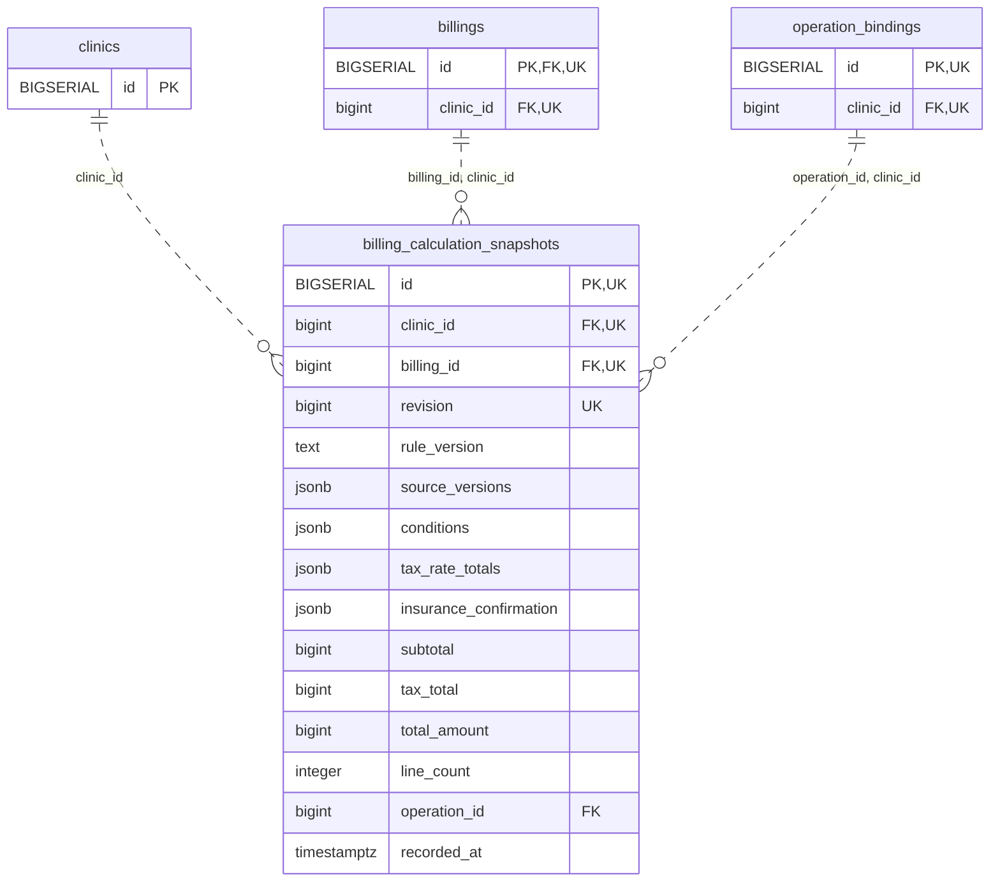

<!-- GENERATED: scripts/tools/generate-erd-detail.py; do not edit -->
# `billing_calculation_snapshots`

[詳細ERD一覧](index.md) · [概要ERD](../erd.md)

このページは、マイグレーションをファイル名順に静的解析した最終定義です。稼働DBの状態は未確認です。

## カラム

型・DEFAULTはDDLの宣言表記です。`bigserial` は採番宣言であり、DBカタログ上の型名ではありません。

| カラム | 型（DDL） | NULL | DEFAULT（DDL） | キー構成列 | 定義元 |
|:---|:---|:---|:---|:---|:---|
| `id` | `BIGSERIAL` | NOT NULL | — | PK, UK | [001_init.sql:9396](../../../backend/migrations/001_init.sql#L9396) |
| `clinic_id` | `bigint` | NOT NULL | — | FK, UK | [001_init.sql:9397](../../../backend/migrations/001_init.sql#L9397) |
| `billing_id` | `bigint` | NOT NULL | — | FK, UK | [001_init.sql:9398](../../../backend/migrations/001_init.sql#L9398) |
| `revision` | `bigint` | NOT NULL | — | UK | [001_init.sql:9399](../../../backend/migrations/001_init.sql#L9399) |
| `rule_version` | `text` | NOT NULL | — | — | [001_init.sql:9400](../../../backend/migrations/001_init.sql#L9400) |
| `source_versions` | `jsonb` | NOT NULL | — | — | [001_init.sql:9401](../../../backend/migrations/001_init.sql#L9401) |
| `conditions` | `jsonb` | NOT NULL | — | — | [001_init.sql:9402](../../../backend/migrations/001_init.sql#L9402) |
| `tax_rate_totals` | `jsonb` | NOT NULL | — | — | [001_init.sql:9403](../../../backend/migrations/001_init.sql#L9403) |
| `insurance_confirmation` | `jsonb` | NOT NULL | — | — | [001_init.sql:9404](../../../backend/migrations/001_init.sql#L9404) |
| `subtotal` | `bigint` | NOT NULL | — | — | [001_init.sql:9405](../../../backend/migrations/001_init.sql#L9405) |
| `tax_total` | `bigint` | NOT NULL | — | — | [001_init.sql:9406](../../../backend/migrations/001_init.sql#L9406) |
| `total_amount` | `bigint` | NOT NULL | — | — | [001_init.sql:9407](../../../backend/migrations/001_init.sql#L9407) |
| `line_count` | `integer` | NOT NULL | — | — | [001_init.sql:9408](../../../backend/migrations/001_init.sql#L9408) |
| `operation_id` | `bigint` | NOT NULL | — | FK | [001_init.sql:9409](../../../backend/migrations/001_init.sql#L9409) |
| `recorded_at` | `timestamptz` | NOT NULL | `clock_timestamp()` | — | [001_init.sql:9410](../../../backend/migrations/001_init.sql#L9410) |

PK/FK/UKはキーの構成列を示します。複合キーの各列が単独で一意という意味ではありません。部分uniqueは下記indexの述語を参照してください。

## ERD

このテーブルの全カラムと、すべての参照先を表示します。参照先はFKの対象列だけを表示し、全カラムは各テーブルのページに置きます。

親側の任意参照はFK列のNULL可否、子側の最大1件は無条件のPK/UNIQUEから導出します。部分uniqueによる条件付きの最大件数は図に反映せず、index一覧に記録します。実線はFK全列が子のPKに含まれる識別関係、破線はそれ以外です。

## 外部キー（全件）

| 制約 | 子の列（順序あり） | 参照先 | 親の列（順序あり） | 削除時の動作 | 定義元 |
|:---|:---|:---|:---|:---|:---|
| `billing_calculation_snapshots_clinic_id_fkey` | `clinic_id` | [clinics](clinics.md) | `id` | `ON DELETE RESTRICT` | [001_init.sql:9397](../../../backend/migrations/001_init.sql#L9397) |
| `billing_calculation_snapshots_billing_id_clinic_id_fkey` | `billing_id, clinic_id` | [billings](billings.md) | `id, clinic_id` | `ON DELETE RESTRICT` | [001_init.sql:9413](../../../backend/migrations/001_init.sql#L9413) |
| `billing_calculation_snapshots_operation_id_clinic_id_fkey` | `operation_id, clinic_id` | [operation_bindings](operation_bindings.md) | `id, clinic_id` | `ON DELETE RESTRICT` | [001_init.sql:9414](../../../backend/migrations/001_init.sql#L9414) |

正確なON UPDATE・MATCH・DEFERRABLE等を含む制約DDL:

- `billing_calculation_snapshots_clinic_id_fkey`: `REFERENCES clinics(id) ON DELETE RESTRICT`
- `billing_calculation_snapshots_billing_id_clinic_id_fkey`: `FOREIGN KEY (billing_id,clinic_id) REFERENCES billings(id,clinic_id) ON DELETE RESTRICT`
- `billing_calculation_snapshots_operation_id_clinic_id_fkey`: `FOREIGN KEY (operation_id,clinic_id) REFERENCES operation_bindings(id,clinic_id) ON DELETE RESTRICT`

## その他の制約

| 制約 | 種別 | DDL | 定義元 |
|:---|:---|:---|:---|
| `billing_calculation_snapshots_pkey` | primary | `PRIMARY KEY` | [001_init.sql:9396](../../../backend/migrations/001_init.sql#L9396) |
| `billing_calculation_snapshots_revision_check` | check | `CHECK (revision > 0)` | [001_init.sql:9399](../../../backend/migrations/001_init.sql#L9399) |
| `billing_calculation_snapshots_source_versions_check` | check | `CHECK (jsonb_typeof(source_versions)='object')` | [001_init.sql:9401](../../../backend/migrations/001_init.sql#L9401) |
| `billing_calculation_snapshots_conditions_check` | check | `CHECK (jsonb_typeof(conditions)='object')` | [001_init.sql:9402](../../../backend/migrations/001_init.sql#L9402) |
| `billing_calculation_snapshots_tax_rate_totals_check` | check | `CHECK (jsonb_typeof(tax_rate_totals)='array')` | [001_init.sql:9403](../../../backend/migrations/001_init.sql#L9403) |
| `billing_calculation_snapshots_insurance_confirmation_check` | check | `CHECK (jsonb_typeof(insurance_confirmation)='object')` | [001_init.sql:9404](../../../backend/migrations/001_init.sql#L9404) |
| `billing_calculation_snapshots_subtotal_check` | check | `CHECK (subtotal >= 0)` | [001_init.sql:9405](../../../backend/migrations/001_init.sql#L9405) |
| `billing_calculation_snapshots_tax_total_check` | check | `CHECK (tax_total >= 0)` | [001_init.sql:9406](../../../backend/migrations/001_init.sql#L9406) |
| `billing_calculation_snapshots_total_amount_check` | check | `CHECK (total_amount >= 0)` | [001_init.sql:9407](../../../backend/migrations/001_init.sql#L9407) |
| `billing_calculation_snapshots_line_count_check` | check | `CHECK (line_count >= 0)` | [001_init.sql:9408](../../../backend/migrations/001_init.sql#L9408) |
| `billing_calculation_snapshots_id_clinic_id_billing_id_key` | unique | `UNIQUE (id,clinic_id,billing_id)` | [001_init.sql:9411](../../../backend/migrations/001_init.sql#L9411) |
| `billing_calculation_snapshots_clinic_id_billing_id_revision_key` | unique | `UNIQUE (clinic_id,billing_id,revision)` | [001_init.sql:9412](../../../backend/migrations/001_init.sql#L9412) |

## インデックス

明示的なCREATE INDEXなし。PK/UNIQUEに付随する暗黙のindexは制約欄を参照してください。
