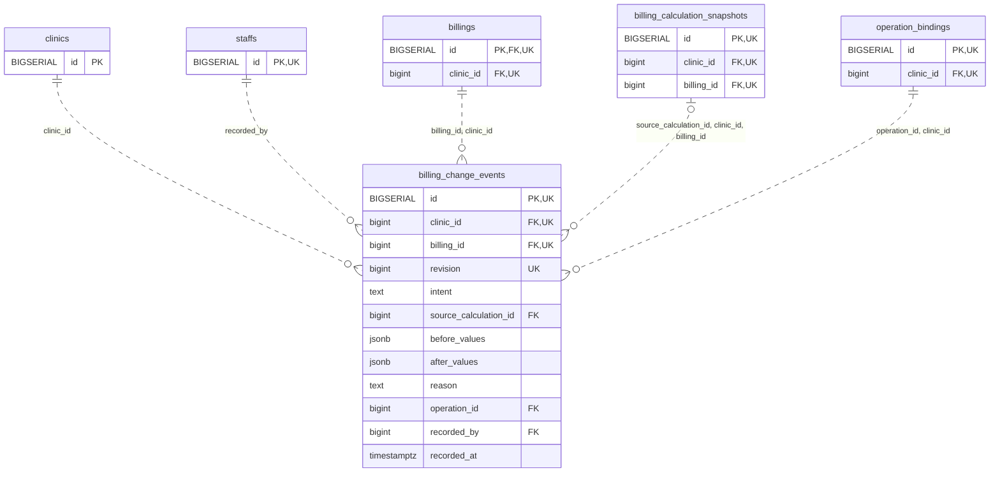

<!-- GENERATED: scripts/tools/generate-erd-detail.py; do not edit -->
# `billing_change_events`

[詳細ERD一覧](index.md) · [概要ERD](../erd.md)

このページは、マイグレーションをファイル名順に静的解析した最終定義です。稼働DBの状態は未確認です。

## カラム

型・DEFAULTはDDLの宣言表記です。`bigserial` は採番宣言であり、DBカタログ上の型名ではありません。

| カラム | 型（DDL） | NULL | DEFAULT（DDL） | キー構成列 | 定義元 |
|:---|:---|:---|:---|:---|:---|
| `id` | `BIGSERIAL` | NOT NULL | — | PK, UK | [001_init.sql:9455](../../../backend/migrations/001_init.sql#L9455) |
| `clinic_id` | `bigint` | NOT NULL | — | FK, UK | [001_init.sql:9456](../../../backend/migrations/001_init.sql#L9456) |
| `billing_id` | `bigint` | NOT NULL | — | FK, UK | [001_init.sql:9457](../../../backend/migrations/001_init.sql#L9457) |
| `revision` | `bigint` | NOT NULL | — | UK | [001_init.sql:9458](../../../backend/migrations/001_init.sql#L9458) |
| `intent` | `text` | NOT NULL | — | — | [001_init.sql:9459](../../../backend/migrations/001_init.sql#L9459) |
| `source_calculation_id` | `bigint` | NULL | — | FK | [001_init.sql:9460](../../../backend/migrations/001_init.sql#L9460) |
| `before_values` | `jsonb` | NOT NULL | — | — | [001_init.sql:9461](../../../backend/migrations/001_init.sql#L9461) |
| `after_values` | `jsonb` | NOT NULL | — | — | [001_init.sql:9462](../../../backend/migrations/001_init.sql#L9462) |
| `reason` | `text` | NULL | — | — | [001_init.sql:9463](../../../backend/migrations/001_init.sql#L9463) |
| `operation_id` | `bigint` | NOT NULL | — | FK | [001_init.sql:9464](../../../backend/migrations/001_init.sql#L9464) |
| `recorded_by` | `bigint` | NOT NULL | — | FK | [001_init.sql:9465](../../../backend/migrations/001_init.sql#L9465) |
| `recorded_at` | `timestamptz` | NOT NULL | `clock_timestamp()` | — | [001_init.sql:9466](../../../backend/migrations/001_init.sql#L9466) |

PK/FK/UKはキーの構成列を示します。複合キーの各列が単独で一意という意味ではありません。部分uniqueは下記indexの述語を参照してください。

## ERD

このテーブルの全カラムと、すべての参照先を表示します。参照先はFKの対象列だけを表示し、全カラムは各テーブルのページに置きます。

親側の任意参照はFK列のNULL可否、子側の最大1件は無条件のPK/UNIQUEから導出します。部分uniqueによる条件付きの最大件数は図に反映せず、index一覧に記録します。実線はFK全列が子のPKに含まれる識別関係、破線はそれ以外です。

## 外部キー（全件）

| 制約 | 子の列（順序あり） | 参照先 | 親の列（順序あり） | 削除時の動作 | 定義元 |
|:---|:---|:---|:---|:---|:---|
| `billing_change_events_clinic_id_fkey` | `clinic_id` | [clinics](clinics.md) | `id` | `ON DELETE RESTRICT` | [001_init.sql:9456](../../../backend/migrations/001_init.sql#L9456) |
| `billing_change_events_recorded_by_fkey` | `recorded_by` | [staffs](staffs.md) | `id` | `ON DELETE RESTRICT` | [001_init.sql:9465](../../../backend/migrations/001_init.sql#L9465) |
| `billing_change_events_billing_id_clinic_id_fkey` | `billing_id, clinic_id` | [billings](billings.md) | `id, clinic_id` | `ON DELETE RESTRICT` | [001_init.sql:9470](../../../backend/migrations/001_init.sql#L9470) |
| `billing_change_events_source_calculation_id_clinic_id_bill_fkey` | `source_calculation_id, clinic_id, billing_id` | [billing_calculation_snapshots](billing_calculation_snapshots.md) | `id, clinic_id, billing_id` | `ON DELETE RESTRICT` | [001_init.sql:9471](../../../backend/migrations/001_init.sql#L9471) |
| `billing_change_events_operation_id_clinic_id_fkey` | `operation_id, clinic_id` | [operation_bindings](operation_bindings.md) | `id, clinic_id` | `ON DELETE RESTRICT` | [001_init.sql:9472](../../../backend/migrations/001_init.sql#L9472) |

正確なON UPDATE・MATCH・DEFERRABLE等を含む制約DDL:

- `billing_change_events_clinic_id_fkey`: `REFERENCES clinics(id) ON DELETE RESTRICT`
- `billing_change_events_recorded_by_fkey`: `REFERENCES staffs(id) ON DELETE RESTRICT`
- `billing_change_events_billing_id_clinic_id_fkey`: `FOREIGN KEY (billing_id,clinic_id) REFERENCES billings(id,clinic_id) ON DELETE RESTRICT`
- `billing_change_events_source_calculation_id_clinic_id_bill_fkey`: `FOREIGN KEY (source_calculation_id,clinic_id,billing_id) REFERENCES billing_calculation_snapshots(id,clinic_id,billing_id) ON DELETE RESTRICT`
- `billing_change_events_operation_id_clinic_id_fkey`: `FOREIGN KEY (operation_id,clinic_id) REFERENCES operation_bindings(id,clinic_id) ON DELETE RESTRICT`

## その他の制約

| 制約 | 種別 | DDL | 定義元 |
|:---|:---|:---|:---|
| `billing_change_events_pkey` | primary | `PRIMARY KEY` | [001_init.sql:9455](../../../backend/migrations/001_init.sql#L9455) |
| `billing_change_events_revision_check` | check | `CHECK (revision > 0)` | [001_init.sql:9458](../../../backend/migrations/001_init.sql#L9458) |
| `billing_change_events_intent_check` | check | `CHECK (intent IN ('finalize','correct','cancel','collect','refund','reallocate'))` | [001_init.sql:9459](../../../backend/migrations/001_init.sql#L9459) |
| `billing_change_events_before_values_check` | check | `CHECK (jsonb_typeof(before_values)='object')` | [001_init.sql:9461](../../../backend/migrations/001_init.sql#L9461) |
| `billing_change_events_after_values_check` | check | `CHECK (jsonb_typeof(after_values)='object')` | [001_init.sql:9462](../../../backend/migrations/001_init.sql#L9462) |
| `billing_change_events_id_clinic_id_key` | unique | `UNIQUE (id,clinic_id)` | [001_init.sql:9467](../../../backend/migrations/001_init.sql#L9467) |
| `billing_change_events_clinic_id_billing_id_revision_key` | unique | `UNIQUE (clinic_id,billing_id,revision)` | [001_init.sql:9468](../../../backend/migrations/001_init.sql#L9468) |
| `billing_change_events_check` | check | `CHECK (intent NOT IN ('correct','cancel','refund') OR (reason IS NOT NULL AND btrim(reason)<>''))` | [001_init.sql:9469](../../../backend/migrations/001_init.sql#L9469) |

## インデックス

明示的なCREATE INDEXなし。PK/UNIQUEに付随する暗黙のindexは制約欄を参照してください。
