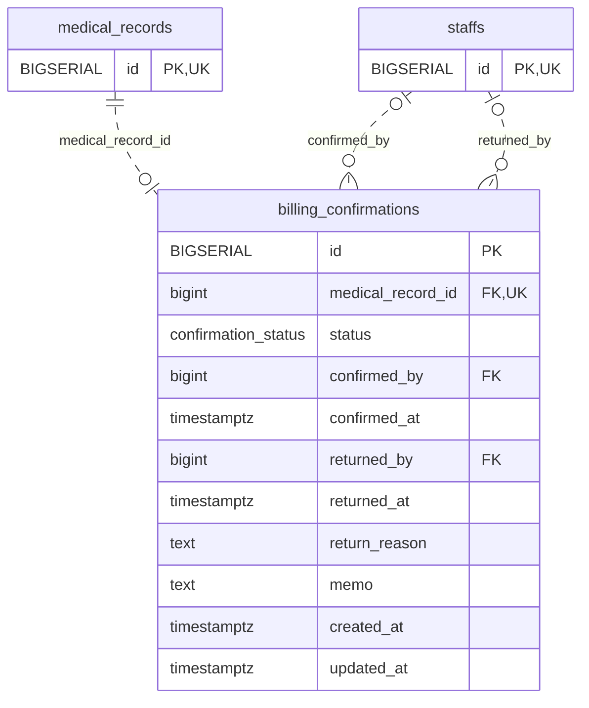

<!-- GENERATED: scripts/tools/generate-erd-detail.py; do not edit -->
# `billing_confirmations`

[詳細ERD一覧](index.md) · [概要ERD](../erd.md)

このページは、マイグレーションをファイル名順に静的解析した最終定義です。稼働DBの状態は未確認です。

## カラム

型・DEFAULTはDDLの宣言表記です。`bigserial` は採番宣言であり、DBカタログ上の型名ではありません。

| カラム | 型（DDL） | NULL | DEFAULT（DDL） | キー構成列 | 定義元 |
|:---|:---|:---|:---|:---|:---|
| `id` | `BIGSERIAL` | NOT NULL | — | PK | [001_init.sql:1677](../../../backend/migrations/001_init.sql#L1677) |
| `medical_record_id` | `bigint` | NOT NULL | — | FK, UK | [001_init.sql:1678](../../../backend/migrations/001_init.sql#L1678) |
| `status` | `confirmation_status` | NULL | `'pending'` | — | [001_init.sql:1679](../../../backend/migrations/001_init.sql#L1679) |
| `confirmed_by` | `bigint` | NULL | — | FK | [001_init.sql:1680](../../../backend/migrations/001_init.sql#L1680) |
| `confirmed_at` | `timestamptz` | NULL | — | — | [001_init.sql:1681](../../../backend/migrations/001_init.sql#L1681) |
| `returned_by` | `bigint` | NULL | — | FK | [001_init.sql:1682](../../../backend/migrations/001_init.sql#L1682) |
| `returned_at` | `timestamptz` | NULL | — | — | [001_init.sql:1683](../../../backend/migrations/001_init.sql#L1683) |
| `return_reason` | `text` | NOT NULL | `''` | — | [001_init.sql:1684](../../../backend/migrations/001_init.sql#L1684) |
| `memo` | `text` | NOT NULL | `''` | — | [001_init.sql:1685](../../../backend/migrations/001_init.sql#L1685) |
| `created_at` | `timestamptz` | NOT NULL | `now()` | — | [001_init.sql:1686](../../../backend/migrations/001_init.sql#L1686) |
| `updated_at` | `timestamptz` | NOT NULL | `now()` | — | [001_init.sql:1687](../../../backend/migrations/001_init.sql#L1687) |

PK/FK/UKはキーの構成列を示します。複合キーの各列が単独で一意という意味ではありません。部分uniqueは下記indexの述語を参照してください。

## ERD

このテーブルの全カラムと、すべての参照先を表示します。参照先はFKの対象列だけを表示し、全カラムは各テーブルのページに置きます。

親側の任意参照はFK列のNULL可否、子側の最大1件は無条件のPK/UNIQUEから導出します。部分uniqueによる条件付きの最大件数は図に反映せず、index一覧に記録します。実線はFK全列が子のPKに含まれる識別関係、破線はそれ以外です。

## 外部キー（全件）

| 制約 | 子の列（順序あり） | 参照先 | 親の列（順序あり） | 削除時の動作 | 定義元 |
|:---|:---|:---|:---|:---|:---|
| `billing_confirmations_medical_record_id_fkey` | `medical_record_id` | [medical_records](medical_records.md) | `id` | `ON DELETE CASCADE` | [001_init.sql:1678](../../../backend/migrations/001_init.sql#L1678) |
| `billing_confirmations_confirmed_by_fkey` | `confirmed_by` | [staffs](staffs.md) | `id` | `ON DELETE SET NULL` | [001_init.sql:1680](../../../backend/migrations/001_init.sql#L1680) |
| `billing_confirmations_returned_by_fkey` | `returned_by` | [staffs](staffs.md) | `id` | `ON DELETE SET NULL` | [001_init.sql:1682](../../../backend/migrations/001_init.sql#L1682) |

正確なON UPDATE・MATCH・DEFERRABLE等を含む制約DDL:

- `billing_confirmations_medical_record_id_fkey`: `REFERENCES medical_records(id) ON DELETE CASCADE`
- `billing_confirmations_confirmed_by_fkey`: `REFERENCES staffs(id) ON DELETE SET NULL`
- `billing_confirmations_returned_by_fkey`: `REFERENCES staffs(id) ON DELETE SET NULL`

## その他の制約

| 制約 | 種別 | DDL | 定義元 |
|:---|:---|:---|:---|
| `billing_confirmations_pkey` | primary | `PRIMARY KEY` | [001_init.sql:1677](../../../backend/migrations/001_init.sql#L1677) |
| `billing_confirmations_medical_record_id_key` | unique | `UNIQUE` | [001_init.sql:1678](../../../backend/migrations/001_init.sql#L1678) |

## インデックス

明示的なCREATE INDEXなし。PK/UNIQUEに付随する暗黙のindexは制約欄を参照してください。
