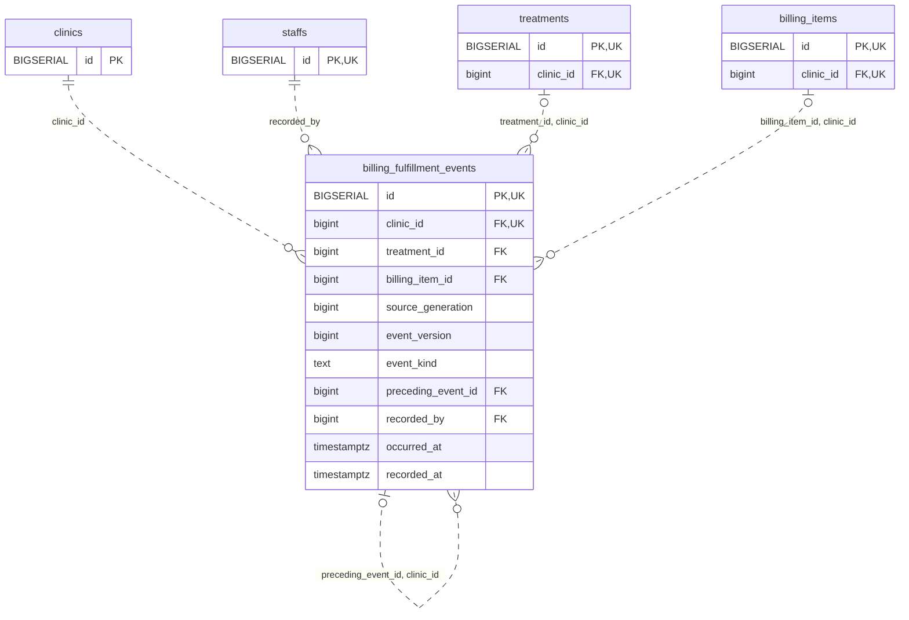

<!-- GENERATED: scripts/tools/generate-erd-detail.py; do not edit -->
# `billing_fulfillment_events`

[詳細ERD一覧](index.md) · [概要ERD](../erd.md)

このページは、マイグレーションをファイル名順に静的解析した最終定義です。稼働DBの状態は未確認です。

## カラム

型・DEFAULTはDDLの宣言表記です。`bigserial` は採番宣言であり、DBカタログ上の型名ではありません。

| カラム | 型（DDL） | NULL | DEFAULT（DDL） | キー構成列 | 定義元 |
|:---|:---|:---|:---|:---|:---|
| `id` | `BIGSERIAL` | NOT NULL | — | PK, UK | [001_init.sql:8263](../../../backend/migrations/001_init.sql#L8263) |
| `clinic_id` | `bigint` | NOT NULL | — | FK, UK | [001_init.sql:8264](../../../backend/migrations/001_init.sql#L8264) |
| `treatment_id` | `bigint` | NULL | — | FK | [001_init.sql:8265](../../../backend/migrations/001_init.sql#L8265) |
| `billing_item_id` | `bigint` | NULL | — | FK | [001_init.sql:8266](../../../backend/migrations/001_init.sql#L8266) |
| `source_generation` | `bigint` | NOT NULL | — | — | [001_init.sql:8267](../../../backend/migrations/001_init.sql#L8267) |
| `event_version` | `bigint` | NOT NULL | — | — | [001_init.sql:8268](../../../backend/migrations/001_init.sql#L8268) |
| `event_kind` | `text` | NOT NULL | — | — | [001_init.sql:8269](../../../backend/migrations/001_init.sql#L8269) |
| `preceding_event_id` | `bigint` | NULL | — | FK | [001_init.sql:8270](../../../backend/migrations/001_init.sql#L8270) |
| `recorded_by` | `bigint` | NOT NULL | — | FK | [001_init.sql:8271](../../../backend/migrations/001_init.sql#L8271) |
| `occurred_at` | `timestamptz` | NOT NULL | — | — | [001_init.sql:8272](../../../backend/migrations/001_init.sql#L8272) |
| `recorded_at` | `timestamptz` | NOT NULL | `clock_timestamp()` | — | [001_init.sql:8273](../../../backend/migrations/001_init.sql#L8273) |

PK/FK/UKはキーの構成列を示します。複合キーの各列が単独で一意という意味ではありません。部分uniqueは下記indexの述語を参照してください。

## ERD

このテーブルの全カラムと、すべての参照先を表示します。参照先はFKの対象列だけを表示し、全カラムは各テーブルのページに置きます。

親側の任意参照はFK列のNULL可否、子側の最大1件は無条件のPK/UNIQUEから導出します。部分uniqueによる条件付きの最大件数は図に反映せず、index一覧に記録します。実線はFK全列が子のPKに含まれる識別関係、破線はそれ以外です。

## 外部キー（全件）

| 制約 | 子の列（順序あり） | 参照先 | 親の列（順序あり） | 削除時の動作 | 定義元 |
|:---|:---|:---|:---|:---|:---|
| `billing_fulfillment_events_clinic_id_fkey` | `clinic_id` | [clinics](clinics.md) | `id` | `ON DELETE RESTRICT` | [001_init.sql:8264](../../../backend/migrations/001_init.sql#L8264) |
| `billing_fulfillment_events_recorded_by_fkey` | `recorded_by` | [staffs](staffs.md) | `id` | `ON DELETE RESTRICT` | [001_init.sql:8271](../../../backend/migrations/001_init.sql#L8271) |
| `billing_fulfillment_events_treatment_id_clinic_id_fkey` | `treatment_id, clinic_id` | [treatments](treatments.md) | `id, clinic_id` | `ON DELETE RESTRICT` | [001_init.sql:8278](../../../backend/migrations/001_init.sql#L8278) |
| `billing_fulfillment_events_billing_item_id_clinic_id_fkey` | `billing_item_id, clinic_id` | [billing_items](billing_items.md) | `id, clinic_id` | `ON DELETE RESTRICT` | [001_init.sql:8279](../../../backend/migrations/001_init.sql#L8279) |
| `billing_fulfillment_events_preceding_event_id_clinic_id_fkey` | `preceding_event_id, clinic_id` | [billing_fulfillment_events](billing_fulfillment_events.md) | `id, clinic_id` | `ON DELETE RESTRICT` | [001_init.sql:8280](../../../backend/migrations/001_init.sql#L8280) |

正確なON UPDATE・MATCH・DEFERRABLE等を含む制約DDL:

- `billing_fulfillment_events_clinic_id_fkey`: `REFERENCES clinics(id) ON DELETE RESTRICT`
- `billing_fulfillment_events_recorded_by_fkey`: `REFERENCES staffs(id) ON DELETE RESTRICT`
- `billing_fulfillment_events_treatment_id_clinic_id_fkey`: `FOREIGN KEY (treatment_id,clinic_id) REFERENCES treatments(id,clinic_id) ON DELETE RESTRICT`
- `billing_fulfillment_events_billing_item_id_clinic_id_fkey`: `FOREIGN KEY (billing_item_id,clinic_id) REFERENCES billing_items(id,clinic_id) ON DELETE RESTRICT`
- `billing_fulfillment_events_preceding_event_id_clinic_id_fkey`: `FOREIGN KEY (preceding_event_id,clinic_id) REFERENCES billing_fulfillment_events(id,clinic_id) ON DELETE RESTRICT`

## その他の制約

| 制約 | 種別 | DDL | 定義元 |
|:---|:---|:---|:---|
| `billing_fulfillment_events_pkey` | primary | `PRIMARY KEY` | [001_init.sql:8263](../../../backend/migrations/001_init.sql#L8263) |
| `billing_fulfillment_events_source_generation_check` | check | `CHECK (source_generation > 0)` | [001_init.sql:8267](../../../backend/migrations/001_init.sql#L8267) |
| `billing_fulfillment_events_event_version_check` | check | `CHECK (event_version > 0)` | [001_init.sql:8268](../../../backend/migrations/001_init.sql#L8268) |
| `billing_fulfillment_events_event_kind_check` | check | `CHECK (event_kind IN ('performed','prepared','revoked'))` | [001_init.sql:8269](../../../backend/migrations/001_init.sql#L8269) |
| `billing_fulfillment_events_id_clinic_id_key` | unique | `UNIQUE (id,clinic_id)` | [001_init.sql:8274](../../../backend/migrations/001_init.sql#L8274) |
| `billing_fulfillment_events_check` | check | `CHECK (num_nonnulls(treatment_id,billing_item_id)=1)` | [001_init.sql:8275](../../../backend/migrations/001_init.sql#L8275) |
| `billing_fulfillment_events_check1` | check | `CHECK ((event_kind='revoked' AND preceding_event_id IS NOT NULL)         OR (event_kind IN ('performed','prepared') AND preceding_event_id IS NULL))` | [001_init.sql:8276](../../../backend/migrations/001_init.sql#L8276) |

## インデックス

| 名前 | UNIQUE | 述語 | DDL | 定義元 |
|:---|:---|:---|:---|:---|
| `uq_fulfillment_treatment_version` | YES | `treatment_id IS NOT NULL` | `CREATE UNIQUE INDEX uq_fulfillment_treatment_version ON billing_fulfillment_events(clinic_id,treatment_id,event_version) WHERE treatment_id IS NOT NULL` | [001_init.sql:8282](../../../backend/migrations/001_init.sql#L8282) |
| `uq_fulfillment_billing_line_version` | YES | `billing_item_id IS NOT NULL` | `CREATE UNIQUE INDEX uq_fulfillment_billing_line_version ON billing_fulfillment_events(clinic_id,billing_item_id,event_version) WHERE billing_item_id IS NOT NULL` | [001_init.sql:8283](../../../backend/migrations/001_init.sql#L8283) |
| `uq_fulfillment_revoke_once` | YES | `preceding_event_id IS NOT NULL` | `CREATE UNIQUE INDEX uq_fulfillment_revoke_once ON billing_fulfillment_events(clinic_id,preceding_event_id) WHERE preceding_event_id IS NOT NULL` | [001_init.sql:8284](../../../backend/migrations/001_init.sql#L8284) |
