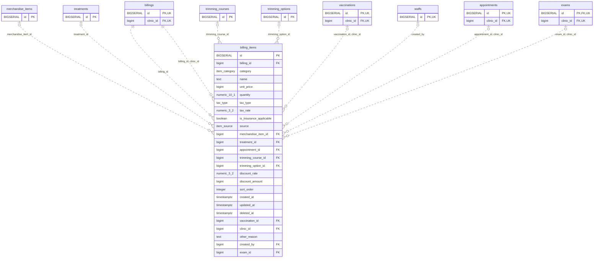

<!-- GENERATED: scripts/tools/generate-erd-detail.py; do not edit -->
# `billing_items`

[詳細ERD一覧](index.md) · [概要ERD](../erd.md)

このページは、マイグレーションをファイル名順に静的解析した最終定義です。稼働DBの状態は未確認です。

## カラム

型・DEFAULTはDDLの宣言表記です。`bigserial` は採番宣言であり、DBカタログ上の型名ではありません。

| カラム | 型（DDL） | NULL | DEFAULT（DDL） | キー構成列 | 定義元 |
|:---|:---|:---|:---|:---|:---|
| `id` | `BIGSERIAL` | NOT NULL | — | PK | [001_init.sql:1922](../../../backend/migrations/001_init.sql#L1922) |
| `billing_id` | `bigint` | NOT NULL | — | FK | [001_init.sql:1923](../../../backend/migrations/001_init.sql#L1923) |
| `category` | `item_category` | NOT NULL | — | — | [001_init.sql:1924](../../../backend/migrations/001_init.sql#L1924) |
| `name` | `text` | NOT NULL | `''` | — | [001_init.sql:1925](../../../backend/migrations/001_init.sql#L1925) |
| `unit_price` | `bigint` | NOT NULL | `0` | — | [001_init.sql:1926](../../../backend/migrations/001_init.sql#L1926) |
| `quantity` | `numeric(10,1)` | NOT NULL | `1` | — | [001_init.sql:1927](../../../backend/migrations/001_init.sql#L1927) |
| `tax_type` | `tax_type` | NOT NULL | `'excluded'` | — | [001_init.sql:1928](../../../backend/migrations/001_init.sql#L1928) |
| `tax_rate` | `numeric(3,2)` | NULL | `0.10` | — | [001_init.sql:1929](../../../backend/migrations/001_init.sql#L1929) |
| `is_insurance_applicable` | `boolean` | NULL | `false` | — | [001_init.sql:1930](../../../backend/migrations/001_init.sql#L1930) |
| `source` | `item_source` | NULL | `'manual'` | — | [001_init.sql:1931](../../../backend/migrations/001_init.sql#L1931) |
| `merchandise_item_id` | `bigint` | NULL | — | FK | [001_init.sql:1932](../../../backend/migrations/001_init.sql#L1932) |
| `treatment_id` | `bigint` | NULL | — | FK | [001_init.sql:1933](../../../backend/migrations/001_init.sql#L1933) |
| `appointment_id` | `bigint` | NULL | — | FK | [001_init.sql:1934](../../../backend/migrations/001_init.sql#L1934) |
| `trimming_course_id` | `bigint` | NULL | — | FK | [001_init.sql:1935](../../../backend/migrations/001_init.sql#L1935) |
| `trimming_option_id` | `bigint` | NULL | — | FK | [001_init.sql:1936](../../../backend/migrations/001_init.sql#L1936) |
| `discount_rate` | `numeric(5,2)` | NOT NULL | `0` | — | [001_init.sql:1937](../../../backend/migrations/001_init.sql#L1937) |
| `discount_amount` | `bigint` | NOT NULL | `0` | — | [001_init.sql:1938](../../../backend/migrations/001_init.sql#L1938) |
| `sort_order` | `integer` | NULL | `0` | — | [001_init.sql:1939](../../../backend/migrations/001_init.sql#L1939) |
| `created_at` | `timestamptz` | NOT NULL | `now()` | — | [001_init.sql:1940](../../../backend/migrations/001_init.sql#L1940) |
| `updated_at` | `timestamptz` | NOT NULL | `now()` | — | [001_init.sql:1941](../../../backend/migrations/001_init.sql#L1941) |
| `deleted_at` | `timestamptz` | NULL | — | — | [001_init.sql:1942](../../../backend/migrations/001_init.sql#L1942) |
| `vaccination_id` | `bigint` | NULL | — | FK | [001_init.sql:4042](../../../backend/migrations/001_init.sql#L4042) |
| `clinic_id` | `bigint` | NOT NULL | — | FK | [001_init.sql:6185](../../../backend/migrations/001_init.sql#L6185) |
| `other_reason` | `text` | NULL | — | — | [001_init.sql:4084](../../../backend/migrations/001_init.sql#L4084) |
| `created_by` | `bigint` | NULL | — | FK | [001_init.sql:4085](../../../backend/migrations/001_init.sql#L4085) |
| `exam_id` | `bigint` | NULL | — | FK | [001_init.sql:6177](../../../backend/migrations/001_init.sql#L6177) |

PK/FK/UKはキーの構成列を示します。複合キーの各列が単独で一意という意味ではありません。部分uniqueは下記indexの述語を参照してください。

## ERD

このテーブルの全カラムと、すべての参照先を表示します。参照先はFKの対象列だけを表示し、全カラムは各テーブルのページに置きます。

親側の任意参照はFK列のNULL可否、子側の最大1件は無条件のPK/UNIQUEから導出します。部分uniqueによる条件付きの最大件数は図に反映せず、index一覧に記録します。実線はFK全列が子のPKに含まれる識別関係、破線はそれ以外です。

## 外部キー（全件）

| 制約 | 子の列（順序あり） | 参照先 | 親の列（順序あり） | 削除時の動作 | 定義元 |
|:---|:---|:---|:---|:---|:---|
| `billing_items_billing_id_fkey` | `billing_id` | [billings](billings.md) | `id` | `ON DELETE CASCADE` | [001_init.sql:1923](../../../backend/migrations/001_init.sql#L1923) |
| `fk_billing_items_merchandise` | `merchandise_item_id` | [merchandise_items](merchandise_items.md) | `id` | `ON DELETE SET NULL` | [001_init.sql:1932](../../../backend/migrations/001_init.sql#L1932) |
| `billing_items_treatment_id_fkey` | `treatment_id` | [treatments](treatments.md) | `id` | `ON DELETE SET NULL` | [001_init.sql:1933](../../../backend/migrations/001_init.sql#L1933) |
| `billing_items_trimming_course_id_fkey` | `trimming_course_id` | [trimming_courses](trimming_courses.md) | `id` | `ON DELETE SET NULL` | [001_init.sql:1935](../../../backend/migrations/001_init.sql#L1935) |
| `billing_items_trimming_option_id_fkey` | `trimming_option_id` | [trimming_options](trimming_options.md) | `id` | `ON DELETE SET NULL` | [001_init.sql:1936](../../../backend/migrations/001_init.sql#L1936) |
| `fk_billing_items_billing_clinic` | `billing_id, clinic_id` | [billings](billings.md) | `id, clinic_id` | `ON DELETE NO ACTION` | [001_init.sql:4057](../../../backend/migrations/001_init.sql#L4057) |
| `fk_billing_items_vaccination_clinic` | `vaccination_id, clinic_id` | [vaccinations](vaccinations.md) | `id, clinic_id` | `ON DELETE RESTRICT` | [001_init.sql:4060](../../../backend/migrations/001_init.sql#L4060) |
| `fk_billing_items_created_by` | `created_by` | [staffs](staffs.md) | `id` | `ON DELETE RESTRICT` | [001_init.sql:4086](../../../backend/migrations/001_init.sql#L4086) |
| `fk_billing_items_appointment_clinic` | `appointment_id, clinic_id` | [appointments](appointments.md) | `id, clinic_id` | `ON DELETE SET NULL (appointment_id)` | [001_init.sql:6189](../../../backend/migrations/001_init.sql#L6189) |
| `fk_billing_items_exam_clinic` | `exam_id, clinic_id` | [exams](exams.md) | `id, clinic_id` | `ON DELETE RESTRICT` | [001_init.sql:6202](../../../backend/migrations/001_init.sql#L6202) |

正確なON UPDATE・MATCH・DEFERRABLE等を含む制約DDL:

- `billing_items_billing_id_fkey`: `REFERENCES billings(id) ON DELETE CASCADE`
- `fk_billing_items_merchandise`: `CONSTRAINT fk_billing_items_merchandise REFERENCES merchandise_items(id) ON DELETE SET NULL`
- `billing_items_treatment_id_fkey`: `REFERENCES treatments(id) ON DELETE SET NULL`
- `billing_items_trimming_course_id_fkey`: `REFERENCES trimming_courses(id) ON DELETE SET NULL`
- `billing_items_trimming_option_id_fkey`: `REFERENCES trimming_options(id) ON DELETE SET NULL`
- `fk_billing_items_billing_clinic`: `CONSTRAINT fk_billing_items_billing_clinic         FOREIGN KEY (billing_id, clinic_id)         REFERENCES billings (id, clinic_id)`
- `fk_billing_items_vaccination_clinic`: `CONSTRAINT fk_billing_items_vaccination_clinic         FOREIGN KEY (vaccination_id, clinic_id)         REFERENCES vaccinations (id, clinic_id)         ON DELETE RESTRICT`
- `fk_billing_items_created_by`: `CONSTRAINT fk_billing_items_created_by         FOREIGN KEY (created_by) REFERENCES staffs(id) ON DELETE RESTRICT`
- `fk_billing_items_appointment_clinic`: `CONSTRAINT fk_billing_items_appointment_clinic         FOREIGN KEY (appointment_id, clinic_id)         REFERENCES appointments (id, clinic_id)         ON DELETE SET NULL (appointment_id)`
- `fk_billing_items_exam_clinic`: `CONSTRAINT fk_billing_items_exam_clinic         FOREIGN KEY (exam_id, clinic_id)         REFERENCES exams (id, clinic_id)         ON DELETE RESTRICT`

## その他の制約

| 制約 | 種別 | DDL | 定義元 |
|:---|:---|:---|:---|
| `billing_items_pkey` | primary | `PRIMARY KEY` | [001_init.sql:1922](../../../backend/migrations/001_init.sql#L1922) |
| `chk_billing_item_quantity` | check | `CONSTRAINT chk_billing_item_quantity CHECK (quantity > 0)` | [001_init.sql:1943](../../../backend/migrations/001_init.sql#L1943) |
| `chk_billing_items_provenance_exclusive` | check | `CONSTRAINT chk_billing_items_provenance_exclusive         CHECK (num_nonnulls(vaccination_id, exam_id) <= 1)` | [001_init.sql:6195](../../../backend/migrations/001_init.sql#L6195) |

## インデックス

| 名前 | UNIQUE | 述語 | DDL | 定義元 |
|:---|:---|:---|:---|:---|
| `idx_billing_items_merchandise_item_id` | NO | `deleted_at IS NULL` | `CREATE INDEX idx_billing_items_merchandise_item_id  ON billing_items(merchandise_item_id)  WHERE deleted_at IS NULL` | [001_init.sql:2176](../../../backend/migrations/001_init.sql#L2176) |
| `idx_billing_items_treatment_id` | NO | `treatment_id IS NOT NULL AND deleted_at IS NULL` | `CREATE INDEX idx_billing_items_treatment_id         ON billing_items(treatment_id)         WHERE treatment_id IS NOT NULL AND deleted_at IS NULL` | [001_init.sql:2177](../../../backend/migrations/001_init.sql#L2177) |
| `idx_billing_items_appointment_id` | NO | `appointment_id IS NOT NULL AND deleted_at IS NULL` | `CREATE INDEX idx_billing_items_appointment_id       ON billing_items(appointment_id)       WHERE appointment_id IS NOT NULL AND deleted_at IS NULL` | [001_init.sql:2178](../../../backend/migrations/001_init.sql#L2178) |
| `idx_billing_items_trimming_course_id` | NO | `trimming_course_id IS NOT NULL AND deleted_at IS NULL` | `CREATE INDEX idx_billing_items_trimming_course_id   ON billing_items(trimming_course_id)   WHERE trimming_course_id IS NOT NULL AND deleted_at IS NULL` | [001_init.sql:2179](../../../backend/migrations/001_init.sql#L2179) |
| `idx_billing_items_trimming_option_id` | NO | `trimming_option_id IS NOT NULL AND deleted_at IS NULL` | `CREATE INDEX idx_billing_items_trimming_option_id   ON billing_items(trimming_option_id)   WHERE trimming_option_id IS NOT NULL AND deleted_at IS NULL` | [001_init.sql:2180](../../../backend/migrations/001_init.sql#L2180) |
| `idx_billing_items_billing_id` | NO | — | `CREATE INDEX idx_billing_items_billing_id ON billing_items(billing_id)` | [001_init.sql:2315](../../../backend/migrations/001_init.sql#L2315) |
| `idx_billing_items_deleted_at` | NO | — | `CREATE INDEX idx_billing_items_deleted_at ON billing_items(deleted_at)` | [001_init.sql:2316](../../../backend/migrations/001_init.sql#L2316) |
| `uq_billing_items_vaccination_lifetime` | YES | `vaccination_id IS NOT NULL` | `CREATE UNIQUE INDEX uq_billing_items_vaccination_lifetime     ON billing_items(vaccination_id)     WHERE vaccination_id IS NOT NULL` | [001_init.sql:4069](../../../backend/migrations/001_init.sql#L4069) |
| `idx_billing_items_created_by` | NO | `created_by IS NOT NULL` | `CREATE INDEX idx_billing_items_created_by     ON billing_items (created_by)     WHERE created_by IS NOT NULL` | [001_init.sql:4089](../../../backend/migrations/001_init.sql#L4089) |
| `idx_billing_items_clinic_id` | NO | — | `CREATE INDEX idx_billing_items_clinic_id     ON billing_items (clinic_id)` | [001_init.sql:6198](../../../backend/migrations/001_init.sql#L6198) |
| `uq_billing_items_exam_lifetime` | YES | `exam_id IS NOT NULL` | `CREATE UNIQUE INDEX uq_billing_items_exam_lifetime     ON billing_items(exam_id)     WHERE exam_id IS NOT NULL` | [001_init.sql:6207](../../../backend/migrations/001_init.sql#L6207) |
| `uq_billing_items_treatment_lifetime` | YES | `treatment_id IS NOT NULL` | `CREATE UNIQUE INDEX uq_billing_items_treatment_lifetime     ON billing_items (treatment_id)     WHERE treatment_id IS NOT NULL` | [001_init.sql:6313](../../../backend/migrations/001_init.sql#L6313) |
