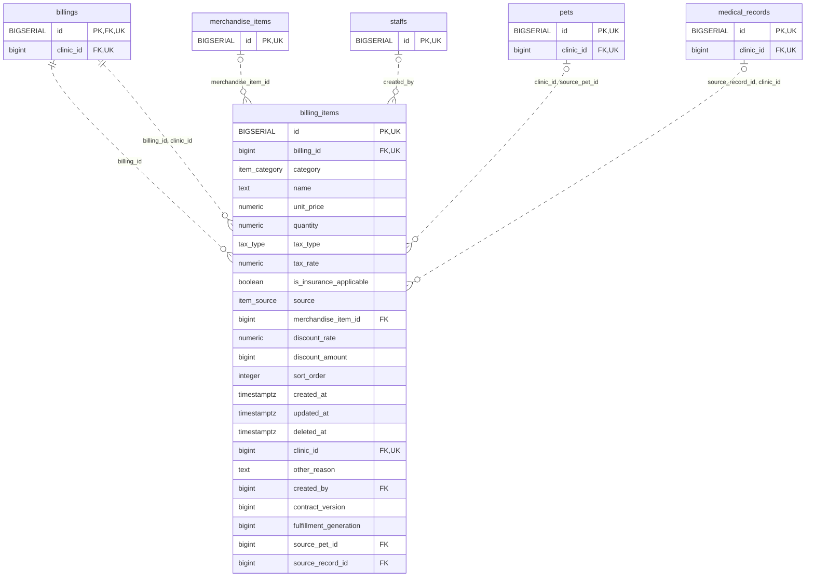

<!-- GENERATED: scripts/tools/generate-erd-detail.py; do not edit -->
# `billing_items`

[詳細ERD一覧](index.md) · [概要ERD](../erd.md)

このページは、マイグレーションをファイル名順に静的解析した最終定義です。稼働DBの状態は未確認です。

## カラム

型・DEFAULTはDDLの宣言表記です。`bigserial` は採番宣言であり、DBカタログ上の型名ではありません。

| カラム | 型（DDL） | NULL | DEFAULT（DDL） | キー構成列 | 定義元 |
|:---|:---|:---|:---|:---|:---|
| `id` | `BIGSERIAL` | NOT NULL | — | PK, UK | [001_init.sql:1934](../../../backend/migrations/001_init.sql#L1934) |
| `billing_id` | `bigint` | NOT NULL | — | FK, UK | [001_init.sql:1935](../../../backend/migrations/001_init.sql#L1935) |
| `category` | `item_category` | NOT NULL | — | — | [001_init.sql:1936](../../../backend/migrations/001_init.sql#L1936) |
| `name` | `text` | NOT NULL | `''` | — | [001_init.sql:1937](../../../backend/migrations/001_init.sql#L1937) |
| `unit_price` | `numeric` | NOT NULL | `0` | — | [001_init.sql:9396](../../../backend/migrations/001_init.sql#L9396) |
| `quantity` | `numeric` | NOT NULL | `1` | — | [001_init.sql:9397](../../../backend/migrations/001_init.sql#L9397) |
| `tax_type` | `tax_type` | NOT NULL | `'excluded'` | — | [001_init.sql:1940](../../../backend/migrations/001_init.sql#L1940) |
| `tax_rate` | `numeric` | NULL | `0.10` | — | [001_init.sql:9399](../../../backend/migrations/001_init.sql#L9399) |
| `is_insurance_applicable` | `boolean` | NULL | `false` | — | [001_init.sql:1942](../../../backend/migrations/001_init.sql#L1942) |
| `source` | `item_source` | NULL | `'manual'` | — | [001_init.sql:1943](../../../backend/migrations/001_init.sql#L1943) |
| `merchandise_item_id` | `bigint` | NULL | — | FK | [001_init.sql:1944](../../../backend/migrations/001_init.sql#L1944) |
| `discount_rate` | `numeric` | NOT NULL | `0` | — | [001_init.sql:9398](../../../backend/migrations/001_init.sql#L9398) |
| `discount_amount` | `bigint` | NOT NULL | `0` | — | [001_init.sql:1950](../../../backend/migrations/001_init.sql#L1950) |
| `sort_order` | `integer` | NULL | `0` | — | [001_init.sql:1951](../../../backend/migrations/001_init.sql#L1951) |
| `created_at` | `timestamptz` | NOT NULL | `now()` | — | [001_init.sql:1952](../../../backend/migrations/001_init.sql#L1952) |
| `updated_at` | `timestamptz` | NOT NULL | `now()` | — | [001_init.sql:1953](../../../backend/migrations/001_init.sql#L1953) |
| `deleted_at` | `timestamptz` | NULL | — | — | [001_init.sql:1954](../../../backend/migrations/001_init.sql#L1954) |
| `clinic_id` | `bigint` | NOT NULL | — | FK, UK | [001_init.sql:6197](../../../backend/migrations/001_init.sql#L6197) |
| `other_reason` | `text` | NULL | — | — | [001_init.sql:4096](../../../backend/migrations/001_init.sql#L4096) |
| `created_by` | `bigint` | NULL | — | FK | [001_init.sql:4097](../../../backend/migrations/001_init.sql#L4097) |
| `contract_version` | `bigint` | NOT NULL | `1` | — | [001_init.sql:8298](../../../backend/migrations/001_init.sql#L8298) |
| `fulfillment_generation` | `bigint` | NOT NULL | `1` | — | [001_init.sql:8299](../../../backend/migrations/001_init.sql#L8299) |
| `source_pet_id` | `bigint` | NULL | — | FK | [001_init.sql:9400](../../../backend/migrations/001_init.sql#L9400) |
| `source_record_id` | `bigint` | NULL | — | FK | [001_init.sql:9401](../../../backend/migrations/001_init.sql#L9401) |

PK/FK/UKはキーの構成列を示します。複合キーの各列が単独で一意という意味ではありません。部分uniqueは下記indexの述語を参照してください。

## ERD

このテーブルの全カラムと、すべての参照先を表示します。参照先はFKの対象列だけを表示し、全カラムは各テーブルのページに置きます。

親側の任意参照はFK列のNULL可否、子側の最大1件は無条件のPK/UNIQUEから導出します。部分uniqueによる条件付きの最大件数は図に反映せず、index一覧に記録します。実線はFK全列が子のPKに含まれる識別関係、破線はそれ以外です。

## 外部キー（全件）

| 制約 | 子の列（順序あり） | 参照先 | 親の列（順序あり） | 削除時の動作 | 定義元 |
|:---|:---|:---|:---|:---|:---|
| `billing_items_billing_id_fkey` | `billing_id` | [billings](billings.md) | `id` | `ON DELETE CASCADE` | [001_init.sql:1935](../../../backend/migrations/001_init.sql#L1935) |
| `fk_billing_items_merchandise` | `merchandise_item_id` | [merchandise_items](merchandise_items.md) | `id` | `ON DELETE SET NULL` | [001_init.sql:1944](../../../backend/migrations/001_init.sql#L1944) |
| `fk_billing_items_billing_clinic` | `billing_id, clinic_id` | [billings](billings.md) | `id, clinic_id` | `ON DELETE NO ACTION` | [001_init.sql:4069](../../../backend/migrations/001_init.sql#L4069) |
| `fk_billing_items_created_by` | `created_by` | [staffs](staffs.md) | `id` | `ON DELETE RESTRICT` | [001_init.sql:4098](../../../backend/migrations/001_init.sql#L4098) |
| `fk_billing_item_source_pet` | `clinic_id, source_pet_id` | [pets](pets.md) | `clinic_id, id` | `ON DELETE RESTRICT` | [001_init.sql:9402](../../../backend/migrations/001_init.sql#L9402) |
| `fk_billing_item_source_record` | `source_record_id, clinic_id` | [medical_records](medical_records.md) | `id, clinic_id` | `ON DELETE RESTRICT` | [001_init.sql:9403](../../../backend/migrations/001_init.sql#L9403) |

正確なON UPDATE・MATCH・DEFERRABLE等を含む制約DDL:

- `billing_items_billing_id_fkey`: `REFERENCES billings(id) ON DELETE CASCADE`
- `fk_billing_items_merchandise`: `CONSTRAINT fk_billing_items_merchandise REFERENCES merchandise_items(id) ON DELETE SET NULL`
- `fk_billing_items_billing_clinic`: `CONSTRAINT fk_billing_items_billing_clinic         FOREIGN KEY (billing_id, clinic_id)         REFERENCES billings (id, clinic_id)`
- `fk_billing_items_created_by`: `CONSTRAINT fk_billing_items_created_by         FOREIGN KEY (created_by) REFERENCES staffs(id) ON DELETE RESTRICT`
- `fk_billing_item_source_pet`: `CONSTRAINT fk_billing_item_source_pet FOREIGN KEY (clinic_id,source_pet_id) REFERENCES pets(clinic_id,id) ON DELETE RESTRICT`
- `fk_billing_item_source_record`: `CONSTRAINT fk_billing_item_source_record FOREIGN KEY (source_record_id,clinic_id) REFERENCES medical_records(id,clinic_id) ON DELETE RESTRICT`

## その他の制約

| 制約 | 種別 | DDL | 定義元 |
|:---|:---|:---|:---|
| `billing_items_pkey` | primary | `PRIMARY KEY` | [001_init.sql:1934](../../../backend/migrations/001_init.sql#L1934) |
| `chk_billing_item_quantity` | check | `CONSTRAINT chk_billing_item_quantity CHECK (quantity > 0)` | [001_init.sql:1955](../../../backend/migrations/001_init.sql#L1955) |
| `uq_billing_items_id_clinic` | unique | `CONSTRAINT uq_billing_items_id_clinic UNIQUE (id, clinic_id)` | [001_init.sql:7940](../../../backend/migrations/001_init.sql#L7940) |
| `billing_items_contract_version_check` | check | `CHECK (contract_version > 0)` | [001_init.sql:8298](../../../backend/migrations/001_init.sql#L8298) |
| `billing_items_fulfillment_generation_check` | check | `CHECK (fulfillment_generation > 0)` | [001_init.sql:8299](../../../backend/migrations/001_init.sql#L8299) |
| `uq_billing_items_id_clinic_billing` | unique | `CONSTRAINT uq_billing_items_id_clinic_billing UNIQUE (id,clinic_id,billing_id)` | [001_init.sql:8300](../../../backend/migrations/001_init.sql#L8300) |

## インデックス

| 名前 | UNIQUE | 述語 | DDL | 定義元 |
|:---|:---|:---|:---|:---|
| `idx_billing_items_merchandise_item_id` | NO | `deleted_at IS NULL` | `CREATE INDEX idx_billing_items_merchandise_item_id  ON billing_items(merchandise_item_id)  WHERE deleted_at IS NULL` | [001_init.sql:2188](../../../backend/migrations/001_init.sql#L2188) |
| `idx_billing_items_billing_id` | NO | — | `CREATE INDEX idx_billing_items_billing_id ON billing_items(billing_id)` | [001_init.sql:2327](../../../backend/migrations/001_init.sql#L2327) |
| `idx_billing_items_deleted_at` | NO | — | `CREATE INDEX idx_billing_items_deleted_at ON billing_items(deleted_at)` | [001_init.sql:2328](../../../backend/migrations/001_init.sql#L2328) |
| `idx_billing_items_created_by` | NO | `created_by IS NOT NULL` | `CREATE INDEX idx_billing_items_created_by     ON billing_items (created_by)     WHERE created_by IS NOT NULL` | [001_init.sql:4101](../../../backend/migrations/001_init.sql#L4101) |
| `idx_billing_items_clinic_id` | NO | — | `CREATE INDEX idx_billing_items_clinic_id     ON billing_items (clinic_id)` | [001_init.sql:6210](../../../backend/migrations/001_init.sql#L6210) |
