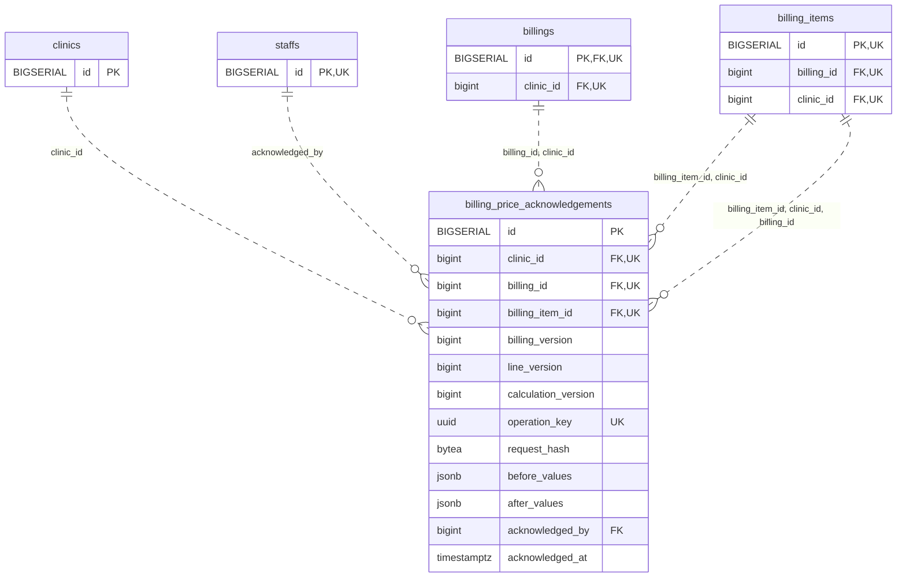

<!-- GENERATED: scripts/tools/generate-erd-detail.py; do not edit -->
# `billing_price_acknowledgements`

[詳細ERD一覧](index.md) · [概要ERD](../erd.md)

このページは、マイグレーションをファイル名順に静的解析した最終定義です。稼働DBの状態は未確認です。

## カラム

型・DEFAULTはDDLの宣言表記です。`bigserial` は採番宣言であり、DBカタログ上の型名ではありません。

| カラム | 型（DDL） | NULL | DEFAULT（DDL） | キー構成列 | 定義元 |
|:---|:---|:---|:---|:---|:---|
| `id` | `BIGSERIAL` | NOT NULL | — | PK | [001_init.sql:8242](../../../backend/migrations/001_init.sql#L8242) |
| `clinic_id` | `bigint` | NOT NULL | — | FK, UK | [001_init.sql:8243](../../../backend/migrations/001_init.sql#L8243) |
| `billing_id` | `bigint` | NOT NULL | — | FK, UK | [001_init.sql:8244](../../../backend/migrations/001_init.sql#L8244) |
| `billing_item_id` | `bigint` | NOT NULL | — | FK, UK | [001_init.sql:8245](../../../backend/migrations/001_init.sql#L8245) |
| `billing_version` | `bigint` | NOT NULL | — | — | [001_init.sql:8246](../../../backend/migrations/001_init.sql#L8246) |
| `line_version` | `bigint` | NOT NULL | — | — | [001_init.sql:8247](../../../backend/migrations/001_init.sql#L8247) |
| `calculation_version` | `bigint` | NOT NULL | — | — | [001_init.sql:8248](../../../backend/migrations/001_init.sql#L8248) |
| `operation_key` | `uuid` | NOT NULL | — | UK | [001_init.sql:8249](../../../backend/migrations/001_init.sql#L8249) |
| `request_hash` | `bytea` | NOT NULL | — | — | [001_init.sql:8250](../../../backend/migrations/001_init.sql#L8250) |
| `before_values` | `jsonb` | NOT NULL | — | — | [001_init.sql:8251](../../../backend/migrations/001_init.sql#L8251) |
| `after_values` | `jsonb` | NOT NULL | — | — | [001_init.sql:8252](../../../backend/migrations/001_init.sql#L8252) |
| `acknowledged_by` | `bigint` | NOT NULL | — | FK | [001_init.sql:8253](../../../backend/migrations/001_init.sql#L8253) |
| `acknowledged_at` | `timestamptz` | NOT NULL | `clock_timestamp()` | — | [001_init.sql:8254](../../../backend/migrations/001_init.sql#L8254) |

PK/FK/UKはキーの構成列を示します。複合キーの各列が単独で一意という意味ではありません。部分uniqueは下記indexの述語を参照してください。

## ERD

このテーブルの全カラムと、すべての参照先を表示します。参照先はFKの対象列だけを表示し、全カラムは各テーブルのページに置きます。

親側の任意参照はFK列のNULL可否、子側の最大1件は無条件のPK/UNIQUEから導出します。部分uniqueによる条件付きの最大件数は図に反映せず、index一覧に記録します。実線はFK全列が子のPKに含まれる識別関係、破線はそれ以外です。

## 外部キー（全件）

| 制約 | 子の列（順序あり） | 参照先 | 親の列（順序あり） | 削除時の動作 | 定義元 |
|:---|:---|:---|:---|:---|:---|
| `billing_price_acknowledgements_clinic_id_fkey` | `clinic_id` | [clinics](clinics.md) | `id` | `ON DELETE RESTRICT` | [001_init.sql:8243](../../../backend/migrations/001_init.sql#L8243) |
| `billing_price_acknowledgements_acknowledged_by_fkey` | `acknowledged_by` | [staffs](staffs.md) | `id` | `ON DELETE RESTRICT` | [001_init.sql:8253](../../../backend/migrations/001_init.sql#L8253) |
| `billing_price_acknowledgements_billing_id_clinic_id_fkey` | `billing_id, clinic_id` | [billings](billings.md) | `id, clinic_id` | `ON DELETE RESTRICT` | [001_init.sql:8256](../../../backend/migrations/001_init.sql#L8256) |
| `billing_price_acknowledgements_billing_item_id_clinic_id_fkey` | `billing_item_id, clinic_id` | [billing_items](billing_items.md) | `id, clinic_id` | `ON DELETE RESTRICT` | [001_init.sql:8257](../../../backend/migrations/001_init.sql#L8257) |
| `fk_price_ack_line_billing` | `billing_item_id, clinic_id, billing_id` | [billing_items](billing_items.md) | `id, clinic_id, billing_id` | `ON DELETE RESTRICT` | [001_init.sql:8303](../../../backend/migrations/001_init.sql#L8303) |

正確なON UPDATE・MATCH・DEFERRABLE等を含む制約DDL:

- `billing_price_acknowledgements_clinic_id_fkey`: `REFERENCES clinics(id) ON DELETE RESTRICT`
- `billing_price_acknowledgements_acknowledged_by_fkey`: `REFERENCES staffs(id) ON DELETE RESTRICT`
- `billing_price_acknowledgements_billing_id_clinic_id_fkey`: `FOREIGN KEY (billing_id,clinic_id) REFERENCES billings(id,clinic_id) ON DELETE RESTRICT`
- `billing_price_acknowledgements_billing_item_id_clinic_id_fkey`: `FOREIGN KEY (billing_item_id,clinic_id) REFERENCES billing_items(id,clinic_id) ON DELETE RESTRICT`
- `fk_price_ack_line_billing`: `CONSTRAINT fk_price_ack_line_billing  FOREIGN KEY (billing_item_id,clinic_id,billing_id) REFERENCES billing_items(id,clinic_id,billing_id) ON DELETE RESTRICT`

## その他の制約

| 制約 | 種別 | DDL | 定義元 |
|:---|:---|:---|:---|
| `billing_price_acknowledgements_pkey` | primary | `PRIMARY KEY` | [001_init.sql:8242](../../../backend/migrations/001_init.sql#L8242) |
| `billing_price_acknowledgements_billing_version_check` | check | `CHECK (billing_version > 0)` | [001_init.sql:8246](../../../backend/migrations/001_init.sql#L8246) |
| `billing_price_acknowledgements_line_version_check` | check | `CHECK (line_version > 0)` | [001_init.sql:8247](../../../backend/migrations/001_init.sql#L8247) |
| `billing_price_acknowledgements_calculation_version_check` | check | `CHECK (calculation_version > 0)` | [001_init.sql:8248](../../../backend/migrations/001_init.sql#L8248) |
| `billing_price_acknowledgements_request_hash_check` | check | `CHECK (octet_length(request_hash)=32)` | [001_init.sql:8250](../../../backend/migrations/001_init.sql#L8250) |
| `billing_price_acknowledgements_before_values_check` | check | `CHECK (jsonb_typeof(before_values)='object')` | [001_init.sql:8251](../../../backend/migrations/001_init.sql#L8251) |
| `billing_price_acknowledgements_after_values_check` | check | `CHECK (jsonb_typeof(after_values)='object')` | [001_init.sql:8252](../../../backend/migrations/001_init.sql#L8252) |
| `billing_price_acknowledgement_clinic_id_billing_id_operatio_key` | unique | `UNIQUE (clinic_id,billing_id,operation_key,billing_item_id)` | [001_init.sql:8255](../../../backend/migrations/001_init.sql#L8255) |

## インデックス

明示的なCREATE INDEXなし。PK/UNIQUEに付随する暗黙のindexは制約欄を参照してください。
