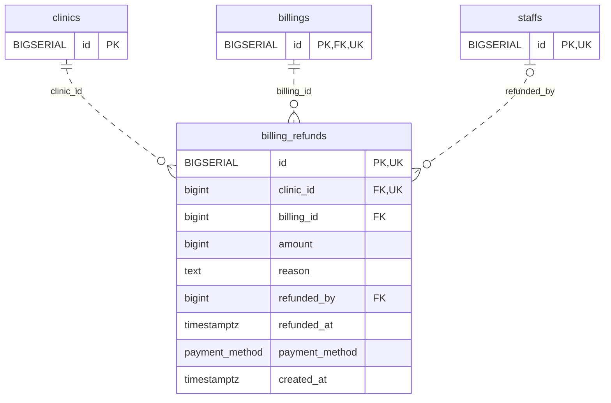

<!-- GENERATED: scripts/tools/generate-erd-detail.py; do not edit -->
# `billing_refunds`

[詳細ERD一覧](index.md) · [概要ERD](../erd.md)

このページは、マイグレーションをファイル名順に静的解析した最終定義です。稼働DBの状態は未確認です。

## カラム

型・DEFAULTはDDLの宣言表記です。`bigserial` は採番宣言であり、DBカタログ上の型名ではありません。

| カラム | 型（DDL） | NULL | DEFAULT（DDL） | キー構成列 | 定義元 |
|:---|:---|:---|:---|:---|:---|
| `id` | `BIGSERIAL` | NOT NULL | — | PK, UK | [001_init.sql:2020](../../../backend/migrations/001_init.sql#L2020) |
| `clinic_id` | `bigint` | NOT NULL | — | FK, UK | [001_init.sql:2021](../../../backend/migrations/001_init.sql#L2021) |
| `billing_id` | `bigint` | NOT NULL | — | FK | [001_init.sql:2022](../../../backend/migrations/001_init.sql#L2022) |
| `amount` | `bigint` | NOT NULL | — | — | [001_init.sql:2023](../../../backend/migrations/001_init.sql#L2023) |
| `reason` | `text` | NOT NULL | `''` | — | [001_init.sql:2024](../../../backend/migrations/001_init.sql#L2024) |
| `refunded_by` | `bigint` | NULL | — | FK | [001_init.sql:2025](../../../backend/migrations/001_init.sql#L2025) |
| `refunded_at` | `timestamptz` | NOT NULL | `now()` | — | [001_init.sql:2026](../../../backend/migrations/001_init.sql#L2026) |
| `payment_method` | `payment_method` | NULL | — | — | [001_init.sql:2027](../../../backend/migrations/001_init.sql#L2027) |
| `created_at` | `timestamptz` | NOT NULL | `now()` | — | [001_init.sql:2028](../../../backend/migrations/001_init.sql#L2028) |

PK/FK/UKはキーの構成列を示します。複合キーの各列が単独で一意という意味ではありません。部分uniqueは下記indexの述語を参照してください。

## ERD

このテーブルの全カラムと、すべての参照先を表示します。参照先はFKの対象列だけを表示し、全カラムは各テーブルのページに置きます。

親側の任意参照はFK列のNULL可否、子側の最大1件は無条件のPK/UNIQUEから導出します。部分uniqueによる条件付きの最大件数は図に反映せず、index一覧に記録します。実線はFK全列が子のPKに含まれる識別関係、破線はそれ以外です。

## 外部キー（全件）

| 制約 | 子の列（順序あり） | 参照先 | 親の列（順序あり） | 削除時の動作 | 定義元 |
|:---|:---|:---|:---|:---|:---|
| `billing_refunds_clinic_id_fkey` | `clinic_id` | [clinics](clinics.md) | `id` | `ON DELETE RESTRICT` | [001_init.sql:2021](../../../backend/migrations/001_init.sql#L2021) |
| `billing_refunds_billing_id_fkey` | `billing_id` | [billings](billings.md) | `id` | `ON DELETE RESTRICT` | [001_init.sql:2022](../../../backend/migrations/001_init.sql#L2022) |
| `billing_refunds_refunded_by_fkey` | `refunded_by` | [staffs](staffs.md) | `id` | `ON DELETE NO ACTION` | [001_init.sql:2025](../../../backend/migrations/001_init.sql#L2025) |

正確なON UPDATE・MATCH・DEFERRABLE等を含む制約DDL:

- `billing_refunds_clinic_id_fkey`: `REFERENCES clinics(id) ON DELETE RESTRICT`
- `billing_refunds_billing_id_fkey`: `REFERENCES billings(id) ON DELETE RESTRICT`
- `billing_refunds_refunded_by_fkey`: `REFERENCES staffs(id)`

## その他の制約

| 制約 | 種別 | DDL | 定義元 |
|:---|:---|:---|:---|
| `billing_refunds_pkey` | primary | `PRIMARY KEY` | [001_init.sql:2020](../../../backend/migrations/001_init.sql#L2020) |
| `billing_refunds_amount_check` | check | `CHECK (amount > 0)` | [001_init.sql:2023](../../../backend/migrations/001_init.sql#L2023) |
| `uq_billing_refunds_id_clinic` | unique | `CONSTRAINT uq_billing_refunds_id_clinic UNIQUE(id,clinic_id)` | [001_init.sql:9577](../../../backend/migrations/001_init.sql#L9577) |

## インデックス

| 名前 | UNIQUE | 述語 | DDL | 定義元 |
|:---|:---|:---|:---|:---|
| `idx_billing_refunds_billing` | NO | — | `CREATE INDEX idx_billing_refunds_billing ON billing_refunds(billing_id)` | [001_init.sql:2320](../../../backend/migrations/001_init.sql#L2320) |
| `idx_billing_refunds_clinic_billing` | NO | — | `CREATE INDEX idx_billing_refunds_clinic_billing ON billing_refunds(clinic_id, billing_id)` | [001_init.sql:2321](../../../backend/migrations/001_init.sql#L2321) |
| `idx_billing_refunds_staff` | NO | — | `CREATE INDEX idx_billing_refunds_staff ON billing_refunds(refunded_by)` | [001_init.sql:2323](../../../backend/migrations/001_init.sql#L2323) |
