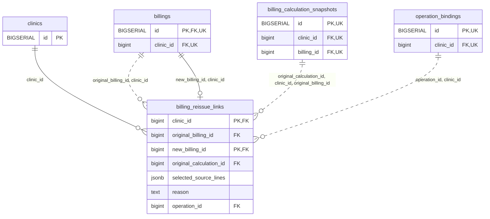

<!-- GENERATED: scripts/tools/generate-erd-detail.py; do not edit -->
# `billing_reissue_links`

[詳細ERD一覧](index.md) · [概要ERD](../erd.md)

このページは、マイグレーションをファイル名順に静的解析した最終定義です。稼働DBの状態は未確認です。

## カラム

型・DEFAULTはDDLの宣言表記です。`bigserial` は採番宣言であり、DBカタログ上の型名ではありません。

| カラム | 型（DDL） | NULL | DEFAULT（DDL） | キー構成列 | 定義元 |
|:---|:---|:---|:---|:---|:---|
| `clinic_id` | `bigint` | NOT NULL | — | PK, FK | [001_init.sql:9477](../../../backend/migrations/001_init.sql#L9477) |
| `original_billing_id` | `bigint` | NOT NULL | — | FK | [001_init.sql:9478](../../../backend/migrations/001_init.sql#L9478) |
| `new_billing_id` | `bigint` | NOT NULL | — | PK, FK | [001_init.sql:9479](../../../backend/migrations/001_init.sql#L9479) |
| `original_calculation_id` | `bigint` | NOT NULL | — | FK | [001_init.sql:9480](../../../backend/migrations/001_init.sql#L9480) |
| `selected_source_lines` | `jsonb` | NOT NULL | — | — | [001_init.sql:9481](../../../backend/migrations/001_init.sql#L9481) |
| `reason` | `text` | NOT NULL | — | — | [001_init.sql:9482](../../../backend/migrations/001_init.sql#L9482) |
| `operation_id` | `bigint` | NOT NULL | — | FK | [001_init.sql:9483](../../../backend/migrations/001_init.sql#L9483) |

PK/FK/UKはキーの構成列を示します。複合キーの各列が単独で一意という意味ではありません。部分uniqueは下記indexの述語を参照してください。

## ERD

このテーブルの全カラムと、すべての参照先を表示します。参照先はFKの対象列だけを表示し、全カラムは各テーブルのページに置きます。

親側の任意参照はFK列のNULL可否、子側の最大1件は無条件のPK/UNIQUEから導出します。部分uniqueによる条件付きの最大件数は図に反映せず、index一覧に記録します。実線はFK全列が子のPKに含まれる識別関係、破線はそれ以外です。

## 外部キー（全件）

| 制約 | 子の列（順序あり） | 参照先 | 親の列（順序あり） | 削除時の動作 | 定義元 |
|:---|:---|:---|:---|:---|:---|
| `billing_reissue_links_clinic_id_fkey` | `clinic_id` | [clinics](clinics.md) | `id` | `ON DELETE RESTRICT` | [001_init.sql:9477](../../../backend/migrations/001_init.sql#L9477) |
| `billing_reissue_links_original_billing_id_clinic_id_fkey` | `original_billing_id, clinic_id` | [billings](billings.md) | `id, clinic_id` | `ON DELETE RESTRICT` | [001_init.sql:9486](../../../backend/migrations/001_init.sql#L9486) |
| `billing_reissue_links_new_billing_id_clinic_id_fkey` | `new_billing_id, clinic_id` | [billings](billings.md) | `id, clinic_id` | `ON DELETE RESTRICT` | [001_init.sql:9487](../../../backend/migrations/001_init.sql#L9487) |
| `billing_reissue_links_original_calculation_id_clinic_id_or_fkey` | `original_calculation_id, clinic_id, original_billing_id` | [billing_calculation_snapshots](billing_calculation_snapshots.md) | `id, clinic_id, billing_id` | `ON DELETE RESTRICT` | [001_init.sql:9488](../../../backend/migrations/001_init.sql#L9488) |
| `billing_reissue_links_operation_id_clinic_id_fkey` | `operation_id, clinic_id` | [operation_bindings](operation_bindings.md) | `id, clinic_id` | `ON DELETE RESTRICT` | [001_init.sql:9489](../../../backend/migrations/001_init.sql#L9489) |

正確なON UPDATE・MATCH・DEFERRABLE等を含む制約DDL:

- `billing_reissue_links_clinic_id_fkey`: `REFERENCES clinics(id) ON DELETE RESTRICT`
- `billing_reissue_links_original_billing_id_clinic_id_fkey`: `FOREIGN KEY (original_billing_id,clinic_id) REFERENCES billings(id,clinic_id) ON DELETE RESTRICT`
- `billing_reissue_links_new_billing_id_clinic_id_fkey`: `FOREIGN KEY (new_billing_id,clinic_id) REFERENCES billings(id,clinic_id) ON DELETE RESTRICT`
- `billing_reissue_links_original_calculation_id_clinic_id_or_fkey`: `FOREIGN KEY (original_calculation_id,clinic_id,original_billing_id) REFERENCES billing_calculation_snapshots(id,clinic_id,billing_id) ON DELETE RESTRICT`
- `billing_reissue_links_operation_id_clinic_id_fkey`: `FOREIGN KEY (operation_id,clinic_id) REFERENCES operation_bindings(id,clinic_id) ON DELETE RESTRICT`

## その他の制約

| 制約 | 種別 | DDL | 定義元 |
|:---|:---|:---|:---|
| `billing_reissue_links_selected_source_lines_check` | check | `CHECK (jsonb_typeof(selected_source_lines)='array')` | [001_init.sql:9481](../../../backend/migrations/001_init.sql#L9481) |
| `billing_reissue_links_reason_check` | check | `CHECK (btrim(reason)<>'')` | [001_init.sql:9482](../../../backend/migrations/001_init.sql#L9482) |
| `billing_reissue_links_pkey` | primary | `PRIMARY KEY (clinic_id,new_billing_id)` | [001_init.sql:9484](../../../backend/migrations/001_init.sql#L9484) |
| `billing_reissue_links_check` | check | `CHECK (original_billing_id<>new_billing_id)` | [001_init.sql:9485](../../../backend/migrations/001_init.sql#L9485) |

## インデックス

明示的なCREATE INDEXなし。PK/UNIQUEに付随する暗黙のindexは制約欄を参照してください。
