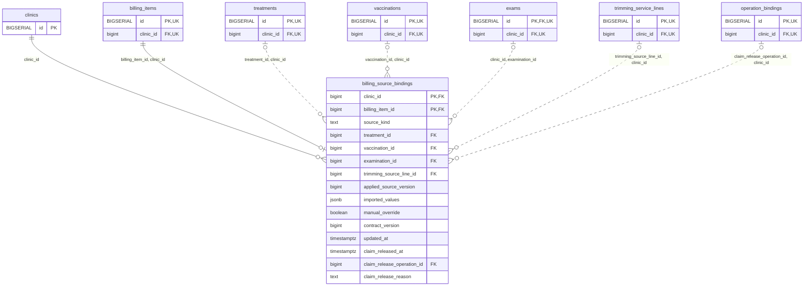

<!-- GENERATED: scripts/tools/generate-erd-detail.py; do not edit -->
# `billing_source_bindings`

[詳細ERD一覧](index.md) · [概要ERD](../erd.md)

このページは、マイグレーションをファイル名順に静的解析した最終定義です。稼働DBの状態は未確認です。

## カラム

型・DEFAULTはDDLの宣言表記です。`bigserial` は採番宣言であり、DBカタログ上の型名ではありません。

| カラム | 型（DDL） | NULL | DEFAULT（DDL） | キー構成列 | 定義元 |
|:---|:---|:---|:---|:---|:---|
| `clinic_id` | `bigint` | NOT NULL | — | PK, FK | [001_init.sql:8182](../../../backend/migrations/001_init.sql#L8182) |
| `billing_item_id` | `bigint` | NOT NULL | — | PK, FK | [001_init.sql:8183](../../../backend/migrations/001_init.sql#L8183) |
| `source_kind` | `text` | NOT NULL | — | — | [001_init.sql:8184](../../../backend/migrations/001_init.sql#L8184) |
| `treatment_id` | `bigint` | NULL | — | FK | [001_init.sql:8185](../../../backend/migrations/001_init.sql#L8185) |
| `vaccination_id` | `bigint` | NULL | — | FK | [001_init.sql:8186](../../../backend/migrations/001_init.sql#L8186) |
| `examination_id` | `bigint` | NULL | — | FK | [001_init.sql:8187](../../../backend/migrations/001_init.sql#L8187) |
| `trimming_source_line_id` | `bigint` | NULL | — | FK | [001_init.sql:8188](../../../backend/migrations/001_init.sql#L8188) |
| `applied_source_version` | `bigint` | NOT NULL | — | — | [001_init.sql:8189](../../../backend/migrations/001_init.sql#L8189) |
| `imported_values` | `jsonb` | NOT NULL | — | — | [001_init.sql:8190](../../../backend/migrations/001_init.sql#L8190) |
| `manual_override` | `boolean` | NULL | — | — | [001_init.sql:8191](../../../backend/migrations/001_init.sql#L8191) |
| `contract_version` | `bigint` | NOT NULL | `1` | — | [001_init.sql:8192](../../../backend/migrations/001_init.sql#L8192) |
| `updated_at` | `timestamptz` | NOT NULL | `clock_timestamp()` | — | [001_init.sql:8193](../../../backend/migrations/001_init.sql#L8193) |
| `claim_released_at` | `timestamptz` | NULL | — | — | [001_init.sql:9481](../../../backend/migrations/001_init.sql#L9481) |
| `claim_release_operation_id` | `bigint` | NULL | — | FK | [001_init.sql:9482](../../../backend/migrations/001_init.sql#L9482) |
| `claim_release_reason` | `text` | NULL | — | — | [001_init.sql:9483](../../../backend/migrations/001_init.sql#L9483) |

PK/FK/UKはキーの構成列を示します。複合キーの各列が単独で一意という意味ではありません。部分uniqueは下記indexの述語を参照してください。

## ERD

このテーブルの全カラムと、すべての参照先を表示します。参照先はFKの対象列だけを表示し、全カラムは各テーブルのページに置きます。

親側の任意参照はFK列のNULL可否、子側の最大1件は無条件のPK/UNIQUEから導出します。部分uniqueによる条件付きの最大件数は図に反映せず、index一覧に記録します。実線はFK全列が子のPKに含まれる識別関係、破線はそれ以外です。

## 外部キー（全件）

| 制約 | 子の列（順序あり） | 参照先 | 親の列（順序あり） | 削除時の動作 | 定義元 |
|:---|:---|:---|:---|:---|:---|
| `billing_source_bindings_clinic_id_fkey` | `clinic_id` | [clinics](clinics.md) | `id` | `ON DELETE RESTRICT` | [001_init.sql:8182](../../../backend/migrations/001_init.sql#L8182) |
| `billing_source_bindings_billing_item_id_clinic_id_fkey` | `billing_item_id, clinic_id` | [billing_items](billing_items.md) | `id, clinic_id` | `ON DELETE RESTRICT` | [001_init.sql:8199](../../../backend/migrations/001_init.sql#L8199) |
| `billing_source_bindings_treatment_id_clinic_id_fkey` | `treatment_id, clinic_id` | [treatments](treatments.md) | `id, clinic_id` | `ON DELETE RESTRICT` | [001_init.sql:8200](../../../backend/migrations/001_init.sql#L8200) |
| `billing_source_bindings_vaccination_id_clinic_id_fkey` | `vaccination_id, clinic_id` | [vaccinations](vaccinations.md) | `id, clinic_id` | `ON DELETE RESTRICT` | [001_init.sql:8201](../../../backend/migrations/001_init.sql#L8201) |
| `billing_source_bindings_clinic_id_examination_id_fkey` | `clinic_id, examination_id` | [exams](exams.md) | `clinic_id, id` | `ON DELETE RESTRICT` | [001_init.sql:8202](../../../backend/migrations/001_init.sql#L8202) |
| `billing_source_bindings_trimming_source_line_id_clinic_id_fkey` | `trimming_source_line_id, clinic_id` | [trimming_service_lines](trimming_service_lines.md) | `id, clinic_id` | `ON DELETE RESTRICT` | [001_init.sql:8203](../../../backend/migrations/001_init.sql#L8203) |
| `fk_billing_claim_release_operation` | `claim_release_operation_id, clinic_id` | [operation_bindings](operation_bindings.md) | `id, clinic_id` | `ON DELETE RESTRICT` | [001_init.sql:9487](../../../backend/migrations/001_init.sql#L9487) |

正確なON UPDATE・MATCH・DEFERRABLE等を含む制約DDL:

- `billing_source_bindings_clinic_id_fkey`: `REFERENCES clinics(id) ON DELETE RESTRICT`
- `billing_source_bindings_billing_item_id_clinic_id_fkey`: `FOREIGN KEY (billing_item_id,clinic_id) REFERENCES billing_items(id,clinic_id) ON DELETE RESTRICT`
- `billing_source_bindings_treatment_id_clinic_id_fkey`: `FOREIGN KEY (treatment_id,clinic_id) REFERENCES treatments(id,clinic_id) ON DELETE RESTRICT`
- `billing_source_bindings_vaccination_id_clinic_id_fkey`: `FOREIGN KEY (vaccination_id,clinic_id) REFERENCES vaccinations(id,clinic_id) ON DELETE RESTRICT`
- `billing_source_bindings_clinic_id_examination_id_fkey`: `FOREIGN KEY (clinic_id,examination_id) REFERENCES exams(clinic_id,id) ON DELETE RESTRICT`
- `billing_source_bindings_trimming_source_line_id_clinic_id_fkey`: `FOREIGN KEY (trimming_source_line_id,clinic_id) REFERENCES trimming_service_lines(id,clinic_id) ON DELETE RESTRICT`
- `fk_billing_claim_release_operation`: `CONSTRAINT fk_billing_claim_release_operation FOREIGN KEY (claim_release_operation_id,clinic_id) REFERENCES operation_bindings(id,clinic_id) ON DELETE RESTRICT`

## その他の制約

| 制約 | 種別 | DDL | 定義元 |
|:---|:---|:---|:---|
| `billing_source_bindings_source_kind_check` | check | `CHECK (source_kind IN ('treatment','vaccination','examination','trimming'))` | [001_init.sql:8184](../../../backend/migrations/001_init.sql#L8184) |
| `billing_source_bindings_applied_source_version_check` | check | `CHECK (applied_source_version > 0)` | [001_init.sql:8189](../../../backend/migrations/001_init.sql#L8189) |
| `billing_source_bindings_imported_values_check` | check | `CHECK (jsonb_typeof(imported_values)='object')` | [001_init.sql:8190](../../../backend/migrations/001_init.sql#L8190) |
| `billing_source_bindings_contract_version_check` | check | `CHECK (contract_version > 0)` | [001_init.sql:8192](../../../backend/migrations/001_init.sql#L8192) |
| `billing_source_bindings_pkey` | primary | `PRIMARY KEY (clinic_id,billing_item_id)` | [001_init.sql:8194](../../../backend/migrations/001_init.sql#L8194) |
| `billing_source_bindings_check` | check | `CHECK ((source_kind='treatment' AND treatment_id IS NOT NULL AND num_nonnulls(vaccination_id,examination_id,trimming_source_line_id)=0)         OR (source_kind='vaccination' AND vaccination_id IS NOT NULL AND num_nonnulls(treatment_id,examination_id,trimming_source_line_id)=0)         OR (source_kind='examination' AND examination_id IS NOT NULL AND num_nonnulls(treatment_id,vaccination_id,trimming_source_line_id)=0)         OR (source_kind='trimming' AND trimming_source_line_id IS NOT NULL AND num_nonnulls(treatment_id,vaccination_id,examination_id)=0))` | [001_init.sql:8195](../../../backend/migrations/001_init.sql#L8195) |
| `ck_billing_source_claim_release` | check | `CONSTRAINT ck_billing_source_claim_release CHECK (       (claim_released_at IS NULL AND claim_release_operation_id IS NULL AND claim_release_reason IS NULL)       OR (claim_released_at IS NOT NULL AND claim_release_operation_id IS NOT NULL AND claim_release_reason IS NOT NULL AND btrim(claim_release_reason)<>''))` | [001_init.sql:9484](../../../backend/migrations/001_init.sql#L9484) |

## インデックス

| 名前 | UNIQUE | 述語 | DDL | 定義元 |
|:---|:---|:---|:---|:---|
| `uq_active_billing_treatment_source` | YES | `treatment_id IS NOT NULL AND claim_released_at IS NULL` | `CREATE UNIQUE INDEX uq_active_billing_treatment_source ON billing_source_bindings(clinic_id,treatment_id) WHERE treatment_id IS NOT NULL AND claim_released_at IS NULL` | [001_init.sql:9488](../../../backend/migrations/001_init.sql#L9488) |
| `uq_active_billing_vaccination_source` | YES | `vaccination_id IS NOT NULL AND claim_released_at IS NULL` | `CREATE UNIQUE INDEX uq_active_billing_vaccination_source ON billing_source_bindings(clinic_id,vaccination_id) WHERE vaccination_id IS NOT NULL AND claim_released_at IS NULL` | [001_init.sql:9489](../../../backend/migrations/001_init.sql#L9489) |
| `uq_active_billing_exam_source` | YES | `examination_id IS NOT NULL AND claim_released_at IS NULL` | `CREATE UNIQUE INDEX uq_active_billing_exam_source ON billing_source_bindings(clinic_id,examination_id) WHERE examination_id IS NOT NULL AND claim_released_at IS NULL` | [001_init.sql:9490](../../../backend/migrations/001_init.sql#L9490) |
| `uq_active_billing_trimming_source` | YES | `trimming_source_line_id IS NOT NULL AND claim_released_at IS NULL` | `CREATE UNIQUE INDEX uq_active_billing_trimming_source ON billing_source_bindings(clinic_id,trimming_source_line_id) WHERE trimming_source_line_id IS NOT NULL AND claim_released_at IS NULL` | [001_init.sql:9491](../../../backend/migrations/001_init.sql#L9491) |
