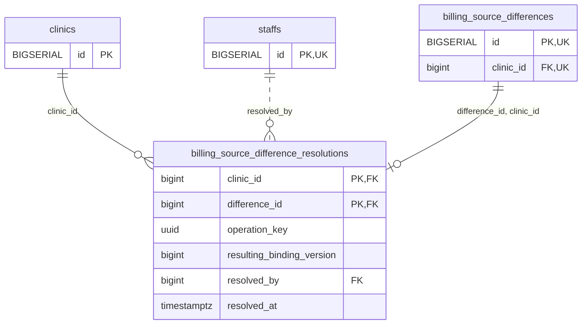

<!-- GENERATED: scripts/tools/generate-erd-detail.py; do not edit -->
# `billing_source_difference_resolutions`

[詳細ERD一覧](index.md) · [概要ERD](../erd.md)

このページは、マイグレーションをファイル名順に静的解析した最終定義です。稼働DBの状態は未確認です。

## カラム

型・DEFAULTはDDLの宣言表記です。`bigserial` は採番宣言であり、DBカタログ上の型名ではありません。

| カラム | 型（DDL） | NULL | DEFAULT（DDL） | キー構成列 | 定義元 |
|:---|:---|:---|:---|:---|:---|
| `clinic_id` | `bigint` | NOT NULL | — | PK, FK | [001_init.sql:8287](../../../backend/migrations/001_init.sql#L8287) |
| `difference_id` | `bigint` | NOT NULL | — | PK, FK | [001_init.sql:8288](../../../backend/migrations/001_init.sql#L8288) |
| `operation_key` | `uuid` | NOT NULL | — | — | [001_init.sql:8289](../../../backend/migrations/001_init.sql#L8289) |
| `resulting_binding_version` | `bigint` | NOT NULL | — | — | [001_init.sql:8290](../../../backend/migrations/001_init.sql#L8290) |
| `resolved_by` | `bigint` | NOT NULL | — | FK | [001_init.sql:8291](../../../backend/migrations/001_init.sql#L8291) |
| `resolved_at` | `timestamptz` | NOT NULL | `clock_timestamp()` | — | [001_init.sql:8292](../../../backend/migrations/001_init.sql#L8292) |

PK/FK/UKはキーの構成列を示します。複合キーの各列が単独で一意という意味ではありません。部分uniqueは下記indexの述語を参照してください。

## ERD

このテーブルの全カラムと、すべての参照先を表示します。参照先はFKの対象列だけを表示し、全カラムは各テーブルのページに置きます。

親側の任意参照はFK列のNULL可否、子側の最大1件は無条件のPK/UNIQUEから導出します。部分uniqueによる条件付きの最大件数は図に反映せず、index一覧に記録します。実線はFK全列が子のPKに含まれる識別関係、破線はそれ以外です。

## 外部キー（全件）

| 制約 | 子の列（順序あり） | 参照先 | 親の列（順序あり） | 削除時の動作 | 定義元 |
|:---|:---|:---|:---|:---|:---|
| `billing_source_difference_resolutions_clinic_id_fkey` | `clinic_id` | [clinics](clinics.md) | `id` | `ON DELETE RESTRICT` | [001_init.sql:8287](../../../backend/migrations/001_init.sql#L8287) |
| `billing_source_difference_resolutions_resolved_by_fkey` | `resolved_by` | [staffs](staffs.md) | `id` | `ON DELETE RESTRICT` | [001_init.sql:8291](../../../backend/migrations/001_init.sql#L8291) |
| `billing_source_difference_resoluti_difference_id_clinic_id_fkey` | `difference_id, clinic_id` | [billing_source_differences](billing_source_differences.md) | `id, clinic_id` | `ON DELETE RESTRICT` | [001_init.sql:8294](../../../backend/migrations/001_init.sql#L8294) |

正確なON UPDATE・MATCH・DEFERRABLE等を含む制約DDL:

- `billing_source_difference_resolutions_clinic_id_fkey`: `REFERENCES clinics(id) ON DELETE RESTRICT`
- `billing_source_difference_resolutions_resolved_by_fkey`: `REFERENCES staffs(id) ON DELETE RESTRICT`
- `billing_source_difference_resoluti_difference_id_clinic_id_fkey`: `FOREIGN KEY (difference_id,clinic_id) REFERENCES billing_source_differences(id,clinic_id) ON DELETE RESTRICT`

## その他の制約

| 制約 | 種別 | DDL | 定義元 |
|:---|:---|:---|:---|
| `billing_source_difference_resol_resulting_binding_version_check` | check | `CHECK (resulting_binding_version > 0)` | [001_init.sql:8290](../../../backend/migrations/001_init.sql#L8290) |
| `billing_source_difference_resolutions_pkey` | primary | `PRIMARY KEY (clinic_id,difference_id)` | [001_init.sql:8293](../../../backend/migrations/001_init.sql#L8293) |

## インデックス

明示的なCREATE INDEXなし。PK/UNIQUEに付随する暗黙のindexは制約欄を参照してください。
