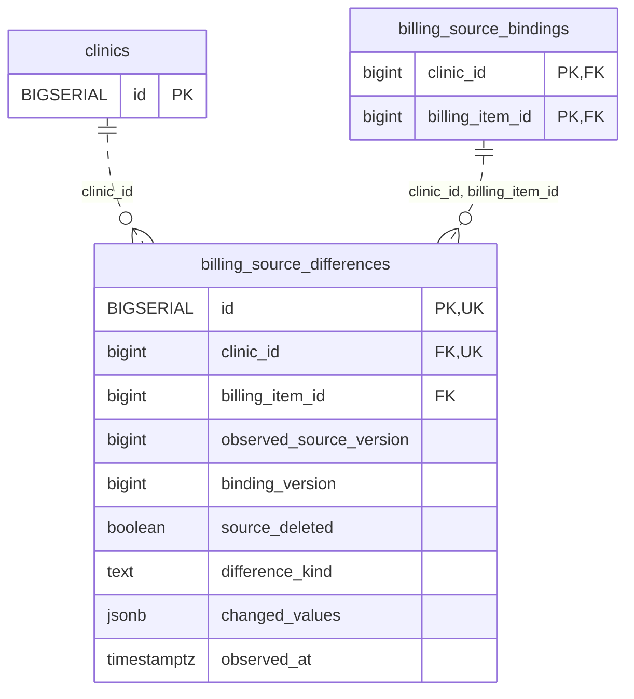

<!-- GENERATED: scripts/tools/generate-erd-detail.py; do not edit -->
# `billing_source_differences`

[詳細ERD一覧](index.md) · [概要ERD](../erd.md)

このページは、マイグレーションをファイル名順に静的解析した最終定義です。稼働DBの状態は未確認です。

## カラム

型・DEFAULTはDDLの宣言表記です。`bigserial` は採番宣言であり、DBカタログ上の型名ではありません。

| カラム | 型（DDL） | NULL | DEFAULT（DDL） | キー構成列 | 定義元 |
|:---|:---|:---|:---|:---|:---|
| `id` | `BIGSERIAL` | NOT NULL | — | PK, UK | [001_init.sql:8225](../../../backend/migrations/001_init.sql#L8225) |
| `clinic_id` | `bigint` | NOT NULL | — | FK, UK | [001_init.sql:8226](../../../backend/migrations/001_init.sql#L8226) |
| `billing_item_id` | `bigint` | NOT NULL | — | FK | [001_init.sql:8227](../../../backend/migrations/001_init.sql#L8227) |
| `observed_source_version` | `bigint` | NOT NULL | — | — | [001_init.sql:8228](../../../backend/migrations/001_init.sql#L8228) |
| `binding_version` | `bigint` | NOT NULL | — | — | [001_init.sql:8229](../../../backend/migrations/001_init.sql#L8229) |
| `source_deleted` | `boolean` | NOT NULL | — | — | [001_init.sql:8230](../../../backend/migrations/001_init.sql#L8230) |
| `difference_kind` | `text` | NOT NULL | — | — | [001_init.sql:8231](../../../backend/migrations/001_init.sql#L8231) |
| `changed_values` | `jsonb` | NOT NULL | — | — | [001_init.sql:8232](../../../backend/migrations/001_init.sql#L8232) |
| `observed_at` | `timestamptz` | NOT NULL | `clock_timestamp()` | — | [001_init.sql:8233](../../../backend/migrations/001_init.sql#L8233) |

PK/FK/UKはキーの構成列を示します。複合キーの各列が単独で一意という意味ではありません。部分uniqueは下記indexの述語を参照してください。

## ERD

このテーブルの全カラムと、すべての参照先を表示します。参照先はFKの対象列だけを表示し、全カラムは各テーブルのページに置きます。

親側の任意参照はFK列のNULL可否、子側の最大1件は無条件のPK/UNIQUEから導出します。部分uniqueによる条件付きの最大件数は図に反映せず、index一覧に記録します。実線はFK全列が子のPKに含まれる識別関係、破線はそれ以外です。

## 外部キー（全件）

| 制約 | 子の列（順序あり） | 参照先 | 親の列（順序あり） | 削除時の動作 | 定義元 |
|:---|:---|:---|:---|:---|:---|
| `billing_source_differences_clinic_id_fkey` | `clinic_id` | [clinics](clinics.md) | `id` | `ON DELETE RESTRICT` | [001_init.sql:8226](../../../backend/migrations/001_init.sql#L8226) |
| `billing_source_differences_clinic_id_billing_item_id_fkey` | `clinic_id, billing_item_id` | [billing_source_bindings](billing_source_bindings.md) | `clinic_id, billing_item_id` | `ON DELETE RESTRICT` | [001_init.sql:8234](../../../backend/migrations/001_init.sql#L8234) |

正確なON UPDATE・MATCH・DEFERRABLE等を含む制約DDL:

- `billing_source_differences_clinic_id_fkey`: `REFERENCES clinics(id) ON DELETE RESTRICT`
- `billing_source_differences_clinic_id_billing_item_id_fkey`: `FOREIGN KEY (clinic_id,billing_item_id) REFERENCES billing_source_bindings(clinic_id,billing_item_id) ON DELETE RESTRICT`

## その他の制約

| 制約 | 種別 | DDL | 定義元 |
|:---|:---|:---|:---|
| `billing_source_differences_pkey` | primary | `PRIMARY KEY` | [001_init.sql:8225](../../../backend/migrations/001_init.sql#L8225) |
| `billing_source_differences_observed_source_version_check` | check | `CHECK (observed_source_version > 0)` | [001_init.sql:8228](../../../backend/migrations/001_init.sql#L8228) |
| `billing_source_differences_binding_version_check` | check | `CHECK (binding_version > 0)` | [001_init.sql:8229](../../../backend/migrations/001_init.sql#L8229) |
| `billing_source_differences_difference_kind_check` | check | `CHECK (difference_kind IN ('clinical','amount','both'))` | [001_init.sql:8231](../../../backend/migrations/001_init.sql#L8231) |
| `billing_source_differences_changed_values_check` | check | `CHECK (jsonb_typeof(changed_values)='object')` | [001_init.sql:8232](../../../backend/migrations/001_init.sql#L8232) |
| `uq_source_difference_id_clinic` | unique | `CONSTRAINT uq_source_difference_id_clinic UNIQUE (id,clinic_id)` | [001_init.sql:8236](../../../backend/migrations/001_init.sql#L8236) |

## インデックス

| 名前 | UNIQUE | 述語 | DDL | 定義元 |
|:---|:---|:---|:---|:---|
| `idx_billing_source_difference_line` | NO | — | `CREATE INDEX idx_billing_source_difference_line ON billing_source_differences(clinic_id,billing_item_id,id)` | [001_init.sql:8237](../../../backend/migrations/001_init.sql#L8237) |
