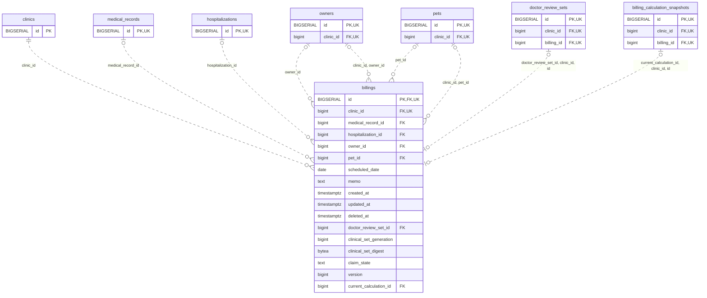

<!-- GENERATED: scripts/tools/generate-erd-detail.py; do not edit -->
# `billings`

[詳細ERD一覧](index.md) · [概要ERD](../erd.md)

このページは、マイグレーションをファイル名順に静的解析した最終定義です。稼働DBの状態は未確認です。

## カラム

型・DEFAULTはDDLの宣言表記です。`bigserial` は採番宣言であり、DBカタログ上の型名ではありません。

| カラム | 型（DDL） | NULL | DEFAULT（DDL） | キー構成列 | 定義元 |
|:---|:---|:---|:---|:---|:---|
| `id` | `BIGSERIAL` | NOT NULL | — | PK, FK, UK | [001_init.sql:1913](../../../backend/migrations/001_init.sql#L1913) |
| `clinic_id` | `bigint` | NOT NULL | — | FK, UK | [001_init.sql:1914](../../../backend/migrations/001_init.sql#L1914) |
| `medical_record_id` | `bigint` | NULL | — | FK | [001_init.sql:1915](../../../backend/migrations/001_init.sql#L1915) |
| `hospitalization_id` | `bigint` | NULL | — | FK | [001_init.sql:1916](../../../backend/migrations/001_init.sql#L1916) |
| `owner_id` | `bigint` | NULL | — | FK | [001_init.sql:1917](../../../backend/migrations/001_init.sql#L1917) |
| `pet_id` | `bigint` | NULL | — | FK | [001_init.sql:1918](../../../backend/migrations/001_init.sql#L1918) |
| `scheduled_date` | `date` | NOT NULL | — | — | [001_init.sql:1924](../../../backend/migrations/001_init.sql#L1924) |
| `memo` | `text` | NOT NULL | `''` | — | [001_init.sql:1926](../../../backend/migrations/001_init.sql#L1926) |
| `created_at` | `timestamptz` | NOT NULL | `now()` | — | [001_init.sql:1927](../../../backend/migrations/001_init.sql#L1927) |
| `updated_at` | `timestamptz` | NOT NULL | `now()` | — | [001_init.sql:1928](../../../backend/migrations/001_init.sql#L1928) |
| `deleted_at` | `timestamptz` | NULL | — | — | [001_init.sql:1929](../../../backend/migrations/001_init.sql#L1929) |
| `doctor_review_set_id` | `bigint` | NULL | — | FK | [001_init.sql:8188](../../../backend/migrations/001_init.sql#L8188) |
| `clinical_set_generation` | `bigint` | NULL | — | — | [001_init.sql:8823](../../../backend/migrations/001_init.sql#L8823) |
| `clinical_set_digest` | `bytea` | NULL | — | — | [001_init.sql:8824](../../../backend/migrations/001_init.sql#L8824) |
| `claim_state` | `text` | NULL | — | — | [001_init.sql:9454](../../../backend/migrations/001_init.sql#L9454) |
| `version` | `bigint` | NOT NULL | `1` | — | [001_init.sql:10901](../../../backend/migrations/001_init.sql#L10901) |
| `current_calculation_id` | `bigint` | NULL | — | FK | [001_init.sql:10902](../../../backend/migrations/001_init.sql#L10902) |

PK/FK/UKはキーの構成列を示します。複合キーの各列が単独で一意という意味ではありません。部分uniqueは下記indexの述語を参照してください。

## ERD

このテーブルの全カラムと、すべての参照先を表示します。参照先はFKの対象列だけを表示し、全カラムは各テーブルのページに置きます。

親側の任意参照はFK列のNULL可否、子側の最大1件は無条件のPK/UNIQUEから導出します。部分uniqueによる条件付きの最大件数は図に反映せず、index一覧に記録します。実線はFK全列が子のPKに含まれる識別関係、破線はそれ以外です。

## 外部キー（全件）

| 制約 | 子の列（順序あり） | 参照先 | 親の列（順序あり） | 削除時の動作 | 定義元 |
|:---|:---|:---|:---|:---|:---|
| `billings_clinic_id_fkey` | `clinic_id` | [clinics](clinics.md) | `id` | `ON DELETE RESTRICT` | [001_init.sql:1914](../../../backend/migrations/001_init.sql#L1914) |
| `billings_medical_record_id_fkey` | `medical_record_id` | [medical_records](medical_records.md) | `id` | `ON DELETE SET NULL` | [001_init.sql:1915](../../../backend/migrations/001_init.sql#L1915) |
| `billings_hospitalization_id_fkey` | `hospitalization_id` | [hospitalizations](hospitalizations.md) | `id` | `ON DELETE SET NULL` | [001_init.sql:1916](../../../backend/migrations/001_init.sql#L1916) |
| `billings_owner_id_fkey` | `owner_id` | [owners](owners.md) | `id` | `ON DELETE SET NULL` | [001_init.sql:1917](../../../backend/migrations/001_init.sql#L1917) |
| `billings_pet_id_fkey` | `pet_id` | [pets](pets.md) | `id` | `ON DELETE SET NULL` | [001_init.sql:1918](../../../backend/migrations/001_init.sql#L1918) |
| `fk_billings_clinic_pet` | `clinic_id, pet_id` | [pets](pets.md) | `clinic_id, id` | `ON DELETE RESTRICT` | [001_init.sql:4440](../../../backend/migrations/001_init.sql#L4440) |
| `fk_billings_clinic_owner` | `clinic_id, owner_id` | [owners](owners.md) | `clinic_id, id` | `ON DELETE RESTRICT` | [001_init.sql:4446](../../../backend/migrations/001_init.sql#L4446) |
| `fk_billing_doctor_review_set` | `doctor_review_set_id, clinic_id, id` | [doctor_review_sets](doctor_review_sets.md) | `id, clinic_id, billing_id` | `ON DELETE RESTRICT` | [001_init.sql:8189](../../../backend/migrations/001_init.sql#L8189) |
| `fk_billing_current_calculation` | `current_calculation_id, clinic_id, id` | [billing_calculation_snapshots](billing_calculation_snapshots.md) | `id, clinic_id, billing_id` | `ON DELETE RESTRICT` | [001_init.sql:10903](../../../backend/migrations/001_init.sql#L10903) |

正確なON UPDATE・MATCH・DEFERRABLE等を含む制約DDL:

- `billings_clinic_id_fkey`: `REFERENCES clinics(id) ON DELETE RESTRICT`
- `billings_medical_record_id_fkey`: `REFERENCES medical_records(id) ON DELETE SET NULL`
- `billings_hospitalization_id_fkey`: `REFERENCES hospitalizations(id) ON DELETE SET NULL`
- `billings_owner_id_fkey`: `REFERENCES owners(id) ON DELETE SET NULL`
- `billings_pet_id_fkey`: `REFERENCES pets(id) ON DELETE SET NULL`
- `fk_billings_clinic_pet`: `CONSTRAINT fk_billings_clinic_pet     FOREIGN KEY (clinic_id, pet_id)     REFERENCES pets (clinic_id, id)     ON DELETE RESTRICT`
- `fk_billings_clinic_owner`: `CONSTRAINT fk_billings_clinic_owner     FOREIGN KEY (clinic_id, owner_id)     REFERENCES owners (clinic_id, id)     ON DELETE RESTRICT`
- `fk_billing_doctor_review_set`: `CONSTRAINT fk_billing_doctor_review_set  FOREIGN KEY (doctor_review_set_id,clinic_id,id) REFERENCES doctor_review_sets(id,clinic_id,billing_id) ON DELETE RESTRICT`
- `fk_billing_current_calculation`: `CONSTRAINT fk_billing_current_calculation FOREIGN KEY(current_calculation_id,clinic_id,id) REFERENCES billing_calculation_snapshots(id,clinic_id,billing_id) ON DELETE RESTRICT`

## その他の制約

| 制約 | 種別 | DDL | 定義元 |
|:---|:---|:---|:---|
| `billings_pkey` | primary | `PRIMARY KEY` | [001_init.sql:1913](../../../backend/migrations/001_init.sql#L1913) |
| `uq_billings_id_clinic` | unique | `CONSTRAINT uq_billings_id_clinic UNIQUE (id, clinic_id)` | [001_init.sql:4068](../../../backend/migrations/001_init.sql#L4068) |
| `billings_clinical_set_generation_check` | check | `CHECK (clinical_set_generation > 0)` | [001_init.sql:8823](../../../backend/migrations/001_init.sql#L8823) |
| `billings_clinical_set_digest_check` | check | `CHECK (octet_length(clinical_set_digest)=32)` | [001_init.sql:8824](../../../backend/migrations/001_init.sql#L8824) |
| `billings_claim_state_check` | check | `CHECK (claim_state IN ('draft','finalized','cancelled'))` | [001_init.sql:9454](../../../backend/migrations/001_init.sql#L9454) |
| `billings_version_check` | check | `CHECK(version>0)` | [001_init.sql:10901](../../../backend/migrations/001_init.sql#L10901) |

## インデックス

| 名前 | UNIQUE | 述語 | DDL | 定義元 |
|:---|:---|:---|:---|:---|
| `idx_billings_medical_record_id_unique` | YES | `medical_record_id IS NOT NULL` | `CREATE UNIQUE INDEX idx_billings_medical_record_id_unique ON billings(medical_record_id) WHERE medical_record_id IS NOT NULL` | [001_init.sql:2219](../../../backend/migrations/001_init.sql#L2219) |
| `idx_billings_hospitalization_id_unique` | YES | `hospitalization_id IS NOT NULL AND deleted_at IS NULL` | `CREATE UNIQUE INDEX idx_billings_hospitalization_id_unique   ON billings(hospitalization_id)   WHERE hospitalization_id IS NOT NULL AND deleted_at IS NULL` | [001_init.sql:2223](../../../backend/migrations/001_init.sql#L2223) |
| `idx_billings_clinic_id` | NO | — | `CREATE INDEX idx_billings_clinic_id ON billings(clinic_id)` | [001_init.sql:2266](../../../backend/migrations/001_init.sql#L2266) |
| `idx_billings_pet_id` | NO | — | `CREATE INDEX idx_billings_pet_id ON billings(pet_id)` | [001_init.sql:2331](../../../backend/migrations/001_init.sql#L2331) |
| `idx_billings_owner_id` | NO | — | `CREATE INDEX idx_billings_owner_id ON billings(owner_id)` | [001_init.sql:2332](../../../backend/migrations/001_init.sql#L2332) |
| `idx_billings_clinic_date` | NO | `deleted_at IS NULL` | `CREATE INDEX idx_billings_clinic_date   ON billings(clinic_id, scheduled_date)   WHERE deleted_at IS NULL` | [001_init.sql:2419](../../../backend/migrations/001_init.sql#L2419) |
| `idx_billings_clinic_owner_scheduled` | NO | `deleted_at IS NULL` | `CREATE INDEX IF NOT EXISTS idx_billings_clinic_owner_scheduled     ON billings (clinic_id, owner_id, scheduled_date DESC, created_at DESC)     WHERE deleted_at IS NULL` | [001_init.sql:6389](../../../backend/migrations/001_init.sql#L6389) |
