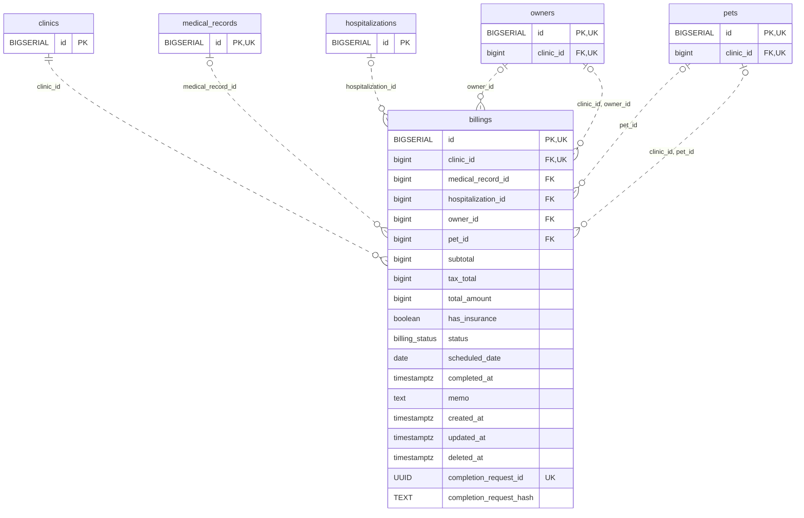

<!-- GENERATED: scripts/tools/generate-erd-detail.py; do not edit -->
# `billings`

[詳細ERD一覧](index.md) · [概要ERD](../erd.md)

このページは、マイグレーションをファイル名順に静的解析した最終定義です。稼働DBの状態は未確認です。

## カラム

型・DEFAULTはDDLの宣言表記です。`bigserial` は採番宣言であり、DBカタログ上の型名ではありません。

| カラム | 型（DDL） | NULL | DEFAULT（DDL） | キー構成列 | 定義元 |
|:---|:---|:---|:---|:---|:---|
| `id` | `BIGSERIAL` | NOT NULL | — | PK, UK | [001_init.sql:1891](../../../backend/migrations/001_init.sql#L1891) |
| `clinic_id` | `bigint` | NOT NULL | — | FK, UK | [001_init.sql:1892](../../../backend/migrations/001_init.sql#L1892) |
| `medical_record_id` | `bigint` | NULL | — | FK | [001_init.sql:1893](../../../backend/migrations/001_init.sql#L1893) |
| `hospitalization_id` | `bigint` | NULL | — | FK | [001_init.sql:1894](../../../backend/migrations/001_init.sql#L1894) |
| `owner_id` | `bigint` | NULL | — | FK | [001_init.sql:1895](../../../backend/migrations/001_init.sql#L1895) |
| `pet_id` | `bigint` | NULL | — | FK | [001_init.sql:1896](../../../backend/migrations/001_init.sql#L1896) |
| `subtotal` | `bigint` | NOT NULL | `0` | — | [001_init.sql:1897](../../../backend/migrations/001_init.sql#L1897) |
| `tax_total` | `bigint` | NOT NULL | `0` | — | [001_init.sql:1898](../../../backend/migrations/001_init.sql#L1898) |
| `total_amount` | `bigint` | NOT NULL | `0` | — | [001_init.sql:1899](../../../backend/migrations/001_init.sql#L1899) |
| `has_insurance` | `boolean` | NOT NULL | `false` | — | [001_init.sql:1900](../../../backend/migrations/001_init.sql#L1900) |
| `status` | `billing_status` | NULL | `'waiting'` | — | [001_init.sql:1901](../../../backend/migrations/001_init.sql#L1901) |
| `scheduled_date` | `date` | NOT NULL | — | — | [001_init.sql:1902](../../../backend/migrations/001_init.sql#L1902) |
| `completed_at` | `timestamptz` | NULL | — | — | [001_init.sql:1903](../../../backend/migrations/001_init.sql#L1903) |
| `memo` | `text` | NOT NULL | `''` | — | [001_init.sql:1904](../../../backend/migrations/001_init.sql#L1904) |
| `created_at` | `timestamptz` | NOT NULL | `now()` | — | [001_init.sql:1905](../../../backend/migrations/001_init.sql#L1905) |
| `updated_at` | `timestamptz` | NOT NULL | `now()` | — | [001_init.sql:1906](../../../backend/migrations/001_init.sql#L1906) |
| `deleted_at` | `timestamptz` | NULL | — | — | [001_init.sql:1907](../../../backend/migrations/001_init.sql#L1907) |
| `completion_request_id` | `UUID` | NULL | — | UK | [001_init.sql:5169](../../../backend/migrations/001_init.sql#L5169) |
| `completion_request_hash` | `TEXT` | NULL | — | — | [001_init.sql:5170](../../../backend/migrations/001_init.sql#L5170) |

PK/FK/UKはキーの構成列を示します。複合キーの各列が単独で一意という意味ではありません。部分uniqueは下記indexの述語を参照してください。

## ERD

このテーブルの全カラムと、すべての参照先を表示します。参照先はFKの対象列だけを表示し、全カラムは各テーブルのページに置きます。

親側の任意参照はFK列のNULL可否、子側の最大1件は無条件のPK/UNIQUEから導出します。部分uniqueによる条件付きの最大件数は図に反映せず、index一覧に記録します。実線はFK全列が子のPKに含まれる識別関係、破線はそれ以外です。

## 外部キー（全件）

| 制約 | 子の列（順序あり） | 参照先 | 親の列（順序あり） | 削除時の動作 | 定義元 |
|:---|:---|:---|:---|:---|:---|
| `billings_clinic_id_fkey` | `clinic_id` | [clinics](clinics.md) | `id` | `ON DELETE RESTRICT` | [001_init.sql:1892](../../../backend/migrations/001_init.sql#L1892) |
| `billings_medical_record_id_fkey` | `medical_record_id` | [medical_records](medical_records.md) | `id` | `ON DELETE SET NULL` | [001_init.sql:1893](../../../backend/migrations/001_init.sql#L1893) |
| `billings_hospitalization_id_fkey` | `hospitalization_id` | [hospitalizations](hospitalizations.md) | `id` | `ON DELETE SET NULL` | [001_init.sql:1894](../../../backend/migrations/001_init.sql#L1894) |
| `billings_owner_id_fkey` | `owner_id` | [owners](owners.md) | `id` | `ON DELETE SET NULL` | [001_init.sql:1895](../../../backend/migrations/001_init.sql#L1895) |
| `billings_pet_id_fkey` | `pet_id` | [pets](pets.md) | `id` | `ON DELETE SET NULL` | [001_init.sql:1896](../../../backend/migrations/001_init.sql#L1896) |
| `fk_billings_clinic_pet` | `clinic_id, pet_id` | [pets](pets.md) | `clinic_id, id` | `ON DELETE RESTRICT` | [001_init.sql:4418](../../../backend/migrations/001_init.sql#L4418) |
| `fk_billings_clinic_owner` | `clinic_id, owner_id` | [owners](owners.md) | `clinic_id, id` | `ON DELETE RESTRICT` | [001_init.sql:4424](../../../backend/migrations/001_init.sql#L4424) |

正確なON UPDATE・MATCH・DEFERRABLE等を含む制約DDL:

- `billings_clinic_id_fkey`: `REFERENCES clinics(id) ON DELETE RESTRICT`
- `billings_medical_record_id_fkey`: `REFERENCES medical_records(id) ON DELETE SET NULL`
- `billings_hospitalization_id_fkey`: `REFERENCES hospitalizations(id) ON DELETE SET NULL`
- `billings_owner_id_fkey`: `REFERENCES owners(id) ON DELETE SET NULL`
- `billings_pet_id_fkey`: `REFERENCES pets(id) ON DELETE SET NULL`
- `fk_billings_clinic_pet`: `CONSTRAINT fk_billings_clinic_pet     FOREIGN KEY (clinic_id, pet_id)     REFERENCES pets (clinic_id, id)     ON DELETE RESTRICT`
- `fk_billings_clinic_owner`: `CONSTRAINT fk_billings_clinic_owner     FOREIGN KEY (clinic_id, owner_id)     REFERENCES owners (clinic_id, id)     ON DELETE RESTRICT`

## その他の制約

| 制約 | 種別 | DDL | 定義元 |
|:---|:---|:---|:---|
| `billings_pkey` | primary | `PRIMARY KEY` | [001_init.sql:1891](../../../backend/migrations/001_init.sql#L1891) |
| `uq_billings_id_clinic` | unique | `CONSTRAINT uq_billings_id_clinic UNIQUE (id, clinic_id)` | [001_init.sql:4046](../../../backend/migrations/001_init.sql#L4046) |

## インデックス

| 名前 | UNIQUE | 述語 | DDL | 定義元 |
|:---|:---|:---|:---|:---|
| `idx_billings_medical_record_id_unique` | YES | `medical_record_id IS NOT NULL` | `CREATE UNIQUE INDEX idx_billings_medical_record_id_unique ON billings(medical_record_id) WHERE medical_record_id IS NOT NULL` | [001_init.sql:2197](../../../backend/migrations/001_init.sql#L2197) |
| `idx_billings_hospitalization_id_unique` | YES | `hospitalization_id IS NOT NULL AND deleted_at IS NULL` | `CREATE UNIQUE INDEX idx_billings_hospitalization_id_unique   ON billings(hospitalization_id)   WHERE hospitalization_id IS NOT NULL AND deleted_at IS NULL` | [001_init.sql:2201](../../../backend/migrations/001_init.sql#L2201) |
| `idx_billings_clinic_id` | NO | — | `CREATE INDEX idx_billings_clinic_id ON billings(clinic_id)` | [001_init.sql:2244](../../../backend/migrations/001_init.sql#L2244) |
| `idx_billings_pet_id` | NO | — | `CREATE INDEX idx_billings_pet_id ON billings(pet_id)` | [001_init.sql:2309](../../../backend/migrations/001_init.sql#L2309) |
| `idx_billings_owner_id` | NO | — | `CREATE INDEX idx_billings_owner_id ON billings(owner_id)` | [001_init.sql:2310](../../../backend/migrations/001_init.sql#L2310) |
| `idx_billings_clinic_date` | NO | `deleted_at IS NULL` | `CREATE INDEX idx_billings_clinic_date   ON billings(clinic_id, scheduled_date)   WHERE deleted_at IS NULL` | [001_init.sql:2397](../../../backend/migrations/001_init.sql#L2397) |
| `idx_billings_clinic_status` | NO | `deleted_at IS NULL` | `CREATE INDEX idx_billings_clinic_status   ON billings(clinic_id, status)   WHERE deleted_at IS NULL` | [001_init.sql:2401](../../../backend/migrations/001_init.sql#L2401) |
| `idx_billings_has_insurance` | NO | `deleted_at IS NULL` | `CREATE INDEX idx_billings_has_insurance   ON billings(clinic_id, has_insurance)   WHERE deleted_at IS NULL` | [001_init.sql:2405](../../../backend/migrations/001_init.sql#L2405) |
| `idx_billings_clinic_completed_at` | NO | `deleted_at IS NULL AND status = 'completed'` | `CREATE INDEX idx_billings_clinic_completed_at   ON billings(clinic_id, completed_at)   WHERE deleted_at IS NULL AND status = 'completed'` | [001_init.sql:2410](../../../backend/migrations/001_init.sql#L2410) |
| `uq_billings_clinic_completion_request_id` | YES | — | `CREATE UNIQUE INDEX IF NOT EXISTS uq_billings_clinic_completion_request_id     ON billings (clinic_id, completion_request_id)` | [001_init.sql:5174](../../../backend/migrations/001_init.sql#L5174) |
| `idx_billings_clinic_owner_scheduled` | NO | `deleted_at IS NULL` | `CREATE INDEX IF NOT EXISTS idx_billings_clinic_owner_scheduled     ON billings (clinic_id, owner_id, scheduled_date DESC, created_at DESC)     WHERE deleted_at IS NULL` | [007_billings_clinic_owner_scheduled_index.sql:8](../../../backend/migrations/007_billings_clinic_owner_scheduled_index.sql#L8) |
