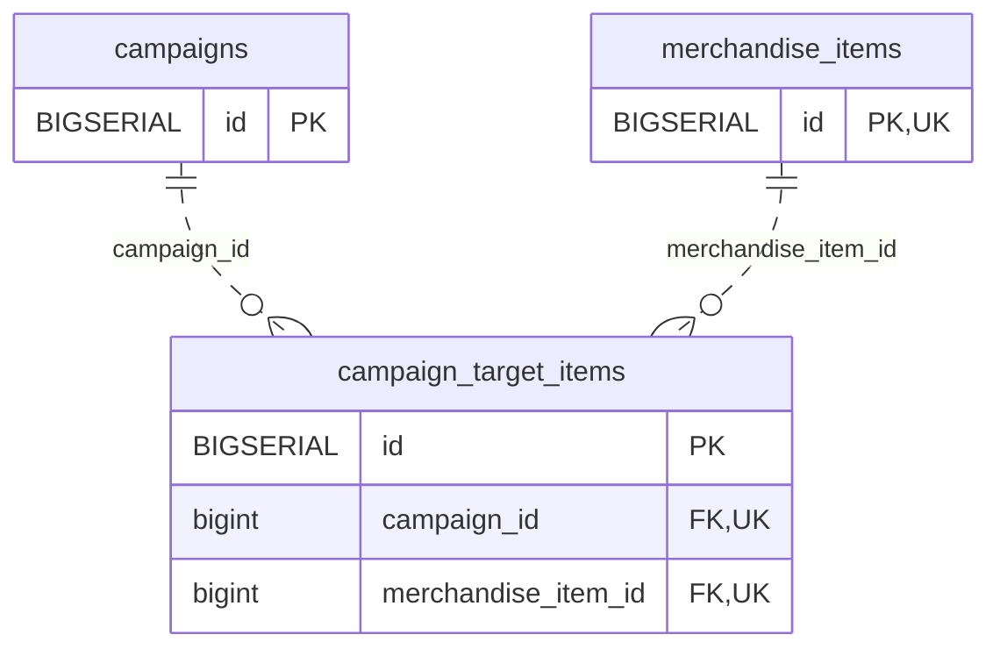

<!-- GENERATED: scripts/tools/generate-erd-detail.py; do not edit -->
# `campaign_target_items`

[詳細ERD一覧](index.md) · [概要ERD](../erd.md)

このページは、マイグレーションをファイル名順に静的解析した最終定義です。稼働DBの状態は未確認です。

## カラム

型・DEFAULTはDDLの宣言表記です。`bigserial` は採番宣言であり、DBカタログ上の型名ではありません。

| カラム | 型（DDL） | NULL | DEFAULT（DDL） | キー構成列 | 定義元 |
|:---|:---|:---|:---|:---|:---|
| `id` | `BIGSERIAL` | NOT NULL | — | PK | [001_init.sql:2951](../../../backend/migrations/001_init.sql#L2951) |
| `campaign_id` | `bigint` | NOT NULL | — | FK, UK | [001_init.sql:2952](../../../backend/migrations/001_init.sql#L2952) |
| `merchandise_item_id` | `bigint` | NOT NULL | — | FK, UK | [001_init.sql:2953](../../../backend/migrations/001_init.sql#L2953) |

PK/FK/UKはキーの構成列を示します。複合キーの各列が単独で一意という意味ではありません。部分uniqueは下記indexの述語を参照してください。

## ERD

このテーブルの全カラムと、すべての参照先を表示します。参照先はFKの対象列だけを表示し、全カラムは各テーブルのページに置きます。

親側の任意参照はFK列のNULL可否、子側の最大1件は無条件のPK/UNIQUEから導出します。部分uniqueによる条件付きの最大件数は図に反映せず、index一覧に記録します。実線はFK全列が子のPKに含まれる識別関係、破線はそれ以外です。

## 外部キー（全件）

| 制約 | 子の列（順序あり） | 参照先 | 親の列（順序あり） | 削除時の動作 | 定義元 |
|:---|:---|:---|:---|:---|:---|
| `campaign_target_items_campaign_id_fkey` | `campaign_id` | [campaigns](campaigns.md) | `id` | `ON DELETE CASCADE` | [001_init.sql:2952](../../../backend/migrations/001_init.sql#L2952) |
| `campaign_target_items_merchandise_item_id_fkey` | `merchandise_item_id` | [merchandise_items](merchandise_items.md) | `id` | `ON DELETE CASCADE` | [001_init.sql:2953](../../../backend/migrations/001_init.sql#L2953) |

正確なON UPDATE・MATCH・DEFERRABLE等を含む制約DDL:

- `campaign_target_items_campaign_id_fkey`: `REFERENCES campaigns(id) ON DELETE CASCADE`
- `campaign_target_items_merchandise_item_id_fkey`: `REFERENCES merchandise_items(id) ON DELETE CASCADE`

## その他の制約

| 制約 | 種別 | DDL | 定義元 |
|:---|:---|:---|:---|
| `campaign_target_items_pkey` | primary | `PRIMARY KEY` | [001_init.sql:2951](../../../backend/migrations/001_init.sql#L2951) |
| `uq_campaign_target_items` | unique | `CONSTRAINT uq_campaign_target_items UNIQUE (campaign_id, merchandise_item_id)` | [001_init.sql:2954](../../../backend/migrations/001_init.sql#L2954) |

## インデックス

| 名前 | UNIQUE | 述語 | DDL | 定義元 |
|:---|:---|:---|:---|:---|
| `idx_campaign_target_items_campaign` | NO | — | `CREATE INDEX idx_campaign_target_items_campaign      ON campaign_target_items(campaign_id)` | [001_init.sql:2960](../../../backend/migrations/001_init.sql#L2960) |
| `idx_campaign_target_items_merchandise` | NO | — | `CREATE INDEX idx_campaign_target_items_merchandise   ON campaign_target_items(merchandise_item_id)` | [001_init.sql:2961](../../../backend/migrations/001_init.sql#L2961) |
