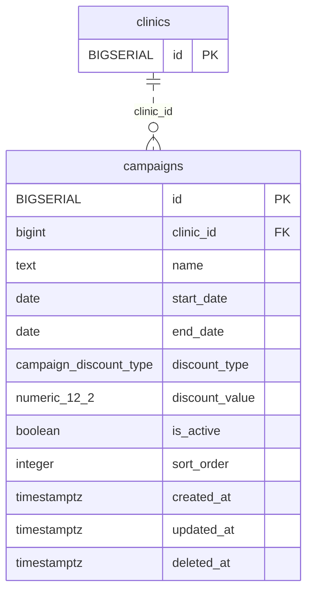

<!-- GENERATED: scripts/tools/generate-erd-detail.py; do not edit -->
# `campaigns`

[詳細ERD一覧](index.md) · [概要ERD](../erd.md)

このページは、マイグレーションをファイル名順に静的解析した最終定義です。稼働DBの状態は未確認です。

## カラム

型・DEFAULTはDDLの宣言表記です。`bigserial` は採番宣言であり、DBカタログ上の型名ではありません。

| カラム | 型（DDL） | NULL | DEFAULT（DDL） | キー構成列 | 定義元 |
|:---|:---|:---|:---|:---|:---|
| `id` | `BIGSERIAL` | NOT NULL | — | PK | [001_init.sql:2908](../../../backend/migrations/001_init.sql#L2908) |
| `clinic_id` | `bigint` | NOT NULL | — | FK | [001_init.sql:2909](../../../backend/migrations/001_init.sql#L2909) |
| `name` | `text` | NOT NULL | `''` | — | [001_init.sql:2910](../../../backend/migrations/001_init.sql#L2910) |
| `start_date` | `date` | NOT NULL | — | — | [001_init.sql:2911](../../../backend/migrations/001_init.sql#L2911) |
| `end_date` | `date` | NOT NULL | — | — | [001_init.sql:2912](../../../backend/migrations/001_init.sql#L2912) |
| `discount_type` | `campaign_discount_type` | NOT NULL | `'rate'` | — | [001_init.sql:2913](../../../backend/migrations/001_init.sql#L2913) |
| `discount_value` | `numeric(12,2)` | NOT NULL | `0` | — | [001_init.sql:2914](../../../backend/migrations/001_init.sql#L2914) |
| `is_active` | `boolean` | NOT NULL | `true` | — | [001_init.sql:2915](../../../backend/migrations/001_init.sql#L2915) |
| `sort_order` | `integer` | NOT NULL | `0` | — | [001_init.sql:2916](../../../backend/migrations/001_init.sql#L2916) |
| `created_at` | `timestamptz` | NOT NULL | `now()` | — | [001_init.sql:2917](../../../backend/migrations/001_init.sql#L2917) |
| `updated_at` | `timestamptz` | NOT NULL | `now()` | — | [001_init.sql:2918](../../../backend/migrations/001_init.sql#L2918) |
| `deleted_at` | `timestamptz` | NULL | — | — | [001_init.sql:2919](../../../backend/migrations/001_init.sql#L2919) |

PK/FK/UKはキーの構成列を示します。複合キーの各列が単独で一意という意味ではありません。部分uniqueは下記indexの述語を参照してください。

## ERD

このテーブルの全カラムと、すべての参照先を表示します。参照先はFKの対象列だけを表示し、全カラムは各テーブルのページに置きます。

親側の任意参照はFK列のNULL可否、子側の最大1件は無条件のPK/UNIQUEから導出します。部分uniqueによる条件付きの最大件数は図に反映せず、index一覧に記録します。実線はFK全列が子のPKに含まれる識別関係、破線はそれ以外です。

## 外部キー（全件）

| 制約 | 子の列（順序あり） | 参照先 | 親の列（順序あり） | 削除時の動作 | 定義元 |
|:---|:---|:---|:---|:---|:---|
| `campaigns_clinic_id_fkey` | `clinic_id` | [clinics](clinics.md) | `id` | `ON DELETE RESTRICT` | [001_init.sql:2909](../../../backend/migrations/001_init.sql#L2909) |

正確なON UPDATE・MATCH・DEFERRABLE等を含む制約DDL:

- `campaigns_clinic_id_fkey`: `REFERENCES clinics(id) ON DELETE RESTRICT`

## その他の制約

| 制約 | 種別 | DDL | 定義元 |
|:---|:---|:---|:---|
| `campaigns_pkey` | primary | `PRIMARY KEY` | [001_init.sql:2908](../../../backend/migrations/001_init.sql#L2908) |
| `chk_campaigns_period` | check | `CONSTRAINT chk_campaigns_period CHECK (end_date >= start_date)` | [001_init.sql:2920](../../../backend/migrations/001_init.sql#L2920) |

## インデックス

| 名前 | UNIQUE | 述語 | DDL | 定義元 |
|:---|:---|:---|:---|:---|
| `idx_campaigns_clinic` | NO | `deleted_at IS NULL` | `CREATE INDEX idx_campaigns_clinic         ON campaigns(clinic_id) WHERE deleted_at IS NULL` | [001_init.sql:2937](../../../backend/migrations/001_init.sql#L2937) |
| `idx_campaigns_clinic_period` | NO | `deleted_at IS NULL` | `CREATE INDEX idx_campaigns_clinic_period  ON campaigns(clinic_id, start_date, end_date) WHERE deleted_at IS NULL` | [001_init.sql:2938](../../../backend/migrations/001_init.sql#L2938) |
