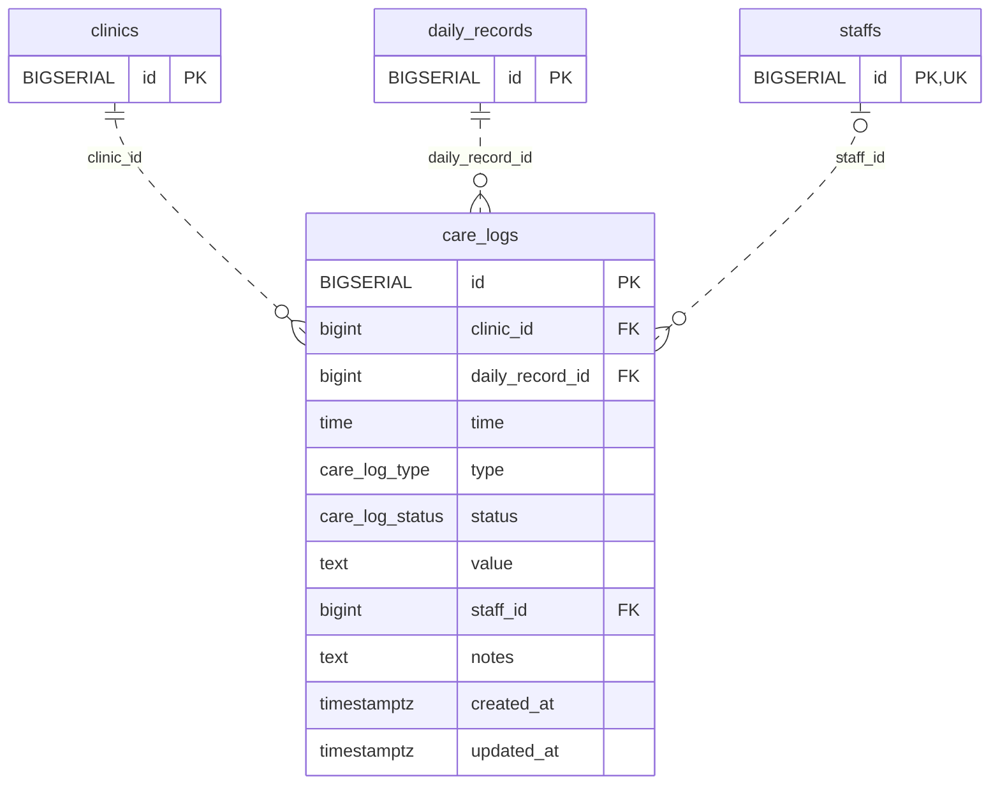

<!-- GENERATED: scripts/tools/generate-erd-detail.py; do not edit -->
# `care_logs`

[詳細ERD一覧](index.md) · [概要ERD](../erd.md)

このページは、マイグレーションをファイル名順に静的解析した最終定義です。稼働DBの状態は未確認です。

## カラム

型・DEFAULTはDDLの宣言表記です。`bigserial` は採番宣言であり、DBカタログ上の型名ではありません。

| カラム | 型（DDL） | NULL | DEFAULT（DDL） | キー構成列 | 定義元 |
|:---|:---|:---|:---|:---|:---|
| `id` | `BIGSERIAL` | NOT NULL | — | PK | [001_init.sql:1874](../../../backend/migrations/001_init.sql#L1874) |
| `clinic_id` | `bigint` | NOT NULL | — | FK | [001_init.sql:1875](../../../backend/migrations/001_init.sql#L1875) |
| `daily_record_id` | `bigint` | NOT NULL | — | FK | [001_init.sql:1876](../../../backend/migrations/001_init.sql#L1876) |
| `time` | `time` | NOT NULL | — | — | [001_init.sql:1877](../../../backend/migrations/001_init.sql#L1877) |
| `type` | `care_log_type` | NOT NULL | — | — | [001_init.sql:1878](../../../backend/migrations/001_init.sql#L1878) |
| `status` | `care_log_status` | NOT NULL | `'completed'` | — | [001_init.sql:1879](../../../backend/migrations/001_init.sql#L1879) |
| `value` | `text` | NOT NULL | `''` | — | [001_init.sql:1880](../../../backend/migrations/001_init.sql#L1880) |
| `staff_id` | `bigint` | NULL | — | FK | [001_init.sql:1881](../../../backend/migrations/001_init.sql#L1881) |
| `notes` | `text` | NOT NULL | `''` | — | [001_init.sql:1882](../../../backend/migrations/001_init.sql#L1882) |
| `created_at` | `timestamptz` | NOT NULL | `now()` | — | [001_init.sql:1883](../../../backend/migrations/001_init.sql#L1883) |
| `updated_at` | `timestamptz` | NOT NULL | `now()` | — | [001_init.sql:1884](../../../backend/migrations/001_init.sql#L1884) |

PK/FK/UKはキーの構成列を示します。複合キーの各列が単独で一意という意味ではありません。部分uniqueは下記indexの述語を参照してください。

## ERD

このテーブルの全カラムと、すべての参照先を表示します。参照先はFKの対象列だけを表示し、全カラムは各テーブルのページに置きます。

親側の任意参照はFK列のNULL可否、子側の最大1件は無条件のPK/UNIQUEから導出します。部分uniqueによる条件付きの最大件数は図に反映せず、index一覧に記録します。実線はFK全列が子のPKに含まれる識別関係、破線はそれ以外です。

## 外部キー（全件）

| 制約 | 子の列（順序あり） | 参照先 | 親の列（順序あり） | 削除時の動作 | 定義元 |
|:---|:---|:---|:---|:---|:---|
| `care_logs_clinic_id_fkey` | `clinic_id` | [clinics](clinics.md) | `id` | `ON DELETE RESTRICT` | [001_init.sql:1875](../../../backend/migrations/001_init.sql#L1875) |
| `care_logs_daily_record_id_fkey` | `daily_record_id` | [daily_records](daily_records.md) | `id` | `ON DELETE CASCADE` | [001_init.sql:1876](../../../backend/migrations/001_init.sql#L1876) |
| `care_logs_staff_id_fkey` | `staff_id` | [staffs](staffs.md) | `id` | `ON DELETE SET NULL` | [001_init.sql:1881](../../../backend/migrations/001_init.sql#L1881) |

正確なON UPDATE・MATCH・DEFERRABLE等を含む制約DDL:

- `care_logs_clinic_id_fkey`: `REFERENCES clinics(id) ON DELETE RESTRICT`
- `care_logs_daily_record_id_fkey`: `REFERENCES daily_records(id) ON DELETE CASCADE`
- `care_logs_staff_id_fkey`: `REFERENCES staffs(id) ON DELETE SET NULL`

## その他の制約

| 制約 | 種別 | DDL | 定義元 |
|:---|:---|:---|:---|
| `care_logs_pkey` | primary | `PRIMARY KEY` | [001_init.sql:1874](../../../backend/migrations/001_init.sql#L1874) |

## インデックス

| 名前 | UNIQUE | 述語 | DDL | 定義元 |
|:---|:---|:---|:---|:---|
| `idx_care_logs_clinic_id` | NO | — | `CREATE INDEX idx_care_logs_clinic_id ON care_logs(clinic_id)` | [001_init.sql:2326](../../../backend/migrations/001_init.sql#L2326) |
