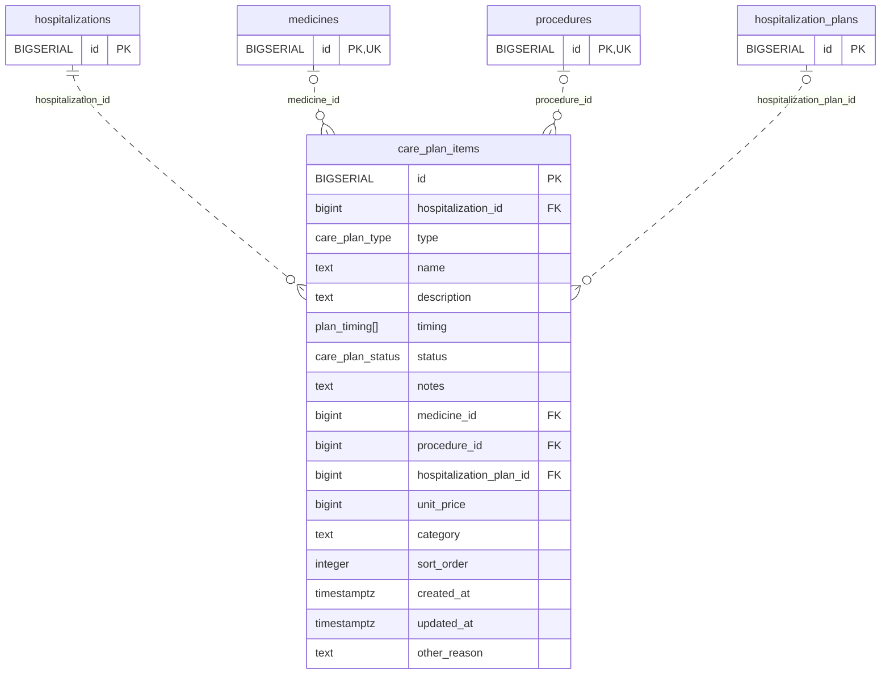

<!-- GENERATED: scripts/tools/generate-erd-detail.py; do not edit -->
# `care_plan_items`

[詳細ERD一覧](index.md) · [概要ERD](../erd.md)

このページは、マイグレーションをファイル名順に静的解析した最終定義です。稼働DBの状態は未確認です。

## カラム

型・DEFAULTはDDLの宣言表記です。`bigserial` は採番宣言であり、DBカタログ上の型名ではありません。

| カラム | 型（DDL） | NULL | DEFAULT（DDL） | キー構成列 | 定義元 |
|:---|:---|:---|:---|:---|:---|
| `id` | `BIGSERIAL` | NOT NULL | — | PK | [001_init.sql:1776](../../../backend/migrations/001_init.sql#L1776) |
| `hospitalization_id` | `bigint` | NOT NULL | — | FK | [001_init.sql:1777](../../../backend/migrations/001_init.sql#L1777) |
| `type` | `care_plan_type` | NOT NULL | — | — | [001_init.sql:1778](../../../backend/migrations/001_init.sql#L1778) |
| `name` | `text` | NOT NULL | `''` | — | [001_init.sql:1779](../../../backend/migrations/001_init.sql#L1779) |
| `description` | `text` | NOT NULL | `''` | — | [001_init.sql:1780](../../../backend/migrations/001_init.sql#L1780) |
| `timing` | `plan_timing[]` | NULL | `'{}'` | — | [001_init.sql:1781](../../../backend/migrations/001_init.sql#L1781) |
| `status` | `care_plan_status` | NULL | `'active'` | — | [001_init.sql:1782](../../../backend/migrations/001_init.sql#L1782) |
| `notes` | `text` | NOT NULL | `''` | — | [001_init.sql:1783](../../../backend/migrations/001_init.sql#L1783) |
| `medicine_id` | `bigint` | NULL | — | FK | [001_init.sql:1784](../../../backend/migrations/001_init.sql#L1784) |
| `procedure_id` | `bigint` | NULL | — | FK | [001_init.sql:1785](../../../backend/migrations/001_init.sql#L1785) |
| `hospitalization_plan_id` | `bigint` | NULL | — | FK | [001_init.sql:1786](../../../backend/migrations/001_init.sql#L1786) |
| `unit_price` | `bigint` | NULL | `0` | — | [001_init.sql:1787](../../../backend/migrations/001_init.sql#L1787) |
| `category` | `text` | NOT NULL | `''` | — | [001_init.sql:1788](../../../backend/migrations/001_init.sql#L1788) |
| `sort_order` | `integer` | NULL | `0` | — | [001_init.sql:1789](../../../backend/migrations/001_init.sql#L1789) |
| `created_at` | `timestamptz` | NOT NULL | `now()` | — | [001_init.sql:1790](../../../backend/migrations/001_init.sql#L1790) |
| `updated_at` | `timestamptz` | NOT NULL | `now()` | — | [001_init.sql:1791](../../../backend/migrations/001_init.sql#L1791) |
| `other_reason` | `text` | NOT NULL | `''` | — | [011_care_plan_items_manual_other.sql:11](../../../backend/migrations/011_care_plan_items_manual_other.sql#L11) |

PK/FK/UKはキーの構成列を示します。複合キーの各列が単独で一意という意味ではありません。部分uniqueは下記indexの述語を参照してください。

## ERD

このテーブルの全カラムと、すべての参照先を表示します。参照先はFKの対象列だけを表示し、全カラムは各テーブルのページに置きます。

親側の任意参照はFK列のNULL可否、子側の最大1件は無条件のPK/UNIQUEから導出します。部分uniqueによる条件付きの最大件数は図に反映せず、index一覧に記録します。実線はFK全列が子のPKに含まれる識別関係、破線はそれ以外です。

## 外部キー（全件）

| 制約 | 子の列（順序あり） | 参照先 | 親の列（順序あり） | 削除時の動作 | 定義元 |
|:---|:---|:---|:---|:---|:---|
| `care_plan_items_hospitalization_id_fkey` | `hospitalization_id` | [hospitalizations](hospitalizations.md) | `id` | `ON DELETE CASCADE` | [001_init.sql:1777](../../../backend/migrations/001_init.sql#L1777) |
| `care_plan_items_medicine_id_fkey` | `medicine_id` | [medicines](medicines.md) | `id` | `ON DELETE SET NULL` | [001_init.sql:1784](../../../backend/migrations/001_init.sql#L1784) |
| `care_plan_items_procedure_id_fkey` | `procedure_id` | [procedures](procedures.md) | `id` | `ON DELETE SET NULL` | [001_init.sql:1785](../../../backend/migrations/001_init.sql#L1785) |
| `care_plan_items_hospitalization_plan_id_fkey` | `hospitalization_plan_id` | [hospitalization_plans](hospitalization_plans.md) | `id` | `ON DELETE SET NULL` | [001_init.sql:1786](../../../backend/migrations/001_init.sql#L1786) |

正確なON UPDATE・MATCH・DEFERRABLE等を含む制約DDL:

- `care_plan_items_hospitalization_id_fkey`: `REFERENCES hospitalizations(id) ON DELETE CASCADE`
- `care_plan_items_medicine_id_fkey`: `REFERENCES medicines(id) ON DELETE SET NULL`
- `care_plan_items_procedure_id_fkey`: `REFERENCES procedures(id) ON DELETE SET NULL`
- `care_plan_items_hospitalization_plan_id_fkey`: `REFERENCES hospitalization_plans(id) ON DELETE SET NULL`

## その他の制約

| 制約 | 種別 | DDL | 定義元 |
|:---|:---|:---|:---|
| `care_plan_items_pkey` | primary | `PRIMARY KEY` | [001_init.sql:1776](../../../backend/migrations/001_init.sql#L1776) |
| `chk_care_plan_item_ref` | check | `CONSTRAINT chk_care_plan_item_ref CHECK (         (type = 'medicine'    AND medicine_id IS NOT NULL) OR         (type = 'treatment'   AND procedure_id IS NOT NULL) OR         (type = 'item'        AND hospitalization_plan_id IS NOT NULL) OR         (type = 'item'        AND hospitalization_plan_id IS NULL             AND category = 'other' AND btrim(other_reason) <> '') OR         (type IN ('food', 'instruction'))     )` | [011_care_plan_items_manual_other.sql:17](../../../backend/migrations/011_care_plan_items_manual_other.sql#L17) |

## インデックス

| 名前 | UNIQUE | 述語 | DDL | 定義元 |
|:---|:---|:---|:---|:---|
| `idx_care_plan_items_hospitalization_id` | NO | — | `CREATE INDEX idx_care_plan_items_hospitalization_id ON care_plan_items(hospitalization_id)` | [001_init.sql:2303](../../../backend/migrations/001_init.sql#L2303) |
| `idx_care_plan_items_medicine_id` | NO | `medicine_id IS NOT NULL` | `CREATE INDEX idx_care_plan_items_medicine_id ON care_plan_items(medicine_id) WHERE medicine_id IS NOT NULL` | [001_init.sql:2438](../../../backend/migrations/001_init.sql#L2438) |
| `idx_care_plan_items_procedure_id` | NO | `procedure_id IS NOT NULL` | `CREATE INDEX idx_care_plan_items_procedure_id ON care_plan_items(procedure_id) WHERE procedure_id IS NOT NULL` | [001_init.sql:2439](../../../backend/migrations/001_init.sql#L2439) |
| `idx_care_plan_items_plan_id` | NO | `hospitalization_plan_id IS NOT NULL` | `CREATE INDEX idx_care_plan_items_plan_id ON care_plan_items(hospitalization_plan_id) WHERE hospitalization_plan_id IS NOT NULL` | [001_init.sql:2440](../../../backend/migrations/001_init.sql#L2440) |
