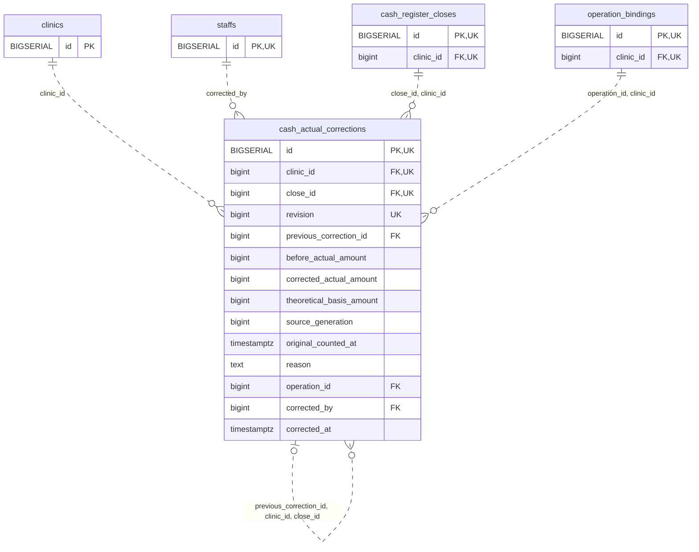

<!-- GENERATED: scripts/tools/generate-erd-detail.py; do not edit -->
# `cash_actual_corrections`

[詳細ERD一覧](index.md) · [概要ERD](../erd.md)

このページは、マイグレーションをファイル名順に静的解析した最終定義です。稼働DBの状態は未確認です。

## カラム

型・DEFAULTはDDLの宣言表記です。`bigserial` は採番宣言であり、DBカタログ上の型名ではありません。

| カラム | 型（DDL） | NULL | DEFAULT（DDL） | キー構成列 | 定義元 |
|:---|:---|:---|:---|:---|:---|
| `id` | `BIGSERIAL` | NOT NULL | — | PK, UK | [001_init.sql:9906](../../../backend/migrations/001_init.sql#L9906) |
| `clinic_id` | `bigint` | NOT NULL | — | FK, UK | [001_init.sql:9907](../../../backend/migrations/001_init.sql#L9907) |
| `close_id` | `bigint` | NOT NULL | — | FK, UK | [001_init.sql:9908](../../../backend/migrations/001_init.sql#L9908) |
| `revision` | `bigint` | NOT NULL | — | UK | [001_init.sql:9909](../../../backend/migrations/001_init.sql#L9909) |
| `previous_correction_id` | `bigint` | NULL | — | FK | [001_init.sql:9910](../../../backend/migrations/001_init.sql#L9910) |
| `before_actual_amount` | `bigint` | NOT NULL | — | — | [001_init.sql:9911](../../../backend/migrations/001_init.sql#L9911) |
| `corrected_actual_amount` | `bigint` | NOT NULL | — | — | [001_init.sql:9912](../../../backend/migrations/001_init.sql#L9912) |
| `theoretical_basis_amount` | `bigint` | NOT NULL | — | — | [001_init.sql:9913](../../../backend/migrations/001_init.sql#L9913) |
| `source_generation` | `bigint` | NOT NULL | — | — | [001_init.sql:9914](../../../backend/migrations/001_init.sql#L9914) |
| `original_counted_at` | `timestamptz` | NULL | — | — | [001_init.sql:9915](../../../backend/migrations/001_init.sql#L9915) |
| `reason` | `text` | NOT NULL | — | — | [001_init.sql:9916](../../../backend/migrations/001_init.sql#L9916) |
| `operation_id` | `bigint` | NOT NULL | — | FK | [001_init.sql:9917](../../../backend/migrations/001_init.sql#L9917) |
| `corrected_by` | `bigint` | NOT NULL | — | FK | [001_init.sql:9918](../../../backend/migrations/001_init.sql#L9918) |
| `corrected_at` | `timestamptz` | NOT NULL | `clock_timestamp()` | — | [001_init.sql:9919](../../../backend/migrations/001_init.sql#L9919) |

PK/FK/UKはキーの構成列を示します。複合キーの各列が単独で一意という意味ではありません。部分uniqueは下記indexの述語を参照してください。

## ERD

このテーブルの全カラムと、すべての参照先を表示します。参照先はFKの対象列だけを表示し、全カラムは各テーブルのページに置きます。

親側の任意参照はFK列のNULL可否、子側の最大1件は無条件のPK/UNIQUEから導出します。部分uniqueによる条件付きの最大件数は図に反映せず、index一覧に記録します。実線はFK全列が子のPKに含まれる識別関係、破線はそれ以外です。

## 外部キー（全件）

| 制約 | 子の列（順序あり） | 参照先 | 親の列（順序あり） | 削除時の動作 | 定義元 |
|:---|:---|:---|:---|:---|:---|
| `cash_actual_corrections_clinic_id_fkey` | `clinic_id` | [clinics](clinics.md) | `id` | `ON DELETE RESTRICT` | [001_init.sql:9907](../../../backend/migrations/001_init.sql#L9907) |
| `cash_actual_corrections_corrected_by_fkey` | `corrected_by` | [staffs](staffs.md) | `id` | `ON DELETE RESTRICT` | [001_init.sql:9918](../../../backend/migrations/001_init.sql#L9918) |
| `cash_actual_corrections_close_id_clinic_id_fkey` | `close_id, clinic_id` | [cash_register_closes](cash_register_closes.md) | `id, clinic_id` | `ON DELETE RESTRICT` | [001_init.sql:9922](../../../backend/migrations/001_init.sql#L9922) |
| `cash_actual_corrections_previous_correction_id_clinic_id_c_fkey` | `previous_correction_id, clinic_id, close_id` | [cash_actual_corrections](cash_actual_corrections.md) | `id, clinic_id, close_id` | `ON DELETE RESTRICT` | [001_init.sql:9923](../../../backend/migrations/001_init.sql#L9923) |
| `cash_actual_corrections_operation_id_clinic_id_fkey` | `operation_id, clinic_id` | [operation_bindings](operation_bindings.md) | `id, clinic_id` | `ON DELETE RESTRICT` | [001_init.sql:9924](../../../backend/migrations/001_init.sql#L9924) |

正確なON UPDATE・MATCH・DEFERRABLE等を含む制約DDL:

- `cash_actual_corrections_clinic_id_fkey`: `REFERENCES clinics(id) ON DELETE RESTRICT`
- `cash_actual_corrections_corrected_by_fkey`: `REFERENCES staffs(id) ON DELETE RESTRICT`
- `cash_actual_corrections_close_id_clinic_id_fkey`: `FOREIGN KEY (close_id,clinic_id) REFERENCES cash_register_closes(id,clinic_id) ON DELETE RESTRICT`
- `cash_actual_corrections_previous_correction_id_clinic_id_c_fkey`: `FOREIGN KEY (previous_correction_id,clinic_id,close_id) REFERENCES cash_actual_corrections(id,clinic_id,close_id) ON DELETE RESTRICT`
- `cash_actual_corrections_operation_id_clinic_id_fkey`: `FOREIGN KEY (operation_id,clinic_id) REFERENCES operation_bindings(id,clinic_id) ON DELETE RESTRICT`

## その他の制約

| 制約 | 種別 | DDL | 定義元 |
|:---|:---|:---|:---|
| `cash_actual_corrections_pkey` | primary | `PRIMARY KEY` | [001_init.sql:9906](../../../backend/migrations/001_init.sql#L9906) |
| `cash_actual_corrections_revision_check` | check | `CHECK (revision > 0)` | [001_init.sql:9909](../../../backend/migrations/001_init.sql#L9909) |
| `cash_actual_corrections_corrected_actual_amount_check` | check | `CHECK (corrected_actual_amount >= 0)` | [001_init.sql:9912](../../../backend/migrations/001_init.sql#L9912) |
| `cash_actual_corrections_source_generation_check` | check | `CHECK (source_generation > 0)` | [001_init.sql:9914](../../../backend/migrations/001_init.sql#L9914) |
| `cash_actual_corrections_reason_check` | check | `CHECK (btrim(reason)<>'')` | [001_init.sql:9916](../../../backend/migrations/001_init.sql#L9916) |
| `cash_actual_corrections_id_clinic_id_close_id_key` | unique | `UNIQUE (id,clinic_id,close_id)` | [001_init.sql:9920](../../../backend/migrations/001_init.sql#L9920) |
| `cash_actual_corrections_clinic_id_close_id_revision_key` | unique | `UNIQUE (clinic_id,close_id,revision)` | [001_init.sql:9921](../../../backend/migrations/001_init.sql#L9921) |

## インデックス

明示的なCREATE INDEXなし。PK/UNIQUEに付随する暗黙のindexは制約欄を参照してください。
