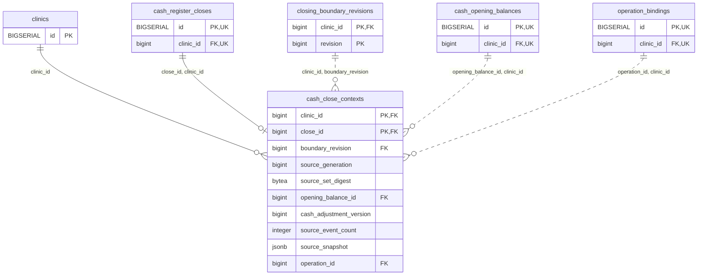

<!-- GENERATED: scripts/tools/generate-erd-detail.py; do not edit -->
# `cash_close_contexts`

[詳細ERD一覧](index.md) · [概要ERD](../erd.md)

このページは、マイグレーションをファイル名順に静的解析した最終定義です。稼働DBの状態は未確認です。

## カラム

型・DEFAULTはDDLの宣言表記です。`bigserial` は採番宣言であり、DBカタログ上の型名ではありません。

| カラム | 型（DDL） | NULL | DEFAULT（DDL） | キー構成列 | 定義元 |
|:---|:---|:---|:---|:---|:---|
| `clinic_id` | `bigint` | NOT NULL | — | PK, FK | [001_init.sql:9895](../../../backend/migrations/001_init.sql#L9895) |
| `close_id` | `bigint` | NOT NULL | — | PK, FK | [001_init.sql:9896](../../../backend/migrations/001_init.sql#L9896) |
| `boundary_revision` | `bigint` | NOT NULL | — | FK | [001_init.sql:9897](../../../backend/migrations/001_init.sql#L9897) |
| `source_generation` | `bigint` | NOT NULL | — | — | [001_init.sql:9898](../../../backend/migrations/001_init.sql#L9898) |
| `source_set_digest` | `bytea` | NOT NULL | — | — | [001_init.sql:9899](../../../backend/migrations/001_init.sql#L9899) |
| `opening_balance_id` | `bigint` | NOT NULL | — | FK | [001_init.sql:9900](../../../backend/migrations/001_init.sql#L9900) |
| `cash_adjustment_version` | `bigint` | NOT NULL | — | — | [001_init.sql:9901](../../../backend/migrations/001_init.sql#L9901) |
| `source_event_count` | `integer` | NOT NULL | — | — | [001_init.sql:9902](../../../backend/migrations/001_init.sql#L9902) |
| `source_snapshot` | `jsonb` | NOT NULL | — | — | [001_init.sql:9903](../../../backend/migrations/001_init.sql#L9903) |
| `operation_id` | `bigint` | NOT NULL | — | FK | [001_init.sql:9904](../../../backend/migrations/001_init.sql#L9904) |

PK/FK/UKはキーの構成列を示します。複合キーの各列が単独で一意という意味ではありません。部分uniqueは下記indexの述語を参照してください。

## ERD

このテーブルの全カラムと、すべての参照先を表示します。参照先はFKの対象列だけを表示し、全カラムは各テーブルのページに置きます。

親側の任意参照はFK列のNULL可否、子側の最大1件は無条件のPK/UNIQUEから導出します。部分uniqueによる条件付きの最大件数は図に反映せず、index一覧に記録します。実線はFK全列が子のPKに含まれる識別関係、破線はそれ以外です。

## 外部キー（全件）

| 制約 | 子の列（順序あり） | 参照先 | 親の列（順序あり） | 削除時の動作 | 定義元 |
|:---|:---|:---|:---|:---|:---|
| `cash_close_contexts_clinic_id_fkey` | `clinic_id` | [clinics](clinics.md) | `id` | `ON DELETE RESTRICT` | [001_init.sql:9895](../../../backend/migrations/001_init.sql#L9895) |
| `cash_close_contexts_close_id_clinic_id_fkey` | `close_id, clinic_id` | [cash_register_closes](cash_register_closes.md) | `id, clinic_id` | `ON DELETE RESTRICT` | [001_init.sql:9906](../../../backend/migrations/001_init.sql#L9906) |
| `cash_close_contexts_clinic_id_boundary_revision_fkey` | `clinic_id, boundary_revision` | [closing_boundary_revisions](closing_boundary_revisions.md) | `clinic_id, revision` | `ON DELETE RESTRICT` | [001_init.sql:9907](../../../backend/migrations/001_init.sql#L9907) |
| `cash_close_contexts_opening_balance_id_clinic_id_fkey` | `opening_balance_id, clinic_id` | [cash_opening_balances](cash_opening_balances.md) | `id, clinic_id` | `ON DELETE RESTRICT` | [001_init.sql:9908](../../../backend/migrations/001_init.sql#L9908) |
| `cash_close_contexts_operation_id_clinic_id_fkey` | `operation_id, clinic_id` | [operation_bindings](operation_bindings.md) | `id, clinic_id` | `ON DELETE RESTRICT` | [001_init.sql:9909](../../../backend/migrations/001_init.sql#L9909) |

正確なON UPDATE・MATCH・DEFERRABLE等を含む制約DDL:

- `cash_close_contexts_clinic_id_fkey`: `REFERENCES clinics(id) ON DELETE RESTRICT`
- `cash_close_contexts_close_id_clinic_id_fkey`: `FOREIGN KEY (close_id,clinic_id) REFERENCES cash_register_closes(id,clinic_id) ON DELETE RESTRICT`
- `cash_close_contexts_clinic_id_boundary_revision_fkey`: `FOREIGN KEY (clinic_id,boundary_revision) REFERENCES closing_boundary_revisions(clinic_id,revision) ON DELETE RESTRICT`
- `cash_close_contexts_opening_balance_id_clinic_id_fkey`: `FOREIGN KEY (opening_balance_id,clinic_id) REFERENCES cash_opening_balances(id,clinic_id) ON DELETE RESTRICT`
- `cash_close_contexts_operation_id_clinic_id_fkey`: `FOREIGN KEY (operation_id,clinic_id) REFERENCES operation_bindings(id,clinic_id) ON DELETE RESTRICT`

## その他の制約

| 制約 | 種別 | DDL | 定義元 |
|:---|:---|:---|:---|
| `cash_close_contexts_source_generation_check` | check | `CHECK (source_generation > 0)` | [001_init.sql:9898](../../../backend/migrations/001_init.sql#L9898) |
| `cash_close_contexts_source_set_digest_check` | check | `CHECK (octet_length(source_set_digest)=32)` | [001_init.sql:9899](../../../backend/migrations/001_init.sql#L9899) |
| `cash_close_contexts_cash_adjustment_version_check` | check | `CHECK (cash_adjustment_version >= 0)` | [001_init.sql:9901](../../../backend/migrations/001_init.sql#L9901) |
| `cash_close_contexts_source_event_count_check` | check | `CHECK (source_event_count >= 0)` | [001_init.sql:9902](../../../backend/migrations/001_init.sql#L9902) |
| `cash_close_contexts_source_snapshot_check` | check | `CHECK (jsonb_typeof(source_snapshot)='object')` | [001_init.sql:9903](../../../backend/migrations/001_init.sql#L9903) |
| `cash_close_contexts_pkey` | primary | `PRIMARY KEY (clinic_id,close_id)` | [001_init.sql:9905](../../../backend/migrations/001_init.sql#L9905) |

## インデックス

明示的なCREATE INDEXなし。PK/UNIQUEに付随する暗黙のindexは制約欄を参照してください。
