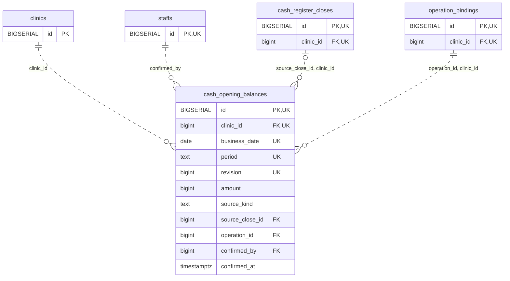

<!-- GENERATED: scripts/tools/generate-erd-detail.py; do not edit -->
# `cash_opening_balances`

[詳細ERD一覧](index.md) · [概要ERD](../erd.md)

このページは、マイグレーションをファイル名順に静的解析した最終定義です。稼働DBの状態は未確認です。

## カラム

型・DEFAULTはDDLの宣言表記です。`bigserial` は採番宣言であり、DBカタログ上の型名ではありません。

| カラム | 型（DDL） | NULL | DEFAULT（DDL） | キー構成列 | 定義元 |
|:---|:---|:---|:---|:---|:---|
| `id` | `BIGSERIAL` | NOT NULL | — | PK, UK | [001_init.sql:9802](../../../backend/migrations/001_init.sql#L9802) |
| `clinic_id` | `bigint` | NOT NULL | — | FK, UK | [001_init.sql:9803](../../../backend/migrations/001_init.sql#L9803) |
| `business_date` | `date` | NOT NULL | — | UK | [001_init.sql:9804](../../../backend/migrations/001_init.sql#L9804) |
| `period` | `text` | NOT NULL | — | UK | [001_init.sql:9805](../../../backend/migrations/001_init.sql#L9805) |
| `revision` | `bigint` | NOT NULL | — | UK | [001_init.sql:9806](../../../backend/migrations/001_init.sql#L9806) |
| `amount` | `bigint` | NOT NULL | — | — | [001_init.sql:9807](../../../backend/migrations/001_init.sql#L9807) |
| `source_kind` | `text` | NOT NULL | — | — | [001_init.sql:9808](../../../backend/migrations/001_init.sql#L9808) |
| `source_close_id` | `bigint` | NULL | — | FK | [001_init.sql:9809](../../../backend/migrations/001_init.sql#L9809) |
| `operation_id` | `bigint` | NOT NULL | — | FK | [001_init.sql:9810](../../../backend/migrations/001_init.sql#L9810) |
| `confirmed_by` | `bigint` | NOT NULL | — | FK | [001_init.sql:9811](../../../backend/migrations/001_init.sql#L9811) |
| `confirmed_at` | `timestamptz` | NOT NULL | `clock_timestamp()` | — | [001_init.sql:9812](../../../backend/migrations/001_init.sql#L9812) |

PK/FK/UKはキーの構成列を示します。複合キーの各列が単独で一意という意味ではありません。部分uniqueは下記indexの述語を参照してください。

## ERD

このテーブルの全カラムと、すべての参照先を表示します。参照先はFKの対象列だけを表示し、全カラムは各テーブルのページに置きます。

親側の任意参照はFK列のNULL可否、子側の最大1件は無条件のPK/UNIQUEから導出します。部分uniqueによる条件付きの最大件数は図に反映せず、index一覧に記録します。実線はFK全列が子のPKに含まれる識別関係、破線はそれ以外です。

## 外部キー（全件）

| 制約 | 子の列（順序あり） | 参照先 | 親の列（順序あり） | 削除時の動作 | 定義元 |
|:---|:---|:---|:---|:---|:---|
| `cash_opening_balances_clinic_id_fkey` | `clinic_id` | [clinics](clinics.md) | `id` | `ON DELETE RESTRICT` | [001_init.sql:9803](../../../backend/migrations/001_init.sql#L9803) |
| `cash_opening_balances_confirmed_by_fkey` | `confirmed_by` | [staffs](staffs.md) | `id` | `ON DELETE RESTRICT` | [001_init.sql:9811](../../../backend/migrations/001_init.sql#L9811) |
| `cash_opening_balances_source_close_id_clinic_id_fkey` | `source_close_id, clinic_id` | [cash_register_closes](cash_register_closes.md) | `id, clinic_id` | `ON DELETE RESTRICT` | [001_init.sql:9816](../../../backend/migrations/001_init.sql#L9816) |
| `cash_opening_balances_operation_id_clinic_id_fkey` | `operation_id, clinic_id` | [operation_bindings](operation_bindings.md) | `id, clinic_id` | `ON DELETE RESTRICT` | [001_init.sql:9817](../../../backend/migrations/001_init.sql#L9817) |

正確なON UPDATE・MATCH・DEFERRABLE等を含む制約DDL:

- `cash_opening_balances_clinic_id_fkey`: `REFERENCES clinics(id) ON DELETE RESTRICT`
- `cash_opening_balances_confirmed_by_fkey`: `REFERENCES staffs(id) ON DELETE RESTRICT`
- `cash_opening_balances_source_close_id_clinic_id_fkey`: `FOREIGN KEY (source_close_id,clinic_id) REFERENCES cash_register_closes(id,clinic_id) ON DELETE RESTRICT`
- `cash_opening_balances_operation_id_clinic_id_fkey`: `FOREIGN KEY (operation_id,clinic_id) REFERENCES operation_bindings(id,clinic_id) ON DELETE RESTRICT`

## その他の制約

| 制約 | 種別 | DDL | 定義元 |
|:---|:---|:---|:---|
| `cash_opening_balances_pkey` | primary | `PRIMARY KEY` | [001_init.sql:9802](../../../backend/migrations/001_init.sql#L9802) |
| `cash_opening_balances_revision_check` | check | `CHECK (revision > 0)` | [001_init.sql:9806](../../../backend/migrations/001_init.sql#L9806) |
| `cash_opening_balances_amount_check` | check | `CHECK (amount >= 0)` | [001_init.sql:9807](../../../backend/migrations/001_init.sql#L9807) |
| `cash_opening_balances_source_kind_check` | check | `CHECK (source_kind IN ('manual','confirmed_close','verified_legacy'))` | [001_init.sql:9808](../../../backend/migrations/001_init.sql#L9808) |
| `cash_opening_balances_id_clinic_id_key` | unique | `UNIQUE (id,clinic_id)` | [001_init.sql:9813](../../../backend/migrations/001_init.sql#L9813) |
| `cash_opening_balances_clinic_id_business_date_period_revisi_key` | unique | `UNIQUE (clinic_id,business_date,period,revision)` | [001_init.sql:9814](../../../backend/migrations/001_init.sql#L9814) |
| `cash_opening_balances_check` | check | `CHECK (source_kind<>'confirmed_close' OR source_close_id IS NOT NULL)` | [001_init.sql:9815](../../../backend/migrations/001_init.sql#L9815) |

## インデックス

明示的なCREATE INDEXなし。PK/UNIQUEに付随する暗黙のindexは制約欄を参照してください。
