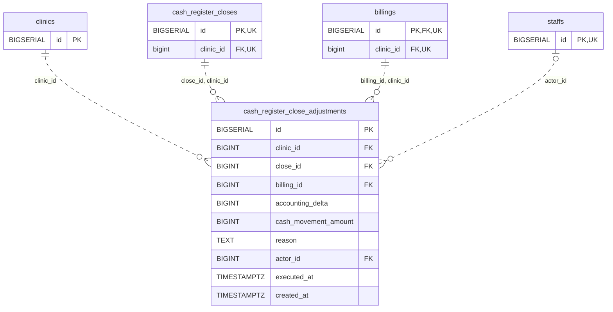

<!-- GENERATED: scripts/tools/generate-erd-detail.py; do not edit -->
# `cash_register_close_adjustments`

[詳細ERD一覧](index.md) · [概要ERD](../erd.md)

このページは、マイグレーションをファイル名順に静的解析した最終定義です。稼働DBの状態は未確認です。

## カラム

型・DEFAULTはDDLの宣言表記です。`bigserial` は採番宣言であり、DBカタログ上の型名ではありません。

| カラム | 型（DDL） | NULL | DEFAULT（DDL） | キー構成列 | 定義元 |
|:---|:---|:---|:---|:---|:---|
| `id` | `BIGSERIAL` | NOT NULL | — | PK | [001_init.sql:4906](../../../backend/migrations/001_init.sql#L4906) |
| `clinic_id` | `BIGINT` | NOT NULL | — | FK | [001_init.sql:4907](../../../backend/migrations/001_init.sql#L4907) |
| `close_id` | `BIGINT` | NOT NULL | — | FK | [001_init.sql:4908](../../../backend/migrations/001_init.sql#L4908) |
| `billing_id` | `BIGINT` | NOT NULL | — | FK | [001_init.sql:4909](../../../backend/migrations/001_init.sql#L4909) |
| `accounting_delta` | `BIGINT` | NOT NULL | `0` | — | [001_init.sql:4910](../../../backend/migrations/001_init.sql#L4910) |
| `cash_movement_amount` | `BIGINT` | NOT NULL | `0` | — | [001_init.sql:4911](../../../backend/migrations/001_init.sql#L4911) |
| `reason` | `TEXT` | NOT NULL | — | — | [001_init.sql:4912](../../../backend/migrations/001_init.sql#L4912) |
| `actor_id` | `BIGINT` | NULL | — | FK | [001_init.sql:4913](../../../backend/migrations/001_init.sql#L4913) |
| `executed_at` | `TIMESTAMPTZ` | NOT NULL | `now()` | — | [001_init.sql:4914](../../../backend/migrations/001_init.sql#L4914) |
| `created_at` | `TIMESTAMPTZ` | NOT NULL | `now()` | — | [001_init.sql:4915](../../../backend/migrations/001_init.sql#L4915) |

PK/FK/UKはキーの構成列を示します。複合キーの各列が単独で一意という意味ではありません。部分uniqueは下記indexの述語を参照してください。

## ERD

このテーブルの全カラムと、すべての参照先を表示します。参照先はFKの対象列だけを表示し、全カラムは各テーブルのページに置きます。

親側の任意参照はFK列のNULL可否、子側の最大1件は無条件のPK/UNIQUEから導出します。部分uniqueによる条件付きの最大件数は図に反映せず、index一覧に記録します。実線はFK全列が子のPKに含まれる識別関係、破線はそれ以外です。

## 外部キー（全件）

| 制約 | 子の列（順序あり） | 参照先 | 親の列（順序あり） | 削除時の動作 | 定義元 |
|:---|:---|:---|:---|:---|:---|
| `cash_register_close_adjustments_clinic_id_fkey` | `clinic_id` | [clinics](clinics.md) | `id` | `ON DELETE NO ACTION` | [001_init.sql:4907](../../../backend/migrations/001_init.sql#L4907) |
| `fk_cash_register_close_adjustments_close_clinic` | `close_id, clinic_id` | [cash_register_closes](cash_register_closes.md) | `id, clinic_id` | `ON DELETE RESTRICT` | [001_init.sql:5709](../../../backend/migrations/001_init.sql#L5709) |
| `fk_cash_register_close_adjustments_billing_clinic` | `billing_id, clinic_id` | [billings](billings.md) | `id, clinic_id` | `ON DELETE RESTRICT` | [001_init.sql:5713](../../../backend/migrations/001_init.sql#L5713) |
| `fk_cash_register_close_adjustments_actor` | `actor_id` | [staffs](staffs.md) | `id` | `ON DELETE RESTRICT` | [001_init.sql:6788](../../../backend/migrations/001_init.sql#L6788) |

正確なON UPDATE・MATCH・DEFERRABLE等を含む制約DDL:

- `cash_register_close_adjustments_clinic_id_fkey`: `REFERENCES clinics(id)`
- `fk_cash_register_close_adjustments_close_clinic`: `CONSTRAINT fk_cash_register_close_adjustments_close_clinic         FOREIGN KEY (close_id, clinic_id)         REFERENCES cash_register_closes (id, clinic_id)         ON DELETE RESTRICT`
- `fk_cash_register_close_adjustments_billing_clinic`: `CONSTRAINT fk_cash_register_close_adjustments_billing_clinic         FOREIGN KEY (billing_id, clinic_id)         REFERENCES billings (id, clinic_id)         ON DELETE RESTRICT`
- `fk_cash_register_close_adjustments_actor`: `CONSTRAINT fk_cash_register_close_adjustments_actor         FOREIGN KEY (actor_id) REFERENCES staffs (id) ON DELETE RESTRICT`

## その他の制約

| 制約 | 種別 | DDL | 定義元 |
|:---|:---|:---|:---|
| `cash_register_close_adjustments_pkey` | primary | `PRIMARY KEY` | [001_init.sql:4906](../../../backend/migrations/001_init.sql#L4906) |

## インデックス

| 名前 | UNIQUE | 述語 | DDL | 定義元 |
|:---|:---|:---|:---|:---|
| `idx_cash_register_close_adjustments_close` | NO | — | `CREATE INDEX IF NOT EXISTS idx_cash_register_close_adjustments_close     ON cash_register_close_adjustments (clinic_id, close_id)` | [001_init.sql:4918](../../../backend/migrations/001_init.sql#L4918) |
| `idx_cash_register_close_adjustments_executed` | NO | — | `CREATE INDEX IF NOT EXISTS idx_cash_register_close_adjustments_executed     ON cash_register_close_adjustments (clinic_id, executed_at)` | [001_init.sql:4921](../../../backend/migrations/001_init.sql#L4921) |
