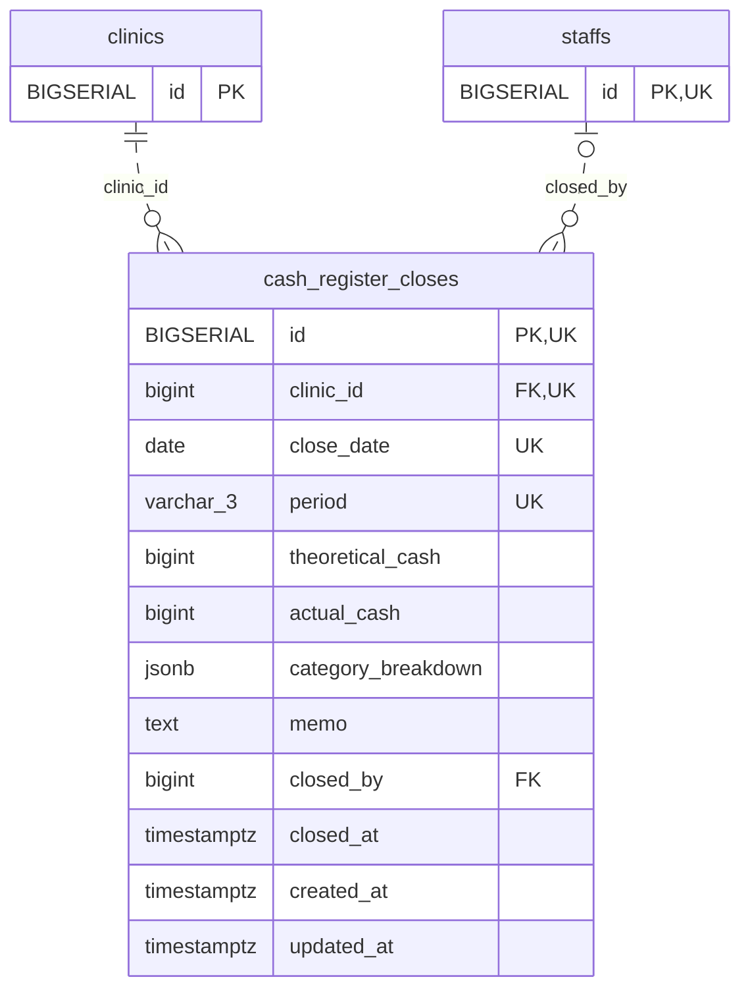

<!-- GENERATED: scripts/tools/generate-erd-detail.py; do not edit -->
# `cash_register_closes`

[詳細ERD一覧](index.md) · [概要ERD](../erd.md)

このページは、マイグレーションをファイル名順に静的解析した最終定義です。稼働DBの状態は未確認です。

## カラム

型・DEFAULTはDDLの宣言表記です。`bigserial` は採番宣言であり、DBカタログ上の型名ではありません。

| カラム | 型（DDL） | NULL | DEFAULT（DDL） | キー構成列 | 定義元 |
|:---|:---|:---|:---|:---|:---|
| `id` | `BIGSERIAL` | NOT NULL | — | PK, UK | [001_init.sql:2154](../../../backend/migrations/001_init.sql#L2154) |
| `clinic_id` | `bigint` | NOT NULL | — | FK, UK | [001_init.sql:2155](../../../backend/migrations/001_init.sql#L2155) |
| `close_date` | `date` | NOT NULL | — | UK | [001_init.sql:2156](../../../backend/migrations/001_init.sql#L2156) |
| `period` | `varchar(3)` | NOT NULL | — | UK | [001_init.sql:2157](../../../backend/migrations/001_init.sql#L2157) |
| `theoretical_cash` | `bigint` | NOT NULL | `0` | — | [001_init.sql:2158](../../../backend/migrations/001_init.sql#L2158) |
| `actual_cash` | `bigint` | NOT NULL | `0` | — | [001_init.sql:2159](../../../backend/migrations/001_init.sql#L2159) |
| `category_breakdown` | `jsonb` | NOT NULL | `'{}'` | — | [001_init.sql:2161](../../../backend/migrations/001_init.sql#L2161) |
| `memo` | `text` | NOT NULL | `''` | — | [001_init.sql:2162](../../../backend/migrations/001_init.sql#L2162) |
| `closed_by` | `bigint` | NULL | — | FK | [001_init.sql:2163](../../../backend/migrations/001_init.sql#L2163) |
| `closed_at` | `timestamptz` | NOT NULL | `now()` | — | [001_init.sql:2164](../../../backend/migrations/001_init.sql#L2164) |
| `created_at` | `timestamptz` | NOT NULL | `now()` | — | [001_init.sql:2165](../../../backend/migrations/001_init.sql#L2165) |
| `updated_at` | `timestamptz` | NOT NULL | `now()` | — | [001_init.sql:2166](../../../backend/migrations/001_init.sql#L2166) |

PK/FK/UKはキーの構成列を示します。複合キーの各列が単独で一意という意味ではありません。部分uniqueは下記indexの述語を参照してください。

## ERD

このテーブルの全カラムと、すべての参照先を表示します。参照先はFKの対象列だけを表示し、全カラムは各テーブルのページに置きます。

親側の任意参照はFK列のNULL可否、子側の最大1件は無条件のPK/UNIQUEから導出します。部分uniqueによる条件付きの最大件数は図に反映せず、index一覧に記録します。実線はFK全列が子のPKに含まれる識別関係、破線はそれ以外です。

## 外部キー（全件）

| 制約 | 子の列（順序あり） | 参照先 | 親の列（順序あり） | 削除時の動作 | 定義元 |
|:---|:---|:---|:---|:---|:---|
| `cash_register_closes_clinic_id_fkey` | `clinic_id` | [clinics](clinics.md) | `id` | `ON DELETE CASCADE` | [001_init.sql:2155](../../../backend/migrations/001_init.sql#L2155) |
| `cash_register_closes_closed_by_fkey` | `closed_by` | [staffs](staffs.md) | `id` | `ON DELETE NO ACTION` | [001_init.sql:2163](../../../backend/migrations/001_init.sql#L2163) |

正確なON UPDATE・MATCH・DEFERRABLE等を含む制約DDL:

- `cash_register_closes_clinic_id_fkey`: `REFERENCES clinics(id) ON DELETE CASCADE`
- `cash_register_closes_closed_by_fkey`: `REFERENCES staffs(id)`

## その他の制約

| 制約 | 種別 | DDL | 定義元 |
|:---|:---|:---|:---|
| `cash_register_closes_pkey` | primary | `PRIMARY KEY` | [001_init.sql:2154](../../../backend/migrations/001_init.sql#L2154) |
| `cash_register_closes_period_check` | check | `CHECK (period IN ('am', 'pm', 'emg'))` | [001_init.sql:2157](../../../backend/migrations/001_init.sql#L2157) |
| `uq_cash_register_closes_id_clinic` | unique | `CONSTRAINT uq_cash_register_closes_id_clinic         UNIQUE (id, clinic_id)` | [001_init.sql:5700](../../../backend/migrations/001_init.sql#L5700) |
| `ck_cash_actual_nonnegative` | check | `CONSTRAINT ck_cash_actual_nonnegative CHECK(actual_cash>=0)` | [001_init.sql:10645](../../../backend/migrations/001_init.sql#L10645) |
| `ck_close_difference_note` | check | `CONSTRAINT ck_close_difference_note CHECK(actual_cash=theoretical_cash OR btrim(memo)<>'')` | [001_init.sql:10897](../../../backend/migrations/001_init.sql#L10897) |

## インデックス

| 名前 | UNIQUE | 述語 | DDL | 定義元 |
|:---|:---|:---|:---|:---|
| `idx_cash_register_closes_clinic` | NO | — | `CREATE INDEX idx_cash_register_closes_clinic ON cash_register_closes(clinic_id, close_date DESC)` | [001_init.sql:2170](../../../backend/migrations/001_init.sql#L2170) |
| `uq_cash_register_closes_date_period` | YES | — | `CREATE UNIQUE INDEX uq_cash_register_closes_date_period     ON cash_register_closes (clinic_id, close_date, period)` | [001_init.sql:4896](../../../backend/migrations/001_init.sql#L4896) |
