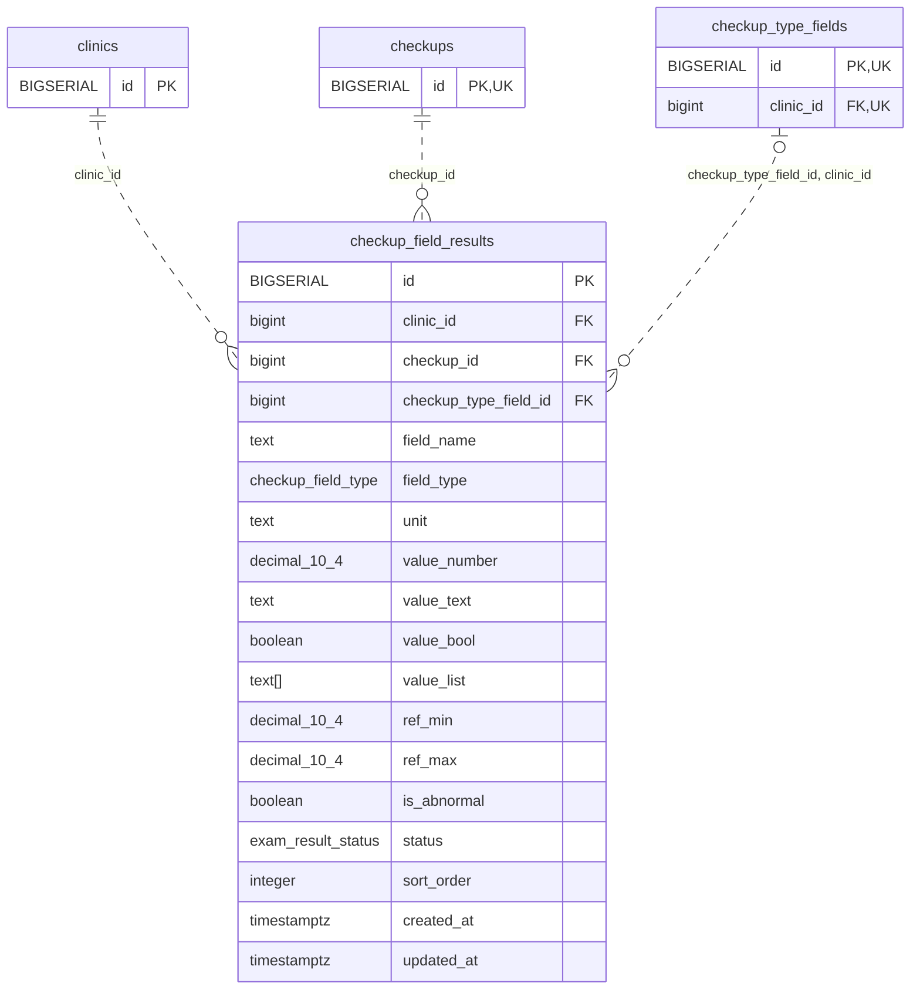

<!-- GENERATED: scripts/tools/generate-erd-detail.py; do not edit -->
# `checkup_field_results`

[詳細ERD一覧](index.md) · [概要ERD](../erd.md)

このページは、マイグレーションをファイル名順に静的解析した最終定義です。稼働DBの状態は未確認です。

## カラム

型・DEFAULTはDDLの宣言表記です。`bigserial` は採番宣言であり、DBカタログ上の型名ではありません。

| カラム | 型（DDL） | NULL | DEFAULT（DDL） | キー構成列 | 定義元 |
|:---|:---|:---|:---|:---|:---|
| `id` | `BIGSERIAL` | NOT NULL | — | PK | [001_init.sql:3716](../../../backend/migrations/001_init.sql#L3716) |
| `clinic_id` | `bigint` | NOT NULL | — | FK | [001_init.sql:3717](../../../backend/migrations/001_init.sql#L3717) |
| `checkup_id` | `bigint` | NOT NULL | — | FK | [001_init.sql:3718](../../../backend/migrations/001_init.sql#L3718) |
| `checkup_type_field_id` | `bigint` | NULL | — | FK | [001_init.sql:3719](../../../backend/migrations/001_init.sql#L3719) |
| `field_name` | `text` | NOT NULL | `''` | — | [001_init.sql:3721](../../../backend/migrations/001_init.sql#L3721) |
| `field_type` | `checkup_field_type` | NOT NULL | — | — | [001_init.sql:3722](../../../backend/migrations/001_init.sql#L3722) |
| `unit` | `text` | NOT NULL | `''` | — | [001_init.sql:3723](../../../backend/migrations/001_init.sql#L3723) |
| `value_number` | `decimal(10,4)` | NULL | — | — | [001_init.sql:3725](../../../backend/migrations/001_init.sql#L3725) |
| `value_text` | `text` | NOT NULL | `''` | — | [001_init.sql:3726](../../../backend/migrations/001_init.sql#L3726) |
| `value_bool` | `boolean` | NULL | — | — | [001_init.sql:3727](../../../backend/migrations/001_init.sql#L3727) |
| `value_list` | `text[]` | NOT NULL | `'{}'` | — | [001_init.sql:3728](../../../backend/migrations/001_init.sql#L3728) |
| `ref_min` | `decimal(10,4)` | NULL | — | — | [001_init.sql:3730](../../../backend/migrations/001_init.sql#L3730) |
| `ref_max` | `decimal(10,4)` | NULL | — | — | [001_init.sql:3731](../../../backend/migrations/001_init.sql#L3731) |
| `is_abnormal` | `boolean` | NOT NULL | `false` | — | [001_init.sql:3732](../../../backend/migrations/001_init.sql#L3732) |
| `status` | `exam_result_status` | NOT NULL | `'normal'` | — | [001_init.sql:3733](../../../backend/migrations/001_init.sql#L3733) |
| `sort_order` | `integer` | NOT NULL | `0` | — | [001_init.sql:3734](../../../backend/migrations/001_init.sql#L3734) |
| `created_at` | `timestamptz` | NOT NULL | `now()` | — | [001_init.sql:3735](../../../backend/migrations/001_init.sql#L3735) |
| `updated_at` | `timestamptz` | NOT NULL | `now()` | — | [001_init.sql:3736](../../../backend/migrations/001_init.sql#L3736) |

PK/FK/UKはキーの構成列を示します。複合キーの各列が単独で一意という意味ではありません。部分uniqueは下記indexの述語を参照してください。

## ERD

このテーブルの全カラムと、すべての参照先を表示します。参照先はFKの対象列だけを表示し、全カラムは各テーブルのページに置きます。

親側の任意参照はFK列のNULL可否、子側の最大1件は無条件のPK/UNIQUEから導出します。部分uniqueによる条件付きの最大件数は図に反映せず、index一覧に記録します。実線はFK全列が子のPKに含まれる識別関係、破線はそれ以外です。

## 外部キー（全件）

| 制約 | 子の列（順序あり） | 参照先 | 親の列（順序あり） | 削除時の動作 | 定義元 |
|:---|:---|:---|:---|:---|:---|
| `checkup_field_results_clinic_id_fkey` | `clinic_id` | [clinics](clinics.md) | `id` | `ON DELETE RESTRICT` | [001_init.sql:3717](../../../backend/migrations/001_init.sql#L3717) |
| `checkup_field_results_checkup_id_fkey` | `checkup_id` | [checkups](checkups.md) | `id` | `ON DELETE CASCADE` | [001_init.sql:3718](../../../backend/migrations/001_init.sql#L3718) |
| `fk_checkup_field_results_field_clinic` | `checkup_type_field_id, clinic_id` | [checkup_type_fields](checkup_type_fields.md) | `id, clinic_id` | `ON DELETE SET NULL (checkup_type_field_id)` | [001_init.sql:3816](../../../backend/migrations/001_init.sql#L3816) |

正確なON UPDATE・MATCH・DEFERRABLE等を含む制約DDL:

- `checkup_field_results_clinic_id_fkey`: `REFERENCES clinics(id)   ON DELETE RESTRICT`
- `checkup_field_results_checkup_id_fkey`: `REFERENCES checkups(id)  ON DELETE CASCADE`
- `fk_checkup_field_results_field_clinic`: `CONSTRAINT fk_checkup_field_results_field_clinic     FOREIGN KEY (checkup_type_field_id, clinic_id)     REFERENCES checkup_type_fields (id, clinic_id)     ON DELETE SET NULL (checkup_type_field_id)`

## その他の制約

| 制約 | 種別 | DDL | 定義元 |
|:---|:---|:---|:---|
| `checkup_field_results_pkey` | primary | `PRIMARY KEY` | [001_init.sql:3716](../../../backend/migrations/001_init.sql#L3716) |

## インデックス

| 名前 | UNIQUE | 述語 | DDL | 定義元 |
|:---|:---|:---|:---|:---|
| `idx_checkup_field_results_clinic_checkup` | NO | — | `CREATE INDEX idx_checkup_field_results_clinic_checkup ON checkup_field_results(clinic_id, checkup_id)` | [001_init.sql:3749](../../../backend/migrations/001_init.sql#L3749) |
| `idx_checkup_field_results_checkup_id` | NO | — | `CREATE INDEX idx_checkup_field_results_checkup_id      ON checkup_field_results(checkup_id)` | [001_init.sql:3751](../../../backend/migrations/001_init.sql#L3751) |
| `idx_checkup_field_results_field_id` | NO | `checkup_type_field_id IS NOT NULL` | `CREATE INDEX idx_checkup_field_results_field_id        ON checkup_field_results(checkup_type_field_id) WHERE checkup_type_field_id IS NOT NULL` | [001_init.sql:3753](../../../backend/migrations/001_init.sql#L3753) |
