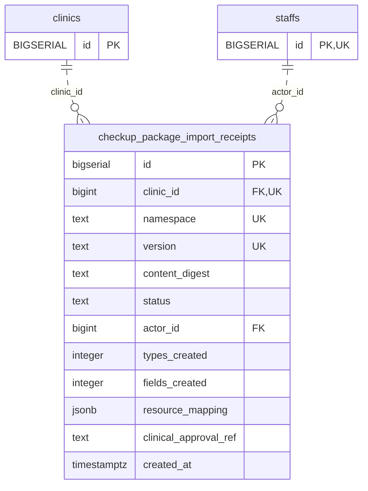

<!-- GENERATED: scripts/tools/generate-erd-detail.py; do not edit -->
# `checkup_package_import_receipts`

[詳細ERD一覧](index.md) · [概要ERD](../erd.md)

このページは、マイグレーションをファイル名順に静的解析した最終定義です。稼働DBの状態は未確認です。

## カラム

型・DEFAULTはDDLの宣言表記です。`bigserial` は採番宣言であり、DBカタログ上の型名ではありません。

| カラム | 型（DDL） | NULL | DEFAULT（DDL） | キー構成列 | 定義元 |
|:---|:---|:---|:---|:---|:---|
| `id` | `bigserial` | NOT NULL | — | PK | [001_init.sql:5271](../../../backend/migrations/001_init.sql#L5271) |
| `clinic_id` | `bigint` | NOT NULL | — | FK, UK | [001_init.sql:5272](../../../backend/migrations/001_init.sql#L5272) |
| `namespace` | `text` | NOT NULL | — | UK | [001_init.sql:5273](../../../backend/migrations/001_init.sql#L5273) |
| `version` | `text` | NOT NULL | — | UK | [001_init.sql:5274](../../../backend/migrations/001_init.sql#L5274) |
| `content_digest` | `text` | NOT NULL | — | — | [001_init.sql:5275](../../../backend/migrations/001_init.sql#L5275) |
| `status` | `text` | NOT NULL | — | — | [001_init.sql:5276](../../../backend/migrations/001_init.sql#L5276) |
| `actor_id` | `bigint` | NOT NULL | — | FK | [001_init.sql:5277](../../../backend/migrations/001_init.sql#L5277) |
| `types_created` | `integer` | NOT NULL | `0` | — | [001_init.sql:5278](../../../backend/migrations/001_init.sql#L5278) |
| `fields_created` | `integer` | NOT NULL | `0` | — | [001_init.sql:5279](../../../backend/migrations/001_init.sql#L5279) |
| `resource_mapping` | `jsonb` | NOT NULL | `'{}'::jsonb` | — | [001_init.sql:5280](../../../backend/migrations/001_init.sql#L5280) |
| `clinical_approval_ref` | `text` | NOT NULL | `''` | — | [001_init.sql:5281](../../../backend/migrations/001_init.sql#L5281) |
| `created_at` | `timestamptz` | NOT NULL | `CURRENT_TIMESTAMP` | — | [001_init.sql:5282](../../../backend/migrations/001_init.sql#L5282) |

PK/FK/UKはキーの構成列を示します。複合キーの各列が単独で一意という意味ではありません。部分uniqueは下記indexの述語を参照してください。

## ERD

このテーブルの全カラムと、すべての参照先を表示します。参照先はFKの対象列だけを表示し、全カラムは各テーブルのページに置きます。

親側の任意参照はFK列のNULL可否、子側の最大1件は無条件のPK/UNIQUEから導出します。部分uniqueによる条件付きの最大件数は図に反映せず、index一覧に記録します。実線はFK全列が子のPKに含まれる識別関係、破線はそれ以外です。

## 外部キー（全件）

| 制約 | 子の列（順序あり） | 参照先 | 親の列（順序あり） | 削除時の動作 | 定義元 |
|:---|:---|:---|:---|:---|:---|
| `checkup_package_import_receipts_clinic_id_fkey` | `clinic_id` | [clinics](clinics.md) | `id` | `ON DELETE RESTRICT` | [001_init.sql:5272](../../../backend/migrations/001_init.sql#L5272) |
| `checkup_package_import_receipts_actor_id_fkey` | `actor_id` | [staffs](staffs.md) | `id` | `ON DELETE RESTRICT` | [001_init.sql:5277](../../../backend/migrations/001_init.sql#L5277) |

正確なON UPDATE・MATCH・DEFERRABLE等を含む制約DDL:

- `checkup_package_import_receipts_clinic_id_fkey`: `REFERENCES clinics(id) ON DELETE RESTRICT`
- `checkup_package_import_receipts_actor_id_fkey`: `REFERENCES staffs(id) ON DELETE RESTRICT`

## その他の制約

| 制約 | 種別 | DDL | 定義元 |
|:---|:---|:---|:---|
| `checkup_package_import_receipts_pkey` | primary | `PRIMARY KEY` | [001_init.sql:5271](../../../backend/migrations/001_init.sql#L5271) |
| `checkup_package_import_receipts_status_check` | check | `CHECK (status IN ('applied', 'noop', 'conflict', 'failed'))` | [001_init.sql:5276](../../../backend/migrations/001_init.sql#L5276) |
| `checkup_package_import_receipts_types_created_check` | check | `CHECK (types_created >= 0)` | [001_init.sql:5278](../../../backend/migrations/001_init.sql#L5278) |
| `checkup_package_import_receipts_fields_created_check` | check | `CHECK (fields_created >= 0)` | [001_init.sql:5279](../../../backend/migrations/001_init.sql#L5279) |
| `uq_checkup_package_import_receipts_clinic_ns_ver` | unique | `CONSTRAINT uq_checkup_package_import_receipts_clinic_ns_ver         UNIQUE (clinic_id, namespace, version)` | [001_init.sql:5283](../../../backend/migrations/001_init.sql#L5283) |

## インデックス

| 名前 | UNIQUE | 述語 | DDL | 定義元 |
|:---|:---|:---|:---|:---|
| `idx_checkup_package_import_receipts_clinic_created` | NO | — | `CREATE INDEX IF NOT EXISTS idx_checkup_package_import_receipts_clinic_created     ON checkup_package_import_receipts (clinic_id, created_at DESC)` | [001_init.sql:5287](../../../backend/migrations/001_init.sql#L5287) |
| `idx_checkup_package_import_receipts_clinic_digest` | NO | — | `CREATE INDEX IF NOT EXISTS idx_checkup_package_import_receipts_clinic_digest     ON checkup_package_import_receipts (clinic_id, content_digest)` | [001_init.sql:5290](../../../backend/migrations/001_init.sql#L5290) |
