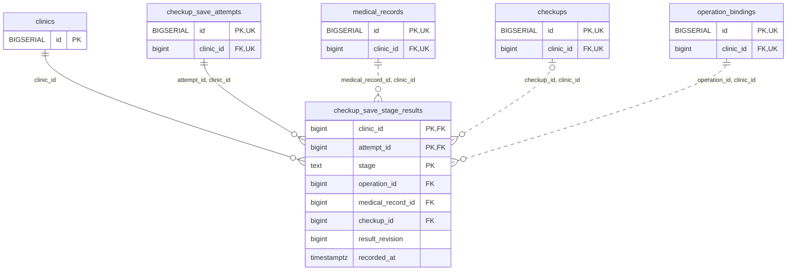

<!-- GENERATED: scripts/tools/generate-erd-detail.py; do not edit -->
# `checkup_save_stage_results`

[詳細ERD一覧](index.md) · [概要ERD](../erd.md)

このページは、マイグレーションをファイル名順に静的解析した最終定義です。稼働DBの状態は未確認です。

## カラム

型・DEFAULTはDDLの宣言表記です。`bigserial` は採番宣言であり、DBカタログ上の型名ではありません。

| カラム | 型（DDL） | NULL | DEFAULT（DDL） | キー構成列 | 定義元 |
|:---|:---|:---|:---|:---|:---|
| `clinic_id` | `bigint` | NOT NULL | — | PK, FK | [001_init.sql:9951](../../../backend/migrations/001_init.sql#L9951) |
| `attempt_id` | `bigint` | NOT NULL | — | PK, FK | [001_init.sql:9951](../../../backend/migrations/001_init.sql#L9951) |
| `stage` | `text` | NOT NULL | — | PK | [001_init.sql:9952](../../../backend/migrations/001_init.sql#L9952) |
| `operation_id` | `bigint` | NOT NULL | — | FK | [001_init.sql:9952](../../../backend/migrations/001_init.sql#L9952) |
| `medical_record_id` | `bigint` | NOT NULL | — | FK | [001_init.sql:9953](../../../backend/migrations/001_init.sql#L9953) |
| `checkup_id` | `bigint` | NULL | — | FK | [001_init.sql:9953](../../../backend/migrations/001_init.sql#L9953) |
| `result_revision` | `bigint` | NULL | — | — | [001_init.sql:9953](../../../backend/migrations/001_init.sql#L9953) |
| `recorded_at` | `timestamptz` | NOT NULL | `clock_timestamp()` | — | [001_init.sql:9954](../../../backend/migrations/001_init.sql#L9954) |

PK/FK/UKはキーの構成列を示します。複合キーの各列が単独で一意という意味ではありません。部分uniqueは下記indexの述語を参照してください。

## ERD

このテーブルの全カラムと、すべての参照先を表示します。参照先はFKの対象列だけを表示し、全カラムは各テーブルのページに置きます。

親側の任意参照はFK列のNULL可否、子側の最大1件は無条件のPK/UNIQUEから導出します。部分uniqueによる条件付きの最大件数は図に反映せず、index一覧に記録します。実線はFK全列が子のPKに含まれる識別関係、破線はそれ以外です。

## 外部キー（全件）

| 制約 | 子の列（順序あり） | 参照先 | 親の列（順序あり） | 削除時の動作 | 定義元 |
|:---|:---|:---|:---|:---|:---|
| `checkup_save_stage_results_clinic_id_fkey` | `clinic_id` | [clinics](clinics.md) | `id` | `ON DELETE RESTRICT` | [001_init.sql:9951](../../../backend/migrations/001_init.sql#L9951) |
| `checkup_save_stage_results_attempt_id_clinic_id_fkey` | `attempt_id, clinic_id` | [checkup_save_attempts](checkup_save_attempts.md) | `id, clinic_id` | `ON DELETE RESTRICT` | [001_init.sql:9958](../../../backend/migrations/001_init.sql#L9958) |
| `checkup_save_stage_results_medical_record_id_clinic_id_fkey` | `medical_record_id, clinic_id` | [medical_records](medical_records.md) | `id, clinic_id` | `ON DELETE RESTRICT` | [001_init.sql:9959](../../../backend/migrations/001_init.sql#L9959) |
| `checkup_save_stage_results_checkup_id_clinic_id_fkey` | `checkup_id, clinic_id` | [checkups](checkups.md) | `id, clinic_id` | `ON DELETE RESTRICT` | [001_init.sql:9960](../../../backend/migrations/001_init.sql#L9960) |
| `checkup_save_stage_results_operation_id_clinic_id_fkey` | `operation_id, clinic_id` | [operation_bindings](operation_bindings.md) | `id, clinic_id` | `ON DELETE RESTRICT` | [001_init.sql:9961](../../../backend/migrations/001_init.sql#L9961) |

正確なON UPDATE・MATCH・DEFERRABLE等を含む制約DDL:

- `checkup_save_stage_results_clinic_id_fkey`: `REFERENCES clinics(id) ON DELETE RESTRICT`
- `checkup_save_stage_results_attempt_id_clinic_id_fkey`: `FOREIGN KEY(attempt_id,clinic_id) REFERENCES checkup_save_attempts(id,clinic_id) ON DELETE RESTRICT`
- `checkup_save_stage_results_medical_record_id_clinic_id_fkey`: `FOREIGN KEY(medical_record_id,clinic_id) REFERENCES medical_records(id,clinic_id) ON DELETE RESTRICT`
- `checkup_save_stage_results_checkup_id_clinic_id_fkey`: `FOREIGN KEY(checkup_id,clinic_id) REFERENCES checkups(id,clinic_id) ON DELETE RESTRICT`
- `checkup_save_stage_results_operation_id_clinic_id_fkey`: `FOREIGN KEY(operation_id,clinic_id) REFERENCES operation_bindings(id,clinic_id) ON DELETE RESTRICT`

## その他の制約

| 制約 | 種別 | DDL | 定義元 |
|:---|:---|:---|:---|
| `checkup_save_stage_results_stage_check` | check | `CHECK(stage IN ('parent','checkup','results'))` | [001_init.sql:9952](../../../backend/migrations/001_init.sql#L9952) |
| `checkup_save_stage_results_pkey` | primary | `PRIMARY KEY(clinic_id,attempt_id,stage)` | [001_init.sql:9954](../../../backend/migrations/001_init.sql#L9954) |
| `checkup_save_stage_results_check` | check | `CHECK((stage='parent' AND checkup_id IS NULL AND result_revision IS NULL)  OR(stage='checkup' AND checkup_id IS NOT NULL AND result_revision IS NULL)  OR(stage='results' AND checkup_id IS NOT NULL AND result_revision>0))` | [001_init.sql:9955](../../../backend/migrations/001_init.sql#L9955) |

## インデックス

明示的なCREATE INDEXなし。PK/UNIQUEに付随する暗黙のindexは制約欄を参照してください。
