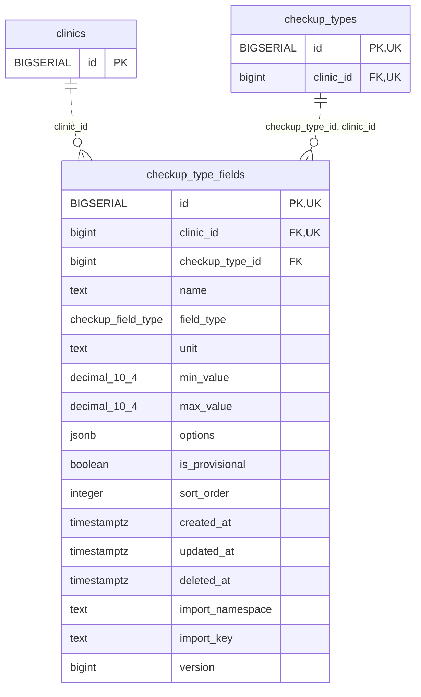

<!-- GENERATED: scripts/tools/generate-erd-detail.py; do not edit -->
# `checkup_type_fields`

[詳細ERD一覧](index.md) · [概要ERD](../erd.md)

このページは、マイグレーションをファイル名順に静的解析した最終定義です。稼働DBの状態は未確認です。

## カラム

型・DEFAULTはDDLの宣言表記です。`bigserial` は採番宣言であり、DBカタログ上の型名ではありません。

| カラム | 型（DDL） | NULL | DEFAULT（DDL） | キー構成列 | 定義元 |
|:---|:---|:---|:---|:---|:---|
| `id` | `BIGSERIAL` | NOT NULL | — | PK, UK | [001_init.sql:3679](../../../backend/migrations/001_init.sql#L3679) |
| `clinic_id` | `bigint` | NOT NULL | — | FK, UK | [001_init.sql:3680](../../../backend/migrations/001_init.sql#L3680) |
| `checkup_type_id` | `bigint` | NOT NULL | — | FK | [001_init.sql:3681](../../../backend/migrations/001_init.sql#L3681) |
| `name` | `text` | NOT NULL | — | — | [001_init.sql:3682](../../../backend/migrations/001_init.sql#L3682) |
| `field_type` | `checkup_field_type` | NOT NULL | — | — | [001_init.sql:3683](../../../backend/migrations/001_init.sql#L3683) |
| `unit` | `text` | NOT NULL | `''` | — | [001_init.sql:3684](../../../backend/migrations/001_init.sql#L3684) |
| `min_value` | `decimal(10,4)` | NULL | — | — | [001_init.sql:3686](../../../backend/migrations/001_init.sql#L3686) |
| `max_value` | `decimal(10,4)` | NULL | — | — | [001_init.sql:3687](../../../backend/migrations/001_init.sql#L3687) |
| `options` | `jsonb` | NOT NULL | `'[]'::jsonb` | — | [001_init.sql:3689](../../../backend/migrations/001_init.sql#L3689) |
| `is_provisional` | `boolean` | NOT NULL | `false` | — | [001_init.sql:3691](../../../backend/migrations/001_init.sql#L3691) |
| `sort_order` | `integer` | NOT NULL | `0` | — | [001_init.sql:3692](../../../backend/migrations/001_init.sql#L3692) |
| `created_at` | `timestamptz` | NOT NULL | `now()` | — | [001_init.sql:3693](../../../backend/migrations/001_init.sql#L3693) |
| `updated_at` | `timestamptz` | NOT NULL | `now()` | — | [001_init.sql:3694](../../../backend/migrations/001_init.sql#L3694) |
| `deleted_at` | `timestamptz` | NULL | — | — | [001_init.sql:3695](../../../backend/migrations/001_init.sql#L3695) |
| `import_namespace` | `text` | NULL | — | — | [001_init.sql:5219](../../../backend/migrations/001_init.sql#L5219) |
| `import_key` | `text` | NULL | — | — | [001_init.sql:5220](../../../backend/migrations/001_init.sql#L5220) |
| `version` | `bigint` | NOT NULL | `1` | — | [001_init.sql:9940](../../../backend/migrations/001_init.sql#L9940) |

PK/FK/UKはキーの構成列を示します。複合キーの各列が単独で一意という意味ではありません。部分uniqueは下記indexの述語を参照してください。

## ERD

このテーブルの全カラムと、すべての参照先を表示します。参照先はFKの対象列だけを表示し、全カラムは各テーブルのページに置きます。

親側の任意参照はFK列のNULL可否、子側の最大1件は無条件のPK/UNIQUEから導出します。部分uniqueによる条件付きの最大件数は図に反映せず、index一覧に記録します。実線はFK全列が子のPKに含まれる識別関係、破線はそれ以外です。

## 外部キー（全件）

| 制約 | 子の列（順序あり） | 参照先 | 親の列（順序あり） | 削除時の動作 | 定義元 |
|:---|:---|:---|:---|:---|:---|
| `checkup_type_fields_clinic_id_fkey` | `clinic_id` | [clinics](clinics.md) | `id` | `ON DELETE RESTRICT` | [001_init.sql:3680](../../../backend/migrations/001_init.sql#L3680) |
| `fk_checkup_type_fields_type_clinic` | `checkup_type_id, clinic_id` | [checkup_types](checkup_types.md) | `id, clinic_id` | `ON DELETE CASCADE` | [001_init.sql:3832](../../../backend/migrations/001_init.sql#L3832) |

正確なON UPDATE・MATCH・DEFERRABLE等を含む制約DDL:

- `checkup_type_fields_clinic_id_fkey`: `REFERENCES clinics(id)       ON DELETE RESTRICT`
- `fk_checkup_type_fields_type_clinic`: `CONSTRAINT fk_checkup_type_fields_type_clinic     FOREIGN KEY (checkup_type_id, clinic_id)     REFERENCES checkup_types (id, clinic_id)     ON DELETE CASCADE`

## その他の制約

| 制約 | 種別 | DDL | 定義元 |
|:---|:---|:---|:---|
| `checkup_type_fields_pkey` | primary | `PRIMARY KEY` | [001_init.sql:3679](../../../backend/migrations/001_init.sql#L3679) |
| `uq_checkup_type_fields_id_clinic` | unique | `CONSTRAINT uq_checkup_type_fields_id_clinic UNIQUE (id, clinic_id)` | [001_init.sql:3795](../../../backend/migrations/001_init.sql#L3795) |
| `checkup_type_fields_version_check` | check | `CHECK (version>0)` | [001_init.sql:9940](../../../backend/migrations/001_init.sql#L9940) |

## インデックス

| 名前 | UNIQUE | 述語 | DDL | 定義元 |
|:---|:---|:---|:---|:---|
| `idx_checkup_type_fields_clinic_id` | NO | — | `CREATE INDEX idx_checkup_type_fields_clinic_id        ON checkup_type_fields(clinic_id)` | [001_init.sql:3728](../../../backend/migrations/001_init.sql#L3728) |
| `idx_checkup_type_fields_checkup_type_id` | NO | — | `CREATE INDEX idx_checkup_type_fields_checkup_type_id  ON checkup_type_fields(checkup_type_id)` | [001_init.sql:3729](../../../backend/migrations/001_init.sql#L3729) |
| `idx_checkup_type_fields_clinic_type_sort` | NO | `deleted_at IS NULL` | `CREATE INDEX idx_checkup_type_fields_clinic_type_sort ON checkup_type_fields(clinic_id, checkup_type_id, sort_order) WHERE deleted_at IS NULL` | [001_init.sql:3730](../../../backend/migrations/001_init.sql#L3730) |
| `uq_checkup_type_fields_clinic_import_key` | YES | `import_namespace IS NOT NULL       AND import_key IS NOT NULL       AND deleted_at IS NULL` | `CREATE UNIQUE INDEX IF NOT EXISTS uq_checkup_type_fields_clinic_import_key     ON checkup_type_fields (clinic_id, import_namespace, import_key)     WHERE import_namespace IS NOT NULL       AND import_key IS NOT NULL       AND deleted_at IS NULL` | [001_init.sql:5222](../../../backend/migrations/001_init.sql#L5222) |
| `idx_checkup_type_fields_clinic_import_namespace` | NO | `import_namespace IS NOT NULL       AND deleted_at IS NULL` | `CREATE INDEX IF NOT EXISTS idx_checkup_type_fields_clinic_import_namespace     ON checkup_type_fields (clinic_id, import_namespace)     WHERE import_namespace IS NOT NULL       AND deleted_at IS NULL` | [001_init.sql:5228](../../../backend/migrations/001_init.sql#L5228) |
