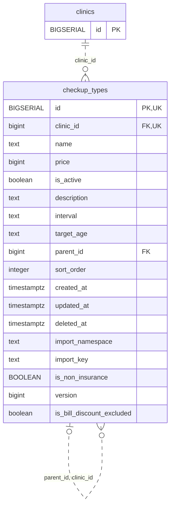

<!-- GENERATED: scripts/tools/generate-erd-detail.py; do not edit -->
# `checkup_types`

[詳細ERD一覧](index.md) · [概要ERD](../erd.md)

このページは、マイグレーションをファイル名順に静的解析した最終定義です。稼働DBの状態は未確認です。

## カラム

型・DEFAULTはDDLの宣言表記です。`bigserial` は採番宣言であり、DBカタログ上の型名ではありません。

| カラム | 型（DDL） | NULL | DEFAULT（DDL） | キー構成列 | 定義元 |
|:---|:---|:---|:---|:---|:---|
| `id` | `BIGSERIAL` | NOT NULL | — | PK, UK | [001_init.sql:1065](../../../backend/migrations/001_init.sql#L1065) |
| `clinic_id` | `bigint` | NOT NULL | — | FK, UK | [001_init.sql:1066](../../../backend/migrations/001_init.sql#L1066) |
| `name` | `text` | NOT NULL | — | — | [001_init.sql:1067](../../../backend/migrations/001_init.sql#L1067) |
| `price` | `bigint` | NULL | — | — | [001_init.sql:1068](../../../backend/migrations/001_init.sql#L1068) |
| `is_active` | `boolean` | NOT NULL | `true` | — | [001_init.sql:1069](../../../backend/migrations/001_init.sql#L1069) |
| `description` | `text` | NOT NULL | `''` | — | [001_init.sql:1070](../../../backend/migrations/001_init.sql#L1070) |
| `interval` | `text` | NOT NULL | `''` | — | [001_init.sql:1071](../../../backend/migrations/001_init.sql#L1071) |
| `target_age` | `text` | NOT NULL | `''` | — | [001_init.sql:1072](../../../backend/migrations/001_init.sql#L1072) |
| `parent_id` | `bigint` | NULL | — | FK | [001_init.sql:1073](../../../backend/migrations/001_init.sql#L1073) |
| `sort_order` | `integer` | NULL | `0` | — | [001_init.sql:1074](../../../backend/migrations/001_init.sql#L1074) |
| `created_at` | `timestamptz` | NOT NULL | `now()` | — | [001_init.sql:1075](../../../backend/migrations/001_init.sql#L1075) |
| `updated_at` | `timestamptz` | NOT NULL | `now()` | — | [001_init.sql:1076](../../../backend/migrations/001_init.sql#L1076) |
| `deleted_at` | `timestamptz` | NULL | — | — | [001_init.sql:1077](../../../backend/migrations/001_init.sql#L1077) |
| `import_namespace` | `text` | NULL | — | — | [001_init.sql:5203](../../../backend/migrations/001_init.sql#L5203) |
| `import_key` | `text` | NULL | — | — | [001_init.sql:5204](../../../backend/migrations/001_init.sql#L5204) |
| `is_non_insurance` | `BOOLEAN` | NULL | — | — | [001_init.sql:7611](../../../backend/migrations/001_init.sql#L7611) |
| `version` | `bigint` | NOT NULL | `1` | — | [001_init.sql:9941](../../../backend/migrations/001_init.sql#L9941) |
| `is_bill_discount_excluded` | `boolean` | NULL | — | — | [007_bill_discount_excluded_and_master_versions.sql:21](../../../backend/migrations/007_bill_discount_excluded_and_master_versions.sql#L21) |

PK/FK/UKはキーの構成列を示します。複合キーの各列が単独で一意という意味ではありません。部分uniqueは下記indexの述語を参照してください。

## ERD

このテーブルの全カラムと、すべての参照先を表示します。参照先はFKの対象列だけを表示し、全カラムは各テーブルのページに置きます。

親側の任意参照はFK列のNULL可否、子側の最大1件は無条件のPK/UNIQUEから導出します。部分uniqueによる条件付きの最大件数は図に反映せず、index一覧に記録します。実線はFK全列が子のPKに含まれる識別関係、破線はそれ以外です。

## 外部キー（全件）

| 制約 | 子の列（順序あり） | 参照先 | 親の列（順序あり） | 削除時の動作 | 定義元 |
|:---|:---|:---|:---|:---|:---|
| `checkup_types_clinic_id_fkey` | `clinic_id` | [clinics](clinics.md) | `id` | `ON DELETE RESTRICT` | [001_init.sql:1066](../../../backend/migrations/001_init.sql#L1066) |
| `fk_checkup_types_parent_clinic` | `parent_id, clinic_id` | [checkup_types](checkup_types.md) | `id, clinic_id` | `ON DELETE SET NULL (parent_id)` | [001_init.sql:5253](../../../backend/migrations/001_init.sql#L5253) |

正確なON UPDATE・MATCH・DEFERRABLE等を含む制約DDL:

- `checkup_types_clinic_id_fkey`: `REFERENCES clinics(id) ON DELETE RESTRICT`
- `fk_checkup_types_parent_clinic`: `CONSTRAINT fk_checkup_types_parent_clinic FOREIGN KEY (parent_id, clinic_id) REFERENCES checkup_types (id, clinic_id) ON DELETE SET NULL (parent_id)`

## その他の制約

| 制約 | 種別 | DDL | 定義元 |
|:---|:---|:---|:---|
| `checkup_types_pkey` | primary | `PRIMARY KEY` | [001_init.sql:1065](../../../backend/migrations/001_init.sql#L1065) |
| `uq_checkup_types_id_clinic` | unique | `CONSTRAINT uq_checkup_types_id_clinic UNIQUE (id, clinic_id)` | [001_init.sql:3824](../../../backend/migrations/001_init.sql#L3824) |
| `checkup_types_version_check` | check | `CHECK (version>0)` | [001_init.sql:9941](../../../backend/migrations/001_init.sql#L9941) |

## インデックス

| 名前 | UNIQUE | 述語 | DDL | 定義元 |
|:---|:---|:---|:---|:---|
| `idx_checkup_types_clinic_id` | NO | — | `CREATE INDEX idx_checkup_types_clinic_id ON checkup_types(clinic_id)` | [001_init.sql:2238](../../../backend/migrations/001_init.sql#L2238) |
| `idx_checkup_types_deleted_at` | NO | — | `CREATE INDEX idx_checkup_types_deleted_at ON checkup_types(deleted_at)` | [001_init.sql:2240](../../../backend/migrations/001_init.sql#L2240) |
| `idx_checkup_types_clinic_sort` | NO | `deleted_at IS NULL` | `CREATE INDEX idx_checkup_types_clinic_sort     ON checkup_types(clinic_id, sort_order)           WHERE deleted_at IS NULL` | [001_init.sql:2266](../../../backend/migrations/001_init.sql#L2266) |
| `idx_checkup_types_clinic_name` | YES | `deleted_at IS NULL` | `CREATE UNIQUE INDEX idx_checkup_types_clinic_name ON checkup_types(clinic_id, name) WHERE deleted_at IS NULL` | [001_init.sql:2469](../../../backend/migrations/001_init.sql#L2469) |
| `uq_checkup_types_clinic_import_key` | YES | `import_namespace IS NOT NULL       AND import_key IS NOT NULL       AND deleted_at IS NULL` | `CREATE UNIQUE INDEX IF NOT EXISTS uq_checkup_types_clinic_import_key     ON checkup_types (clinic_id, import_namespace, import_key)     WHERE import_namespace IS NOT NULL       AND import_key IS NOT NULL       AND deleted_at IS NULL` | [001_init.sql:5206](../../../backend/migrations/001_init.sql#L5206) |
| `idx_checkup_types_clinic_import_namespace` | NO | `import_namespace IS NOT NULL       AND deleted_at IS NULL` | `CREATE INDEX IF NOT EXISTS idx_checkup_types_clinic_import_namespace     ON checkup_types (clinic_id, import_namespace)     WHERE import_namespace IS NOT NULL       AND deleted_at IS NULL` | [001_init.sql:5212](../../../backend/migrations/001_init.sql#L5212) |
| `idx_checkup_types_clinic_parent` | NO | `parent_id IS NOT NULL` | `CREATE INDEX IF NOT EXISTS idx_checkup_types_clinic_parent     ON checkup_types (clinic_id, parent_id)     WHERE parent_id IS NOT NULL` | [001_init.sql:5273](../../../backend/migrations/001_init.sql#L5273) |
