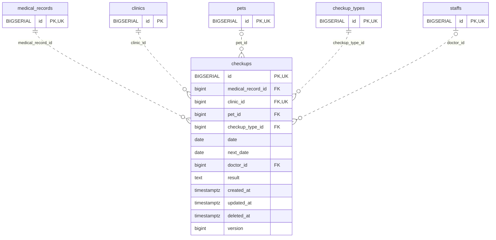

<!-- GENERATED: scripts/tools/generate-erd-detail.py; do not edit -->
# `checkups`

[詳細ERD一覧](index.md) · [概要ERD](../erd.md)

このページは、マイグレーションをファイル名順に静的解析した最終定義です。稼働DBの状態は未確認です。

## カラム

型・DEFAULTはDDLの宣言表記です。`bigserial` は採番宣言であり、DBカタログ上の型名ではありません。

| カラム | 型（DDL） | NULL | DEFAULT（DDL） | キー構成列 | 定義元 |
|:---|:---|:---|:---|:---|:---|
| `id` | `BIGSERIAL` | NOT NULL | — | PK, UK | [001_init.sql:1510](../../../backend/migrations/001_init.sql#L1510) |
| `medical_record_id` | `bigint` | NOT NULL | — | FK | [001_init.sql:1511](../../../backend/migrations/001_init.sql#L1511) |
| `clinic_id` | `bigint` | NOT NULL | — | FK, UK | [001_init.sql:1512](../../../backend/migrations/001_init.sql#L1512) |
| `pet_id` | `bigint` | NULL | — | FK | [001_init.sql:1513](../../../backend/migrations/001_init.sql#L1513) |
| `checkup_type_id` | `bigint` | NOT NULL | — | FK | [001_init.sql:1514](../../../backend/migrations/001_init.sql#L1514) |
| `date` | `date` | NOT NULL | — | — | [001_init.sql:1515](../../../backend/migrations/001_init.sql#L1515) |
| `next_date` | `date` | NULL | — | — | [001_init.sql:1516](../../../backend/migrations/001_init.sql#L1516) |
| `doctor_id` | `bigint` | NULL | — | FK | [001_init.sql:1517](../../../backend/migrations/001_init.sql#L1517) |
| `result` | `text` | NOT NULL | `''` | — | [001_init.sql:1518](../../../backend/migrations/001_init.sql#L1518) |
| `created_at` | `timestamptz` | NOT NULL | `now()` | — | [001_init.sql:1519](../../../backend/migrations/001_init.sql#L1519) |
| `updated_at` | `timestamptz` | NOT NULL | `now()` | — | [001_init.sql:1520](../../../backend/migrations/001_init.sql#L1520) |
| `deleted_at` | `timestamptz` | NULL | — | — | [001_init.sql:1521](../../../backend/migrations/001_init.sql#L1521) |
| `version` | `bigint` | NOT NULL | `1` | — | [001_init.sql:9939](../../../backend/migrations/001_init.sql#L9939) |

PK/FK/UKはキーの構成列を示します。複合キーの各列が単独で一意という意味ではありません。部分uniqueは下記indexの述語を参照してください。

## ERD

このテーブルの全カラムと、すべての参照先を表示します。参照先はFKの対象列だけを表示し、全カラムは各テーブルのページに置きます。

親側の任意参照はFK列のNULL可否、子側の最大1件は無条件のPK/UNIQUEから導出します。部分uniqueによる条件付きの最大件数は図に反映せず、index一覧に記録します。実線はFK全列が子のPKに含まれる識別関係、破線はそれ以外です。

## 外部キー（全件）

| 制約 | 子の列（順序あり） | 参照先 | 親の列（順序あり） | 削除時の動作 | 定義元 |
|:---|:---|:---|:---|:---|:---|
| `checkups_medical_record_id_fkey` | `medical_record_id` | [medical_records](medical_records.md) | `id` | `ON DELETE CASCADE` | [001_init.sql:1511](../../../backend/migrations/001_init.sql#L1511) |
| `checkups_clinic_id_fkey` | `clinic_id` | [clinics](clinics.md) | `id` | `ON DELETE RESTRICT` | [001_init.sql:1512](../../../backend/migrations/001_init.sql#L1512) |
| `checkups_pet_id_fkey` | `pet_id` | [pets](pets.md) | `id` | `ON DELETE RESTRICT` | [001_init.sql:1513](../../../backend/migrations/001_init.sql#L1513) |
| `checkups_checkup_type_id_fkey` | `checkup_type_id` | [checkup_types](checkup_types.md) | `id` | `ON DELETE RESTRICT` | [001_init.sql:1514](../../../backend/migrations/001_init.sql#L1514) |
| `checkups_doctor_id_fkey` | `doctor_id` | [staffs](staffs.md) | `id` | `ON DELETE SET NULL` | [001_init.sql:1517](../../../backend/migrations/001_init.sql#L1517) |

正確なON UPDATE・MATCH・DEFERRABLE等を含む制約DDL:

- `checkups_medical_record_id_fkey`: `REFERENCES medical_records(id) ON DELETE CASCADE`
- `checkups_clinic_id_fkey`: `REFERENCES clinics(id) ON DELETE RESTRICT`
- `checkups_pet_id_fkey`: `REFERENCES pets(id) ON DELETE RESTRICT`
- `checkups_checkup_type_id_fkey`: `REFERENCES checkup_types(id) ON DELETE RESTRICT`
- `checkups_doctor_id_fkey`: `REFERENCES staffs(id) ON DELETE SET NULL`

## その他の制約

| 制約 | 種別 | DDL | 定義元 |
|:---|:---|:---|:---|
| `checkups_pkey` | primary | `PRIMARY KEY` | [001_init.sql:1510](../../../backend/migrations/001_init.sql#L1510) |
| `checkups_version_check` | check | `CHECK (version>0)` | [001_init.sql:9939](../../../backend/migrations/001_init.sql#L9939) |
| `uq_checkups_id_clinic` | unique | `CONSTRAINT uq_checkups_id_clinic UNIQUE(id,clinic_id)` | [001_init.sql:9940](../../../backend/migrations/001_init.sql#L9940) |

## インデックス

| 名前 | UNIQUE | 述語 | DDL | 定義元 |
|:---|:---|:---|:---|:---|
| `idx_checkups_medical_record_id` | NO | — | `CREATE INDEX idx_checkups_medical_record_id ON checkups(medical_record_id)` | [001_init.sql:2297](../../../backend/migrations/001_init.sql#L2297) |
| `idx_checkups_pet_id` | NO | — | `CREATE INDEX idx_checkups_pet_id ON checkups(pet_id)` | [001_init.sql:2298](../../../backend/migrations/001_init.sql#L2298) |
| `idx_checkups_checkup_type_id` | NO | — | `CREATE INDEX idx_checkups_checkup_type_id ON checkups(checkup_type_id)` | [001_init.sql:2299](../../../backend/migrations/001_init.sql#L2299) |
| `idx_checkups_clinic_date` | NO | `deleted_at IS NULL` | `CREATE INDEX idx_checkups_clinic_date   ON checkups(clinic_id, date)   WHERE deleted_at IS NULL` | [001_init.sql:2382](../../../backend/migrations/001_init.sql#L2382) |
| `idx_checkups_clinic_next_date` | NO | `deleted_at IS NULL AND next_date IS NOT NULL` | `CREATE INDEX idx_checkups_clinic_next_date   ON checkups(clinic_id, next_date)   WHERE deleted_at IS NULL AND next_date IS NOT NULL` | [001_init.sql:2386](../../../backend/migrations/001_init.sql#L2386) |
| `idx_checkups_clinic_id` | NO | — | `CREATE INDEX idx_checkups_clinic_id ON checkups(clinic_id)` | [001_init.sql:2453](../../../backend/migrations/001_init.sql#L2453) |
