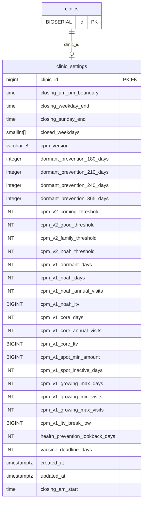

<!-- GENERATED: scripts/tools/generate-erd-detail.py; do not edit -->
# `clinic_settings`

[詳細ERD一覧](index.md) · [概要ERD](../erd.md)

このページは、マイグレーションをファイル名順に静的解析した最終定義です。稼働DBの状態は未確認です。

## カラム

型・DEFAULTはDDLの宣言表記です。`bigserial` は採番宣言であり、DBカタログ上の型名ではありません。

| カラム | 型（DDL） | NULL | DEFAULT（DDL） | キー構成列 | 定義元 |
|:---|:---|:---|:---|:---|:---|
| `clinic_id` | `bigint` | NOT NULL | — | PK, FK | [001_init.sql:2066](../../../backend/migrations/001_init.sql#L2066) |
| `closing_am_pm_boundary` | `time` | NOT NULL | `'14:00'` | — | [001_init.sql:2067](../../../backend/migrations/001_init.sql#L2067) |
| `closing_weekday_end` | `time` | NOT NULL | `'18:30'` | — | [001_init.sql:2068](../../../backend/migrations/001_init.sql#L2068) |
| `closing_sunday_end` | `time` | NOT NULL | `'17:30'` | — | [001_init.sql:2069](../../../backend/migrations/001_init.sql#L2069) |
| `closed_weekdays` | `smallint[]` | NOT NULL | `'{}'` | — | [001_init.sql:2070](../../../backend/migrations/001_init.sql#L2070) |
| `cpm_version` | `varchar(8)` | NOT NULL | `'v1'` | — | [001_init.sql:2071](../../../backend/migrations/001_init.sql#L2071) |
| `dormant_prevention_180_days` | `integer` | NOT NULL | `180` | — | [001_init.sql:2073](../../../backend/migrations/001_init.sql#L2073) |
| `dormant_prevention_210_days` | `integer` | NOT NULL | `210` | — | [001_init.sql:2074](../../../backend/migrations/001_init.sql#L2074) |
| `dormant_prevention_240_days` | `integer` | NOT NULL | `240` | — | [001_init.sql:2075](../../../backend/migrations/001_init.sql#L2075) |
| `dormant_prevention_365_days` | `integer` | NOT NULL | `365` | — | [001_init.sql:2076](../../../backend/migrations/001_init.sql#L2076) |
| `cpm_v2_coming_threshold` | `INT` | NOT NULL | `2` | — | [001_init.sql:2078](../../../backend/migrations/001_init.sql#L2078) |
| `cpm_v2_good_threshold` | `INT` | NOT NULL | `4` | — | [001_init.sql:2079](../../../backend/migrations/001_init.sql#L2079) |
| `cpm_v2_family_threshold` | `INT` | NOT NULL | `8` | — | [001_init.sql:2080](../../../backend/migrations/001_init.sql#L2080) |
| `cpm_v2_noah_threshold` | `INT` | NOT NULL | `13` | — | [001_init.sql:2081](../../../backend/migrations/001_init.sql#L2081) |
| `cpm_v1_dormant_days` | `INT` | NOT NULL | `240` | — | [001_init.sql:2083](../../../backend/migrations/001_init.sql#L2083) |
| `cpm_v1_noah_days` | `INT` | NOT NULL | `365` | — | [001_init.sql:2084](../../../backend/migrations/001_init.sql#L2084) |
| `cpm_v1_noah_annual_visits` | `INT` | NOT NULL | `3` | — | [001_init.sql:2085](../../../backend/migrations/001_init.sql#L2085) |
| `cpm_v1_noah_ltv` | `BIGINT` | NOT NULL | `80000` | — | [001_init.sql:2086](../../../backend/migrations/001_init.sql#L2086) |
| `cpm_v1_core_days` | `INT` | NOT NULL | `180` | — | [001_init.sql:2087](../../../backend/migrations/001_init.sql#L2087) |
| `cpm_v1_core_annual_visits` | `INT` | NOT NULL | `2` | — | [001_init.sql:2088](../../../backend/migrations/001_init.sql#L2088) |
| `cpm_v1_core_ltv` | `BIGINT` | NOT NULL | `50000` | — | [001_init.sql:2089](../../../backend/migrations/001_init.sql#L2089) |
| `cpm_v1_spot_min_amount` | `BIGINT` | NOT NULL | `30000` | — | [001_init.sql:2090](../../../backend/migrations/001_init.sql#L2090) |
| `cpm_v1_spot_inactive_days` | `INT` | NOT NULL | `90` | — | [001_init.sql:2091](../../../backend/migrations/001_init.sql#L2091) |
| `cpm_v1_growing_max_days` | `INT` | NOT NULL | `90` | — | [001_init.sql:2092](../../../backend/migrations/001_init.sql#L2092) |
| `cpm_v1_growing_min_visits` | `INT` | NOT NULL | `2` | — | [001_init.sql:2093](../../../backend/migrations/001_init.sql#L2093) |
| `cpm_v1_growing_max_visits` | `INT` | NOT NULL | `3` | — | [001_init.sql:2094](../../../backend/migrations/001_init.sql#L2094) |
| `cpm_v1_ltv_break_low` | `BIGINT` | NOT NULL | `20000` | — | [001_init.sql:2095](../../../backend/migrations/001_init.sql#L2095) |
| `health_prevention_lookback_days` | `INT` | NOT NULL | `365` | — | [001_init.sql:2097](../../../backend/migrations/001_init.sql#L2097) |
| `vaccine_deadline_days` | `INT` | NOT NULL | `60` | — | [001_init.sql:2098](../../../backend/migrations/001_init.sql#L2098) |
| `created_at` | `timestamptz` | NOT NULL | `now()` | — | [001_init.sql:2099](../../../backend/migrations/001_init.sql#L2099) |
| `updated_at` | `timestamptz` | NOT NULL | `now()` | — | [001_init.sql:2100](../../../backend/migrations/001_init.sql#L2100) |
| `closing_am_start` | `time` | NOT NULL | `'09:00'` | — | [001_init.sql:3773](../../../backend/migrations/001_init.sql#L3773) |

PK/FK/UKはキーの構成列を示します。複合キーの各列が単独で一意という意味ではありません。部分uniqueは下記indexの述語を参照してください。

## ERD

このテーブルの全カラムと、すべての参照先を表示します。参照先はFKの対象列だけを表示し、全カラムは各テーブルのページに置きます。

親側の任意参照はFK列のNULL可否、子側の最大1件は無条件のPK/UNIQUEから導出します。部分uniqueによる条件付きの最大件数は図に反映せず、index一覧に記録します。実線はFK全列が子のPKに含まれる識別関係、破線はそれ以外です。

## 外部キー（全件）

| 制約 | 子の列（順序あり） | 参照先 | 親の列（順序あり） | 削除時の動作 | 定義元 |
|:---|:---|:---|:---|:---|:---|
| `clinic_settings_clinic_id_fkey` | `clinic_id` | [clinics](clinics.md) | `id` | `ON DELETE CASCADE` | [001_init.sql:2066](../../../backend/migrations/001_init.sql#L2066) |

正確なON UPDATE・MATCH・DEFERRABLE等を含む制約DDL:

- `clinic_settings_clinic_id_fkey`: `REFERENCES clinics(id) ON DELETE CASCADE`

## その他の制約

| 制約 | 種別 | DDL | 定義元 |
|:---|:---|:---|:---|
| `clinic_settings_pkey` | primary | `PRIMARY KEY` | [001_init.sql:2066](../../../backend/migrations/001_init.sql#L2066) |
| `clinic_settings_cpm_version_check` | check | `CHECK (cpm_version IN ('v1', 'v2'))` | [001_init.sql:2071](../../../backend/migrations/001_init.sql#L2071) |
| `clinic_settings_cpm_v2_coming_threshold_check` | check | `CHECK (cpm_v2_coming_threshold  >= 1)` | [001_init.sql:2078](../../../backend/migrations/001_init.sql#L2078) |
| `clinic_settings_cpm_v2_good_threshold_check` | check | `CHECK (cpm_v2_good_threshold    >= 1)` | [001_init.sql:2079](../../../backend/migrations/001_init.sql#L2079) |
| `clinic_settings_cpm_v2_family_threshold_check` | check | `CHECK (cpm_v2_family_threshold  >= 1)` | [001_init.sql:2080](../../../backend/migrations/001_init.sql#L2080) |
| `clinic_settings_cpm_v2_noah_threshold_check` | check | `CHECK (cpm_v2_noah_threshold    >= 1)` | [001_init.sql:2081](../../../backend/migrations/001_init.sql#L2081) |
| `clinic_settings_cpm_v1_dormant_days_check` | check | `CHECK (cpm_v1_dormant_days       >= 1)` | [001_init.sql:2083](../../../backend/migrations/001_init.sql#L2083) |
| `clinic_settings_cpm_v1_noah_days_check` | check | `CHECK (cpm_v1_noah_days          >= 1)` | [001_init.sql:2084](../../../backend/migrations/001_init.sql#L2084) |
| `clinic_settings_cpm_v1_noah_annual_visits_check` | check | `CHECK (cpm_v1_noah_annual_visits >= 1)` | [001_init.sql:2085](../../../backend/migrations/001_init.sql#L2085) |
| `clinic_settings_cpm_v1_noah_ltv_check` | check | `CHECK (cpm_v1_noah_ltv           >= 0)` | [001_init.sql:2086](../../../backend/migrations/001_init.sql#L2086) |
| `clinic_settings_cpm_v1_core_days_check` | check | `CHECK (cpm_v1_core_days          >= 1)` | [001_init.sql:2087](../../../backend/migrations/001_init.sql#L2087) |
| `clinic_settings_cpm_v1_core_annual_visits_check` | check | `CHECK (cpm_v1_core_annual_visits >= 1)` | [001_init.sql:2088](../../../backend/migrations/001_init.sql#L2088) |
| `clinic_settings_cpm_v1_core_ltv_check` | check | `CHECK (cpm_v1_core_ltv           >= 0)` | [001_init.sql:2089](../../../backend/migrations/001_init.sql#L2089) |
| `clinic_settings_cpm_v1_spot_min_amount_check` | check | `CHECK (cpm_v1_spot_min_amount    >= 0)` | [001_init.sql:2090](../../../backend/migrations/001_init.sql#L2090) |
| `clinic_settings_cpm_v1_spot_inactive_days_check` | check | `CHECK (cpm_v1_spot_inactive_days >= 1)` | [001_init.sql:2091](../../../backend/migrations/001_init.sql#L2091) |
| `clinic_settings_cpm_v1_growing_max_days_check` | check | `CHECK (cpm_v1_growing_max_days   >= 1)` | [001_init.sql:2092](../../../backend/migrations/001_init.sql#L2092) |
| `clinic_settings_cpm_v1_growing_min_visits_check` | check | `CHECK (cpm_v1_growing_min_visits >= 1)` | [001_init.sql:2093](../../../backend/migrations/001_init.sql#L2093) |
| `clinic_settings_cpm_v1_growing_max_visits_check` | check | `CHECK (cpm_v1_growing_max_visits >= 1)` | [001_init.sql:2094](../../../backend/migrations/001_init.sql#L2094) |
| `clinic_settings_cpm_v1_ltv_break_low_check` | check | `CHECK (cpm_v1_ltv_break_low      >= 0)` | [001_init.sql:2095](../../../backend/migrations/001_init.sql#L2095) |

## インデックス

明示的なCREATE INDEXなし。PK/UNIQUEに付随する暗黙のindexは制約欄を参照してください。
