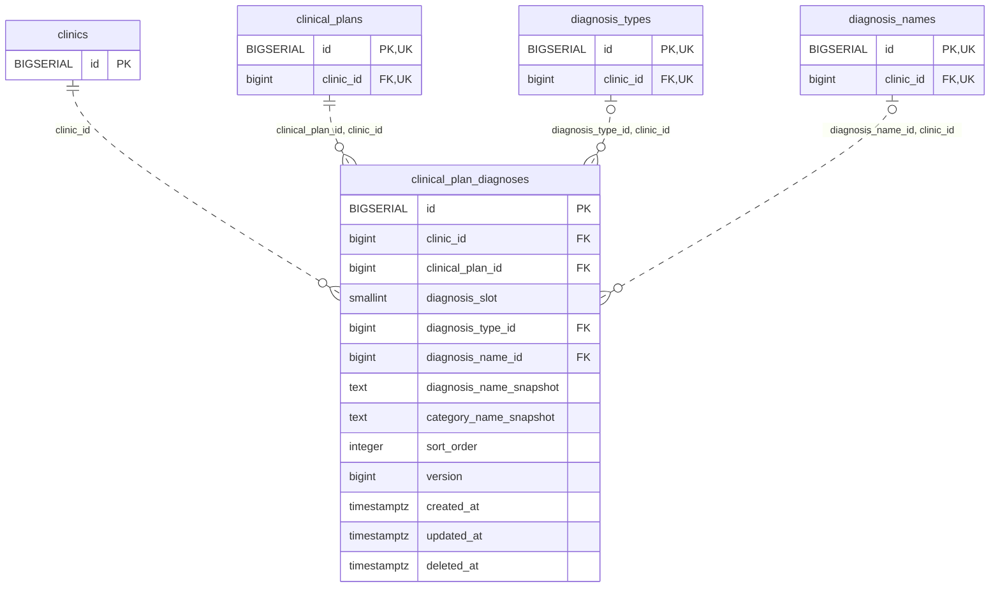

<!-- GENERATED: scripts/tools/generate-erd-detail.py; do not edit -->
# `clinical_plan_diagnoses`

[詳細ERD一覧](index.md) · [概要ERD](../erd.md)

このページは、マイグレーションをファイル名順に静的解析した最終定義です。稼働DBの状態は未確認です。

## カラム

型・DEFAULTはDDLの宣言表記です。`bigserial` は採番宣言であり、DBカタログ上の型名ではありません。

| カラム | 型（DDL） | NULL | DEFAULT（DDL） | キー構成列 | 定義元 |
|:---|:---|:---|:---|:---|:---|
| `id` | `BIGSERIAL` | NOT NULL | — | PK | [001_init.sql:10985](../../../backend/migrations/001_init.sql#L10985) |
| `clinic_id` | `bigint` | NOT NULL | — | FK | [001_init.sql:10985](../../../backend/migrations/001_init.sql#L10985) |
| `clinical_plan_id` | `bigint` | NOT NULL | — | FK | [001_init.sql:10986](../../../backend/migrations/001_init.sql#L10986) |
| `diagnosis_slot` | `smallint` | NOT NULL | — | — | [001_init.sql:10986](../../../backend/migrations/001_init.sql#L10986) |
| `diagnosis_type_id` | `bigint` | NULL | — | FK | [001_init.sql:10987](../../../backend/migrations/001_init.sql#L10987) |
| `diagnosis_name_id` | `bigint` | NULL | — | FK | [001_init.sql:10987](../../../backend/migrations/001_init.sql#L10987) |
| `diagnosis_name_snapshot` | `text` | NULL | — | — | [001_init.sql:10987](../../../backend/migrations/001_init.sql#L10987) |
| `category_name_snapshot` | `text` | NULL | — | — | [001_init.sql:10987](../../../backend/migrations/001_init.sql#L10987) |
| `sort_order` | `integer` | NOT NULL | `0` | — | [001_init.sql:10988](../../../backend/migrations/001_init.sql#L10988) |
| `version` | `bigint` | NOT NULL | `1` | — | [001_init.sql:10988](../../../backend/migrations/001_init.sql#L10988) |
| `created_at` | `timestamptz` | NOT NULL | `clock_timestamp()` | — | [001_init.sql:10989](../../../backend/migrations/001_init.sql#L10989) |
| `updated_at` | `timestamptz` | NOT NULL | `clock_timestamp()` | — | [001_init.sql:10989](../../../backend/migrations/001_init.sql#L10989) |
| `deleted_at` | `timestamptz` | NULL | — | — | [001_init.sql:10989](../../../backend/migrations/001_init.sql#L10989) |

PK/FK/UKはキーの構成列を示します。複合キーの各列が単独で一意という意味ではありません。部分uniqueは下記indexの述語を参照してください。

## ERD

このテーブルの全カラムと、すべての参照先を表示します。参照先はFKの対象列だけを表示し、全カラムは各テーブルのページに置きます。

親側の任意参照はFK列のNULL可否、子側の最大1件は無条件のPK/UNIQUEから導出します。部分uniqueによる条件付きの最大件数は図に反映せず、index一覧に記録します。実線はFK全列が子のPKに含まれる識別関係、破線はそれ以外です。

## 外部キー（全件）

| 制約 | 子の列（順序あり） | 参照先 | 親の列（順序あり） | 削除時の動作 | 定義元 |
|:---|:---|:---|:---|:---|:---|
| `clinical_plan_diagnoses_clinic_id_fkey` | `clinic_id` | [clinics](clinics.md) | `id` | `ON DELETE RESTRICT` | [001_init.sql:10985](../../../backend/migrations/001_init.sql#L10985) |
| `clinical_plan_diagnoses_clinical_plan_id_clinic_id_fkey` | `clinical_plan_id, clinic_id` | [clinical_plans](clinical_plans.md) | `id, clinic_id` | `ON DELETE RESTRICT` | [001_init.sql:10990](../../../backend/migrations/001_init.sql#L10990) |
| `clinical_plan_diagnoses_diagnosis_type_id_clinic_id_fkey` | `diagnosis_type_id, clinic_id` | [diagnosis_types](diagnosis_types.md) | `id, clinic_id` | `ON DELETE RESTRICT` | [001_init.sql:10991](../../../backend/migrations/001_init.sql#L10991) |
| `clinical_plan_diagnoses_diagnosis_name_id_clinic_id_fkey` | `diagnosis_name_id, clinic_id` | [diagnosis_names](diagnosis_names.md) | `id, clinic_id` | `ON DELETE RESTRICT` | [001_init.sql:10992](../../../backend/migrations/001_init.sql#L10992) |

正確なON UPDATE・MATCH・DEFERRABLE等を含む制約DDL:

- `clinical_plan_diagnoses_clinic_id_fkey`: `REFERENCES clinics(id) ON DELETE RESTRICT`
- `clinical_plan_diagnoses_clinical_plan_id_clinic_id_fkey`: `FOREIGN KEY(clinical_plan_id,clinic_id) REFERENCES clinical_plans(id,clinic_id) ON DELETE RESTRICT`
- `clinical_plan_diagnoses_diagnosis_type_id_clinic_id_fkey`: `FOREIGN KEY(diagnosis_type_id,clinic_id) REFERENCES diagnosis_types(id,clinic_id) ON DELETE RESTRICT`
- `clinical_plan_diagnoses_diagnosis_name_id_clinic_id_fkey`: `FOREIGN KEY(diagnosis_name_id,clinic_id) REFERENCES diagnosis_names(id,clinic_id) ON DELETE RESTRICT`

## その他の制約

| 制約 | 種別 | DDL | 定義元 |
|:---|:---|:---|:---|
| `clinical_plan_diagnoses_pkey` | primary | `PRIMARY KEY` | [001_init.sql:10985](../../../backend/migrations/001_init.sql#L10985) |
| `clinical_plan_diagnoses_diagnosis_slot_check` | check | `CHECK(diagnosis_slot IN(1,2))` | [001_init.sql:10986](../../../backend/migrations/001_init.sql#L10986) |
| `clinical_plan_diagnoses_version_check` | check | `CHECK(version>0)` | [001_init.sql:10988](../../../backend/migrations/001_init.sql#L10988) |

## インデックス

| 名前 | UNIQUE | 述語 | DDL | 定義元 |
|:---|:---|:---|:---|:---|
| `idx_clinical_plan_diagnoses_group` | NO | `deleted_at IS NULL` | `CREATE INDEX idx_clinical_plan_diagnoses_group ON clinical_plan_diagnoses(clinic_id,clinical_plan_id,diagnosis_slot,sort_order,id) WHERE deleted_at IS NULL` | [001_init.sql:10994](../../../backend/migrations/001_init.sql#L10994) |
