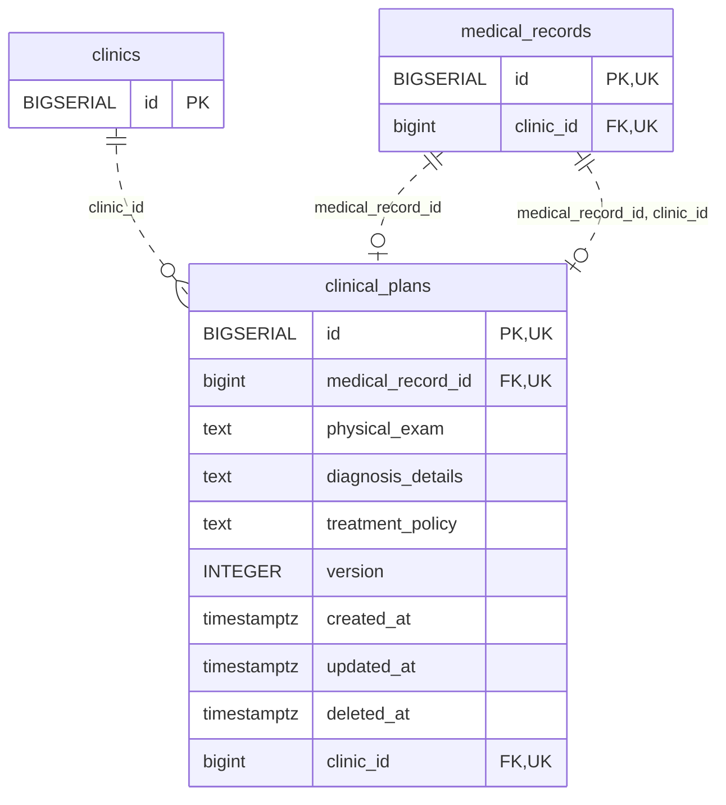

<!-- GENERATED: scripts/tools/generate-erd-detail.py; do not edit -->
# `clinical_plans`

[詳細ERD一覧](index.md) · [概要ERD](../erd.md)

このページは、マイグレーションをファイル名順に静的解析した最終定義です。稼働DBの状態は未確認です。

## カラム

型・DEFAULTはDDLの宣言表記です。`bigserial` は採番宣言であり、DBカタログ上の型名ではありません。

| カラム | 型（DDL） | NULL | DEFAULT（DDL） | キー構成列 | 定義元 |
|:---|:---|:---|:---|:---|:---|
| `id` | `BIGSERIAL` | NOT NULL | — | PK, UK | [001_init.sql:1586](../../../backend/migrations/001_init.sql#L1586) |
| `medical_record_id` | `bigint` | NOT NULL | — | FK, UK | [001_init.sql:1587](../../../backend/migrations/001_init.sql#L1587) |
| `physical_exam` | `text` | NOT NULL | `''` | — | [001_init.sql:1588](../../../backend/migrations/001_init.sql#L1588) |
| `diagnosis_details` | `text` | NOT NULL | `''` | — | [001_init.sql:1593](../../../backend/migrations/001_init.sql#L1593) |
| `treatment_policy` | `text` | NOT NULL | `''` | — | [001_init.sql:1594](../../../backend/migrations/001_init.sql#L1594) |
| `version` | `INTEGER` | NOT NULL | `1` | — | [001_init.sql:1595](../../../backend/migrations/001_init.sql#L1595) |
| `created_at` | `timestamptz` | NOT NULL | `now()` | — | [001_init.sql:1596](../../../backend/migrations/001_init.sql#L1596) |
| `updated_at` | `timestamptz` | NOT NULL | `now()` | — | [001_init.sql:1597](../../../backend/migrations/001_init.sql#L1597) |
| `deleted_at` | `timestamptz` | NULL | — | — | [001_init.sql:1598](../../../backend/migrations/001_init.sql#L1598) |
| `clinic_id` | `bigint` | NOT NULL | — | FK, UK | [001_init.sql:10990](../../../backend/migrations/001_init.sql#L10990) |

PK/FK/UKはキーの構成列を示します。複合キーの各列が単独で一意という意味ではありません。部分uniqueは下記indexの述語を参照してください。

## ERD

このテーブルの全カラムと、すべての参照先を表示します。参照先はFKの対象列だけを表示し、全カラムは各テーブルのページに置きます。

親側の任意参照はFK列のNULL可否、子側の最大1件は無条件のPK/UNIQUEから導出します。部分uniqueによる条件付きの最大件数は図に反映せず、index一覧に記録します。実線はFK全列が子のPKに含まれる識別関係、破線はそれ以外です。

## 外部キー（全件）

| 制約 | 子の列（順序あり） | 参照先 | 親の列（順序あり） | 削除時の動作 | 定義元 |
|:---|:---|:---|:---|:---|:---|
| `clinical_plans_medical_record_id_fkey` | `medical_record_id` | [medical_records](medical_records.md) | `id` | `ON DELETE CASCADE` | [001_init.sql:1587](../../../backend/migrations/001_init.sql#L1587) |
| `fk_clinical_plan_clinic` | `clinic_id` | [clinics](clinics.md) | `id` | `ON DELETE RESTRICT` | [001_init.sql:10991](../../../backend/migrations/001_init.sql#L10991) |
| `fk_clinical_plan_record_clinic` | `medical_record_id, clinic_id` | [medical_records](medical_records.md) | `id, clinic_id` | `ON DELETE RESTRICT` | [001_init.sql:10993](../../../backend/migrations/001_init.sql#L10993) |

正確なON UPDATE・MATCH・DEFERRABLE等を含む制約DDL:

- `clinical_plans_medical_record_id_fkey`: `REFERENCES medical_records(id) ON DELETE CASCADE`
- `fk_clinical_plan_clinic`: `CONSTRAINT fk_clinical_plan_clinic FOREIGN KEY(clinic_id) REFERENCES clinics(id) ON DELETE RESTRICT`
- `fk_clinical_plan_record_clinic`: `CONSTRAINT fk_clinical_plan_record_clinic FOREIGN KEY(medical_record_id,clinic_id) REFERENCES medical_records(id,clinic_id) ON DELETE RESTRICT`

## その他の制約

| 制約 | 種別 | DDL | 定義元 |
|:---|:---|:---|:---|
| `clinical_plans_pkey` | primary | `PRIMARY KEY` | [001_init.sql:1586](../../../backend/migrations/001_init.sql#L1586) |
| `clinical_plans_medical_record_id_key` | unique | `UNIQUE` | [001_init.sql:1587](../../../backend/migrations/001_init.sql#L1587) |
| `uq_clinical_plan_id_clinic` | unique | `CONSTRAINT uq_clinical_plan_id_clinic UNIQUE(id,clinic_id)` | [001_init.sql:10992](../../../backend/migrations/001_init.sql#L10992) |

## インデックス

| 名前 | UNIQUE | 述語 | DDL | 定義元 |
|:---|:---|:---|:---|:---|
| `idx_clinical_plans_medical_record_id` | NO | — | `CREATE INDEX idx_clinical_plans_medical_record_id ON clinical_plans(medical_record_id)` | [001_init.sql:2312](../../../backend/migrations/001_init.sql#L2312) |
