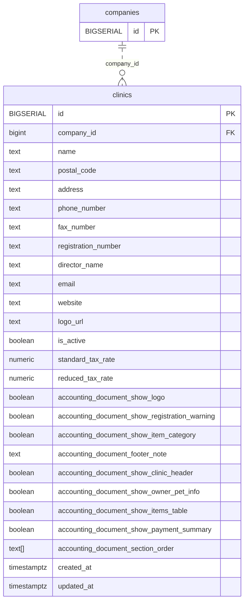

<!-- GENERATED: scripts/tools/generate-erd-detail.py; do not edit -->
# `clinics`

[詳細ERD一覧](index.md) · [概要ERD](../erd.md)

このページは、マイグレーションをファイル名順に静的解析した最終定義です。稼働DBの状態は未確認です。

## カラム

型・DEFAULTはDDLの宣言表記です。`bigserial` は採番宣言であり、DBカタログ上の型名ではありません。

| カラム | 型（DDL） | NULL | DEFAULT（DDL） | キー構成列 | 定義元 |
|:---|:---|:---|:---|:---|:---|
| `id` | `BIGSERIAL` | NOT NULL | — | PK | [001_init.sql:168](../../../backend/migrations/001_init.sql#L168) |
| `company_id` | `bigint` | NOT NULL | — | FK | [001_init.sql:169](../../../backend/migrations/001_init.sql#L169) |
| `name` | `text` | NOT NULL | — | — | [001_init.sql:170](../../../backend/migrations/001_init.sql#L170) |
| `postal_code` | `text` | NOT NULL | `''` | — | [001_init.sql:171](../../../backend/migrations/001_init.sql#L171) |
| `address` | `text` | NOT NULL | `''` | — | [001_init.sql:172](../../../backend/migrations/001_init.sql#L172) |
| `phone_number` | `text` | NOT NULL | `''` | — | [001_init.sql:173](../../../backend/migrations/001_init.sql#L173) |
| `fax_number` | `text` | NOT NULL | `''` | — | [001_init.sql:174](../../../backend/migrations/001_init.sql#L174) |
| `registration_number` | `text` | NOT NULL | `''` | — | [001_init.sql:175](../../../backend/migrations/001_init.sql#L175) |
| `director_name` | `text` | NOT NULL | `''` | — | [001_init.sql:176](../../../backend/migrations/001_init.sql#L176) |
| `email` | `text` | NOT NULL | `''` | — | [001_init.sql:177](../../../backend/migrations/001_init.sql#L177) |
| `website` | `text` | NOT NULL | `''` | — | [001_init.sql:178](../../../backend/migrations/001_init.sql#L178) |
| `logo_url` | `text` | NOT NULL | `''` | — | [001_init.sql:179](../../../backend/migrations/001_init.sql#L179) |
| `is_active` | `boolean` | NOT NULL | `true` | — | [001_init.sql:180](../../../backend/migrations/001_init.sql#L180) |
| `standard_tax_rate` | `numeric` | NOT NULL | `0.10` | — | [001_init.sql:181](../../../backend/migrations/001_init.sql#L181) |
| `reduced_tax_rate` | `numeric` | NOT NULL | `0.08` | — | [001_init.sql:182](../../../backend/migrations/001_init.sql#L182) |
| `accounting_document_show_logo` | `boolean` | NOT NULL | `false` | — | [001_init.sql:184](../../../backend/migrations/001_init.sql#L184) |
| `accounting_document_show_registration_warning` | `boolean` | NOT NULL | `true` | — | [001_init.sql:185](../../../backend/migrations/001_init.sql#L185) |
| `accounting_document_show_item_category` | `boolean` | NOT NULL | `true` | — | [001_init.sql:186](../../../backend/migrations/001_init.sql#L186) |
| `accounting_document_footer_note` | `text` | NOT NULL | `''` | — | [001_init.sql:187](../../../backend/migrations/001_init.sql#L187) |
| `accounting_document_show_clinic_header` | `boolean` | NOT NULL | `true` | — | [001_init.sql:189](../../../backend/migrations/001_init.sql#L189) |
| `accounting_document_show_owner_pet_info` | `boolean` | NOT NULL | `true` | — | [001_init.sql:190](../../../backend/migrations/001_init.sql#L190) |
| `accounting_document_show_items_table` | `boolean` | NOT NULL | `true` | — | [001_init.sql:191](../../../backend/migrations/001_init.sql#L191) |
| `accounting_document_show_payment_summary` | `boolean` | NOT NULL | `true` | — | [001_init.sql:192](../../../backend/migrations/001_init.sql#L192) |
| `accounting_document_section_order` | `text[]` | NOT NULL | `'{}'` | — | [001_init.sql:193](../../../backend/migrations/001_init.sql#L193) |
| `created_at` | `timestamptz` | NOT NULL | `now()` | — | [001_init.sql:194](../../../backend/migrations/001_init.sql#L194) |
| `updated_at` | `timestamptz` | NOT NULL | `now()` | — | [001_init.sql:195](../../../backend/migrations/001_init.sql#L195) |

PK/FK/UKはキーの構成列を示します。複合キーの各列が単独で一意という意味ではありません。部分uniqueは下記indexの述語を参照してください。

## ERD

このテーブルの全カラムと、すべての参照先を表示します。参照先はFKの対象列だけを表示し、全カラムは各テーブルのページに置きます。

親側の任意参照はFK列のNULL可否、子側の最大1件は無条件のPK/UNIQUEから導出します。部分uniqueによる条件付きの最大件数は図に反映せず、index一覧に記録します。実線はFK全列が子のPKに含まれる識別関係、破線はそれ以外です。

## 外部キー（全件）

| 制約 | 子の列（順序あり） | 参照先 | 親の列（順序あり） | 削除時の動作 | 定義元 |
|:---|:---|:---|:---|:---|:---|
| `clinics_company_id_fkey` | `company_id` | [companies](companies.md) | `id` | `ON DELETE NO ACTION` | [001_init.sql:169](../../../backend/migrations/001_init.sql#L169) |

正確なON UPDATE・MATCH・DEFERRABLE等を含む制約DDL:

- `clinics_company_id_fkey`: `REFERENCES companies(id)`

## その他の制約

| 制約 | 種別 | DDL | 定義元 |
|:---|:---|:---|:---|
| `clinics_pkey` | primary | `PRIMARY KEY` | [001_init.sql:168](../../../backend/migrations/001_init.sql#L168) |

## インデックス

明示的なCREATE INDEXなし。PK/UNIQUEに付随する暗黙のindexは制約欄を参照してください。
