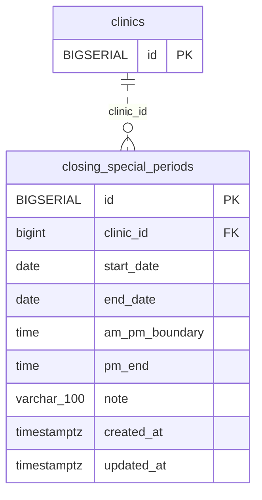

<!-- GENERATED: scripts/tools/generate-erd-detail.py; do not edit -->
# `closing_special_periods`

[詳細ERD一覧](index.md) · [概要ERD](../erd.md)

このページは、マイグレーションをファイル名順に静的解析した最終定義です。稼働DBの状態は未確認です。

## カラム

型・DEFAULTはDDLの宣言表記です。`bigserial` は採番宣言であり、DBカタログ上の型名ではありません。

| カラム | 型（DDL） | NULL | DEFAULT（DDL） | キー構成列 | 定義元 |
|:---|:---|:---|:---|:---|:---|
| `id` | `BIGSERIAL` | NOT NULL | — | PK | [001_init.sql:2125](../../../backend/migrations/001_init.sql#L2125) |
| `clinic_id` | `bigint` | NOT NULL | — | FK | [001_init.sql:2126](../../../backend/migrations/001_init.sql#L2126) |
| `start_date` | `date` | NOT NULL | — | — | [001_init.sql:2127](../../../backend/migrations/001_init.sql#L2127) |
| `end_date` | `date` | NOT NULL | — | — | [001_init.sql:2128](../../../backend/migrations/001_init.sql#L2128) |
| `am_pm_boundary` | `time` | NOT NULL | — | — | [001_init.sql:2129](../../../backend/migrations/001_init.sql#L2129) |
| `pm_end` | `time` | NOT NULL | — | — | [001_init.sql:2130](../../../backend/migrations/001_init.sql#L2130) |
| `note` | `varchar(100)` | NOT NULL | `''` | — | [001_init.sql:2131](../../../backend/migrations/001_init.sql#L2131) |
| `created_at` | `timestamptz` | NOT NULL | `now()` | — | [001_init.sql:2132](../../../backend/migrations/001_init.sql#L2132) |
| `updated_at` | `timestamptz` | NOT NULL | `now()` | — | [001_init.sql:2133](../../../backend/migrations/001_init.sql#L2133) |

PK/FK/UKはキーの構成列を示します。複合キーの各列が単独で一意という意味ではありません。部分uniqueは下記indexの述語を参照してください。

## ERD

このテーブルの全カラムと、すべての参照先を表示します。参照先はFKの対象列だけを表示し、全カラムは各テーブルのページに置きます。

親側の任意参照はFK列のNULL可否、子側の最大1件は無条件のPK/UNIQUEから導出します。部分uniqueによる条件付きの最大件数は図に反映せず、index一覧に記録します。実線はFK全列が子のPKに含まれる識別関係、破線はそれ以外です。

## 外部キー（全件）

| 制約 | 子の列（順序あり） | 参照先 | 親の列（順序あり） | 削除時の動作 | 定義元 |
|:---|:---|:---|:---|:---|:---|
| `closing_special_periods_clinic_id_fkey` | `clinic_id` | [clinics](clinics.md) | `id` | `ON DELETE CASCADE` | [001_init.sql:2126](../../../backend/migrations/001_init.sql#L2126) |

正確なON UPDATE・MATCH・DEFERRABLE等を含む制約DDL:

- `closing_special_periods_clinic_id_fkey`: `REFERENCES clinics(id) ON DELETE CASCADE`

## その他の制約

| 制約 | 種別 | DDL | 定義元 |
|:---|:---|:---|:---|
| `closing_special_periods_pkey` | primary | `PRIMARY KEY` | [001_init.sql:2125](../../../backend/migrations/001_init.sql#L2125) |
| `chk_closing_special_periods_date_range` | check | `CONSTRAINT chk_closing_special_periods_date_range CHECK (start_date <= end_date)` | [001_init.sql:2134](../../../backend/migrations/001_init.sql#L2134) |
| `chk_closing_special_periods_time_order` | check | `CONSTRAINT chk_closing_special_periods_time_order CHECK (am_pm_boundary < pm_end)` | [001_init.sql:2135](../../../backend/migrations/001_init.sql#L2135) |
| `excl_closing_special_periods_clinic_daterange` | exclude | `CONSTRAINT excl_closing_special_periods_clinic_daterange     EXCLUDE USING gist (         clinic_id WITH =,         daterange(start_date, end_date, '[]') WITH &&     )` | [001_init.sql:4574](../../../backend/migrations/001_init.sql#L4574) |

## インデックス

| 名前 | UNIQUE | 述語 | DDL | 定義元 |
|:---|:---|:---|:---|:---|
| `idx_closing_special_periods_clinic` | NO | — | `CREATE INDEX idx_closing_special_periods_clinic ON closing_special_periods(clinic_id, start_date, end_date)` | [001_init.sql:2138](../../../backend/migrations/001_init.sql#L2138) |
