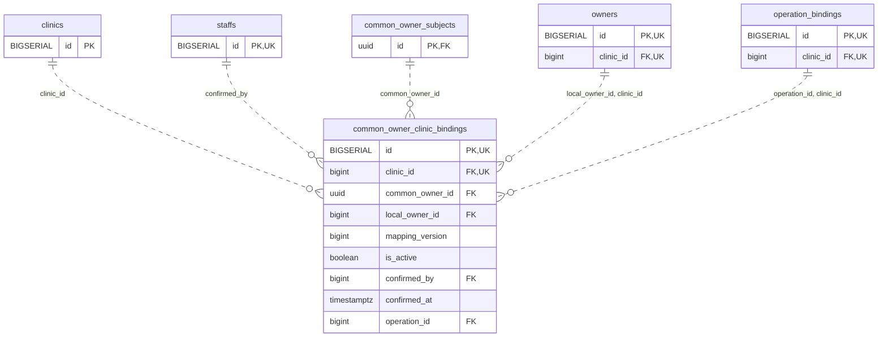

<!-- GENERATED: scripts/tools/generate-erd-detail.py; do not edit -->
# `common_owner_clinic_bindings`

[詳細ERD一覧](index.md) · [概要ERD](../erd.md)

このページは、マイグレーションをファイル名順に静的解析した最終定義です。稼働DBの状態は未確認です。

## カラム

型・DEFAULTはDDLの宣言表記です。`bigserial` は採番宣言であり、DBカタログ上の型名ではありません。

| カラム | 型（DDL） | NULL | DEFAULT（DDL） | キー構成列 | 定義元 |
|:---|:---|:---|:---|:---|:---|
| `id` | `BIGSERIAL` | NOT NULL | — | PK, UK | [001_init.sql:10718](../../../backend/migrations/001_init.sql#L10718) |
| `clinic_id` | `bigint` | NOT NULL | — | FK, UK | [001_init.sql:10718](../../../backend/migrations/001_init.sql#L10718) |
| `common_owner_id` | `uuid` | NOT NULL | — | FK | [001_init.sql:10719](../../../backend/migrations/001_init.sql#L10719) |
| `local_owner_id` | `bigint` | NOT NULL | — | FK | [001_init.sql:10719](../../../backend/migrations/001_init.sql#L10719) |
| `mapping_version` | `bigint` | NOT NULL | `1` | — | [001_init.sql:10720](../../../backend/migrations/001_init.sql#L10720) |
| `is_active` | `boolean` | NOT NULL | `true` | — | [001_init.sql:10720](../../../backend/migrations/001_init.sql#L10720) |
| `confirmed_by` | `bigint` | NOT NULL | — | FK | [001_init.sql:10721](../../../backend/migrations/001_init.sql#L10721) |
| `confirmed_at` | `timestamptz` | NOT NULL | — | — | [001_init.sql:10721](../../../backend/migrations/001_init.sql#L10721) |
| `operation_id` | `bigint` | NOT NULL | — | FK | [001_init.sql:10722](../../../backend/migrations/001_init.sql#L10722) |

PK/FK/UKはキーの構成列を示します。複合キーの各列が単独で一意という意味ではありません。部分uniqueは下記indexの述語を参照してください。

## ERD

このテーブルの全カラムと、すべての参照先を表示します。参照先はFKの対象列だけを表示し、全カラムは各テーブルのページに置きます。

親側の任意参照はFK列のNULL可否、子側の最大1件は無条件のPK/UNIQUEから導出します。部分uniqueによる条件付きの最大件数は図に反映せず、index一覧に記録します。実線はFK全列が子のPKに含まれる識別関係、破線はそれ以外です。

## 外部キー（全件）

| 制約 | 子の列（順序あり） | 参照先 | 親の列（順序あり） | 削除時の動作 | 定義元 |
|:---|:---|:---|:---|:---|:---|
| `common_owner_clinic_bindings_clinic_id_fkey` | `clinic_id` | [clinics](clinics.md) | `id` | `ON DELETE RESTRICT` | [001_init.sql:10718](../../../backend/migrations/001_init.sql#L10718) |
| `common_owner_clinic_bindings_confirmed_by_fkey` | `confirmed_by` | [staffs](staffs.md) | `id` | `ON DELETE RESTRICT` | [001_init.sql:10721](../../../backend/migrations/001_init.sql#L10721) |
| `common_owner_clinic_bindings_common_owner_id_fkey` | `common_owner_id` | [common_owner_subjects](common_owner_subjects.md) | `id` | `ON DELETE RESTRICT` | [001_init.sql:10723](../../../backend/migrations/001_init.sql#L10723) |
| `common_owner_clinic_bindings_local_owner_id_clinic_id_fkey` | `local_owner_id, clinic_id` | [owners](owners.md) | `id, clinic_id` | `ON DELETE RESTRICT` | [001_init.sql:10724](../../../backend/migrations/001_init.sql#L10724) |
| `common_owner_clinic_bindings_operation_id_clinic_id_fkey` | `operation_id, clinic_id` | [operation_bindings](operation_bindings.md) | `id, clinic_id` | `ON DELETE RESTRICT` | [001_init.sql:10725](../../../backend/migrations/001_init.sql#L10725) |

正確なON UPDATE・MATCH・DEFERRABLE等を含む制約DDL:

- `common_owner_clinic_bindings_clinic_id_fkey`: `REFERENCES clinics(id) ON DELETE RESTRICT`
- `common_owner_clinic_bindings_confirmed_by_fkey`: `REFERENCES staffs(id) ON DELETE RESTRICT`
- `common_owner_clinic_bindings_common_owner_id_fkey`: `FOREIGN KEY(common_owner_id) REFERENCES common_owner_subjects(id) ON DELETE RESTRICT DEFERRABLE INITIALLY DEFERRED`
- `common_owner_clinic_bindings_local_owner_id_clinic_id_fkey`: `FOREIGN KEY(local_owner_id,clinic_id) REFERENCES owners(id,clinic_id) ON DELETE RESTRICT`
- `common_owner_clinic_bindings_operation_id_clinic_id_fkey`: `FOREIGN KEY(operation_id,clinic_id) REFERENCES operation_bindings(id,clinic_id) ON DELETE RESTRICT`

## その他の制約

| 制約 | 種別 | DDL | 定義元 |
|:---|:---|:---|:---|
| `common_owner_clinic_bindings_pkey` | primary | `PRIMARY KEY` | [001_init.sql:10718](../../../backend/migrations/001_init.sql#L10718) |
| `common_owner_clinic_bindings_mapping_version_check` | check | `CHECK(mapping_version>0)` | [001_init.sql:10720](../../../backend/migrations/001_init.sql#L10720) |
| `common_owner_clinic_bindings_id_clinic_id_key` | unique | `UNIQUE(id,clinic_id)` | [001_init.sql:10722](../../../backend/migrations/001_init.sql#L10722) |

## インデックス

| 名前 | UNIQUE | 述語 | DDL | 定義元 |
|:---|:---|:---|:---|:---|
| `uq_active_common_owner_clinic` | YES | `is_active` | `CREATE UNIQUE INDEX uq_active_common_owner_clinic ON common_owner_clinic_bindings(clinic_id,common_owner_id) WHERE is_active` | [001_init.sql:10727](../../../backend/migrations/001_init.sql#L10727) |
| `uq_active_common_owner_local` | YES | `is_active` | `CREATE UNIQUE INDEX uq_active_common_owner_local ON common_owner_clinic_bindings(clinic_id,local_owner_id) WHERE is_active` | [001_init.sql:10728](../../../backend/migrations/001_init.sql#L10728) |
