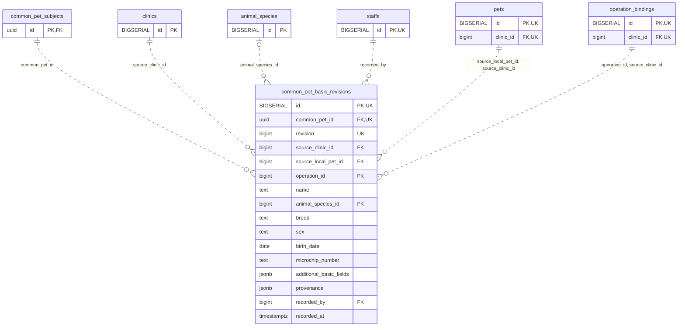

<!-- GENERATED: scripts/tools/generate-erd-detail.py; do not edit -->
# `common_pet_basic_revisions`

[詳細ERD一覧](index.md) · [概要ERD](../erd.md)

このページは、マイグレーションをファイル名順に静的解析した最終定義です。稼働DBの状態は未確認です。

## カラム

型・DEFAULTはDDLの宣言表記です。`bigserial` は採番宣言であり、DBカタログ上の型名ではありません。

| カラム | 型（DDL） | NULL | DEFAULT（DDL） | キー構成列 | 定義元 |
|:---|:---|:---|:---|:---|:---|
| `id` | `BIGSERIAL` | NOT NULL | — | PK, UK | [001_init.sql:10753](../../../backend/migrations/001_init.sql#L10753) |
| `common_pet_id` | `uuid` | NOT NULL | — | FK, UK | [001_init.sql:10753](../../../backend/migrations/001_init.sql#L10753) |
| `revision` | `bigint` | NOT NULL | — | UK | [001_init.sql:10754](../../../backend/migrations/001_init.sql#L10754) |
| `source_clinic_id` | `bigint` | NOT NULL | — | FK | [001_init.sql:10754](../../../backend/migrations/001_init.sql#L10754) |
| `source_local_pet_id` | `bigint` | NOT NULL | — | FK | [001_init.sql:10755](../../../backend/migrations/001_init.sql#L10755) |
| `operation_id` | `bigint` | NOT NULL | — | FK | [001_init.sql:10755](../../../backend/migrations/001_init.sql#L10755) |
| `name` | `text` | NOT NULL | — | — | [001_init.sql:10756](../../../backend/migrations/001_init.sql#L10756) |
| `animal_species_id` | `bigint` | NULL | — | FK | [001_init.sql:10756](../../../backend/migrations/001_init.sql#L10756) |
| `breed` | `text` | NULL | — | — | [001_init.sql:10757](../../../backend/migrations/001_init.sql#L10757) |
| `sex` | `text` | NULL | — | — | [001_init.sql:10757](../../../backend/migrations/001_init.sql#L10757) |
| `birth_date` | `date` | NULL | — | — | [001_init.sql:10757](../../../backend/migrations/001_init.sql#L10757) |
| `microchip_number` | `text` | NULL | — | — | [001_init.sql:10757](../../../backend/migrations/001_init.sql#L10757) |
| `additional_basic_fields` | `jsonb` | NOT NULL | — | — | [001_init.sql:10758](../../../backend/migrations/001_init.sql#L10758) |
| `provenance` | `jsonb` | NOT NULL | — | — | [001_init.sql:10759](../../../backend/migrations/001_init.sql#L10759) |
| `recorded_by` | `bigint` | NOT NULL | — | FK | [001_init.sql:10759](../../../backend/migrations/001_init.sql#L10759) |
| `recorded_at` | `timestamptz` | NOT NULL | `clock_timestamp()` | — | [001_init.sql:10760](../../../backend/migrations/001_init.sql#L10760) |

PK/FK/UKはキーの構成列を示します。複合キーの各列が単独で一意という意味ではありません。部分uniqueは下記indexの述語を参照してください。

## ERD

このテーブルの全カラムと、すべての参照先を表示します。参照先はFKの対象列だけを表示し、全カラムは各テーブルのページに置きます。

親側の任意参照はFK列のNULL可否、子側の最大1件は無条件のPK/UNIQUEから導出します。部分uniqueによる条件付きの最大件数は図に反映せず、index一覧に記録します。実線はFK全列が子のPKに含まれる識別関係、破線はそれ以外です。

## 外部キー（全件）

| 制約 | 子の列（順序あり） | 参照先 | 親の列（順序あり） | 削除時の動作 | 定義元 |
|:---|:---|:---|:---|:---|:---|
| `common_pet_basic_revisions_common_pet_id_fkey` | `common_pet_id` | [common_pet_subjects](common_pet_subjects.md) | `id` | `ON DELETE RESTRICT` | [001_init.sql:10753](../../../backend/migrations/001_init.sql#L10753) |
| `common_pet_basic_revisions_source_clinic_id_fkey` | `source_clinic_id` | [clinics](clinics.md) | `id` | `ON DELETE RESTRICT` | [001_init.sql:10754](../../../backend/migrations/001_init.sql#L10754) |
| `common_pet_basic_revisions_animal_species_id_fkey` | `animal_species_id` | [animal_species](animal_species.md) | `id` | `ON DELETE RESTRICT` | [001_init.sql:10756](../../../backend/migrations/001_init.sql#L10756) |
| `common_pet_basic_revisions_recorded_by_fkey` | `recorded_by` | [staffs](staffs.md) | `id` | `ON DELETE RESTRICT` | [001_init.sql:10759](../../../backend/migrations/001_init.sql#L10759) |
| `common_pet_basic_revisions_source_local_pet_id_source_clin_fkey` | `source_local_pet_id, source_clinic_id` | [pets](pets.md) | `id, clinic_id` | `ON DELETE RESTRICT` | [001_init.sql:10761](../../../backend/migrations/001_init.sql#L10761) |
| `common_pet_basic_revisions_operation_id_source_clinic_id_fkey` | `operation_id, source_clinic_id` | [operation_bindings](operation_bindings.md) | `id, clinic_id` | `ON DELETE RESTRICT` | [001_init.sql:10762](../../../backend/migrations/001_init.sql#L10762) |

正確なON UPDATE・MATCH・DEFERRABLE等を含む制約DDL:

- `common_pet_basic_revisions_common_pet_id_fkey`: `REFERENCES common_pet_subjects(id) ON DELETE RESTRICT`
- `common_pet_basic_revisions_source_clinic_id_fkey`: `REFERENCES clinics(id) ON DELETE RESTRICT`
- `common_pet_basic_revisions_animal_species_id_fkey`: `REFERENCES animal_species(id) ON DELETE RESTRICT`
- `common_pet_basic_revisions_recorded_by_fkey`: `REFERENCES staffs(id) ON DELETE RESTRICT`
- `common_pet_basic_revisions_source_local_pet_id_source_clin_fkey`: `FOREIGN KEY(source_local_pet_id,source_clinic_id) REFERENCES pets(id,clinic_id) ON DELETE RESTRICT`
- `common_pet_basic_revisions_operation_id_source_clinic_id_fkey`: `FOREIGN KEY(operation_id,source_clinic_id) REFERENCES operation_bindings(id,clinic_id) ON DELETE RESTRICT`

## その他の制約

| 制約 | 種別 | DDL | 定義元 |
|:---|:---|:---|:---|
| `common_pet_basic_revisions_pkey` | primary | `PRIMARY KEY` | [001_init.sql:10753](../../../backend/migrations/001_init.sql#L10753) |
| `common_pet_basic_revisions_revision_check` | check | `CHECK(revision>0)` | [001_init.sql:10754](../../../backend/migrations/001_init.sql#L10754) |
| `common_pet_basic_revisions_additional_basic_fields_check` | check | `CHECK(jsonb_typeof(additional_basic_fields)='object')` | [001_init.sql:10758](../../../backend/migrations/001_init.sql#L10758) |
| `common_pet_basic_revisions_provenance_check` | check | `CHECK(jsonb_typeof(provenance)='object')` | [001_init.sql:10759](../../../backend/migrations/001_init.sql#L10759) |
| `common_pet_basic_revisions_id_common_pet_id_key` | unique | `UNIQUE(id,common_pet_id)` | [001_init.sql:10760](../../../backend/migrations/001_init.sql#L10760) |
| `common_pet_basic_revisions_common_pet_id_revision_key` | unique | `UNIQUE(common_pet_id,revision)` | [001_init.sql:10760](../../../backend/migrations/001_init.sql#L10760) |

## インデックス

明示的なCREATE INDEXなし。PK/UNIQUEに付随する暗黙のindexは制約欄を参照してください。
