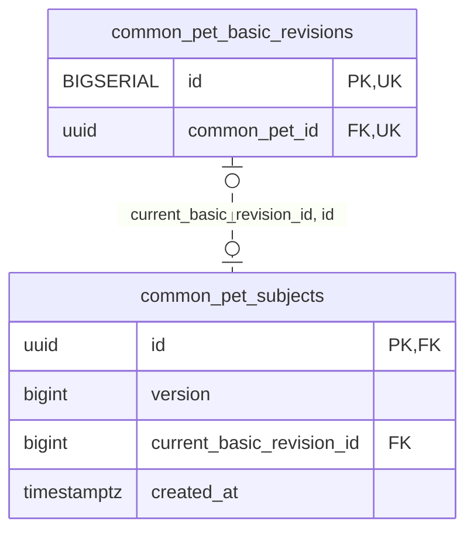

<!-- GENERATED: scripts/tools/generate-erd-detail.py; do not edit -->
# `common_pet_subjects`

[詳細ERD一覧](index.md) · [概要ERD](../erd.md)

このページは、マイグレーションをファイル名順に静的解析した最終定義です。稼働DBの状態は未確認です。

## カラム

型・DEFAULTはDDLの宣言表記です。`bigserial` は採番宣言であり、DBカタログ上の型名ではありません。

| カラム | 型（DDL） | NULL | DEFAULT（DDL） | キー構成列 | 定義元 |
|:---|:---|:---|:---|:---|:---|
| `id` | `uuid` | NOT NULL | — | PK, FK | [001_init.sql:10732](../../../backend/migrations/001_init.sql#L10732) |
| `version` | `bigint` | NOT NULL | `1` | — | [001_init.sql:10732](../../../backend/migrations/001_init.sql#L10732) |
| `current_basic_revision_id` | `bigint` | NULL | — | FK | [001_init.sql:10732](../../../backend/migrations/001_init.sql#L10732) |
| `created_at` | `timestamptz` | NOT NULL | `clock_timestamp()` | — | [001_init.sql:10733](../../../backend/migrations/001_init.sql#L10733) |

PK/FK/UKはキーの構成列を示します。複合キーの各列が単独で一意という意味ではありません。部分uniqueは下記indexの述語を参照してください。

## ERD

このテーブルの全カラムと、すべての参照先を表示します。参照先はFKの対象列だけを表示し、全カラムは各テーブルのページに置きます。

親側の任意参照はFK列のNULL可否、子側の最大1件は無条件のPK/UNIQUEから導出します。部分uniqueによる条件付きの最大件数は図に反映せず、index一覧に記録します。実線はFK全列が子のPKに含まれる識別関係、破線はそれ以外です。

## 外部キー（全件）

| 制約 | 子の列（順序あり） | 参照先 | 親の列（順序あり） | 削除時の動作 | 定義元 |
|:---|:---|:---|:---|:---|:---|
| `fk_common_pet_current_basic` | `current_basic_revision_id, id` | [common_pet_basic_revisions](common_pet_basic_revisions.md) | `id, common_pet_id` | `ON DELETE RESTRICT` | [001_init.sql:10789](../../../backend/migrations/001_init.sql#L10789) |

正確なON UPDATE・MATCH・DEFERRABLE等を含む制約DDL:

- `fk_common_pet_current_basic`: `CONSTRAINT fk_common_pet_current_basic  FOREIGN KEY(current_basic_revision_id,id) REFERENCES common_pet_basic_revisions(id,common_pet_id) ON DELETE RESTRICT DEFERRABLE INITIALLY DEFERRED`

## その他の制約

| 制約 | 種別 | DDL | 定義元 |
|:---|:---|:---|:---|
| `common_pet_subjects_pkey` | primary | `PRIMARY KEY` | [001_init.sql:10732](../../../backend/migrations/001_init.sql#L10732) |
| `common_pet_subjects_version_check` | check | `CHECK(version>0)` | [001_init.sql:10732](../../../backend/migrations/001_init.sql#L10732) |

## インデックス

明示的なCREATE INDEXなし。PK/UNIQUEに付随する暗黙のindexは制約欄を参照してください。
