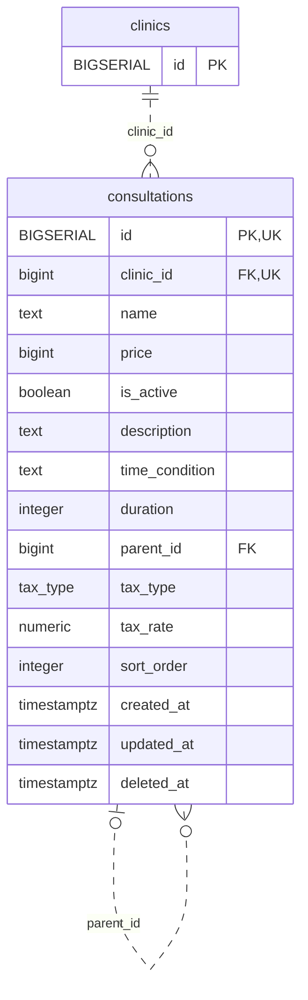

<!-- GENERATED: scripts/tools/generate-erd-detail.py; do not edit -->
# `consultations`

[詳細ERD一覧](index.md) · [概要ERD](../erd.md)

このページは、マイグレーションをファイル名順に静的解析した最終定義です。稼働DBの状態は未確認です。

## カラム

型・DEFAULTはDDLの宣言表記です。`bigserial` は採番宣言であり、DBカタログ上の型名ではありません。

| カラム | 型（DDL） | NULL | DEFAULT（DDL） | キー構成列 | 定義元 |
|:---|:---|:---|:---|:---|:---|
| `id` | `BIGSERIAL` | NOT NULL | — | PK, UK | [001_init.sql:896](../../../backend/migrations/001_init.sql#L896) |
| `clinic_id` | `bigint` | NOT NULL | — | FK, UK | [001_init.sql:897](../../../backend/migrations/001_init.sql#L897) |
| `name` | `text` | NOT NULL | — | — | [001_init.sql:898](../../../backend/migrations/001_init.sql#L898) |
| `price` | `bigint` | NULL | — | — | [001_init.sql:899](../../../backend/migrations/001_init.sql#L899) |
| `is_active` | `boolean` | NOT NULL | `true` | — | [001_init.sql:900](../../../backend/migrations/001_init.sql#L900) |
| `description` | `text` | NOT NULL | `''` | — | [001_init.sql:901](../../../backend/migrations/001_init.sql#L901) |
| `time_condition` | `text` | NOT NULL | `''` | — | [001_init.sql:902](../../../backend/migrations/001_init.sql#L902) |
| `duration` | `integer` | NULL | — | — | [001_init.sql:903](../../../backend/migrations/001_init.sql#L903) |
| `parent_id` | `bigint` | NULL | — | FK | [001_init.sql:904](../../../backend/migrations/001_init.sql#L904) |
| `tax_type` | `tax_type` | NOT NULL | `'excluded'` | — | [001_init.sql:905](../../../backend/migrations/001_init.sql#L905) |
| `tax_rate` | `numeric` | NOT NULL | `0.10` | — | [001_init.sql:906](../../../backend/migrations/001_init.sql#L906) |
| `sort_order` | `integer` | NULL | `0` | — | [001_init.sql:907](../../../backend/migrations/001_init.sql#L907) |
| `created_at` | `timestamptz` | NOT NULL | `now()` | — | [001_init.sql:908](../../../backend/migrations/001_init.sql#L908) |
| `updated_at` | `timestamptz` | NOT NULL | `now()` | — | [001_init.sql:909](../../../backend/migrations/001_init.sql#L909) |
| `deleted_at` | `timestamptz` | NULL | — | — | [001_init.sql:910](../../../backend/migrations/001_init.sql#L910) |

PK/FK/UKはキーの構成列を示します。複合キーの各列が単独で一意という意味ではありません。部分uniqueは下記indexの述語を参照してください。

## ERD

このテーブルの全カラムと、すべての参照先を表示します。参照先はFKの対象列だけを表示し、全カラムは各テーブルのページに置きます。

親側の任意参照はFK列のNULL可否、子側の最大1件は無条件のPK/UNIQUEから導出します。部分uniqueによる条件付きの最大件数は図に反映せず、index一覧に記録します。実線はFK全列が子のPKに含まれる識別関係、破線はそれ以外です。

## 外部キー（全件）

| 制約 | 子の列（順序あり） | 参照先 | 親の列（順序あり） | 削除時の動作 | 定義元 |
|:---|:---|:---|:---|:---|:---|
| `consultations_clinic_id_fkey` | `clinic_id` | [clinics](clinics.md) | `id` | `ON DELETE RESTRICT` | [001_init.sql:897](../../../backend/migrations/001_init.sql#L897) |
| `consultations_parent_id_fkey` | `parent_id` | [consultations](consultations.md) | `id` | `ON DELETE SET NULL` | [001_init.sql:904](../../../backend/migrations/001_init.sql#L904) |

正確なON UPDATE・MATCH・DEFERRABLE等を含む制約DDL:

- `consultations_clinic_id_fkey`: `REFERENCES clinics(id) ON DELETE RESTRICT`
- `consultations_parent_id_fkey`: `REFERENCES consultations(id) ON DELETE SET NULL`

## その他の制約

| 制約 | 種別 | DDL | 定義元 |
|:---|:---|:---|:---|
| `consultations_pkey` | primary | `PRIMARY KEY` | [001_init.sql:896](../../../backend/migrations/001_init.sql#L896) |
| `uq_consultations_id_clinic` | unique | `CONSTRAINT uq_consultations_id_clinic UNIQUE (id, clinic_id)` | [001_init.sql:914](../../../backend/migrations/001_init.sql#L914) |

## インデックス

| 名前 | UNIQUE | 述語 | DDL | 定義元 |
|:---|:---|:---|:---|:---|
| `idx_consultations_clinic_id` | NO | — | `CREATE INDEX idx_consultations_clinic_id ON consultations(clinic_id)` | [001_init.sql:2221](../../../backend/migrations/001_init.sql#L2221) |
| `idx_consultations_parent_id` | NO | — | `CREATE INDEX idx_consultations_parent_id ON consultations(parent_id)` | [001_init.sql:2222](../../../backend/migrations/001_init.sql#L2222) |
| `idx_consultations_clinic_name` | YES | `deleted_at IS NULL` | `CREATE UNIQUE INDEX idx_consultations_clinic_name ON consultations(clinic_id, name) WHERE deleted_at IS NULL` | [001_init.sql:2453](../../../backend/migrations/001_init.sql#L2453) |
| `idx_consultations_active` | NO | `deleted_at IS NULL` | `CREATE INDEX idx_consultations_active ON consultations(clinic_id, id) WHERE deleted_at IS NULL` | [001_init.sql:2484](../../../backend/migrations/001_init.sql#L2484) |
| `idx_consultations_name_fold_trgm` | NO | — | `CREATE INDEX idx_consultations_name_fold_trgm   ON consultations USING gin ((translate(name, 'ァアィイゥウェエォオカガキギクグケゲコゴサザシジスズセゼソゾタダチヂッツヅテデトドナニヌネノハバパヒビピフブプヘベペホボポマミムメモャヤュユョヨラリルレロヮワヰヱヲンヴヵヶ　', 'ぁあぃいぅうぇえぉおかがきぎくぐけげこごさざしじすずせぜそぞただちぢっつづてでとどなにぬねのはばぱひびぴふぶぷへべぺほぼぽまみむめもゃやゅゆょよらりるれろゎわゐゑをんゔゕゖ ')) gin_trgm_ops)` | [015_search_fold_indexes.sql:75](../../../backend/migrations/015_search_fold_indexes.sql#L75) |
