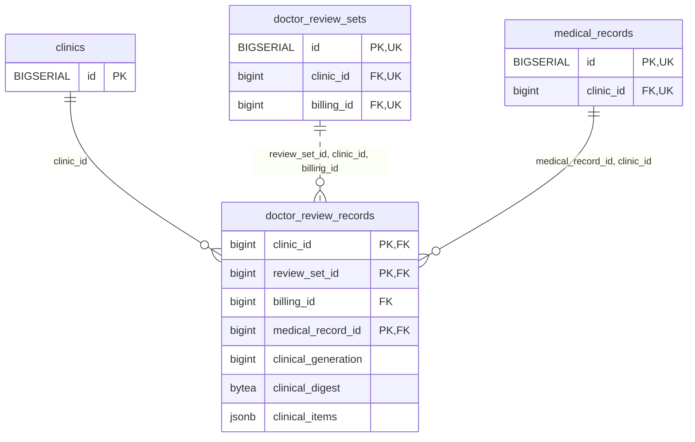

<!-- GENERATED: scripts/tools/generate-erd-detail.py; do not edit -->
# `doctor_review_records`

[詳細ERD一覧](index.md) · [概要ERD](../erd.md)

このページは、マイグレーションをファイル名順に静的解析した最終定義です。稼働DBの状態は未確認です。

## カラム

型・DEFAULTはDDLの宣言表記です。`bigserial` は採番宣言であり、DBカタログ上の型名ではありません。

| カラム | 型（DDL） | NULL | DEFAULT（DDL） | キー構成列 | 定義元 |
|:---|:---|:---|:---|:---|:---|
| `clinic_id` | `bigint` | NOT NULL | — | PK, FK | [001_init.sql:8177](../../../backend/migrations/001_init.sql#L8177) |
| `review_set_id` | `bigint` | NOT NULL | — | PK, FK | [001_init.sql:8178](../../../backend/migrations/001_init.sql#L8178) |
| `billing_id` | `bigint` | NOT NULL | — | FK | [001_init.sql:8179](../../../backend/migrations/001_init.sql#L8179) |
| `medical_record_id` | `bigint` | NOT NULL | — | PK, FK | [001_init.sql:8180](../../../backend/migrations/001_init.sql#L8180) |
| `clinical_generation` | `bigint` | NOT NULL | — | — | [001_init.sql:8181](../../../backend/migrations/001_init.sql#L8181) |
| `clinical_digest` | `bytea` | NOT NULL | — | — | [001_init.sql:8182](../../../backend/migrations/001_init.sql#L8182) |
| `clinical_items` | `jsonb` | NOT NULL | — | — | [001_init.sql:8183](../../../backend/migrations/001_init.sql#L8183) |

PK/FK/UKはキーの構成列を示します。複合キーの各列が単独で一意という意味ではありません。部分uniqueは下記indexの述語を参照してください。

## ERD

このテーブルの全カラムと、すべての参照先を表示します。参照先はFKの対象列だけを表示し、全カラムは各テーブルのページに置きます。

親側の任意参照はFK列のNULL可否、子側の最大1件は無条件のPK/UNIQUEから導出します。部分uniqueによる条件付きの最大件数は図に反映せず、index一覧に記録します。実線はFK全列が子のPKに含まれる識別関係、破線はそれ以外です。

## 外部キー（全件）

| 制約 | 子の列（順序あり） | 参照先 | 親の列（順序あり） | 削除時の動作 | 定義元 |
|:---|:---|:---|:---|:---|:---|
| `doctor_review_records_clinic_id_fkey` | `clinic_id` | [clinics](clinics.md) | `id` | `ON DELETE RESTRICT` | [001_init.sql:8177](../../../backend/migrations/001_init.sql#L8177) |
| `doctor_review_records_review_set_id_clinic_id_billing_id_fkey` | `review_set_id, clinic_id, billing_id` | [doctor_review_sets](doctor_review_sets.md) | `id, clinic_id, billing_id` | `ON DELETE RESTRICT` | [001_init.sql:8185](../../../backend/migrations/001_init.sql#L8185) |
| `doctor_review_records_medical_record_id_clinic_id_fkey` | `medical_record_id, clinic_id` | [medical_records](medical_records.md) | `id, clinic_id` | `ON DELETE RESTRICT` | [001_init.sql:8186](../../../backend/migrations/001_init.sql#L8186) |

正確なON UPDATE・MATCH・DEFERRABLE等を含む制約DDL:

- `doctor_review_records_clinic_id_fkey`: `REFERENCES clinics(id) ON DELETE RESTRICT`
- `doctor_review_records_review_set_id_clinic_id_billing_id_fkey`: `FOREIGN KEY (review_set_id,clinic_id,billing_id) REFERENCES doctor_review_sets(id,clinic_id,billing_id) ON DELETE RESTRICT`
- `doctor_review_records_medical_record_id_clinic_id_fkey`: `FOREIGN KEY (medical_record_id,clinic_id) REFERENCES medical_records(id,clinic_id) ON DELETE RESTRICT`

## その他の制約

| 制約 | 種別 | DDL | 定義元 |
|:---|:---|:---|:---|
| `doctor_review_records_clinical_generation_check` | check | `CHECK (clinical_generation > 0)` | [001_init.sql:8181](../../../backend/migrations/001_init.sql#L8181) |
| `doctor_review_records_clinical_digest_check` | check | `CHECK (octet_length(clinical_digest)=32)` | [001_init.sql:8182](../../../backend/migrations/001_init.sql#L8182) |
| `doctor_review_records_clinical_items_check` | check | `CHECK (jsonb_typeof(clinical_items)='array')` | [001_init.sql:8183](../../../backend/migrations/001_init.sql#L8183) |
| `doctor_review_records_pkey` | primary | `PRIMARY KEY (clinic_id,review_set_id,medical_record_id)` | [001_init.sql:8184](../../../backend/migrations/001_init.sql#L8184) |

## インデックス

明示的なCREATE INDEXなし。PK/UNIQUEに付随する暗黙のindexは制約欄を参照してください。
