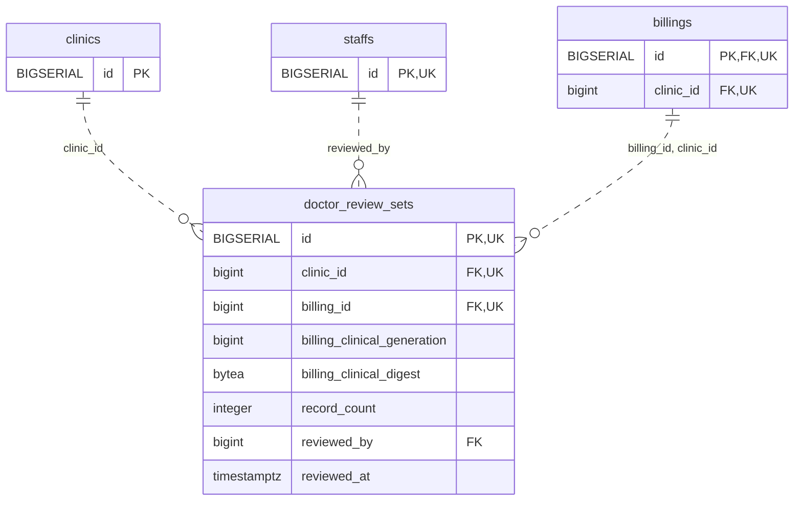

<!-- GENERATED: scripts/tools/generate-erd-detail.py; do not edit -->
# `doctor_review_sets`

[詳細ERD一覧](index.md) · [概要ERD](../erd.md)

このページは、マイグレーションをファイル名順に静的解析した最終定義です。稼働DBの状態は未確認です。

## カラム

型・DEFAULTはDDLの宣言表記です。`bigserial` は採番宣言であり、DBカタログ上の型名ではありません。

| カラム | 型（DDL） | NULL | DEFAULT（DDL） | キー構成列 | 定義元 |
|:---|:---|:---|:---|:---|:---|
| `id` | `BIGSERIAL` | NOT NULL | — | PK, UK | [001_init.sql:8150](../../../backend/migrations/001_init.sql#L8150) |
| `clinic_id` | `bigint` | NOT NULL | — | FK, UK | [001_init.sql:8151](../../../backend/migrations/001_init.sql#L8151) |
| `billing_id` | `bigint` | NOT NULL | — | FK, UK | [001_init.sql:8152](../../../backend/migrations/001_init.sql#L8152) |
| `billing_clinical_generation` | `bigint` | NOT NULL | — | — | [001_init.sql:8153](../../../backend/migrations/001_init.sql#L8153) |
| `billing_clinical_digest` | `bytea` | NOT NULL | — | — | [001_init.sql:8154](../../../backend/migrations/001_init.sql#L8154) |
| `record_count` | `integer` | NOT NULL | — | — | [001_init.sql:8155](../../../backend/migrations/001_init.sql#L8155) |
| `reviewed_by` | `bigint` | NOT NULL | — | FK | [001_init.sql:8156](../../../backend/migrations/001_init.sql#L8156) |
| `reviewed_at` | `timestamptz` | NOT NULL | `clock_timestamp()` | — | [001_init.sql:8157](../../../backend/migrations/001_init.sql#L8157) |

PK/FK/UKはキーの構成列を示します。複合キーの各列が単独で一意という意味ではありません。部分uniqueは下記indexの述語を参照してください。

## ERD

このテーブルの全カラムと、すべての参照先を表示します。参照先はFKの対象列だけを表示し、全カラムは各テーブルのページに置きます。

親側の任意参照はFK列のNULL可否、子側の最大1件は無条件のPK/UNIQUEから導出します。部分uniqueによる条件付きの最大件数は図に反映せず、index一覧に記録します。実線はFK全列が子のPKに含まれる識別関係、破線はそれ以外です。

## 外部キー（全件）

| 制約 | 子の列（順序あり） | 参照先 | 親の列（順序あり） | 削除時の動作 | 定義元 |
|:---|:---|:---|:---|:---|:---|
| `doctor_review_sets_clinic_id_fkey` | `clinic_id` | [clinics](clinics.md) | `id` | `ON DELETE RESTRICT` | [001_init.sql:8151](../../../backend/migrations/001_init.sql#L8151) |
| `doctor_review_sets_reviewed_by_fkey` | `reviewed_by` | [staffs](staffs.md) | `id` | `ON DELETE RESTRICT` | [001_init.sql:8156](../../../backend/migrations/001_init.sql#L8156) |
| `doctor_review_sets_billing_id_clinic_id_fkey` | `billing_id, clinic_id` | [billings](billings.md) | `id, clinic_id` | `ON DELETE RESTRICT` | [001_init.sql:8159](../../../backend/migrations/001_init.sql#L8159) |

正確なON UPDATE・MATCH・DEFERRABLE等を含む制約DDL:

- `doctor_review_sets_clinic_id_fkey`: `REFERENCES clinics(id) ON DELETE RESTRICT`
- `doctor_review_sets_reviewed_by_fkey`: `REFERENCES staffs(id) ON DELETE RESTRICT`
- `doctor_review_sets_billing_id_clinic_id_fkey`: `FOREIGN KEY (billing_id,clinic_id) REFERENCES billings(id,clinic_id) ON DELETE RESTRICT`

## その他の制約

| 制約 | 種別 | DDL | 定義元 |
|:---|:---|:---|:---|
| `doctor_review_sets_pkey` | primary | `PRIMARY KEY` | [001_init.sql:8150](../../../backend/migrations/001_init.sql#L8150) |
| `doctor_review_sets_billing_clinical_generation_check` | check | `CHECK (billing_clinical_generation > 0)` | [001_init.sql:8153](../../../backend/migrations/001_init.sql#L8153) |
| `doctor_review_sets_billing_clinical_digest_check` | check | `CHECK (octet_length(billing_clinical_digest)=32)` | [001_init.sql:8154](../../../backend/migrations/001_init.sql#L8154) |
| `doctor_review_sets_record_count_check` | check | `CHECK (record_count >= 0)` | [001_init.sql:8155](../../../backend/migrations/001_init.sql#L8155) |
| `doctor_review_sets_id_clinic_id_billing_id_key` | unique | `UNIQUE (id,clinic_id,billing_id)` | [001_init.sql:8158](../../../backend/migrations/001_init.sql#L8158) |

## インデックス

| 名前 | UNIQUE | 述語 | DDL | 定義元 |
|:---|:---|:---|:---|:---|
| `idx_doctor_review_sets_billing` | NO | — | `CREATE INDEX idx_doctor_review_sets_billing ON doctor_review_sets(clinic_id,billing_id,id)` | [001_init.sql:8161](../../../backend/migrations/001_init.sql#L8161) |
