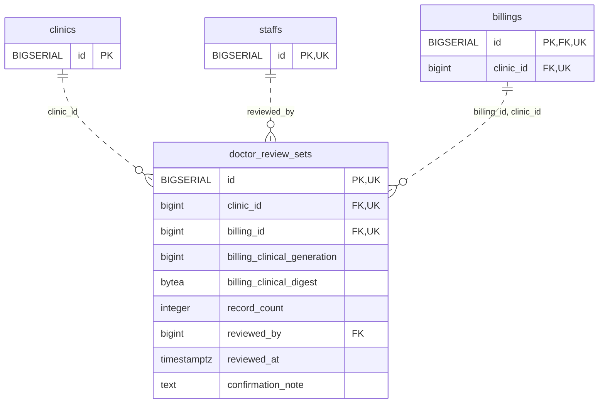

<!-- GENERATED: scripts/tools/generate-erd-detail.py; do not edit -->
# `doctor_review_sets`

[詳細ERD一覧](index.md) · [概要ERD](../erd.md)

このページは、マイグレーションをファイル名順に静的解析した最終定義です。稼働DBの状態は未確認です。

## カラム

型・DEFAULTはDDLの宣言表記です。`bigserial` は採番宣言であり、DBカタログ上の型名ではありません。

| カラム | 型（DDL） | NULL | DEFAULT（DDL） | キー構成列 | 定義元 |
|:---|:---|:---|:---|:---|:---|
| `id` | `BIGSERIAL` | NOT NULL | — | PK, UK | [001_init.sql:8164](../../../backend/migrations/001_init.sql#L8164) |
| `clinic_id` | `bigint` | NOT NULL | — | FK, UK | [001_init.sql:8165](../../../backend/migrations/001_init.sql#L8165) |
| `billing_id` | `bigint` | NOT NULL | — | FK, UK | [001_init.sql:8166](../../../backend/migrations/001_init.sql#L8166) |
| `billing_clinical_generation` | `bigint` | NOT NULL | — | — | [001_init.sql:8167](../../../backend/migrations/001_init.sql#L8167) |
| `billing_clinical_digest` | `bytea` | NOT NULL | — | — | [001_init.sql:8168](../../../backend/migrations/001_init.sql#L8168) |
| `record_count` | `integer` | NOT NULL | — | — | [001_init.sql:8169](../../../backend/migrations/001_init.sql#L8169) |
| `reviewed_by` | `bigint` | NOT NULL | — | FK | [001_init.sql:8170](../../../backend/migrations/001_init.sql#L8170) |
| `reviewed_at` | `timestamptz` | NOT NULL | `clock_timestamp()` | — | [001_init.sql:8171](../../../backend/migrations/001_init.sql#L8171) |
| `confirmation_note` | `text` | NULL | — | — | [001_init.sql:10964](../../../backend/migrations/001_init.sql#L10964) |

PK/FK/UKはキーの構成列を示します。複合キーの各列が単独で一意という意味ではありません。部分uniqueは下記indexの述語を参照してください。

## ERD

このテーブルの全カラムと、すべての参照先を表示します。参照先はFKの対象列だけを表示し、全カラムは各テーブルのページに置きます。

親側の任意参照はFK列のNULL可否、子側の最大1件は無条件のPK/UNIQUEから導出します。部分uniqueによる条件付きの最大件数は図に反映せず、index一覧に記録します。実線はFK全列が子のPKに含まれる識別関係、破線はそれ以外です。

## 外部キー（全件）

| 制約 | 子の列（順序あり） | 参照先 | 親の列（順序あり） | 削除時の動作 | 定義元 |
|:---|:---|:---|:---|:---|:---|
| `doctor_review_sets_clinic_id_fkey` | `clinic_id` | [clinics](clinics.md) | `id` | `ON DELETE RESTRICT` | [001_init.sql:8165](../../../backend/migrations/001_init.sql#L8165) |
| `doctor_review_sets_reviewed_by_fkey` | `reviewed_by` | [staffs](staffs.md) | `id` | `ON DELETE RESTRICT` | [001_init.sql:8170](../../../backend/migrations/001_init.sql#L8170) |
| `doctor_review_sets_billing_id_clinic_id_fkey` | `billing_id, clinic_id` | [billings](billings.md) | `id, clinic_id` | `ON DELETE RESTRICT` | [001_init.sql:8173](../../../backend/migrations/001_init.sql#L8173) |

正確なON UPDATE・MATCH・DEFERRABLE等を含む制約DDL:

- `doctor_review_sets_clinic_id_fkey`: `REFERENCES clinics(id) ON DELETE RESTRICT`
- `doctor_review_sets_reviewed_by_fkey`: `REFERENCES staffs(id) ON DELETE RESTRICT`
- `doctor_review_sets_billing_id_clinic_id_fkey`: `FOREIGN KEY (billing_id,clinic_id) REFERENCES billings(id,clinic_id) ON DELETE RESTRICT`

## その他の制約

| 制約 | 種別 | DDL | 定義元 |
|:---|:---|:---|:---|
| `doctor_review_sets_pkey` | primary | `PRIMARY KEY` | [001_init.sql:8164](../../../backend/migrations/001_init.sql#L8164) |
| `doctor_review_sets_billing_clinical_generation_check` | check | `CHECK (billing_clinical_generation > 0)` | [001_init.sql:8167](../../../backend/migrations/001_init.sql#L8167) |
| `doctor_review_sets_billing_clinical_digest_check` | check | `CHECK (octet_length(billing_clinical_digest)=32)` | [001_init.sql:8168](../../../backend/migrations/001_init.sql#L8168) |
| `doctor_review_sets_record_count_check` | check | `CHECK (record_count >= 0)` | [001_init.sql:8169](../../../backend/migrations/001_init.sql#L8169) |
| `doctor_review_sets_id_clinic_id_billing_id_key` | unique | `UNIQUE (id,clinic_id,billing_id)` | [001_init.sql:8172](../../../backend/migrations/001_init.sql#L8172) |

## インデックス

| 名前 | UNIQUE | 述語 | DDL | 定義元 |
|:---|:---|:---|:---|:---|
| `idx_doctor_review_sets_billing` | NO | — | `CREATE INDEX idx_doctor_review_sets_billing ON doctor_review_sets(clinic_id,billing_id,id)` | [001_init.sql:8175](../../../backend/migrations/001_init.sql#L8175) |
