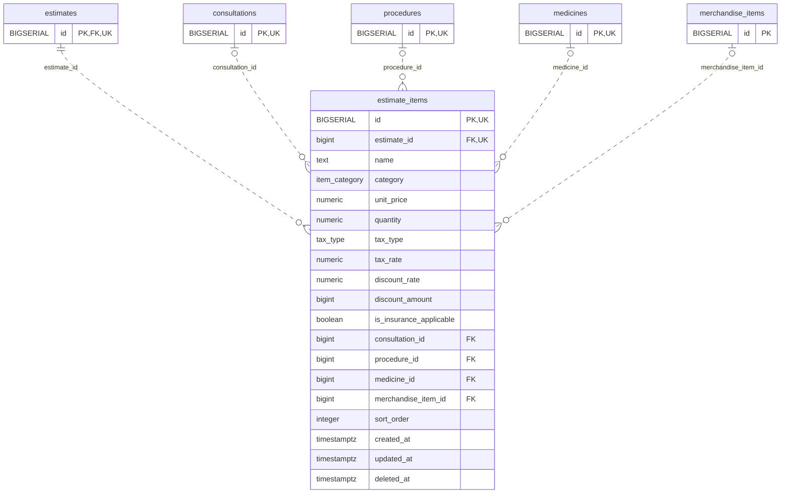

<!-- GENERATED: scripts/tools/generate-erd-detail.py; do not edit -->
# `estimate_items`

[詳細ERD一覧](index.md) · [概要ERD](../erd.md)

このページは、マイグレーションをファイル名順に静的解析した最終定義です。稼働DBの状態は未確認です。

## カラム

型・DEFAULTはDDLの宣言表記です。`bigserial` は採番宣言であり、DBカタログ上の型名ではありません。

| カラム | 型（DDL） | NULL | DEFAULT（DDL） | キー構成列 | 定義元 |
|:---|:---|:---|:---|:---|:---|
| `id` | `BIGSERIAL` | NOT NULL | — | PK, UK | [001_init.sql:1834](../../../backend/migrations/001_init.sql#L1834) |
| `estimate_id` | `bigint` | NOT NULL | — | FK, UK | [001_init.sql:1835](../../../backend/migrations/001_init.sql#L1835) |
| `name` | `text` | NOT NULL | `''` | — | [001_init.sql:1836](../../../backend/migrations/001_init.sql#L1836) |
| `category` | `item_category` | NOT NULL | — | — | [001_init.sql:1837](../../../backend/migrations/001_init.sql#L1837) |
| `unit_price` | `numeric` | NOT NULL | `0` | — | [001_init.sql:9392](../../../backend/migrations/001_init.sql#L9392) |
| `quantity` | `numeric` | NOT NULL | `1` | — | [001_init.sql:9392](../../../backend/migrations/001_init.sql#L9392) |
| `tax_type` | `tax_type` | NOT NULL | `'excluded'` | — | [001_init.sql:1840](../../../backend/migrations/001_init.sql#L1840) |
| `tax_rate` | `numeric` | NULL | `0.10` | — | [001_init.sql:9393](../../../backend/migrations/001_init.sql#L9393) |
| `discount_rate` | `numeric` | NULL | `0` | — | [001_init.sql:9393](../../../backend/migrations/001_init.sql#L9393) |
| `discount_amount` | `bigint` | NULL | `0` | — | [001_init.sql:1843](../../../backend/migrations/001_init.sql#L1843) |
| `is_insurance_applicable` | `boolean` | NULL | `false` | — | [001_init.sql:1844](../../../backend/migrations/001_init.sql#L1844) |
| `consultation_id` | `bigint` | NULL | — | FK | [001_init.sql:1845](../../../backend/migrations/001_init.sql#L1845) |
| `procedure_id` | `bigint` | NULL | — | FK | [001_init.sql:1846](../../../backend/migrations/001_init.sql#L1846) |
| `medicine_id` | `bigint` | NULL | — | FK | [001_init.sql:1847](../../../backend/migrations/001_init.sql#L1847) |
| `merchandise_item_id` | `bigint` | NULL | — | FK | [001_init.sql:1848](../../../backend/migrations/001_init.sql#L1848) |
| `sort_order` | `integer` | NULL | `0` | — | [001_init.sql:1849](../../../backend/migrations/001_init.sql#L1849) |
| `created_at` | `timestamptz` | NOT NULL | `now()` | — | [001_init.sql:1850](../../../backend/migrations/001_init.sql#L1850) |
| `updated_at` | `timestamptz` | NOT NULL | `now()` | — | [001_init.sql:1851](../../../backend/migrations/001_init.sql#L1851) |
| `deleted_at` | `timestamptz` | NULL | — | — | [001_init.sql:1852](../../../backend/migrations/001_init.sql#L1852) |

PK/FK/UKはキーの構成列を示します。複合キーの各列が単独で一意という意味ではありません。部分uniqueは下記indexの述語を参照してください。

## ERD

このテーブルの全カラムと、すべての参照先を表示します。参照先はFKの対象列だけを表示し、全カラムは各テーブルのページに置きます。

親側の任意参照はFK列のNULL可否、子側の最大1件は無条件のPK/UNIQUEから導出します。部分uniqueによる条件付きの最大件数は図に反映せず、index一覧に記録します。実線はFK全列が子のPKに含まれる識別関係、破線はそれ以外です。

## 外部キー（全件）

| 制約 | 子の列（順序あり） | 参照先 | 親の列（順序あり） | 削除時の動作 | 定義元 |
|:---|:---|:---|:---|:---|:---|
| `estimate_items_estimate_id_fkey` | `estimate_id` | [estimates](estimates.md) | `id` | `ON DELETE CASCADE` | [001_init.sql:1835](../../../backend/migrations/001_init.sql#L1835) |
| `estimate_items_consultation_id_fkey` | `consultation_id` | [consultations](consultations.md) | `id` | `ON DELETE SET NULL` | [001_init.sql:1845](../../../backend/migrations/001_init.sql#L1845) |
| `estimate_items_procedure_id_fkey` | `procedure_id` | [procedures](procedures.md) | `id` | `ON DELETE SET NULL` | [001_init.sql:1846](../../../backend/migrations/001_init.sql#L1846) |
| `estimate_items_medicine_id_fkey` | `medicine_id` | [medicines](medicines.md) | `id` | `ON DELETE SET NULL` | [001_init.sql:1847](../../../backend/migrations/001_init.sql#L1847) |
| `fk_estimate_items_merchandise` | `merchandise_item_id` | [merchandise_items](merchandise_items.md) | `id` | `ON DELETE SET NULL` | [001_init.sql:1848](../../../backend/migrations/001_init.sql#L1848) |

正確なON UPDATE・MATCH・DEFERRABLE等を含む制約DDL:

- `estimate_items_estimate_id_fkey`: `REFERENCES estimates(id) ON DELETE CASCADE`
- `estimate_items_consultation_id_fkey`: `REFERENCES consultations(id) ON DELETE SET NULL`
- `estimate_items_procedure_id_fkey`: `REFERENCES procedures(id) ON DELETE SET NULL`
- `estimate_items_medicine_id_fkey`: `REFERENCES medicines(id) ON DELETE SET NULL`
- `fk_estimate_items_merchandise`: `CONSTRAINT fk_estimate_items_merchandise REFERENCES merchandise_items(id) ON DELETE SET NULL`

## その他の制約

| 制約 | 種別 | DDL | 定義元 |
|:---|:---|:---|:---|
| `estimate_items_pkey` | primary | `PRIMARY KEY` | [001_init.sql:1834](../../../backend/migrations/001_init.sql#L1834) |
| `chk_estimate_item_quantity` | check | `CONSTRAINT chk_estimate_item_quantity CHECK (quantity > 0)` | [001_init.sql:1853](../../../backend/migrations/001_init.sql#L1853) |
| `uq_estimate_items_id_estimate` | unique | `CONSTRAINT uq_estimate_items_id_estimate UNIQUE(id,estimate_id)` | [001_init.sql:9496](../../../backend/migrations/001_init.sql#L9496) |

## インデックス

| 名前 | UNIQUE | 述語 | DDL | 定義元 |
|:---|:---|:---|:---|:---|
| `idx_estimate_items_merchandise_item_id` | NO | — | `CREATE INDEX idx_estimate_items_merchandise_item_id ON estimate_items(merchandise_item_id)` | [001_init.sql:2182](../../../backend/migrations/001_init.sql#L2182) |
| `idx_estimate_items_estimate_id` | NO | — | `CREATE INDEX idx_estimate_items_estimate_id ON estimate_items(estimate_id)` | [001_init.sql:2339](../../../backend/migrations/001_init.sql#L2339) |
